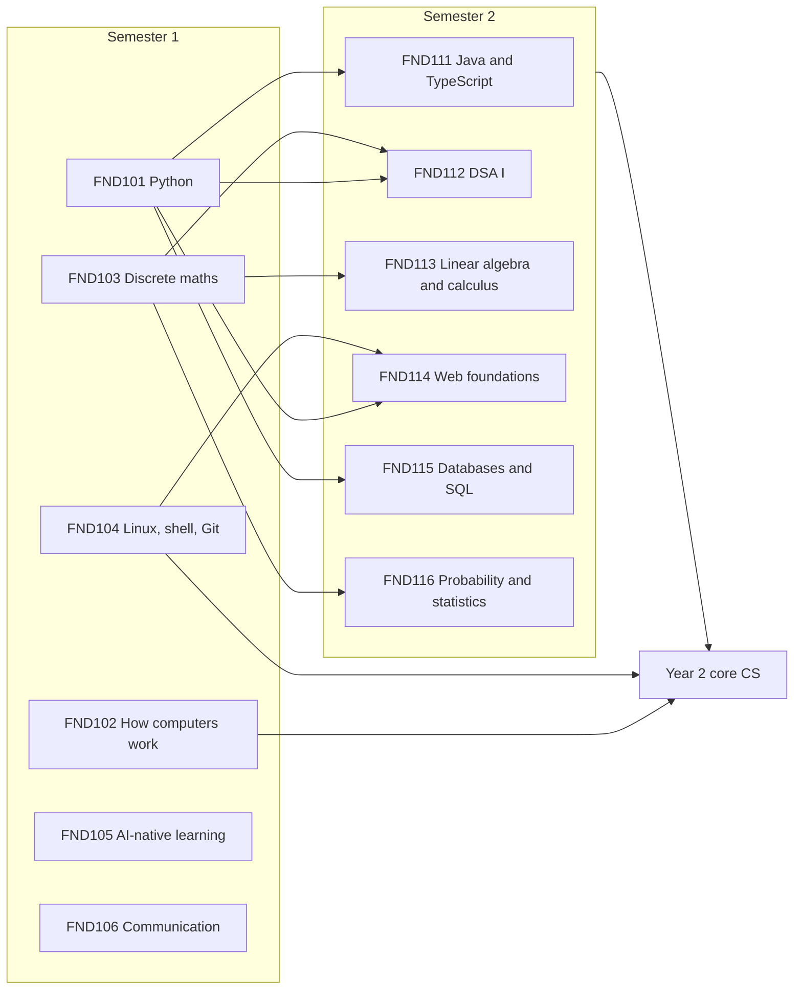

# Year 1 · Foundations

Year 1 takes you from knowing nothing (L0) to intern-ready practice (L2). By the end you can write tested programs in Python, Java and TypeScript; explain how a computer runs them, from NAND gates to the operating system; prove and count; use linear algebra, calculus, probability and statistics; build a small web application on a SQL database; work in Linux, Git and GitHub like a professional team; use AI tools with measured skill instead of blind trust; and explain your work in writing and in person.

Every major starts here. Nothing is assumed except school arithmetic and algebra, a computer that can run Linux (natively, in a VM or through WSL 2), and an internet connection.

## The year at a glance

| Sem | Code | Course | In one line | Prerequisites |
|---|---|---|---|---|
| 1 | [FND101](semester_1/FND101_programming_i_computational_thinking_with_python/README.md) | Programming I: Computational Thinking with Python | Think in steps, write and test Python, read errors, debug systematically, and build real command-line programs. | none |
| 1 | [FND102](semester_1/FND102_how_computers_work_bits_hardware/README.md) | How Computers Work: Bits, Hardware and the Operating System | Build a computer from NAND gates (nand2tetris), then climb through machine code, memory and caches to processes and files. | none |
| 1 | [FND103](semester_1/FND103_discrete_mathematics_for_computing/README.md) | Discrete Mathematics for Computing | Logic, proofs, sets, relations, induction, counting, graphs and number theory, each checked with code and some with Lean. | none |
| 1 | [FND104](semester_1/FND104_the_developers_toolkit_linux_shell_git/README.md) | The Developer's Toolkit: Linux, Shell, Git and GitHub | The shell, scripting, Git internals and recovery, pull requests, SSH, CI and supply-chain basics, and running AI agents safely. | none |
| 1 | [FND105](semester_1/FND105_ai_native_learning_and_building/README.md) | AI-Native Learning and Building | How LLMs work, prompting and context, verification, evals, coding agents, small AI tools, and the AI-off habit that protects your skills. | none |
| 1 | [FND106](semester_1/FND106_technical_communication_and_professional_skills/README.md) | Technical Communication and Professional Skills | READMEs, bug reports, design docs, code review, postmortems, talks, global English and a public portfolio. | none |
| 2 | [FND111](semester_2/FND111_programming_ii_object_oriented_and_typed/README.md) | Programming II: Object-Oriented and Typed Programming (Java and TypeScript) | Types, classes, interfaces and modular design in two industry languages. | FND101 |
| 2 | [FND112](semester_2/FND112_data_structures_and_algorithms_i/README.md) | Data Structures and Algorithms I | Arrays, hash maps, stacks, queues, trees, heaps and graphs, with complexity analysis. | FND101, FND103 |
| 2 | [FND113](semester_2/FND113_linear_algebra_and_calculus_for_computing/README.md) | Linear Algebra and Calculus for Computing | Vectors, matrices, eigenvectors, derivatives and gradients as the language of graphics and machine learning. | FND103 |
| 2 | [FND114](semester_2/FND114_web_foundations_http_html_css_and_javascript/README.md) | Web Foundations: HTTP, HTML, CSS and JavaScript | How the web works and how to build accessible, secure pages and small apps. | FND101, FND104 |
| 2 | [FND115](semester_2/FND115_databases_i_data_modeling_and_sql/README.md) | Databases I: Data Modeling and SQL | Relational modelling, normalisation and SQL on real databases. | FND101 |
| 2 | [FND116](semester_2/FND116_probability_and_statistics_i/README.md) | Probability and Statistics I | Probability, distributions, estimation and experiments for engineering decisions. | FND103 |

Each course is 4 credits (about 120 hours) and has a syllabus (`README.md`) and labs and projects (`projects.md`).

## How the courses connect

Five threads run through the year:

- **Programming:** FND101 → FND111 → FND112, then [CS201](../02_year_2_core_computer_science/semester_3/CS201_algorithms_and_complexity/README.md) and [CS205](../02_year_2_core_computer_science/semester_3/CS205_software_engineering_i_design_testing/README.md). The FND101 expense settler gets a typed rewrite in FND111, and the FND101 journey planner becomes a graph-search problem in FND112.
- **Mathematics:** FND103 → FND112, FND113 and FND116, then [CS206 Mathematics for Machine Learning](../02_year_2_core_computer_science/semester_3/CS206_mathematics_for_machine_learning/README.md). Every proof is paired with code that checks small cases.
- **Systems:** FND102 and FND104 → [CS202](../02_year_2_core_computer_science/semester_3/CS202_computer_architecture_and_systems_programming/README.md), [CS204](../02_year_2_core_computer_science/semester_3/CS204_computer_networks/README.md) and [CS215](../02_year_2_core_computer_science/semester_4/CS215_cloud_and_devops_foundations/README.md). FND114 and FND115 add the web and data layers on top.
- **Practice with AI:** FND105 sets the rules for every other course: AI-off drills, logged AI use, verification before trust, and evals for anything AI-powered.
- **Communication:** FND106 is applied to real artefacts from the other courses. Its README, design-doc and postmortem assignments are written about your FND101, FND102 and FND104 projects, and every later course assumes these habits.

Shared artefacts make the hours count twice: FND101 projects are versioned, reviewed and tested in CI using FND104 skills; FND102's performance report is peer-reviewed with the FND106 checklist; FND104's team project adopts an FND101 program; FND105's tools are built with the FND104 workflow.

## Suggested weekly timetable

Each course is about 8 hours a week across a 14-week teaching block plus a review and exam week (≈ 120 hours). A typical split per course is 3 hours of reading and lectures, 3 hours of lab, and 2 hours of project work and AI-off drills.

| Pace | Hours per week | Semester length | Courses at once |
|---|---|---|---|
| Full-time intensive | about 48 (8 per course) | 15 weeks | all 6 |
| Standard | about 40 (6–7 per course) | 18 weeks | all 6 |
| Part-time | about 20 (6–7 per course) | two terms of 18 weeks | 3, in the pairs below |

**Part-time pairings.** Semester 1: term A is FND101, FND104 and FND105 (programming, tools and AI habits support each other); term B is FND102, FND103 and FND106. Semester 2: term C is FND111, FND112 and FND115; term D is FND113, FND114 and FND116.

**A sample full-time week in Semester 1** (Sunday is rest; spacing each course across two days helps retention):

| Day | Morning (4 h) | Afternoon (4 h) |
|---|---|---|
| Monday | FND101 lecture and lab | FND103 lecture and problem set |
| Tuesday | FND102 reading and nand2tetris | FND104 lecture and lab |
| Wednesday | FND101 project and AI-off drill | FND105 lecture and lab |
| Thursday | FND103 proofs, Lean or code checks | FND106 writing workshop |
| Friday | FND102 measurement lab | FND104 Git and CI lab |
| Saturday | FND105 project | FND106 review exchange and weekly review of all notes |

Semester 2 follows the same pattern with FND111–FND116. Start every day with 20 minutes of spaced-repetition review, AI-off.

## How AI is used in Year 1

| Period | Rule |
|---|---|
| Semester 1, weeks 1–6 | AI-off for writing code and proofs. AI may explain concepts and act as a Socratic tutor (hints, not answers). |
| Semester 1, week 7 onward | AI allowed for building, with an `AI_LOG.md` in every repository: prompt, output, what was accepted or rejected, how it was verified. |
| Every week | One AI-off drill per course (traces, conversions, proofs, Git recovery, timed writing). |
| All exams | Closed to AI unless the exam paper says otherwise (FND105 has one AI-allowed part). |

The reason is measured, not ideological: in a 2026 randomized trial, learners who delegated code generation to an assistant learned far less than those who used it for conceptual questions (details and sources in [FND105](semester_1/FND105_ai_native_learning_and_building/README.md)).

## Year 1 mastery gate

You are ready for Year 2 when you pass a two-day practical.

**Day 1, AI-off (6 hours, official documentation allowed):**
1. From a one-page specification, build a Python command-line program split into functions with at least 15 `pytest` tests covering boundaries (3 hours).
2. Re-implement its core as typed classes in Java or TypeScript, with unit tests.
3. Solve three algorithm problems (one using a hash map, one graph search, one heap or sort) and state and justify each time complexity.
4. Write one induction proof, solve one counting problem and confirm it with a brute-force program, compute one modular inverse, compute one gradient or eigenvector, and answer one Bayes and one confidence-interval question.
5. Convert numbers between binary, hex and two's complement, and explain with live `strace` evidence what happens when your program runs.

**Day 2, AI allowed and logged (6 hours):**

6. Build a small web application: an HTML, CSS and JavaScript front end; a Python back end; a normalised SQL schema with at least three tables.
7. Deliver it through a GitHub repository with a protected `main`, a reviewed pull request and green CI.
8. Add one LLM-powered feature evaluated on at least 20 labelled cases, with its accuracy and one failure documented.
9. Write a README that a stranger can follow to run the app in 10 minutes or less, and give a 5-minute demo with questions.

Each part is marked pass or fail against the standard of the relevant course's mastery gate; you must pass all nine.

## Where next

[Year 2 · Core computer science](../02_year_2_core_computer_science/) deepens every thread: algorithms, architecture and C, operating systems, networks, software engineering, the mathematics of machine learning, databases, distributed systems, security, ML, cloud and compilers. If you are unsure of your level, start at [`00_start_here/`](../00_start_here/).
