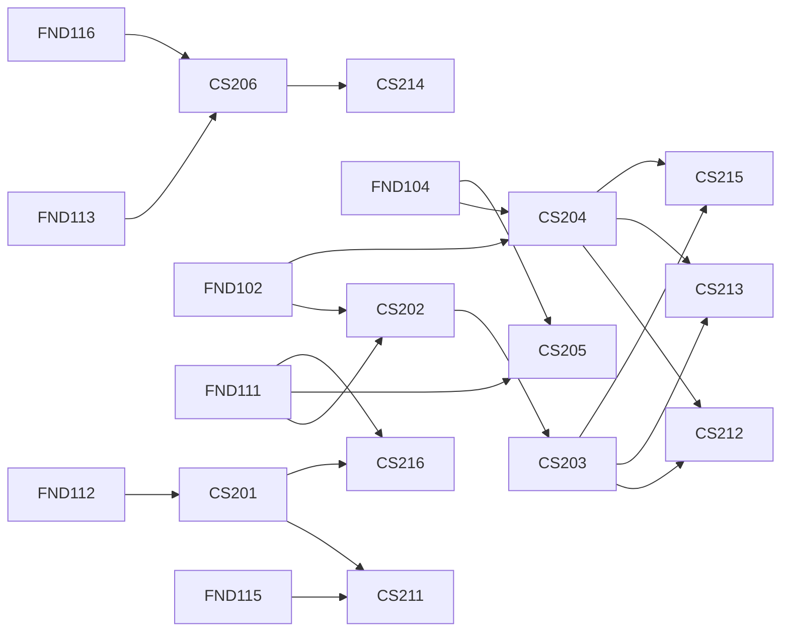

# Year 2 · Core Computer Science

**Semesters 3 and 4 · 12 courses · 48 credits (≈ 1,440 hours) · Level L1 → L3**

Year 1 taught you to program and to use the tools. Year 2 teaches you what is underneath and around the code: how algorithms scale, how the CPU, kernel and network actually run your program, how teams ship software that lasts, and the mathematics behind machine learning. Semester 4 then combines these into the systems that run the industry: databases, distributed systems, security, machine learning, cloud and compilers.

Every major in this university depends on Year 2, and every course in it is written for a world where AI coding agents produce a large share of everyday code. That changes what matters. When generating code is cheap, value moves to the things this year trains: modelling a problem correctly, proving and measuring that a solution works, reading the layer below when something breaks, and checking AI output with evidence rather than trust. Each course states what to delegate to AI, which drills to do without it, and how to verify its output.

**Before you start:** you should have passed the Year 1 mastery gate ([01_year_1_foundations](../01_year_1_foundations/README.md)). If you already know a course's material, you can go straight to its mastery gate; see the placement guidance in [00_start_here](../00_start_here/).

## The 12 courses

### Semester 3 · Foundations of systems and reasoning

| Code | Course | Prerequisites | In one line |
|---|---|---|---|
| [CS201](semester_3/CS201_algorithms_and_complexity/README.md) | Algorithms and Complexity | FND112 | Prove, analyse and engineer algorithms (divide and conquer, greedy, DP, graphs, flows, strings), reduce problems to show NP-hardness, and solve interview problems under time pressure. |
| [CS202](semester_3/CS202_computer_architecture_and_systems_programming/README.md) | Computer Architecture and Systems Programming in C | FND102, FND111 | C, x86-64/AArch64/RISC-V assembly, pipelines, caches, linking and virtual memory, debugged with gdb and sanitizers and measured with hardware counters. |
| [CS203](semester_3/CS203_operating_systems/README.md) | Operating Systems | CS202 | Processes, scheduling, virtual memory, concurrency, file systems and containers, built and broken in xv6 and Linux. |
| [CS204](semester_3/CS204_computer_networks/README.md) | Computer Networks | FND102, FND104 | From sockets to TCP, congestion control, TLS, QUIC/HTTP/3, DNS, IP and BGP, with captures and India-scale capacity reasoning. |
| [CS205](semester_3/CS205_software_engineering_i_design_testing/README.md) | Software Engineering I: Design, Testing and Collaboration | FND111, FND104 | Specifications, design, Git workflows, code review, the test pyramid, CI/CD and planning, plus measured use of AI coding agents across the lifecycle. |
| [CS206](semester_3/CS206_mathematics_for_machine_learning/README.md) | Mathematics for Machine Learning | FND113, FND116 | SVD and PCA, matrix calculus and autodiff, probability, MLE/MAP, information theory, convex optimisation and gradient methods. |

### Semester 4 · The systems the industry runs on

| Code | Course | Prerequisites | In one line |
|---|---|---|---|
| [CS211](semester_4/CS211_database_systems_internals/README.md) | Database Systems Internals | FND115, CS201 | How a database stores, indexes, queries and recovers data, and keeps concurrent transactions correct. |
| [CS212](semester_4/CS212_distributed_systems_i/README.md) | Distributed Systems I | CS203, CS204 | Building services that stay correct when machines, networks and clocks fail: RPC, replication, consistency and consensus. |
| [CS213](semester_4/CS213_security_foundations/README.md) | Security Foundations | CS203, CS204 | Threat modelling, cryptography in practice, authentication, and defending systems and applications, using legal practice environments only. |
| [CS214](semester_4/CS214_machine_learning_foundations/README.md) | Machine Learning Foundations | CS206, FND101 | Supervised and unsupervised learning, evaluation and generalisation, built on the mathematics of CS206. |
| [CS215](semester_4/CS215_cloud_and_devops_foundations/README.md) | Cloud and DevOps Foundations | CS203, CS204, FND104 | Running software in the cloud: infrastructure, containers, delivery pipelines and operations. |
| [CS216](semester_4/CS216_programming_languages_compilers_and_interpreters/README.md) | Programming Languages, Compilers and Interpreters | CS201, FND111 | How languages are defined, parsed, type-checked, interpreted and compiled. |

Each course folder has a `README.md` (the syllabus) and a `projects.md` (labs and three projects from L1 to portfolio-grade L3).

## Weekly timetable

Each 4-credit course is about 120 hours: roughly 7.5 hours a week for 14 teaching weeks, plus a review and exam week. Six courses in parallel is a full-time load of about 45 hours a week. Every course gets the same weekly shape: two 90-minute concept sessions (reading, lectures, worked examples), one 3-hour lab, and one 90-minute practice block (problem sets, drills without AI, or project work). Sunday is for rest.

### Semester 3

| Day | 09:00–10:30 | 11:00–12:30 | 14:00–17:00 (lab) | 17:30–19:00 (practice) |
|---|---|---|---|---|
| Mon | CS201 concepts | CS202 concepts | CS202 lab | CS206 practice |
| Tue | CS206 concepts | CS203 concepts | CS203 lab | CS201 timed problems |
| Wed | CS204 concepts | CS205 concepts | CS204 lab | CS202 practice |
| Thu | CS201 concepts | CS206 concepts | CS206 lab | CS203 practice |
| Fri | CS202 concepts | CS203 concepts | CS205 team lab | CS204 practice |
| Sat | CS204 concepts | CS205 concepts | CS201 lab | CS205 practice + weekly review |

CS202 comes early in the week and CS203 follows it on purpose: CS203 builds on CS202 (C, assembly, virtual memory), and its C-heavy labs are scheduled after the matching CS202 chapters.

### Semester 4

| Day | 09:00–10:30 | 11:00–12:30 | 14:00–17:00 (lab) | 17:30–19:00 (practice) |
|---|---|---|---|---|
| Mon | CS211 concepts | CS212 concepts | CS212 lab | CS216 practice |
| Tue | CS216 concepts | CS213 concepts | CS213 lab | CS211 practice |
| Wed | CS214 concepts | CS215 concepts | CS214 lab | CS212 practice |
| Thu | CS211 concepts | CS216 concepts | CS216 lab | CS213 practice |
| Fri | CS212 concepts | CS213 concepts | CS215 lab | CS214 practice |
| Sat | CS214 concepts | CS215 concepts | CS211 lab | CS215 practice + weekly review |

### Part-time path (15–25 hours a week)

Take three courses per term; Year 2 then takes four terms instead of two. This order respects every prerequisite:

| Term | Courses |
|---|---|
| A | CS201, CS202, CS205 |
| B | CS203, CS204, CS206 |
| C | CS211, CS214, CS216 |
| D | CS212, CS213, CS215 |

## How the courses connect

Three threads run through all twelve courses:

1. **One request, every layer.** Follow a single action, such as paying ₹50 over UPI from a phone or pressing play on a live match, and every Year 2 course explains one part of it: the DNS lookup, TLS and QUIC handshakes (CS204); the server process, threads and memory limits (CS203); the cache misses in the hot loop (CS202); the algorithm and its complexity (CS201); the database transaction and its write-ahead log (CS211); replication and idempotent retries (CS212); authentication and keys (CS213); the model that scores the request for fraud (CS206, CS214); the deployment and autoscaling (CS215); the runtime that compiled the code (CS216); and the tests and review that let it ship safely (CS205). Any description of a specific company's internals in such an exercise is an illustrative scenario unless a public source is cited.
2. **Measure, don't guess.** Doubling experiments (CS201), hardware counters (CS202), the USE method (CS203), latency breakdowns (CS204), delivery metrics and controlled self-experiments with AI tools (CS205), convergence plots (CS206), and so on through Semester 4.
3. **Verify everything, including AI.** Brute-force oracles and stress tests (CS201), sanitizers and fuzzing (CS202), ThreadSanitizer and crash injection (CS203), RFCs and packet captures (CS204), tests-first and mutation testing (CS205), gradient checks and simulation (CS206). Each course keeps a "verified or refuted" log of AI answers.

## Working with AI across Year 2

The rule for the whole year: **use AI to go faster, never to skip understanding.** Each course lists its own AI-off drills, and every mid-term and final exam is taken without AI. Labs and projects allow AI tools when the brief says so, and you must be able to explain every line you submit. The courses use named tools (Claude Code, OpenAI Codex, GitHub Copilot, Cursor, Gemini CLI, and chat assistants), but the verification methods are what matter, because tools change faster than syllabi.

## Declaring your major

At the end of Year 2 you declare one of the 20 majors in [03_majors](../03_majors/). Years 3–5 follow that major's path plus the shared courses. To choose well:

1. Read the guide to choosing a major in [00_start_here](../00_start_here/) and the learning path (roles, AI impact, skill map) in each candidate major's README.
2. Look at your evidence from Year 2: which projects you finished with energy, which mastery gates came easily, and which problems you kept thinking about after the deadline.
3. Check the entry requirements below; each one is a Year 1 or Year 2 course whose mastery gate you must have passed.
4. Write a one-page declaration: the roles you are aiming for, the major, one overlap specialisation from [04_overlaps](../04_overlaps/) you may add in Year 4, and the evidence behind your choice.
5. Because Years 1–2 are common to everyone, switching later only requires the new major's entry courses.

| Major | Code | Entry requirements |
|---|---|---|
| [Computer Science (Theory, Systems and Research)](../03_majors/computer_science_general/README.md) | CSG | CS201, CS212, CS216 |
| [Software Engineering](../03_majors/software_engineering/README.md) | SWE | CS205, CS201 |
| [Backend Engineering](../03_majors/backend_engineering/README.md) | BE | CS211, CS212 |
| [Frontend Engineering](../03_majors/frontend_engineering/README.md) | FE | FND114, CS205 |
| [Mobile Engineering](../03_majors/mobile_engineering/README.md) | MOB | FND111, CS205 |
| [Cloud Engineering](../03_majors/cloud_engineering/README.md) | CLD | CS215, CS212 |
| [DevOps, SRE and Platform Engineering](../03_majors/devops_sre_platform_engineering/README.md) | OPS | CS215, CS203 |
| [Cybersecurity: Defense, Operations and Governance](../03_majors/cybersecurity_defense/README.md) | SEC | CS213 |
| [Ethical Hacking and Offensive Security (Authorized Testing)](../03_majors/ethical_hacking_offensive_security/README.md) | OFF | CS213 |
| [Security Architecture](../03_majors/security_architecture/README.md) | SAR | CS213, CS212 |
| [Data Analysis and Analytics](../03_majors/data_analysis/README.md) | DAN | FND115, FND116 |
| [Data Science](../03_majors/data_science/README.md) | DSC | CS214, FND116 |
| [Data Engineering](../03_majors/data_engineering/README.md) | DEN | CS211, CS212 |
| [Machine Learning Engineering](../03_majors/machine_learning_engineering/README.md) | MLE | CS214, CS205 |
| [Deep Learning](../03_majors/deep_learning/README.md) | DLR | CS214, CS206 |
| [AI Engineering: LLM Applications and Agents](../03_majors/ai_engineering/README.md) | AIE | CS214, CS205 |
| [Forward Deployed Engineering](../03_majors/forward_deployed_engineering/README.md) | FDE | CS205, CS215 |
| [Embedded Systems and IoT](../03_majors/embedded_systems_iot/README.md) | EMB | CS202 |
| [Software Quality and Test Engineering](../03_majors/software_quality_test_engineering/README.md) | QAE | CS205 |
| [IT Infrastructure and Network Engineering](../03_majors/it_infrastructure_networking/README.md) | NET | CS204, CS203 |

Two shared courses also start from Year 2: [PRO301 Professional Practice](../05_shared_years_3_to_5/PRO301_professional_practice_ethics_law_and_responsible/README.md) (after CS213) and [CAR301 Career Lab I](../05_shared_years_3_to_5/CAR301_career_lab_i_dsa_mastery_portfolio_and_open/README.md) (after CS201). Career preparation material is in [06_career_and_market_readiness](../06_career_and_market_readiness/).

## Year 2 mastery gate

You move to Year 3 when you can show all of the following. Each is something you do, not a score.

1. **Every course gate passed.** All twelve course mastery gates, each stated in the course README.
2. **Systems trace (oral, 45 minutes, AI off).** Choose a real action (a UPI payment, a food order, pressing play on a stream) and explain what happens at every layer Year 2 covers, from DNS, TLS and QUIC through processes, caches, the database transaction, replication and authentication to the ML model and the deployment. At each layer, answer two questions: what can fail here, and how would you know? Use public knowledge and label every assumption.
3. **Fundamentals sprint (3 hours, AI off).** Six short tasks, one each from algorithms (solve and prove), systems programming (find a memory bug with sanitizers), operating systems (fix a race), networks (diagnose from a packet capture), software engineering (review a PR with planted defects) and mathematics for ML (derive and check a gradient).
4. **Portfolio check.** At least three of your Year 2 L3 projects are public, each with a README, tests running in CI and measured results. At least one was built with an AI coding agent and includes its verification log: what the agent produced, what you checked, and what you changed.
5. **Major declaration.** Your one-page declaration, reviewed with a mentor or peer, with the entry requirements for that major met.

_Last reviewed: 2026-10_
