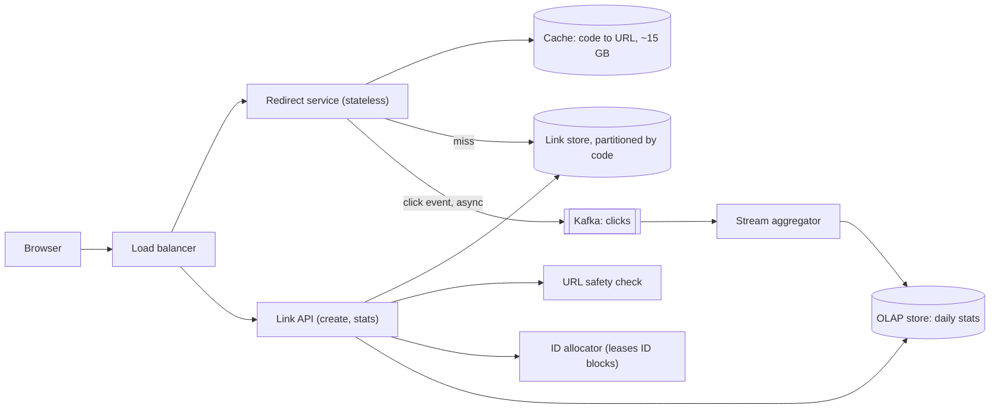

# 01 · URL shortener

**Prompt.** Design a service like bit.ly: users create short links; anyone who opens a short link is redirected to the original URL; owners see click analytics.

**Basis.** Illustrative design. ID-generation options draw on Twitter's public Snowflake design. No company's internal shortener architecture is described here.

**Why it is asked.** It looks trivial, which is the point: it tests whether you estimate before building, choose an ID scheme with reasons, cache a read-heavy path, and keep analytics off the critical path.

## 1. Requirements

**Functional**
1. Create a short link for a long URL, optionally with a custom alias and an expiry date.
2. Redirect `GET /{code}` to the long URL.
3. Show the owner click counts by day, country and referrer.
4. Block links to known malware and phishing pages.

**Non-functional**
- Redirect latency: p99 under 20 ms inside our servers (users add their own network time).
- Redirect availability: 99.99%. A broken redirect breaks every page that embedded the link.
- A code, once issued, must never point to a different URL (unless the owner edits it).
- Analytics may lag by up to a few minutes and may be approximate (±1%).

**Non-goals:** link-in-bio pages, QR-code design, A/B link rotation.

## 2. Estimates

From [estimation.md, example 4](../estimation.md#example-4--cache-size-for-a-url-shortener) (illustrative assumptions):

| Quantity | Value |
|---|---|
| New links | 100 million/month ≈ 39/s average, ~200/s peak |
| Redirects | 10 billion/month ≈ 3,860/s average, ~19,300/s peak |
| Links after 5 years | 6 billion |
| Link row (code, URL, owner, timestamps, status) | ~500 bytes with index overhead → ~3 TB over 5 years |
| Hot set in cache | ~15 GB (links clicked on a given day) |
| Click events | 10 billion/month × ~100 bytes ≈ 1 TB/month raw |

**Code length.** Base62 (a–z, A–Z, 0–9) with 7 characters gives 62⁷ ≈ 3.5 × 10¹² codes. Six billion links use 0.17% of the space, so random codes rarely collide.

**Decision from the numbers.** Writes are tiny (~200/s); reads are 100× larger but almost all hit a 15 GB cache. Storage (3 TB) fits a sharded key-value store or a modest Postgres cluster. The interesting problems are ID generation, cache behaviour and analytics, not raw scale.

## 3. API

```http
POST /v1/links
Idempotency-Key: 6f1c...            # client retry-safe
{ "long_url": "https://example.com/very/long?x=1", "alias": "sale26", "expires_at": "2027-01-01T00:00:00Z" }
→ 201 { "code": "sale26", "short_url": "https://sho.rt/sale26" }
→ 409 if the alias is taken; 422 if the URL is blocked

GET /{code}
→ 302 Location: <long_url>          # 404 if unknown, 410 if expired or disabled

GET /v1/links/{code}/stats?from=2026-10-01&to=2026-10-12&group_by=day,country
DELETE /v1/links/{code}
```

**301 or 302?** A 301 (permanent) is cached by browsers, so repeat clicks never reach you: cheaper, but you lose analytics and cannot disable an abusive link for users who already cached it. A 302 or 307 (temporary) keeps every click visible. Choose 302 if analytics and takedowns matter, and say so (RFC 9110 defines both).

## 4. Data model

| Entity | Key | Fields | Store |
|---|---|---|---|
| `link` | `code` | long_url, owner_id, created_at, expires_at, status (active / disabled / expired) | Key-value or wide-column store, partitioned by `code` (or Postgres sharded by `code`) |
| `links_by_owner` | (`owner_id`, `created_at`) | code | Secondary table for the dashboard |
| `click_event` | event_id | code, ts, country, referrer, user-agent class | Kafka topic, then an OLAP store |
| `daily_stats` | (`code`, `day`) | counts by country and referrer | OLAP store (ClickHouse, Druid, BigQuery) |

**Access patterns.** Redirect: get `link` by `code` (≈ 99.9% of traffic). Dashboard: list `links_by_owner`, read `daily_stats`. Create: conditional insert of `link`.

## 5. Architecture



**Read path.** Balancer → redirect service → cache (hit ~95%+) → link store on miss → 302. The click event is written to a local buffer and shipped to Kafka asynchronously; the redirect never waits for analytics.

**Write path.** Link API checks the URL against a safety list, obtains a code, performs a conditional insert (`IF NOT EXISTS`), and returns.

## 6. Deep dives

### 6.1 Generating codes

| Option | How | Pros | Cons |
|---|---|---|---|
| Global counter → base62 | One sequence | Short, no collisions | Central bottleneck; **sequential codes leak volume and let anyone enumerate all links** |
| Leased counter blocks + permutation | Each server leases a block of 1 million IDs from a coordinator (etcd or a DB row), then maps each ID through a reversible permutation (for example a small Feistel network) before base62 | No per-request coordination; no collisions; codes look random | Losing a server wastes its unused block (harmless) |
| Random 7 characters + conditional insert | Generate, `INSERT IF NOT EXISTS`, retry on conflict | No coordination at all | Retry rate grows as the space fills (0.17% at 6 billion links; fine) |
| Hash of the long URL (truncated) | MD5/SHA-256 → first 7 base62 chars | Same URL → same code (deduplication) | Collisions must be handled anyway; two users shortening the same URL share stats, which is usually wrong |
| Snowflake-style 64-bit ID | 41-bit time, 10-bit machine, 12-bit sequence | Time-sortable, uncoordinated | Base62 of 64 bits is 11 characters: too long for a "short" link |

**Recommendation.** Random codes with conditional insert for simplicity, or leased blocks plus a permutation if you want zero retries. Both keep codes unguessable. Custom aliases use the same conditional insert and return 409 on conflict.

### 6.2 The redirect hot path

- **Cache-aside with LRU**, ~15 GB, replicated. Entries rarely change, so invalidation is simple: on edit or takedown, delete the key and publish an invalidation event.
- **Negative caching.** Cache "not found" for 60 s so scanners hammering random codes do not reach the store.
- **Hot links.** A viral link can send tens of thousands of requests/s to one cache shard. Keep a small in-process LRU (a few thousand entries, 5–10 s TTL) in each redirect server; it absorbs hot keys without cross-node traffic.
- **Edge caching.** With 302 plus `Cache-Control: private, max-age=0` you keep analytics; if the owner opts out of analytics, a CDN can serve the redirect directly.

### 6.3 Analytics without slowing redirects

Redirect servers append click events to an in-memory buffer and flush to Kafka every 100 ms or 1,000 events. A stream job (Flink, Kafka Streams) aggregates per (code, minute, country) and writes to an OLAP store. If Kafka is unavailable, the buffer spills to local disk and drops events beyond a limit: the requirement allows approximate analytics, and redirects must never fail because of analytics. Bot traffic is flagged by user-agent and rate, not removed, so owners can filter it.

### 6.4 Abuse

Check new URLs against a safe-browsing list (for example Google Safe Browsing) and re-check popular links periodically, because pages turn malicious after creation. Rate-limit link creation per account and IP ([case study 02](02_rate_limiter.md)). Disabled links return 410 with an interstitial page. Never fetch the target URL from inside your network without guarding against requests to internal addresses (server-side request forgery).

## 7. Failure modes

| Failure | Effect | Mitigation |
|---|---|---|
| Cache cluster down | All reads go to the store: ~19,000/s instead of ~1,000/s | Store sized to survive a cold cache for minutes; request coalescing; in-process LRU |
| Link store partition unavailable | Codes on that partition fail | Replication factor 3; cached entries keep serving |
| ID allocator down | No new blocks | Servers hold a spare block; random-code fallback |
| Kafka down | Analytics gap | Local spill, bounded; redirects unaffected |
| Bad deploy of redirect service | Every link on the internet that uses you breaks | Canary by percentage of traffic; automatic rollback on 5xx rate |

## 8. Trade-offs

| Decision | Chosen | Rejected | Why |
|---|---|---|---|
| Redirect status | 302 | 301 | Keeps analytics and takedowns; costs more requests |
| Codes | Random 7-char | Sequential counter | Unguessable, no central bottleneck |
| Store | Partitioned key-value by `code` | Single Postgres | Simple point lookups; 3 TB growing. (A single Postgres with replicas would also work for years; say so.) |
| Analytics | Async, approximate | Synchronous counter increment | Redirect latency and availability matter more than exact counts |

## 9. Evolution

- **v1 (one team, weeks):** one Postgres primary with a replica, a stateless app, Redis. Handles thousands of redirects/s.
- **v2:** move links to a partitioned key-value store when the table or write rate outgrows one primary; add Kafka and an OLAP store for analytics; add in-process caches.
- **v3:** multi-region. Redirects served from every region from replicated data (reads tolerate seconds of lag); creates go to the home region, or each region generates codes with a region prefix so no cross-region coordination is needed.

## 10. What interviewers look for

| Level | Expected |
|---|---|
| New grad | Working API, base62 reasoning, a cache, a database table; knows 301 vs 302 |
| SDE-2 | Estimates driving the cache size; ID options compared; analytics made async |
| Senior | Enumeration risk of sequential IDs; hot-link handling; failure modes; abuse; clear trade-offs |
| Staff | Multi-region ID strategy; cost per million redirects; operating model (takedown process, compliance); when *not* to split services |

## References

- Twitter, Snowflake README (2010) — https://github.com/twitter-archive/snowflake/tree/snowflake-2010
- RFC 9110, HTTP Semantics (redirect status codes) — https://www.rfc-editor.org/rfc/rfc9110
- Google Safe Browsing — https://developers.google.com/safe-browsing
- [SWE401 lesson 9.1](../../../03_majors/software_engineering/year_4/SWE401_large_scale_system_design/README.md) · [building_blocks.md](../building_blocks.md) · [lld/02_lru_cache.md](../lld/02_lru_cache.md)

_Last reviewed: 2026-10_
