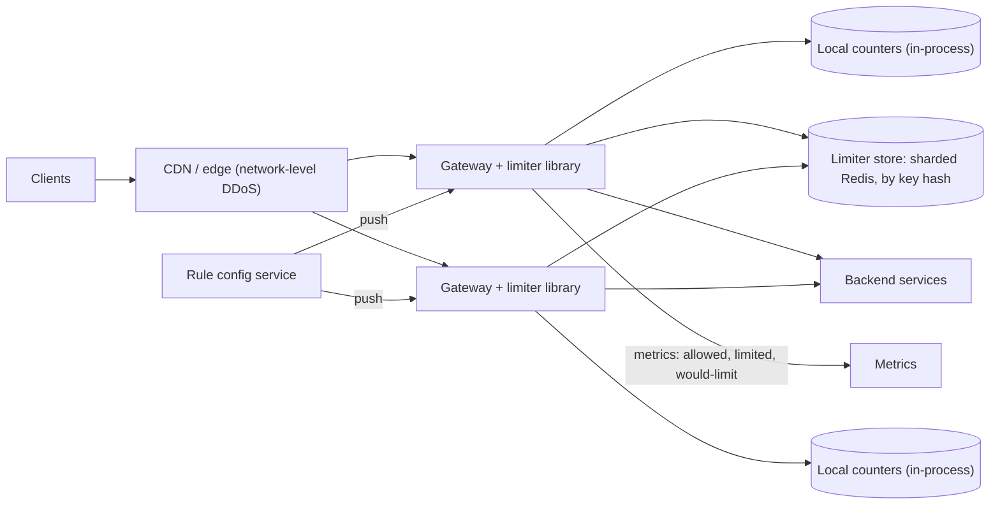

# 02 · Distributed rate limiter

**Prompt.** Design a rate limiter for a public API served by hundreds of gateway servers in several regions. Each API key has a limit (for example 100 requests/s with bursts to 200); unauthenticated traffic is limited per IP.

**Basis.** Uses two public descriptions: Stripe's four limiters (2017) and Cloudflare's sliding-window design (2017). The overall architecture is illustrative.

**Why it is asked.** It is small enough to finish and deep enough to separate levels: algorithm choice, atomicity, accuracy versus latency, and what to do when the limiter itself fails.

## 1. Requirements

**Functional**
1. Limit requests per API key, per IP, and per (key, endpoint) with configurable rules.
2. Return HTTP 429 with a hint for when to retry; expose remaining quota in headers.
3. Change limits without redeploying.
4. Support a concurrency limit (requests in flight) for expensive endpoints.

**Non-functional**
- Added latency: p99 under 1 ms per request.
- Accuracy: no client should exceed its limit by more than ~10% over a minute.
- The API must stay up if the limiter's storage is down.
- Global: a key's limit applies across all gateways (and, ideally, regions).

**Non-goals:** DDoS protection at the network layer (handled by the CDN/edge provider), billing.

## 2. Estimates (illustrative)

| Quantity | Value |
|---|---|
| API traffic | 1 million requests/s at peak across 300 gateways (~3,300/s each) |
| Active keys in a minute | 10 million |
| State per key (token bucket: tokens + last refill time + key) | ~64 bytes → ~640 MB total |
| Limiter operations | 1 per request → 1 million/s |

**Decision.** State is small (fits in memory on a few nodes). Operations are the load: at roughly 100,000 simple operations/s per in-memory store instance (**rough**), a central store needs about 10–20 shards plus replicas, and every request pays one extra network round trip (~0.5 ms, [building_blocks.md](../building_blocks.md#0-latency-numbers-every-engineer-should-know)).

## 3. API

The limiter is a library or sidecar inside the gateway, not a public API:

```text
check(key, rule, cost=1) -> { allowed: bool, remaining: int, reset_after_ms: int }
acquire_concurrency(key, rule) -> token | rejected;  release(token)
```

Client-facing behaviour:

```http
HTTP/1.1 429 Too Many Requests
Retry-After: 2
RateLimit-Policy: "default";q=100;w=1
RateLimit: "default";r=0;t=2
```

HTTP 429 is defined in RFC 6585. The `RateLimit` and `RateLimit-Policy` fields come from an IETF draft; check its current status before relying on the exact syntax.

## 4. Data model

| Item | Key | Value | Where |
|---|---|---|---|
| Rule | rule_id | match (key pattern, endpoint), rate, burst, algorithm, mode (enforce / dark) | Config store, pushed to gateways |
| Bucket state | `rl:{rule}:{key}` | tokens, last_refill_ms | Sharded in-memory store with TTL = time to refill fully |
| Concurrency state | `cc:{rule}:{key}` | set of in-flight token IDs with expiry | Same store |

## 5. Architecture



## 6. Deep dives

### 6.1 Choosing the algorithm

| Algorithm | Accuracy | Memory per key | Burst behaviour | Use |
|---|---|---|---|---|
| Fixed window counter | Allows up to 2× at window edges | 1 counter | Bursty at boundaries | Cheap coarse limits (per day) |
| Sliding log | Exact | One timestamp per request | Exact | Low limits (login attempts: 5 per 15 min) |
| Sliding window counter | Near-exact | 2 counters | Smooth | Cloudflare measured 0.003% of requests wrongly allowed or limited over 400 million requests |
| Token bucket | Exact rate, allows configured burst | 2 numbers | Explicit burst size | Default for APIs (Stripe uses it) |
| Leaky bucket (queue) | Smooth output | Queue | Delays instead of rejecting | Outbound calls to a fragile partner |

Sliding window counter estimate: `rate ≈ prev_count × (1 − elapsed/window) + curr_count`. Cloudflare's example: limit 50/min, 42 in the previous minute, 18 so far, 15 s into this minute → 42 × 0.75 + 18 = 49.5, so the request is allowed.

### 6.2 Atomicity

A naive `GET` then `SET` lets two gateways read 1 remaining token and both allow. Make the check-and-update atomic in the store: a server-side script (Redis Lua) that reads tokens and timestamp, refills by elapsed time, decrements if possible, and writes back in one step. Use the store's clock, not each gateway's, so clock skew between gateways does not create or destroy tokens. For fixed windows, `INCR` then `EXPIRE` must be one atomic operation too, or a crash between them leaves a key that never expires.

### 6.3 Central, local, or hybrid

| Design | Latency | Accuracy | Failure behaviour |
|---|---|---|---|
| Central store per request | +0.5 ms | Exact | Store outage affects every request (fail open) |
| Local only (limit ÷ number of gateways) | ~0 | Poor when the load balancer spreads a key unevenly or gateways scale | Independent |
| **Hybrid: local token lease** | ~0 on most requests | Within a few % | Degrades to local-only |

**Hybrid in detail.** Each gateway leases a batch of tokens (say 10% of a key's per-second rate) from the central bucket and spends them locally; it asks for more when it runs out. Small keys take one central call per request; heavy keys take one central call per batch, which also fixes the hot-key problem (a 50,000 req/s customer would otherwise hammer one store shard). Cloudflare takes a related approach: counters are local to each data centre, which is accurate because a given client usually reaches one data centre.

### 6.4 Multi-region

Exact global limits need cross-region coordination (tens to hundreds of ms): too slow per request. Options: split each key's limit across regions in proportion to recent traffic and rebalance every few seconds, or let each region enforce the full limit and accept up to N× overshoot for clients that spread across regions. State the choice; most APIs accept the second.

### 6.5 Rate limiting is one of several protections

Stripe describes four layers: a per-user request-rate limiter, a concurrent-requests limiter (which catches retry storms on expensive endpoints), a fleet-usage load shedder that reserves capacity for critical traffic, and a worker-utilisation load shedder as the last defence. In one month in 2017 the request-rate limiter rejected millions of requests while the last-resort shedder rejected about 100. Interviewers like candidates who separate *fairness between clients* (rate limits) from *protecting the service* (load shedding).

## 7. Failure modes

| Failure | Effect | Mitigation |
|---|---|---|
| Limiter store down or slow | Every request waits or fails | Strict timeout (2 ms); **fail open** to local-only limits (Stripe's advice); exception: security limits such as login attempts fall back to conservative local limits |
| Hot key on one shard | Shard saturates; other keys suffer | Token leasing; local pre-aggregation |
| Bad rule pushed (limit = 0) | Outage for a customer or everyone | Rules are versioned; dark-launch mode logs "would limit" before enforcing; kill switch |
| Clients retry immediately on 429 | Retry storm | `Retry-After`; documented exponential backoff with jitter; concurrency limiter |
| Gateway scale-out | Local-only limits become looser | Hybrid leasing makes the global limit independent of gateway count |

## 8. Trade-offs

| Decision | Chosen | Rejected | Why |
|---|---|---|---|
| Algorithm | Token bucket (APIs), sliding log (login) | Fixed window everywhere | Explicit bursts; exactness where security needs it |
| Placement | In-gateway library + central store | Separate limiter microservice | One fewer hop; the library can fail open locally |
| Consistency | Approximate (hybrid leasing) | Exact per request | Sub-millisecond overhead; a few % error is acceptable |
| On store failure | Fail open | Fail closed | The limiter must never be the cause of a full outage |

## 9. Evolution

- **v1:** per-gateway in-memory token buckets; limits divided by gateway count. Good enough for one region and a dozen servers.
- **v2:** central Redis with an atomic script; dark-launch mode; dashboards of limited versus would-limit.
- **v3:** hybrid leasing for heavy keys; concurrency limits; load shedding by priority; per-region budgets.

## 10. What interviewers look for

| Level | Expected |
|---|---|
| New grad | Explains token bucket and fixed window; implements one class ([lld/03_rate_limiter_class.md](../lld/03_rate_limiter_class.md)) |
| SDE-2 | Central store with atomic update; headers and 429; where the limiter sits |
| Senior | Accuracy versus latency with numbers; hot keys; fail-open reasoning; multi-region honesty |
| Staff | Separates rate limiting from load shedding and admission control; rollout safety (dark launch, kill switch); limits as a product decision (tiers, contracts) |

## References

- Stripe, "Scaling your API with rate limiters" (30 Mar 2017) — https://stripe.com/blog/rate-limiters
- Cloudflare, "How we built rate limiting capable of scaling to millions of domains" (Jun 2017) — https://blog.cloudflare.com/counting-things-a-lot-of-different-things/
- RFC 6585 (429 Too Many Requests) — https://www.rfc-editor.org/rfc/rfc6585
- IETF draft, RateLimit header fields for HTTP — https://datatracker.ietf.org/doc/draft-ietf-httpapi-ratelimit-headers/
- AWS Builders' Library, "Timeouts, retries, and backoff with jitter" — https://aws.amazon.com/builders-library/timeouts-retries-and-backoff-with-jitter/

_Last reviewed: 2026-10_
