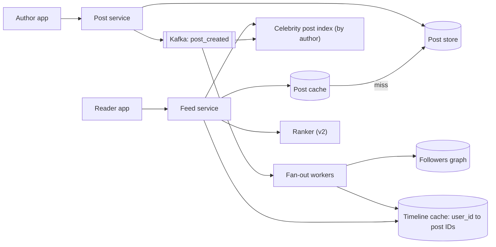

# 03 · News feed

**Prompt.** Design the home feed of a social network: users follow others, post text and media, and open a feed of recent posts from people they follow (optionally ranked).

**Basis.** The fan-out numbers come from Twitter's public talks of 2012–13 (summarised by High Scalability) and Meta's TAO paper (2013). Current internals of any network are not public; the design below is illustrative and uses those sources as anchors.

**Why it is asked.** It is the cleanest test of the **fan-out on write versus fan-out on read** trade-off, and of whether you notice that a few accounts with millions of followers break the obvious design.

## 1. Requirements

**Functional**
1. Create a post (text up to 500 characters, up to 4 media items).
2. Follow and unfollow.
3. Home feed: posts from followed accounts, newest first (v1) or ranked (v2), paginated.
4. Show "N new posts" while the user is on the feed.

**Non-functional**
- Feed load p99 under 200 ms at the server.
- A post appears in followers' feeds within 5 seconds for normal accounts (Twitter's stated goal in 2013 was "no more than 5 seconds").
- Availability 99.95%; eventual consistency is acceptable (a post may appear a few seconds later for some followers).

**Non-goals:** search, direct messages, ads ranking.

## 2. Estimates (illustrative)

| Quantity | Value |
|---|---|
| Daily active users | 300 million |
| Feed loads | 10 per user per day → 3 billion/day ≈ 35,000/s average, ~100,000/s peak |
| Posts | 0.5 per user per day → 150 million/day ≈ 1,700/s average, ~5,000/s peak |
| Average followers per poster | 200 |
| Timeline inserts if every post fans out | 150 × 10⁶ × 200 = 3 × 10¹⁰/day ≈ **350,000/s** average |
| Timeline entry (post ID 8 B + author ID 8 B + flags 4 B) | 20 bytes |
| Timeline length kept | 800 entries → 16 KB per user |
| Timeline cache for all DAU | 300 × 10⁶ × 16 KB ≈ **4.8 TB** (× replicas) |

**Sanity check.** Twitter reported in 2013: 150 million active users, 300,000 timeline-read QPS, about 5,000 tweets/s on average (12,000+/s during big events), home timelines in a Redis cluster with "a couple of terabytes of RAM", 800 entries per timeline, each entry a tweet ID, user ID and 4 bytes of flags. Our numbers are the same order of magnitude.

**Decision.** Reads outnumber posts 20:1, so precomputing feeds (fan-out on write) is attractive. But 350,000 inserts/s average, with spikes from accounts with millions of followers, needs a plan.

## 3. API

```http
POST /v1/posts            { text, media_ids[] }        Idempotency-Key header → 201 { post_id }
POST /v1/follows          { followee_id }
DELETE /v1/follows/{followee_id}
GET  /v1/feed?cursor=<opaque>&limit=20 → { items: [post...], next_cursor }
GET  /v1/feed/new_count?since=<post_id>
```

**Cursor, not offset.** New posts arrive at the top while the user scrolls; an offset would repeat or skip items. The cursor encodes the last post ID seen (IDs are time-sortable, Snowflake-style).

## 4. Data model

| Entity | Key | Store | Notes |
|---|---|---|---|
| `post` | post_id (64-bit, time-sortable) | Sharded key-value / wide-column; media in object storage | Immutable except edits and deletes (tombstones) |
| `follows` | (follower_id, followee_id) | Sharded by follower_id | "Whom do I follow" |
| `followers` | (followee_id, follower_id) | Sharded by followee_id | "Who follows me" (for fan-out); same edge stored twice |
| `timeline` | user_id → list of (post_id, author_id, flags) | In-memory cache (Redis lists), capped at 800 | Rebuildable; not the source of truth |
| `post_cache` | post_id → post | Distributed cache | Hydration |

Meta's TAO (USENIX ATC 2013) is a public example of storing a social graph as objects and associations in MySQL behind a large, graph-aware cache: the same "two directions of every edge" idea.

## 5. Architecture



**Write path.** Store the post → publish `post_created` → fan-out workers page through the author's followers (in batches of a few thousand) and push the post ID onto each active follower's timeline, trimming to 800.

**Read path.** Read the user's timeline IDs → merge in recent posts from followed "celebrity" accounts → hydrate post bodies with a multi-get from the post cache → filter deleted/blocked → (v2) rank → return 20.

## 6. Deep dives

### 6.1 Fan-out on write, on read, or hybrid

| | Fan-out on write (push) | Fan-out on read (pull) | Hybrid |
|---|---|---|---|
| Post cost | O(followers) inserts | O(1) | O(followers) for normal accounts only |
| Read cost | O(1): read one list | O(following): query each followee, merge | One list + a few celebrity lookups |
| Freshness | Delayed by fan-out lag | Always fresh | Fresh for celebrities, seconds for others |
| Problem | Accounts with 30 million followers mean 30 million inserts per post | Users following 2,000 accounts make every read expensive | More code paths |

Twitter's 2013 numbers show the problem: accounts then had 23–31 million followers, fan-out to 1 million followers took 3.5 s at p50, and the p99 for large accounts could reach 5 minutes. The planned fix was to stop fanning out for such accounts and merge their tweets at read time: the hybrid.

**Hybrid rule.** Fan out on write when the author has fewer than ~100,000 followers (a tunable threshold). For bigger authors, write only to a per-author recent-posts index; at read time, fetch the latest posts of the (usually few) celebrities the reader follows and merge. Also skip fan-out to inactive users (no login in 30 days, as Twitter did); rebuild their timeline by pull when they return.

### 6.2 Hydration and hot posts

The timeline holds IDs, so a feed page needs 20 post bodies plus author profiles and counters. Use one multi-get per store (not 20 round trips). A viral post is a hot key in the post cache: replicate hot entries across shards, and keep an in-process cache of the top few thousand posts with a short TTL.

### 6.3 Deletes, edits, blocks and privacy

Do not chase a deleted post through millions of timelines. Mark it deleted in the post store; hydration drops it. Blocks and mutes are applied at read time from the reader's settings. A user who switches to a private account changes who may see future reads, so visibility is checked at hydration, not only at fan-out.

### 6.4 Ranking (v2)

Ranked feeds keep the same retrieval (timeline + celebrity merge + some recommended posts), then score a few hundred candidates with a model predicting engagement, then apply diversity rules. That is the multi-stage pattern of [case study 13](13_recommendation_system.md); the latency budget for ranking is the part of the 200 ms left after retrieval and hydration (~100 ms).

## 7. Failure modes

| Failure | Effect | Mitigation |
|---|---|---|
| Fan-out backlog (queue lag grows) | Feeds stale by minutes | Autoscale workers on consumer lag; prioritise fan-out to recently active users; alert on lag |
| Celebrity posts during a big event | Millions of inserts per post | Hybrid threshold; it is the reason for the hybrid |
| Timeline cache node lost | Those users have empty timelines | Replicas; on miss, rebuild by pull from followees (slower but correct) |
| Post store slow | Hydration fails | Serve from post cache; degrade to fewer items; never fail the whole feed for one missing post |
| Duplicate `post_created` events | Duplicate entries | Fan-out is idempotent: inserting an existing post ID is a no-op (dedupe on post_id) |

## 8. Trade-offs

| Decision | Chosen | Rejected | Why |
|---|---|---|---|
| Fan-out | Hybrid with follower threshold | Pure push or pure pull | Bounded write amplification and cheap reads |
| Timeline storage | In-memory lists of IDs, capped | Full posts in each timeline | 20 bytes per entry instead of ~1 KB; edits and deletes stay in one place |
| Consistency | Eventual (seconds) | Strong | No user-visible harm from a few seconds' delay |
| Pagination | Cursor by post ID | Offset | Stable under inserts |

## 9. Evolution

- **v1:** pull model on one relational database: `SELECT … WHERE author_id IN (followees) ORDER BY created_at DESC LIMIT 20`, with a cache. Fine to a few million users.
- **v2:** push model with timeline cache and Kafka fan-out; celebrity threshold; inactive-user skip.
- **v3:** ranked feed with candidate sources beyond follows; per-region timeline caches; experiments on ranking.

## 10. What interviewers look for

| Level | Expected |
|---|---|
| New grad | Tables for users, posts, follows; a working pull query; pagination |
| SDE-2 | Push vs pull with estimates; timeline cache of IDs; async fan-out via a queue |
| Senior | Celebrity problem with a hybrid and a threshold; hydration and hot posts; deletes and privacy at read time; lag monitoring |
| Staff | Cost of timeline memory vs compute; ranking integration and experimentation; multi-region; migration from pull to push without downtime |

## References

- High Scalability, "The Architecture Twitter Uses to Deal with 150M Active Users, 300K QPS, a 22 MB/S Firehose, and Send Tweets in Under 5 Seconds" (8 Jul 2013), summarising Raffi Krikorian's QCon talk — https://highscalability.com/the-architecture-twitter-uses-to-deal-with-150m-active-users/ ; talk page — https://www.infoq.com/presentations/Twitter-Timeline-Scalability/
- Bronson et al., "TAO: Facebook's Distributed Data Store for the Social Graph" (USENIX ATC 2013) — https://www.usenix.org/conference/atc13/technical-sessions/presentation/bronson
- [SWE401 lesson 7.3](../../../03_majors/software_engineering/year_4/SWE401_large_scale_system_design/README.md) · [case study 13](13_recommendation_system.md)

_Last reviewed: 2026-10_
