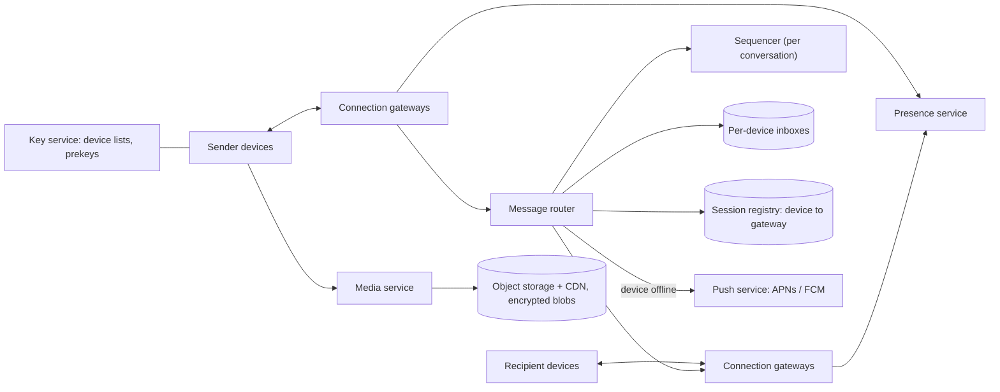

# 04 · Chat at WhatsApp scale

**Prompt.** Design a messaging service with 1:1 and group chats, delivery and read receipts, online presence, media, multiple devices per user, and end-to-end encryption, for hundreds of millions of daily users.

**Basis.** Public facts: WhatsApp says more than 3 billion people use it; its 2012 post reported over 2 million TCP connections on one FreeBSD/Erlang server; its 2021 engineering post describes how multi-device end-to-end encryption works. Discord's 2023 post describes storing message history at scale. The architecture and all traffic numbers below are **illustrative**; WhatsApp has not published its full design.

**Why it is asked.** It combines stateful connections, ordering, delivery guarantees, offline handling and fan-out, and end-to-end encryption removes options a server would normally have.

## 1. Requirements

**Functional**
1. Send text to a person or a group (illustrative cap: 1,000 members).
2. Receipts: sent (server has it), delivered (recipient device has it), read.
3. Offline delivery: messages wait until the device reconnects; a push notification wakes it.
4. Presence: online / last seen, subject to privacy settings.
5. Media: images, video, voice notes, documents.
6. One phone plus up to four linked devices (WhatsApp's documented limit in 2021).
7. End-to-end encryption (E2EE): the server cannot read content.

**Non-functional**
- Delivery latency p99 under 500 ms when both parties are online in the same region.
- No loss: once the sender sees "sent", the message will be delivered.
- Order: messages in a conversation appear in the same order on every device.
- Availability 99.99%.

**Non-goals:** voice/video calls, payments, channels and communities.

## 2. Estimates (illustrative)

| Quantity | Value |
|---|---|
| Daily active users | 500 million |
| Messages | 40 per user per day → 2 × 10¹⁰/day ≈ 231,000/s average, ~700,000/s peak |
| Receipts | delivered + read per message per recipient device → ≥ 2× message volume |
| Concurrent connections at peak | 40% of DAU × 1.3 devices ≈ **260 million** |
| Gateway servers | at ~1 million connections each (half of what WhatsApp reported on 2012 hardware) → ~260, ~400 with headroom and failover |
| Text storage | ~4 TB/day if history were kept; much less if deleted after delivery ([estimation.md, example 2](../estimation.md#example-2--storage-a-chat-service)) |
| Media | ~200 TB/day (dominates; object storage + CDN) |

**Decision.** The system is dominated by long-lived connections and small messages, not by storage. Design the connection layer and routing first.

## 3. API

Clients hold one persistent connection (TLS over TCP, WebSocket or a compact binary protocol) and exchange frames:

```text
→ SEND    { conv_id, client_msg_id, ciphertexts: [{device_id, blob}] | group_ciphertext, ts_client }
← ACK     { client_msg_id, server_seq }              # "sent" tick
← MSG     { conv_id, server_seq, sender, blob }
→ RECEIPT { conv_id, server_seq, type: delivered | read }
→ SYNC    { conv_id, after_seq }                     # on reconnect
→ PRESENCE_SUBSCRIBE { user_ids }                    # only while a chat is open
```

HTTP endpoints handle media upload/download (pre-signed URLs), key bundles for encryption, and device linking.

## 4. Data model

| Entity | Key | Store | Lifetime |
|---|---|---|---|
| `session` | device_id → gateway_id, connected_at | In-memory registry with TTL heartbeats | While connected |
| `inbox` | (device_id, server_seq) → encrypted message | Durable, partitioned by device_id | Until the device acks delivery (store-until-delivered) |
| `conversation_seq` | conv_id → next sequence number | Partitioned by conv_id, replicated with consensus | Forever |
| `group` | group_id → members, admins | Relational or key-value | Forever |
| `device_list` | user_id → device IDs and identity keys | Key-value | Forever |
| `media_blob` | random object key → encrypted bytes | Object storage + CDN | Retention policy (for example 30 days after delivery) |

WhatsApp states that "Messages are not stored on the server after they are delivered." A service that keeps server-side history (like Discord or Slack) instead stores messages in a wide-column store partitioned by (channel, time bucket); Discord reported trillions of messages on 72 ScyllaDB nodes in 2023.

## 5. Architecture



**Send path.** Sender encrypts → gateway → router asks the sequencer for the next `server_seq` in the conversation → writes the message to each recipient device's inbox (durable) → acks the sender ("sent") → looks up each device's gateway in the registry → pushes to online devices → offline devices get a push notification.

**Receive path.** Device receives, decrypts, stores locally, sends `delivered` receipt; the router deletes the inbox entry and forwards the receipt to the sender's devices.

## 6. Deep dives

### 6.1 Delivery guarantees and ordering

- **At-least-once with deduplication.** The sender retries `SEND` until it gets `ACK`; the router deduplicates on (`sender_device`, `client_msg_id`). Recipients deduplicate on `server_seq`.
- **Ordering per conversation.** One sequencer owns each conversation (partitioned by `conv_id`, leader elected through a consensus-backed shard map). Clients display by `server_seq`, never by device clocks, which disagree.
- **Gap detection.** If a device sees seq 41 then 43, it asks `SYNC after 41`.

### 6.2 What end-to-end encryption changes

WhatsApp's 2021 multi-device post describes the model: every device has its own identity key; the server keeps the mapping from account to device identities; for 1:1 messages the sending client encrypts the message separately for each recipient device ("client-fanout"); groups use the Signal Protocol's Sender Keys, so a sender encrypts once and the server fans the same ciphertext out. Consequences for the server design:

- The server **routes opaque blobs**. It cannot search, translate, summarise or filter by content; spam and abuse controls rely on metadata, rate limits and user reports.
- **Fan-out cost moves to clients** for 1:1 multi-device (N encryptions per message).
- **History sync for a new device** is done device-to-device (the phone sends an encrypted bundle), not from a server archive.
- **Media**: the client encrypts with a fresh key, uploads ciphertext, and sends the key inside the E2EE message. The CDN serves encrypted bytes it cannot read.

### 6.3 Connection layer

Each gateway holds hundreds of thousands to millions of idle TCP connections; memory per connection (buffers, TLS state) is the limit, not CPU. The session registry maps device → gateway with a heartbeat TTL (say 60 s). On a gateway crash, its clients reconnect to other gateways with **exponential backoff and jitter**; without jitter, a million clients reconnecting in the same second is a self-inflicted outage. Uber's push platform (RAMEN, 2020) used a 4-second heartbeat and reconnect after 7 seconds of silence on mobile networks, a useful public reference for mobile keep-alive budgets.

### 6.4 Groups

For a 1,000-member group with 1.3 devices each, one message becomes ~1,300 inbox writes. That is acceptable at this cap. Larger broadcast-style groups would switch to a pull model (one group log, members read from it), which is how channel-style products avoid per-member fan-out.

### 6.5 Presence

Broadcasting every online/offline change to every contact is expensive (people open and close the app constantly). Instead, clients subscribe to presence only for chats currently on screen, updates are debounced (a few seconds), and "last seen" is computed from the last heartbeat. Privacy settings are checked before any presence is returned.

## 7. Failure modes

| Failure | Effect | Mitigation |
|---|---|---|
| Gateway crash | 1 million clients disconnected | Reconnect with jittered backoff; `SYNC` from last seq; inboxes are durable, so nothing is lost |
| Region outage | Large reconnect wave to other regions | Pre-provisioned capacity; admission control on reconnect rate |
| Sequencer leader failover | Brief pause for conversations on that partition | Consensus-backed leadership; clients retry with the same `client_msg_id` |
| Push provider (APNs/FCM) delays | Offline users notified late | Messages wait in inbox; retry; FCM and APNs payloads are limited to 4 KB, so send a small wake-up and fetch content on connect |
| Duplicate sends after timeouts | Double messages | Deduplicate on `client_msg_id` |
| Inbox build-up for devices that never return | Storage grows | Expire undelivered messages after a policy period (for example 30 days) and tell the sender |

## 8. Trade-offs

| Decision | Chosen | Rejected | Why |
|---|---|---|---|
| Server storage | Store until delivered | Full server history | Privacy, E2EE, and storage cost; the cost is that a lost phone without backup loses history |
| Ordering | Per-conversation sequencer | Client timestamps | Clocks disagree; one sequencer per conversation is cheap and partitionable |
| Group fan-out | Server fans out one sender-key ciphertext | Per-member encryption by sender | Sender bandwidth on mobile |
| Presence | Subscribe-on-view, debounced | Broadcast to all contacts | Orders of magnitude fewer updates |

## 9. Evolution

- **v1:** one region; WebSocket gateways; Postgres for users and groups; Redis for sessions; messages in a durable queue per device.
- **v2:** E2EE with per-device keys; media via object storage + CDN; push notifications; partitioned sequencers.
- **v3:** multi-region gateways with users homed to a region; cross-region routing for conversations that span regions; linked devices; abuse systems built on metadata.

## 10. What interviewers look for

| Level | Expected |
|---|---|
| New grad | Persistent connections vs polling; message table; sent/delivered/read states |
| SDE-2 | Session registry; inbox per device; ack and retry with deduplication; push for offline |
| Senior | Ordering with sequence numbers; reconnect storms; group fan-out maths; media path; what E2EE removes from the server |
| Staff | Multi-region homing; capacity for connections not QPS; abuse handling without content access; product trade-offs of history and backups |

## References

- WhatsApp, About (user count) — https://www.whatsapp.com/about
- WhatsApp, "1 million is so 2011" (6 Jan 2012) — https://blog.whatsapp.com/1-million-is-so-2011
- Meta Engineering, "How WhatsApp enables multi-device capability" (14 Jul 2021) — https://engineering.fb.com/2021/07/14/security/whatsapp-multi-device/
- Signal Protocol specifications — https://signal.org/docs/
- Discord, "How Discord Stores Trillions of Messages" (2023) — https://discord.com/blog/how-discord-stores-trillions-of-messages
- Uber, "Uber's Real-Time Push Platform" (18 Dec 2020) — https://www.uber.com/blog/real-time-push-platform/
- Firebase Cloud Messaging message types (4,096-byte payload limit) — https://firebase.google.com/docs/cloud-messaging/customize-messages/set-message-type
- [SWE401 lesson 10.1](../../../03_majors/software_engineering/year_4/SWE401_large_scale_system_design/README.md)

_Last reviewed: 2026-10_
