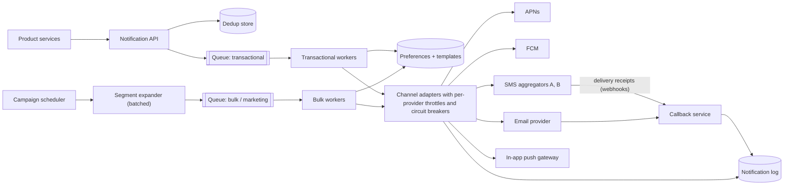

# 05 · Notification system

**Prompt.** Design a platform that every product team uses to send notifications (mobile push, SMS, email, in-app, WhatsApp Business messages): one-time passwords, order updates, and marketing campaigns to tens of millions of users.

**Basis.** Illustrative design. Public constraints used: Firebase Cloud Messaging and Apple Push Notification service payload limits, Uber's public description of its in-app push platform (RAMEN, 2020), and India's rules for commercial SMS (TRAI's TCCCPR 2018, enforced through telecom operators' DLT platforms).

**Why it is asked.** It tests priority isolation, idempotency ("never send the OTP twice"), rate limits imposed by third parties, user preferences, and failure handling when the final hop belongs to someone else.

## 1. Requirements

**Functional**
1. Services send a notification by event: `{user_id, template_id, data, channels, priority}`.
2. Channels: push (APNs, FCM), SMS, email, in-app, WhatsApp Business.
3. Respect user preferences, opt-outs, quiet hours and frequency caps.
4. Templates with localisation (English plus Indian languages).
5. Campaigns: send to a segment of up to 50 million users, optionally scheduled.
6. Track status: queued, sent to provider, delivered, opened, failed.

**Non-functional**
- OTPs and security alerts: handed to the provider within 2 s at p99; never blocked by marketing traffic.
- No duplicates for the same event and channel.
- Campaign of 50 million in 10 minutes (the practice target in [SWE401](../../../03_majors/software_engineering/year_4/SWE401_large_scale_system_design/README.md)).
- Transactional path availability 99.99%.

**Non-goals:** the email/SMS delivery networks themselves; content design tools.

## 2. Estimates (illustrative)

| Quantity | Value |
|---|---|
| Transactional baseline | 5,000/s, peaks of 20,000/s (sales events) |
| Campaign | 50 × 10⁶ ÷ 600 s ≈ **83,000/s** for 10 minutes |
| Notification log | ~1 billion/day × 300 B ≈ 300 GB/day; 30-day retention ≈ 9 TB |
| Device tokens | 200 million users × 1.5 devices × ~200 B ≈ 60 GB |
| Dedup keys | 24 h × 20,000/s peak × 100 B ≈ 170 GB worst case (TTL'd in an in-memory store) |

**Decision.** The platform's own compute is cheap. The limits are **external**: each SMS aggregator, email provider and push service accepts only so many requests per second and fails independently. The design is about queues, per-provider throttles and isolation.

## 3. API

```http
POST /v1/notifications
Idempotency-Key: order-981-shipped-sms
{ "user_id": "u_42", "template_id": "order_shipped", "data": {"order": "981"},
  "channels": ["push", "sms"], "priority": "transactional", "ttl_seconds": 3600 }
→ 202 { "notification_id": "n_..." }

POST /v1/campaigns   { segment_id, template_id, schedule_at, channels, max_rate_per_s }
GET  /v1/notifications/{id}          → per-channel status
POST /v1/devices     { user_id, platform, token }   # register / refresh push token
```

Accepting with **202** (not 200) is deliberate: delivery happens later and may fail.

## 4. Data model

| Entity | Key | Store |
|---|---|---|
| `template` | (template_id, locale, version) | Relational; cached in workers |
| `preference` | user_id → per-category, per-channel opt-in, quiet hours, language | Key-value, cached |
| `device` | user_id → [(platform, token, last_seen)] | Key-value |
| `notification` | notification_id → request, status per channel, timestamps | Wide-column, partitioned by notification_id, TTL 30 days |
| `dedup` | idempotency key → notification_id | In-memory store, TTL 24 h |
| `campaign` | campaign_id → segment, schedule, progress cursor | Relational |

## 5. Architecture



## 6. Deep dives

### 6.1 Priority isolation

Separate queues **and** separate worker pools **and** reserved provider capacity for transactional traffic. If OTPs share a queue with a 50-million campaign, the OTP waits behind 50 million messages. The campaign path also has its own rate cap (`max_rate_per_s`) so it can never take more than its share of a provider's contract.

### 6.2 Never send the OTP twice (or never)

Sources of duplicates: the caller retries after a timeout; the queue redelivers after a worker crash; the provider's API times out after accepting the message.

1. The API stores the idempotency key before enqueueing; a repeat returns the same `notification_id`.
2. Workers record "sent to provider" with the provider's message ID before acknowledging the queue message; a redelivered message whose status is already "sent" is dropped.
3. If the provider call times out, query the provider's status API (where available) before resending; for OTPs, prefer **resending a new OTP on user request** over automatic retries, because a late duplicate OTP confuses users and may be a security issue.

The honest guarantee is *at-least-once with deduplication*. Say so.

### 6.3 Campaign fan-out

Do not expand 50 million users into the queue in one go. The expander pages through the segment in batches of ~10,000, checks preferences and frequency caps in bulk, and enqueues at the campaign's target rate, storing a progress cursor so a crash resumes rather than restarts. Users in quiet hours are delayed to a per-user send time (time zone aware), not dropped.

### 6.4 Third-party limits and failover

- **Payload limits.** FCM allows 4,096 bytes per message; APNs allows 4 KB for standard notifications. Send short content plus an ID; the app fetches details.
- **Dead tokens.** When APNs or FCM reports a token as unregistered, delete it; otherwise you pay to send to devices that no longer exist.
- **SMS in India.** Commercial SMS must use headers and content templates registered with telecom operators on their DLT platforms under TRAI's TCCCPR 2018; a message that does not match a registered template is rejected. Template registration is therefore part of the template workflow, not an afterthought.
- **Failover.** Circuit breakers per provider; if aggregator A's error rate passes a threshold, route to B. For OTPs, fall back across channels (push → SMS) only where the product allows.

### 6.5 In-app delivery

For users with the app open, a persistent connection beats push services. Uber's RAMEN platform replaced polling (80% of API gateway requests had been polling calls) with server push, reaching 1.5 million+ concurrent connections and 250,000+ messages/s with an at-least-once guarantee, sequence numbers and acknowledgements. The same pattern serves in-app notification badges here.

## 7. Failure modes

| Failure | Effect | Mitigation |
|---|---|---|
| SMS aggregator outage | OTPs fail; logins blocked | Second aggregator; circuit breaker; alert on OTP success rate, not just API errors |
| Campaign floods providers | Transactional messages throttled | Reserved capacity; campaign rate cap; separate API credentials per class where providers allow |
| Worker crash mid-batch | Duplicates or gaps | Idempotent status updates; progress cursor |
| Preference store down | Risk of messaging opted-out users | Fail closed for marketing (do not send); fail open for security alerts with cached preferences |
| Callback webhooks lost | Status stuck at "sent" | Periodic status polling for messages without receipts after N minutes |

## 8. Trade-offs

| Decision | Chosen | Rejected | Why |
|---|---|---|---|
| Delivery semantics | At-least-once + dedupe | "Exactly once" | Impossible across a third-party boundary; dedupe makes duplicates rare |
| Queues | Separate per priority (and per channel) | One shared queue | Head-of-line blocking of OTPs |
| Preferences on failure | Fail closed for marketing | Fail open | Sending to opted-out users is a legal and trust problem |
| Campaign expansion | Batched, rate-paced | Expand all at once | Bounded queue size and provider load |

## 9. Evolution

- **v1:** a library each team calls that sends directly to providers. Fast to build; no shared limits.
- **v2:** central service with queues, templates, preferences, dedupe and status tracking.
- **v3:** campaign engine with segments and pacing; multi-provider routing on cost and success rate; per-user send-time optimisation; in-app real-time channel.

## 10. What interviewers look for

| Level | Expected |
|---|---|
| New grad | Queue between API and senders; templates; a table for preferences |
| SDE-2 | Priority queues; idempotency key; retries with backoff; device token handling |
| Senior | Provider throttles and failover; campaign pacing with numbers; honest delivery semantics; regulatory constraints (DLT, opt-outs) |
| Staff | Platform API that teams cannot misuse; cost per notification by channel; ownership of deliverability metrics |

## References

- Firebase Cloud Messaging, message types and payload limit — https://firebase.google.com/docs/cloud-messaging/customize-messages/set-message-type
- Apple, "Generating a remote notification" (payload size) — https://developer.apple.com/documentation/usernotifications/generating-a-remote-notification
- Uber, "Uber's Real-Time Push Platform" (18 Dec 2020) — https://www.uber.com/blog/real-time-push-platform/
- TRAI, Telecom Commercial Communications Customer Preference Regulations, 2018 — https://trai.gov.in/sites/default/files/2025-01/RegulationUcc19072018.pdf ; TRAI, advice to senders (headers, templates, DLT) — https://trai.gov.in/advice-to-senders
- [SWE401 lesson 9.3](../../../03_majors/software_engineering/year_4/SWE401_large_scale_system_design/README.md) · [case study 02](02_rate_limiter.md)

_Last reviewed: 2026-10_
