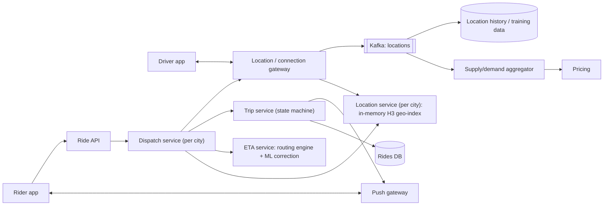

# 06 · Ride-hailing: dispatch and ETA

**Prompt.** Design the core of a ride-hailing app: drivers stream their location, riders request rides, the system matches a driver within seconds, shows pickup and trip ETAs, and tracks the trip live.

**Basis.** Uber has published its H3 hexagonal grid (2018), its real-time push platform RAMEN (2020) and DeepETA (2022). The overall architecture and every traffic number below are **illustrative**, not Uber's or any other company's design.

**Why it is asked.** It combines a high-rate location stream, a geospatial index, a contention problem (two riders must not get the same driver), latency-critical ML (ETA), and real-time push to phones on mobile networks.

## 1. Requirements

**Functional**
1. Drivers go online/offline and send GPS location every few seconds.
2. A rider sees nearby cars and an estimated pickup time before requesting.
3. A request is matched to one driver, who accepts or declines within a timeout.
4. Both apps show the other party's live position and an updating ETA.
5. Trip lifecycle: requested → matched → driver arriving → on trip → completed / cancelled.
6. Prices adjust to local supply and demand (surge).

**Non-functional**
- Match within 5 s at p95 when drivers are available.
- Location shown to the other party within 2 s of the GPS fix.
- A driver is never assigned two trips at once.
- Request and match path availability 99.99%; a city's outage must not affect other cities.

**Non-goals:** payments (see [case study 08](08_upi_style_payment_switch.md)), driver onboarding, ride pooling.

## 2. Estimates (illustrative, one large country)

| Quantity | Value |
|---|---|
| Drivers online at peak | 1 million |
| Location updates | every 4 s → **250,000/s**; ~100 bytes each → 25 MB/s ingest |
| Latest-location state | 1 million × ~100 B = 100 MB (fits in memory many times over) |
| Location history (for trips, analytics, ETA training) | 250,000 × 100 B × 86,400 ≈ 2.2 TB/day |
| Ride requests | 20 million/day ≈ 230/s average; ~1,500/s peak (office hours, rain, events) |
| ETA computations | "nearby cars" screens and matching need ~20–50 ETAs per request → 30,000–75,000/s peak |

**Decision.** Location writes (250,000/s) are the heaviest stream but each is tiny and only the latest value matters for dispatch: keep latest positions in an in-memory geo-index and send the full stream to a log for history. ETA calls are the most expensive per call and must be batched and cached.

## 3. API

```http
# Driver app (over a persistent connection)
LOCATION { driver_id, lat, lng, heading, speed, accuracy_m, ts }       every ~4 s
OFFER_RESPONSE { offer_id, accept: true|false }

# Rider app
GET  /v1/nearby?lat=..&lng=..             → { cars: [{approx_pos}], pickup_eta_s, price_quote_id }
POST /v1/rides   Idempotency-Key: ...  { pickup, drop, price_quote_id } → 202 { ride_id }
GET  /v1/rides/{ride_id}                  → state, driver, eta
POST /v1/rides/{ride_id}/cancel
# Server → apps: push events (ride_matched, driver_location, eta_update, state_change)
```

## 4. Data model

| Entity | Key | Store |
|---|---|---|
| `driver_state` | driver_id → status (offline / available / offered / on_trip), last location, H3 cell, vehicle type | In-memory, partitioned by city; changes logged |
| `cell_index` | (city, H3 cell) → set of available driver IDs | In-memory, same partition as driver_state |
| `ride` | ride_id → rider, driver, state, pickup, drop, quote, timestamps | Relational, partitioned by city or ride_id; state transitions are transactional |
| `location_log` | (driver_id, ts) | Kafka → object storage / analytics |
| `supply_demand` | (city, H3 cell, minute) → open requests, available drivers | Stream-aggregated; feeds pricing |

## 5. Architecture



**Request path.** Rider requests → dispatch (city partition) queries the geo-index for available drivers in the pickup cell and its neighbours → ETA service ranks them by pickup ETA → dispatch marks the best driver `offered` (atomic compare-and-set) → offer sent to driver → accept → trip service records `matched` → push to rider.

## 6. Deep dives

### 6.1 Geospatial index

Divide the map into cells and index available drivers by cell. Uber's H3 uses hexagons: each hexagon's centre is the same distance from all six neighbours (squares have two neighbour distances), which makes "ring of cells around the pickup" a good approximation of a radius search. H3 has 16 resolutions, each cell one-seventh the area of its parent; resolution 8 cells average about 0.74 km² and resolution 9 about 0.1 km² (H3 documentation). A nearby search reads the pickup cell plus 1–2 rings of neighbours (7 or 19 cells), each a small set lookup.

Alternatives: geohash (rectangular cells; neighbours at edges are awkward), S2 (Google's square-based cells on a sphere), quadtrees and R-trees (good for uneven density but harder to update 250,000 times per second).

**Partitioning.** Shard by city (or metro region): almost every query is local, cities fail independently, and a city fits in memory on one machine with replicas. Very large metros can be split by H3 parent cell, with dispatch reading across the boundary.

### 6.2 Matching without double assignment

- **Driver lock.** Offering a driver is a compare-and-set: `available → offered(ride_id, expires_at)`. Only one dispatch decision can win it. If the driver does not answer within ~10–15 s, the offer expires and the driver returns to `available`.
- **Greedy versus batched.** Greedy assigns each request to its best driver immediately. Batched matching collects requests for a short window (a second or two) and solves an assignment problem minimising total pickup ETA across all of them, which serves the city better when supply is tight but adds latency. Many designs use greedy when supply is plentiful and batching under scarcity (illustrative design choice; state it as yours).
- **Idempotency.** The rider's request carries an idempotency key, so a retried request never creates a second ride.

### 6.3 ETA

1. **Routing engine:** shortest travel time on a road graph with live speeds, using precomputed structures (contraction hierarchies or similar) to answer in milliseconds.
2. **ML correction:** Uber's DeepETA post (2022) describes a model that predicts "the residual between the routing engine ETA and real-world observed outcomes", using origin, destination, time, real-time traffic and request type. It is a linear-attention transformer because it "must return an ETA within a few milliseconds at most", and Uber calls it its highest-QPS model. Lyft (2024) has written about measuring ETA *reliability*, not just average error. See [MLE302 chapter 9](../../../03_majors/machine_learning_engineering/year_3/MLE302_machine_learning_system_design/README.md).
3. **Serving:** batch the 20–50 candidate ETAs per request into one call; cache cell-to-cell travel times for a minute for the "nearby cars" screen, where exactness matters less than speed.

### 6.4 Live tracking to phones

Push the driver's position to the rider through a persistent connection rather than polling. Uber's RAMEN replaced polling (80% of API-gateway requests had been polls) and reports 1.5 million+ concurrent connections and at-least-once delivery with sequence numbers. Send positions at most every 2–4 s and let the app interpolate along the route; snap noisy GPS points to roads (map matching) before showing them.

### 6.5 Surge pricing (outline)

Aggregate open requests and available drivers per H3 cell per minute; compute a multiplier per cell with smoothing across neighbouring cells and over time to avoid prices flickering; quote a price with an ID and expiry so the rider pays the price they saw.

## 7. Failure modes

| Failure | Effect | Mitigation |
|---|---|---|
| City partition's geo-index node fails | No matches in that city | Hot standby replica fed by the same location stream; rebuild from the last 10 s of locations |
| Location stream lag | Dispatch uses stale positions | Track lag; exclude drivers whose last fix is older than ~30 s |
| Driver loses network mid-trip | Rider sees a frozen car | App buffers locations and uploads on reconnect; trip continues; ETA marked approximate |
| Hot cells (stadium after a match, airport) | One cell's set is large and contended | Split by finer resolution; queue requests at pickup zones |
| ETA service slow | Matching stalls | Timeout and fall back to straight-line distance × city speed factor |
| Duplicate request after timeout | Two rides | Idempotency key on ride creation |

## 8. Trade-offs

| Decision | Chosen | Rejected | Why |
|---|---|---|---|
| Location storage for dispatch | In-memory latest position per city | Database row per update | 250,000 writes/s of values that are stale in 4 s |
| Partitioning | By city | Global hash of driver ID | Locality of queries; failure isolation |
| Grid | Hexagonal (H3) | Geohash squares | Uniform neighbour distances, smoother aggregation |
| Matching | Greedy by default, batched under scarcity | Always one | Latency versus city-wide efficiency |

## 9. Evolution

- **v1:** one city; PostGIS `ST_DWithin` query on driver locations updated every 10 s; polling apps.
- **v2:** in-memory H3 index per city; offer locks; push gateway; routing-engine ETAs.
- **v3:** ML-corrected ETAs; batched matching; surge per cell; multi-region with cities homed to regions.

## 10. What interviewers look for

| Level | Expected |
|---|---|
| New grad | Tables for drivers and rides; a nearby query; trip states |
| SDE-2 | Location ingest numbers; geo-index choice; offer/accept with timeout; push instead of polling |
| Senior | Double-assignment prevention; city partitioning and hot cells; ETA latency budget and fallback; stale-location handling |
| Staff | Marketplace effects (batching, surge stability, experiments needing switchback tests); multi-region; cost of ETA calls |

## References

- Uber, "H3: Uber's Hexagonal Hierarchical Spatial Index" (27 Jun 2018) — https://www.uber.com/blog/h3/ ; H3 resolution table — https://h3geo.org/docs/core-library/restable
- Uber, "Uber's Real-Time Push Platform" (18 Dec 2020) — https://www.uber.com/blog/real-time-push-platform/
- Uber, "DeepETA: How Uber Predicts Arrival Times" (10 Feb 2022) — https://www.uber.com/blog/deepeta-how-uber-predicts-arrival-times/
- Lyft, "ETA Reliability at Lyft" (20 Jun 2024) — https://eng.lyft.com/eta-estimated-time-of-arrival-reliability-at-lyft-d4ca2720bda8
- DoorDash, "Switchback Tests and Randomized Experimentation Under Network Effects" (2018) — https://careersatdoordash.com/blog/switchback-tests-and-randomized-experimentation-under-network-effects-at-doordash/
- [SWE401 lesson 7.4](../../../03_majors/software_engineering/year_4/SWE401_large_scale_system_design/README.md)

_Last reviewed: 2026-10_
