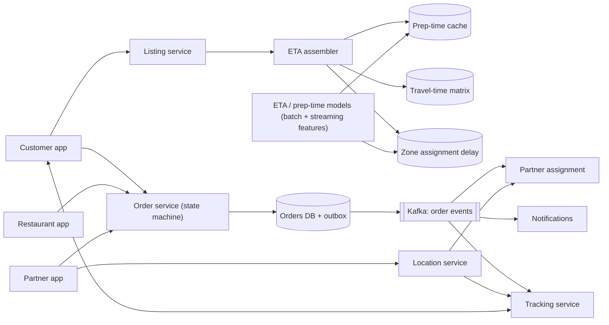
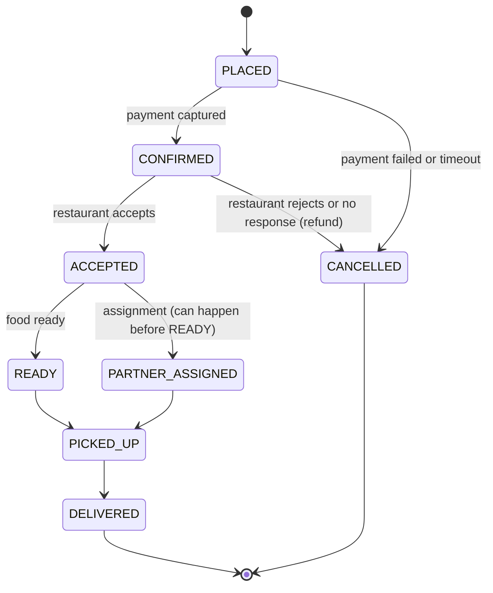

# 07 · Food delivery: ETA and order tracking (Swiggy/Zomato-style)

**Prompt.** Design the order lifecycle, live tracking and delivery-time estimates for a food-delivery marketplace with customers, restaurants and delivery partners.

**Basis.** Swiggy and Zomato have published posts on delivery-time and food-preparation-time prediction (2018–2026), and DoorDash on deep-learning ETAs (2024); they are listed under References and taught in [MLE302](../../../03_majors/machine_learning_engineering/year_3/MLE302_machine_learning_system_design/README.md). The service architecture and all traffic numbers below are **illustrative**, not either company's system.

**Why it is asked.** Three parties, one order: it tests state machines, event-driven design, idempotent transitions, a real-time location stream, and an ETA that must be computed for hundreds of restaurants in a fraction of a second.

## 1. Requirements

**Functional**
1. Listing page shows an ETA for each of 300–500 nearby restaurants.
2. Cart shows a firmer ETA; after ordering, a live ETA that updates.
3. Order lifecycle with restaurant acceptance, preparation, partner assignment, pickup and delivery; cancellations and refunds.
4. Customer sees the partner on a map after pickup (and approaching the restaurant before).
5. Notifications at each state change.

**Non-functional**
- Listing page loads within about half a second; MLE302 cites Swiggy for the 300–500-restaurant, half-second constraint. The ETA part gets ~100 ms at p99.
- An order, once paid, is never lost; each state transition happens exactly once in effect.
- Tracking position no more than ~5 s stale.
- Dinner peaks, rain and big cricket matches multiply demand within minutes.

**Non-goals:** restaurant onboarding, menu search ranking, partner payouts.

## 2. Estimates (illustrative, one large market)

| Quantity | Value |
|---|---|
| Orders | 3 million/day; 35% in a 2-hour dinner peak → ~150 orders/s, spikes ~500/s |
| Listing loads | 150 million/day; peak ~10,000/s |
| ETAs needed for listings | 10,000/s × 400 restaurants = **4 million ETA values/s** at peak |
| Delivery partners online at peak | 300,000, location every 5 s → **60,000 updates/s** |
| Order events | ~10 state changes per order → ~1,500–5,000 events/s at peak |

**Decision.** 4 million ETA *model calls* per second would be absurd. The listing ETA must be **decomposed and precomputed** so that the request does arithmetic over cached parts, not inference per restaurant. Orders themselves are a modest transactional load (hundreds per second) where correctness matters more than throughput.

## 3. API

```http
GET  /v1/listing?lat=..&lng=..        → restaurants with eta_min, eta_max
POST /v1/cart/eta  { restaurant_id, items, address_id } → { eta_min, eta_max, quote_id }
POST /v1/orders    Idempotency-Key: ...  { cart_id, address_id, payment_ref, quote_id } → 201 { order_id }
GET  /v1/orders/{id}                  → state, eta, partner (if assigned)
WS   /v1/orders/{id}/track            → stream of {state, partner_location, eta} events

# Restaurant and partner apps
POST /v1/restaurant/orders/{id}/accept   { prep_time_estimate_min }
POST /v1/restaurant/orders/{id}/ready
POST /v1/partner/orders/{id}/picked_up | /delivered      (each with an event_id for idempotency)
```

## 4. Data model

| Entity | Key | Store | Notes |
|---|---|---|---|
| `order` | order_id | Relational (Postgres/MySQL), partitioned by city or order_id | State, version, items, amounts, parties |
| `order_event` | (order_id, seq) | Same database (outbox table) → Kafka | Source for notifications, tracking, analytics |
| `partner_state` | partner_id → status, location, current orders | In-memory per zone + log | Like drivers in [case study 06](06_ride_hailing_dispatch_eta.md) |
| `prep_time` | restaurant_id → predicted prep minutes (by hour, load) | Feature store / cache, refreshed every minute | |
| `travel_matrix` | (zone cell A, zone cell B) → travel minutes | Cache, refreshed every few minutes | |
| `zone_delay` | zone → expected time to assign and reach restaurant | Cache, refreshed every minute | From live supply/demand |

## 5. Architecture



## 6. Deep dives

### 6.1 Listing ETA in a few milliseconds per restaurant

Decompose the delivery time:

`ETA ≈ max(prep_time(restaurant), time_to_assign_and_reach(zone)) + travel(restaurant_cell → customer_cell) + handover buffer`

Each term changes slowly (minutes) and is shared by many requests, so it can be precomputed: prep time per restaurant from a model refreshed every minute (Zomato has written about predicting food preparation time), assignment delay per zone from live supply and demand, travel time from a cell-to-cell matrix. The request does a few cache lookups and additions per restaurant: 400 restaurants × a few microseconds. Show a **range** (for example 30–35 min) because the promise matters more than the point estimate; a late order hurts more than a slightly pessimistic one.

At the cart and after ordering, run the full model once for that order with richer features (items, current kitchen load, the specific partner). Swiggy's 2023 post covers predicting delivery time at cart; its October 2026 post addresses keeping ETAs consistent across neighbouring regions, a real user-trust issue when two nearby addresses get very different estimates.

### 6.2 The order state machine



(Simplified: in practice `READY` and `PARTNER_ASSIGNED` are independent flags that must both hold before `PICKED_UP`.)

**Rules.**
- Each transition is a conditional update: `UPDATE orders SET state='PICKED_UP', version=version+1 WHERE id=? AND state IN (...) AND version=?`. A duplicate or out-of-order request fails the condition and is answered with the current state (idempotent).
- The same transaction inserts the event into the **outbox** table; a relay publishes it to Kafka. Notification and tracking services never see an event for a transition that did not commit.
- Payment success with a failed order write is the dangerous gap: a reconciliation job matches captured payments to orders every few minutes and auto-refunds orphans (the same pattern as [case study 08](08_upi_style_payment_switch.md)).

### 6.3 Assignment timed to food readiness

Assigning a partner the moment the order is placed wastes partner time waiting at the restaurant; assigning late makes food wait. Use predicted prep time to schedule assignment so the partner arrives just as food is ready, and batch two orders from the same restaurant or nearby restaurants onto one partner when their drop locations are compatible. This is an optimisation run every few seconds per zone (illustrative design).

### 6.4 Live tracking

Partner locations flow to the location service (60,000/s). The tracking service subscribes to locations only for partners with an active order and pushes to the one customer watching that order over a WebSocket or server-sent events; the fan-out is 1:1, so cost scales with active orders, not users. Recompute the order ETA when the partner deviates from the expected route or the restaurant marks the order ready, and push it only when it changes by more than a minute.

## 7. Failure modes

| Failure | Effect | Mitigation |
|---|---|---|
| Restaurant tablet offline | Orders not accepted | Escalate to an automated call after N seconds; auto-cancel and refund after a timeout |
| Partner app loses network | Map freezes; pickup not recorded | App queues events with event IDs and replays on reconnect; idempotent transitions |
| Kafka lag | Late notifications and tracking | Monitor consumer lag; tracking falls back to polling the order API |
| ETA caches stale (model pipeline down) | Wrong promises | Serve last good values with a widened range; heuristic fallback (distance × zone speed + median prep time) |
| Demand spike (rain, match end) | Assignment delays grow | Zone delay feeds listing ETAs immediately; temporarily hide far restaurants; surge fees (product decision) |
| Payment captured, order missing | Customer charged without food | Reconciliation and automatic refund within minutes |

## 8. Trade-offs

| Decision | Chosen | Rejected | Why |
|---|---|---|---|
| Listing ETA | Decomposed, precomputed parts | Model call per restaurant per request | 4 million calls/s is not affordable; parts change slowly |
| ETA display | Range, biased conservative | Point estimate | Trust: late is worse than slightly pessimistic |
| Order store | Relational with conditional updates + outbox | Event-sourced only | Simple queries and strong per-order consistency; events still flow |
| Tracking | Push per active order | Polling | Lower latency and load; 1:1 fan-out |

## 9. Evolution

- **v1:** monolith with an orders table; ETA = distance-based heuristic + fixed prep time; polling tracking.
- **v2:** state machine service with outbox and Kafka; location service; push tracking; prep-time and travel-time models with cached outputs.
- **v3:** assignment optimisation with batching; cart-time ETA model; regional consistency; experiments on ETA ranges measured by on-time rate and conversion.

## 10. What interviewers look for

| Level | Expected |
|---|---|
| New grad | Order states; tables for orders, restaurants, partners |
| SDE-2 | State machine with idempotent transitions; events to notifications and tracking; push for live location |
| Senior | Listing-scale ETA maths and decomposition; outbox; payment/order reconciliation; peak behaviour |
| Staff | Marketplace trade-offs (assignment timing, batching, ETA promise vs conversion); experiment design; city-level isolation |

## References

- Swiggy Bytes, "The Swiggy Delivery Challenge (Part One)" (27 Sep 2018) — https://medium.com/swiggy-bytes/the-swiggy-delivery-challenge-part-one-6a2abb4f82f6
- Swiggy Bytes, "Predicting Food Delivery Time at Cart" (11 Aug 2023) — https://medium.com/swiggy-bytes/predicting-food-delivery-time-at-cart-cda23a84ba63
- Swiggy Bytes, "Solving Regional Consistency of Delivery ETA with a Deep Probabilistic Framework" (8 Oct 2026) — https://medium.com/swiggy-bytes/solving-regional-consistency-of-delivery-eta-with-a-deep-probabilistic-framework-8d82d6abdf41
- Zomato, "The Deep Tech Behind Estimating Food Preparation Time" (4 Feb 2020) — https://www.zomato.com/blog/food-preparation-time/ ; "Predicting your order's Food Preparation Time" (22 Jun 2022) — https://www.zomato.com/blog/predicting-fpt-optimally/
- DoorDash, "Precision in Motion: Deep learning for smarter ETA predictions" (1 Oct 2024) — https://careersatdoordash.com/blog/deep-learning-for-smarter-eta-predictions/
- Chris Richardson, "Pattern: Transactional outbox" — https://microservices.io/patterns/data/transactional-outbox.html

_Last reviewed: 2026-10_
