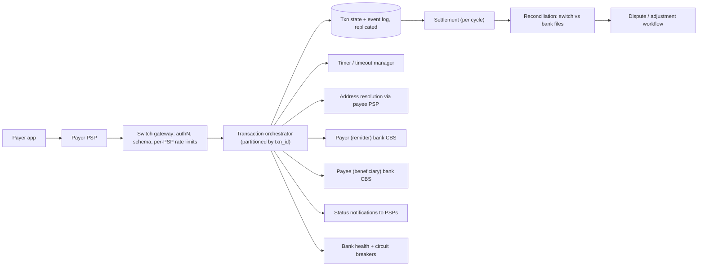
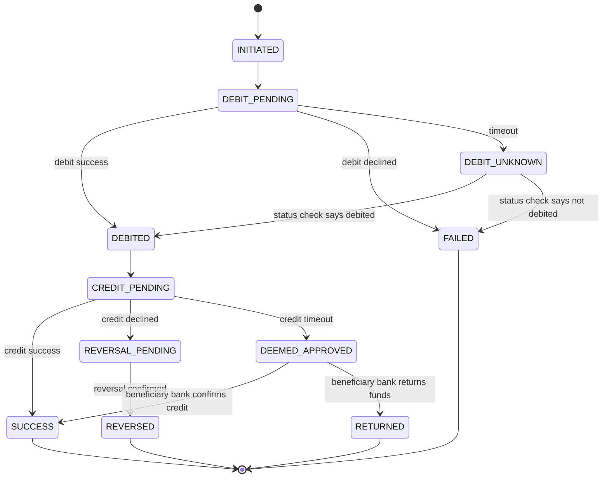

# 08 · UPI-style payment switch

**Prompt.** Design a central real-time payment switch in the style of UPI: payment apps (PSPs) send requests, the switch debits the payer's bank, credits the payee's bank, and every transaction must end in a known, reconciled state, even when a bank does not answer.

**Basis.** Public facts come from NPCI circulars and statistics as reported, and from RBI's turnaround-time and data-storage directions; they are cited below. NPCI's internal architecture is **not public**: the switch design here is **illustrative**. It uses UPI's public vocabulary (pay request, check transaction status, reversal, deemed approval) without claiming to reproduce NPCI's implementation.

**Why it is asked.** Money cannot be "eventually consistent" in the casual sense. The design tests idempotency, the *unknown* outcome after a timeout, retries that do not double-debit, reconciliation, and regulation as a hard requirement.

## 1. Requirements

**Functional**
1. Accept a pay request (payer address → payee address, amount) from a PSP.
2. Resolve the payee's virtual payment address (VPA) to a bank account through the payee's PSP.
3. Orchestrate the **debit** at the payer's bank, then the **credit** at the payee's bank.
4. Return the final status to both PSPs; provide a check-status API.
5. Reverse a debit when the credit definitely failed; handle the case where the credit outcome is unknown.
6. Produce settlement and reconciliation data for every bank, every cycle.

**Non-functional**
- **Timeouts (public):** NPCI circular UPI-OC-No-214-FY-2025-26 (26 April 2025, effective 16 June 2025) cut the response time for pay request/response APIs from 30 s to 15 s, check-transaction-status and reversal APIs from 30 s to 10 s, and validate-address from 15 s to 10 s (as reported by MediaNama).
- **No double debit; no money created.** Every transaction reaches a final state: success, failed, or reversed.
- **Customer protection (public):** RBI's 2019 turnaround-time circular requires that if a UPI fund transfer debits the payer but does not credit the beneficiary, the reversal happens by T+1 day, with ₹100 per day compensation for delay beyond that.
- **Data residency (public):** RBI's 2018 direction requires payment system data to be stored only in India.
- **Availability:** 99.99%+ (illustrative target); planned for the peak, not the average.

**Non-goals:** the PSP apps, bank core systems, fraud models (mentioned only where they touch the switch), dispute portal UI.

## 2. Estimates

From [estimation.md, example 1](../estimation.md#example-1--qps-a-upi-scale-payment-switch):

| Quantity | Value |
|---|---|
| Volume (public) | ~24.07 billion transactions in September 2026 ≈ 802 million/day ≈ 9,300/s average |
| Peak hours (public) | NPCI's 2025 API guidelines define 10:00–13:00 and 17:00–21:30 as peak (as reported) |
| Design peak (assumption) | ~40,000 transactions/s; ~6 switch messages per transaction ≈ 240,000 messages/s |
| Transaction record + message log (assumption) | ~2 KB → ~1.6 TB/day; retained for years |
| In-flight transactions | Little's law: 40,000/s × ~2 s average completion ≈ 80,000 in flight; up to 40,000 × 15 s = 600,000 if banks slow to the timeout limit |

**Decision.** In-flight state can balloon 7× when banks slow down. The switch must hold state for hundreds of thousands of open transactions, time each one out precisely, and shed or reject new load from a PSP or towards a bank that is failing, rather than letting one slow bank consume everything.

## 3. API (simplified)

```text
PayRequest      { txn_id, payer_vpa, payee_vpa, amount, payer_psp, device/risk fields, ts }
  → PayResponse { txn_id, status: SUCCESS | FAILED | PENDING, reason_code }
ValidateAddress { payee_vpa } → { name, account_ref }
CheckStatus     { txn_id } → { status, leg statuses }
Reversal        { txn_id, original_debit_ref }

# Switch → banks
DebitRequest  { txn_id, account, amount }  → DebitResponse  { txn_id, status, bank_ref }
CreditRequest { txn_id, account, amount }  → CreditResponse { txn_id, status, bank_ref }
```

**`txn_id` is the idempotency key** for the whole flow. It is generated by the payer's PSP, globally unique (PSP prefix + time + sequence), and carried to every bank. A repeated `PayRequest` with the same `txn_id` returns the current state; it never starts a second debit. Banks must deduplicate debits by `txn_id` too.

## 4. Data model

| Entity | Key | Fields | Store |
|---|---|---|---|
| `txn` | txn_id | state, payer/payee banks and accounts (tokenised), amount, leg states, bank refs, deadlines, version | Partitioned by hash(txn_id); synchronously replicated within region; replicated to a second Indian site |
| `txn_event` | (txn_id, seq) | every message in and out, with timestamps | Append-only log (immutable, for audit and replay) |
| `timer` | (deadline, txn_id) | next action on timeout | Per partition, in memory, rebuilt from `txn` on failover |
| `bank_health` | bank_id | success rate, latency, technical declines, circuit state | In memory, shared via gossip or a small store |
| `settlement_entry` | (cycle, bank_id, txn_id) | debit/credit amounts | Columnar store / files per cycle |
| `recon_break` | (cycle, txn_id) | type (debit without credit, credit without debit, amount mismatch), resolution | Relational |

## 5. Architecture



**Happy path.** PayRequest → validate, rate-limit per PSP → orchestrator creates `txn` (state `INITIATED`) → resolve payee → `DebitRequest` → bank debits, responds → state `DEBITED` → `CreditRequest` → bank credits → `SUCCESS` → notify both PSPs. Two writes to the replicated state store per leg, so every step survives a crash.

## 6. Deep dives

### 6.1 The state machine and the unknown outcome



Every remote call has **three** outcomes: success, failure, and unknown (timeout). The unknown case is where designs lose money:

- **Debit timeout.** You do not know whether the payer was debited. Never send a second debit. Ask the remitter bank for the status (or send a reversal that the bank applies only if the debit happened). Until resolved, the payer's app shows "pending", not "failed".
- **Credit timeout.** You do not know whether the payee was credited. If you reverse the debit and the credit had in fact happened, money has been created. UPI's public answer, in NPCI circulars since 2017, is **deemed approval**: a credit that times out is treated as approved for settlement, and the beneficiary bank must reconcile and either confirm the credit or return the funds within set timelines. RBI's T+1 reversal rule and compensation then protect the customer if the bank does neither.

### 6.2 Idempotency at every hop

- PSP → switch: `txn_id` uniqueness enforced by a conditional insert in the partition that owns it.
- Switch → bank: the same `txn_id` on debit, credit and reversal; banks must treat a repeated debit with a known `txn_id` as a status query, not a new debit.
- Switch internal: each state transition is a compare-and-set on `version`, so a late bank response for a transaction already timed out does not move it backwards. A late *success* for a `DEBIT_UNKNOWN` transaction is valuable information and resolves it.

### 6.3 Status-check storms and what NPCI did about them

Clients that see "pending" poll. In 2025 NPCI attributed several UPI outages to PSP banks sending check-transaction-status requests "at very high speeds in a repetitive manner" (MediaNama, May 2025). Its directions then required the first status check to wait 90 seconds after the original transaction, and reports describe a cap of three checks within two hours (the exact current timers should be confirmed in the latest NPCI circular). It also capped balance enquiries at 50 per app per customer per day and moved system-initiated traffic such as autopay execution to non-peak hours.

Design lessons for the switch:
1. **Push final status** to PSPs when it is known, so they do not need to poll.
2. **Rate-limit status checks per PSP** at the gateway and answer them from the switch's own state store, never by calling the bank synchronously for each poll.
3. **Prioritise** financial requests over enquiries when overloaded (load shedding by class, as in [case study 02](02_rate_limiter.md)).
4. Treat "retry harder" as an outage cause: retries use exponential backoff with jitter and a budget.

### 6.4 Partitioning, timers and failover

Partition by `hash(txn_id)`: each partition owns its transactions' state, timers and ordering, so no cross-partition locks exist on the hot path. Each partition's state is replicated synchronously to replicas in the same region (one round trip, ~1 ms) and to a second site in India. On failover, the new owner reloads open transactions and re-arms their timers from deadlines stored with each record. Banks are the shared resource: a **per-bank concurrency limit and circuit breaker** stops one slow bank from filling all in-flight slots, and fails fast with a clear "bank unavailable" reason instead of timing out after 15 s.

### 6.5 Settlement and reconciliation

Transactions are settled between banks in net positions per settlement cycle (the switch computes what each bank owes or is owed; money moves through the banks' settlement accounts). Reconciliation is a design component, not an afterthought:

1. Each cycle, compare the switch's log with each bank's records (three-way: switch, remitter, beneficiary).
2. Classify breaks: debit without credit, credit without debit, amount mismatch, unknown `txn_id`.
3. Drive each break to resolution automatically where rules allow (auto-reversal within the RBI T+1 window, beneficiary confirmations or returns for deemed approvals), and to a dispute workflow otherwise.
4. Alert on the *count and value* of open breaks; a dashboard of green API latencies can hide lost money.

## 7. Failure modes

| Failure | Effect | Mitigation |
|---|---|---|
| Remitter bank slow | In-flight state grows; PSP timeouts | Per-bank concurrency cap; circuit breaker; fail fast with a reason code |
| Beneficiary bank times out on credit | Money left the payer, credit unknown | Deemed approval → beneficiary bank confirms or returns; RBI T+1 reversal deadline |
| Orchestrator partition crash | Open transactions paused | Replicated state; new leader re-arms timers from stored deadlines |
| Duplicate PayRequest (PSP retry) | Risk of double debit | `txn_id` conditional insert; return current state |
| Status-check flood | Switch and banks overloaded | Push notifications; per-PSP limits; answer from switch state; minimum wait before first check |
| Site loss | Region-wide outage | Second Indian site with replicated state (data residency); tested failover |
| Reconciliation job fails | Breaks accumulate silently | Alert on job freshness and on open-break value |

## 8. Trade-offs

| Decision | Chosen | Rejected | Why |
|---|---|---|---|
| Credit timeout | Deemed approved, resolved by reconciliation | Auto-reverse the debit | Reversal after an actual credit creates money; customer protected by T+1 rule |
| Consistency | Strong per transaction (single owner partition) | Eventual | Money movement needs a single source of truth per transaction |
| Status | Push + rate-limited pull | Unlimited polling | 2025 outages show polling at scale is a failure mode |
| Topology | Partitioned active-active within India | Single giant database | Throughput and blast radius; regulation forbids leaving India |

## 9. Evolution

- **v1 (small switch):** one relational database with a `txn` table and row-level state transitions; synchronous calls to banks with timeouts; nightly reconciliation.
- **v2:** partitioned orchestrators with replicated state and timers; per-bank circuit breakers; event log; intraday reconciliation.
- **v3:** multi-site active-active within India; push status; class-based load shedding; real-time reconciliation and automated dispute resolution; risk scoring inline within the latency budget.

## 10. What interviewers look for

| Level | Expected |
|---|---|
| New grad | Debit-then-credit flow; a transaction table with states; unique transaction ID |
| SDE-2 | Idempotency key end to end; timeouts; status API; reversal on failed credit |
| Senior | The unknown outcome handled explicitly (deemed approval, no blind retries); status-check storms; per-bank isolation; reconciliation as a component |
| Staff | Regulation as requirements (RBI TAT, data localisation); settlement design; failover with zero data loss; how to roll out timeout changes across hundreds of banks safely |

## References

- UPI volume, September 2026 (NPCI data, as reported) — https://www.outlookmoney.com/banking/upi-processes-2407-billion-transactions-worth-rs-2937-lakh-crore-in-september ; NPCI UPI statistics — https://www.npci.org.in/what-we-do/upi/product-statistics
- MediaNama, NPCI API response-time changes, circular UPI-OC-No-214-FY-2025-26 (Jun 2025) — https://www.medianama.com/2025/06/223-npci-upi-changes-transaction-speed-fraud-prevention/
- MediaNama, NPCI guidelines on UPI API usage (status checks, balance enquiry limits, peak hours) (May 2025) — https://www.medianama.com/2025/05/223-npci-banks-balance-upi-transaction-guidelines/
- NPCI, "Implementation of deemed approved process in UPI" (2017) — https://www.npci.org.in/PDF/npci/imps/circular/2017/IMPS-I-OC-79-I-FY-16-17-I-Implementation-of-deemed-approved-process-in-UPI-&-Segregation-of-UPI-and-IMPS-settlements.pdf ; NPCI OC 93, harmonisation of TAT (2019) — https://www.npci.org.in/PDF/npci/imps/circular/2019/IMPS-UPI-I-OC-93-I-FY-19-20-I-Harmonisation-of-Turn-Around-Time(TAT)-and-customer-compensation-for-failed-transaction.pdf
- RBI, "Harmonisation of Turn Around Time (TAT) and customer compensation for failed transactions" (20 Sep 2019) — https://www.rbi.org.in/Scripts/NotificationUser.aspx?Id=11693
- RBI, "Storage of Payment System Data" (6 Apr 2018) — https://www.rbi.org.in/Scripts/NotificationUser.aspx?Id=11244
- Stripe, "Designing robust and predictable APIs with idempotency" — https://stripe.com/blog/idempotency
- [SWE401 lessons 8.2–8.3, 10.3](../../../03_majors/software_engineering/year_4/SWE401_large_scale_system_design/README.md) · [CS212](../../../02_year_2_core_computer_science/semester_4/CS212_distributed_systems_i/README.md)

_Last reviewed: 2026-10_
