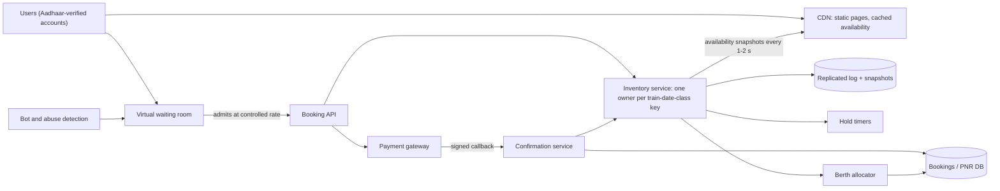

# 09 · Tatkal-style flash booking

**Prompt.** Design a ticket-booking system for a daily flash sale: at exactly 10:00, a small quota of seats on thousands of trains opens, and far more people want them than exist. Booking must be fast, fair, and never oversell.

**Basis.** Public facts: IRCTC's published booking records; the Ministry of Railways' 2025 Tatkal rules (Aadhaar authentication, agent restrictions), as reported by All India Radio's News On AIR. IRCTC and CRIS have not published their system internals, so the architecture is **illustrative**.

**Why it is asked.** It is the purest contention problem in system design: millions of requests for a few hundred rows, in seconds. It tests admission control, inventory locking, holds with expiry, idempotent payment confirmation, and fairness as a requirement.

## 1. Requirements

**Functional**
1. Show availability per train, date, class and quota.
2. Book 1–4 passengers (illustrative limit) on one PNR; allocate berths respecting preferences where possible.
3. Hold seats while the user pays; release them if payment does not complete in time.
4. When confirmed seats run out, issue waitlist numbers in order.
5. Only verified users may book in the opening window.

**Public rules that become requirements.**
- Tatkal booking opens at 10:00 for AC classes and 11:00 for non-AC classes, the day before the journey.
- From 1 July 2025, only Aadhaar-authenticated users can book Tatkal tickets on the IRCTC website and app; from 15 July 2025, counter and agent bookings need an OTP; authorised agents cannot book opening-day Tatkal tickets in the first 30 minutes (10:00–10:30 AC, 11:00–11:30 non-AC). The stated aim is "fair and transparent access" (News On AIR, June 2025).

**Non-functional**
- Never oversell a quota.
- Fairness: arrival order (within measurable precision) or a declared random order; no advantage from automation.
- p99 under 1 s for booking steps for admitted users; the site stays up for everyone else.
- Payment confirmation is idempotent: one payment, one ticket.

**Non-goals:** fare calculation, journey planner, catering, refunds policy.

## 2. Estimates

**Public anchors (IRCTC, checked October 2026):** 30,155 tickets booked in one minute (12 March 2025, at 10:01); 1,85,513 tickets in the 10:00–11:00 Tatkal hour (21 March 2024); 16,17,404 tickets in one day (6 March 2025); about 13.88 lakh e-tickets a day on average in 2024–25; 86.38% of reserved tickets booked online. IRCTC states its system can handle more than 30,000 bookings a minute.

| Quantity | Value |
|---|---|
| Successful bookings at the record minute | 30,155/min ≈ **503/s** |
| Demand in the first 10 s (illustrative, [estimation.md example 6](../estimation.md#example-6--concurrency-and-fleet-size-a-tatkal-style-ticket-opening)) | ~90,000 requests/s; ~18,000 in flight |
| Inventory keys opening at 10:00 (illustrative) | thousands of trains × several AC classes → tens of thousands of (train, date, class, quota) keys |
| Hottest key (illustrative) | a popular overnight train's 3A Tatkal quota: ~100–200 berths, 50,000+ users trying |

**Decision.** The front tier can be scaled with money. A single inventory key receiving 50,000 conflicting updates per second cannot: no database row survives that with locking. The design must (1) admit users at a rate the inventory can process, and (2) process each key's requests serially in memory.

## 3. API

```http
POST /v1/queue/join        { train, date, class }      → { queue_token, position_estimate }
GET  /v1/queue/status      (queue_token)               → { admitted: bool, booking_token? }
GET  /v1/availability?train=..&date=..&class=..        → { available, waitlist_next } (cached, approximate)
POST /v1/bookings          booking_token + Idempotency-Key { passengers[], preferences }
                           → 201 { booking_id, hold_expires_at, fare }  | 409 sold out → waitlist offer
POST /v1/bookings/{id}/payment-callback   (from payment gateway, signed, with payment_id)
GET  /v1/bookings/{id}     → state: HELD | CONFIRMED | WAITLISTED | EXPIRED | FAILED, PNR
```

## 4. Data model

| Entity | Key | Store |
|---|---|---|
| `inventory` | (train, date, class, quota) → confirmed remaining, next waitlist number, version | In-memory owner per key (single writer), backed by a replicated log and snapshot to a relational DB |
| `berth_map` | (train, date, coach) → berth status | Relational; updated by the allocator after the counter grant |
| `hold` | booking_id → key, count, expires_at, state | Same partition as inventory; timer per hold |
| `booking` | booking_id / PNR → passengers, fare, state, payment_id | Relational, partitioned by PNR |
| `payment` | payment_id (gateway) → booking_id, amount, status | Relational; unique on payment_id |
| `queue_token` | token → account, key, issued_at, admitted_at (signed, short TTL) | Stateless signed token + small store |

## 5. Architecture



## 6. Deep dives

### 6.1 Admission control: the virtual waiting room

At 09:59, users who open the booking page join a waiting room instead of hitting the booking API. At 10:00 the room admits users at the rate the inventory and payment tiers can process (for example a few thousand per second), each with a signed, short-lived booking token bound to the account.

**Fairness choice (say it explicitly).**
- *FIFO by arrival at the room:* rewards whoever's request lands first; bots with millisecond timing win.
- *Random order among everyone present before 10:00:00:* removes the incentive to hammer at the exact millisecond; everyone who arrived on time has an equal chance. Users after 10:00 queue behind them.

Either is defensible; the second is more robust against automation. Combine with the public rules: Aadhaar-verified accounts only, agents excluded for 30 minutes, one active booking per account, CAPTCHA or device checks at queue entry rather than at payment (when seconds matter most).

### 6.2 Inventory: single writer per key

A relational row with `SELECT … FOR UPDATE` serialises every booking for a train through lock waits and deadlock detection, at maybe hundreds of operations per second per row. Instead:

- **Partition by key.** Each (train, date, class, quota) is owned by exactly one inventory worker (consistent hashing of keys to workers; ownership through a consensus-backed shard map).
- **Serial in memory.** The owner processes its key's requests from a queue, one at a time: `if remaining ≥ n: remaining -= n; create hold`. In-memory operations take microseconds, so even the hottest key handles tens of thousands per second without locks.
- **Durable before acknowledged.** Each grant is appended to a replicated log (batched every few milliseconds: group commit) before the user is told "held". On owner failure, a replica replays the log and takes over.
- **Two steps.** First grant a *count*; then the berth allocator picks actual berths (preferences, keeping families together) from the berth map. Counting is the contended part; allocation is per booking and parallel.

### 6.3 Holds, payment and the race at expiry

- A hold lasts a fixed window (illustrative: 10 minutes). Timers live with the owner of the key (a timer wheel); expiry returns seats to `remaining`.
- Payment confirmation is idempotent on the gateway's `payment_id` (unique constraint). A duplicate callback returns the existing booking.
- **The race:** payment succeeds just after the hold expired and the seats went to someone else. Options: extend holds slightly beyond the payment page's timeout; on a late success, confirm if seats remain, otherwise issue a waitlist ticket or refund automatically. Choose one and state it; never silently confirm into an oversold train.
- A payment whose status is unknown (gateway timeout) keeps the hold in `PAYMENT_PENDING` until the gateway's status API resolves it, like the unknown outcome in [case study 08](08_upi_style_payment_switch.md).

### 6.4 Availability reads

Most traffic is people refreshing availability. Serve it from snapshots that the inventory owners publish every 1–2 seconds to a cache and CDN, labelled approximate. The authoritative check happens only at booking, inside the owner. This removes most read load from the contended component.

### 6.5 Degraded modes

Hotstar's public lesson from live cricket applies: during the spike, turn off what is not essential (Hotstar switched off recommendations and personalisation to protect streaming and payments). Here: disable booking-history and PNR-status pages for 15 minutes, serve static timetables from the CDN, and reserve capacity for the booking path.

## 7. Failure modes

| Failure | Effect | Mitigation |
|---|---|---|
| Inventory owner crashes | Its keys stall | Replica replays the log and takes ownership within seconds; queued requests retried with the same idempotency key |
| Payment gateway slow | Holds expire; users lose seats after paying | Hold window covers gateway timeout; late-success policy; status polling with backoff |
| Waiting room fails | Unthrottled flood reaches booking | Fail closed (pause admission) rather than open; booking API has its own rate limits |
| Bots | Genuine users lose | Verified accounts only; per-account limits; device and behaviour signals; random-order admission |
| Duplicate booking clicks | Two holds, two payments | Idempotency key per booking attempt; one active booking per account |
| Cached availability wrong | User sees seats that are gone | Labelled approximate; refreshed every 1–2 s; authoritative check at booking |

## 8. Trade-offs

| Decision | Chosen | Rejected | Why |
|---|---|---|---|
| Inventory concurrency | Single writer per key, in memory + log | Row locks in a database | Microseconds per decision instead of lock waits |
| Admission | Waiting room at a controlled rate | Let everyone hit the API | Contention only moves; it does not disappear |
| Fairness | Random among on-time arrivals (or FIFO, stated) | Unstated | Fairness is a requirement, so the rule must be explicit and testable |
| Availability reads | Approximate snapshots | Strongly consistent reads | Reads dominate; correctness enforced at the write |

## 9. Evolution

- **v1:** relational inventory table with row locks; works for a few hundred bookings a minute.
- **v2:** cached availability; holds with TTL; idempotent payment callbacks; rate limiting at the edge.
- **v3:** waiting room; single-writer inventory partitions with replicated logs; berth allocation decoupled; bot defence and verified-account gating; game days rehearsing the 10:00 spike.

## 10. What interviewers look for

| Level | Expected |
|---|---|
| New grad | Booking table; check-then-decrement inside a transaction; awareness of overselling |
| SDE-2 | Holds with expiry; idempotent payment; cached availability; rate limiting |
| Senior | Hot-key analysis with numbers; single-writer inventory; waiting room; the payment-after-expiry race; degraded modes |
| Staff | Fairness definition and its policy consequences; anti-bot strategy tied to identity rules; load-test and game-day plan; operating the 10:00 event every day |

## References

- IRCTC, Internet Ticketing (records and statistics) — https://www.irctc.com/internet-ticketing.php
- News On AIR, "Railways announces new rules for Tatkal tickets; Aadhaar-based OTP authentication must from July 1" (12 Jun 2025) — https://www.newsonair.gov.in/railways-announces-new-rules-for-tatkal-tickets-aadhaar-based-otp-authentication-must-from-july-1
- Hotstar at AWS re:Invent 2019 (graceful degradation), report by Classmethod — https://dev.classmethod.jp/articles/reinvent-2019-cmy302/
- [SWE401 lesson 10.2](../../../03_majors/software_engineering/year_4/SWE401_large_scale_system_design/README.md) · [lld/06_bookmyshow_seat_locking.md](../lld/06_bookmyshow_seat_locking.md)

_Last reviewed: 2026-10_
