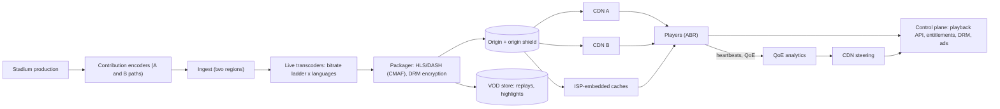

# 10 · Video streaming at live-cricket scale

**Prompt.** Design a streaming platform that serves a live cricket final to tens of millions of concurrent viewers on phones, TVs and browsers, and also serves on-demand video (replays, uploaded videos).

**Basis.** Public sources: JioHotstar's 65.2 million peak concurrent viewers (ICC, March 2026); Hotstar's 2019 AWS re:Invent talk on serving 25.3 million concurrent viewers (as reported by Classmethod); YouTube's 2021 post on its video transcoding chip; Netflix's Open Connect pages; the HLS specification (RFC 8216). Where these sources stop, the design is **illustrative**.

**Why it is asked.** Video looks like "put files on a CDN". At live-event scale the hard parts are distribution capacity measured in tens of terabits, a control plane that gets millions of requests per second when a wicket falls, and choosing what to switch off when things go wrong.

## 1. Requirements

**Functional**
1. Live: ingest the broadcast feed, encode it at several quality levels (bitrate ladder) with multiple commentary languages, and deliver it with adaptive bitrate (ABR) playback.
2. Entitlements: free and subscription tiers, device limits, DRM for premium content.
3. On-demand: highlights and full replays minutes after the event; user uploads (YouTube-style) in the VOD path.
4. Live scorecard and concurrency display; server-side ad insertion in breaks.

**Non-functional**
- Glass-to-glass latency: 15–30 s for standard live HLS/DASH, lower for a low-latency mode.
- Start-up time under 2 s; rebuffering ratio under 0.5% (illustrative targets).
- Survive growth of more than 1 million viewers per minute (Hotstar reported "1M+" per minute in 2019).
- No single CDN, region or encoder failure stops the stream.

**Non-goals:** content recommendation (see [case study 13](13_recommendation_system.md)), billing.

## 2. Estimates

From [estimation.md, example 3](../estimation.md#example-3--bandwidth-live-cricket-streaming):

| Quantity | Value | Basis |
|---|---|---|
| Peak concurrent viewers | 65.2 million | ICC media release, 5 Mar 2026 match |
| Egress | ~26–98 Tbps depending on bitrate mix | 2019 ratio (~0.4 Mbps per viewer) vs assumed 1.5 Mbps |
| Edge HTTP requests | ~22 million/s (segment + playlist every 6 s) | Arithmetic |
| Control-plane API peak | "1M+" requests/s at 25.3 million viewers in 2019 | Hotstar talk, as reported |
| Uploads (VOD side, YouTube) | "more than 500 hours of video" uploaded every minute | YouTube, 2021 |

**Decision.** Encoding a live feed is a small, fixed cost (one ladder per language). Distribution and the control plane scale with viewers. Most design effort goes to CDN capacity, origin protection, and APIs that must absorb synchronised spikes.

## 3. API

```http
POST /v1/playback/start   { content_id, device_id }  → { manifest_url (signed, CDN-specific), drm_license_url, session_token }
POST /v1/playback/heartbeat { session_token, position, bitrate, rebuffer_ms }   every 30–60 s
GET  /v1/score/{match_id}  → cached JSON, TTL 2–5 s at the CDN
GET  {manifest_url}        → HLS master playlist → media playlists → segments (CDN)
POST /v1/drm/license       → license (rate-limited, cached per session)
```

## 4. Data model

| Entity | Key | Store |
|---|---|---|
| `content` | content_id → type (live / VOD), renditions, languages, DRM policy | Relational + cache |
| `entitlement` | user_id → plan, devices, expiry | Key-value; tokens cached on device for the session |
| `session` | session_token → user, device, CDN, start, last heartbeat | In-memory store with TTL (for concurrency limits and counts) |
| `segment` | (content, rendition, sequence) → bytes | Origin storage (object store / packager cache) and CDN caches |
| `qoe_event` | heartbeats | Stream → real-time analytics for CDN steering |

## 5. Architecture



## 6. Deep dives

### 6.1 Segments, ABR and latency

The packager cuts each rendition into segments described by playlists (HLS, RFC 8216; or DASH). Players pick a rendition per segment based on measured throughput.

| Segment length | Latency | Requests per viewer | CDN efficiency |
|---|---|---|---|
| 6 s | ~3 segments buffered → ~20–30 s behind live | 1 per 6 s | High |
| 2 s | ~6–10 s | 3× more | Lower; more playlist refreshes |
| Low-latency HLS partial segments | ~2–5 s | Many more, with blocking playlist reloads | Needs CDN support |

For a national cricket audience, many platforms prefer stability (6 s segments) over the last few seconds of latency; offer a low-latency mode only where the CDN and devices support it. Mention the spoiler effect: neighbours on different platforms cheer at different times.

### 6.2 Distribution: multi-CDN, shield, ISP caches

- **Capacity is reserved, not discovered.** At tens of Tbps, buy commitments from several CDNs and steer traffic by real-time quality (heartbeat data) and remaining capacity.
- **Origin shield and request collapsing** so that a new segment requested by millions of viewers at the same instant becomes one origin fetch per CDN tier.
- **Manifests** change every segment: cache them for a fraction of the segment duration; segments themselves are immutable and cache well.
- **ISP-embedded caches** move bytes closer to users and off transit links; Netflix's Open Connect gives appliances to qualifying ISPs at no charge and fills them before demand. Live content cannot be pre-filled, but embedded caches still serve each segment once per ISP site instead of once per viewer.

### 6.3 The control plane is where it breaks

Video bytes come from caches; logins, entitlement checks, playback-URL signing, DRM licences and ad decisions come from your servers. Spikes are synchronised: the toss, a wicket, the innings break, a push notification sent to everyone. Hotstar's 2019 talk (as reported) described:

- **Autoscaling too slow and capacity-limited:** "insufficient capacity" errors from the cloud provider and a 90-second reaction time; the answer was to **pre-warm** capacity before match time, use fully baked machine images, and scale on request rate or platform concurrency rather than CPU.
- **Load testing at match scale:** an internal tool ("Project HULK") generating load from 108,000 CPUs across 8 regions with 200 Gbps of outbound network; the load generation itself once caused an outage, because cloud networks are shared.
- **Chaos scenarios:** push-notification bursts, "tsunami" traffic, delayed scale-up, bandwidth limits, CDN failure.
- **Panic mode:** switch off recommendations and personalisation to protect the critical paths (streaming and subscriptions). Graceful degradation is a designed feature.

Design consequences: playback-start must be cacheable or cheap (signed URLs generated with local keys, entitlement tokens cached on device for the session); heartbeats are sampled and batched; ad decisioning has a strict timeout and falls back to content; DRM licences are cached per session; push notifications are staggered.

### 6.4 The on-demand and upload path

Uploads land in object storage, then a transcoding pipeline produces the ladder in several codecs, thumbnails and captions. Codec choice is a compute-versus-bandwidth trade: YouTube reported that VP9 takes about 5× the compute of H.264 to encode for better quality per bit, and built a custom Video (trans)Coding Unit that gave "up to 20–33x improvements in compute efficiency" over its previous software system (2021). A practical rule (illustrative): encode every upload cheaply first so it is watchable quickly, then re-encode popular videos with more efficient codecs, because bandwidth saved scales with views.

### 6.5 Counting concurrent viewers

Each session sends a heartbeat every 30–60 s; per-region aggregators count active sessions over a sliding window and publish a total every few seconds. The displayed number is approximate by design; device-limit enforcement uses the session store directly.

## 7. Failure modes

| Failure | Effect | Mitigation |
|---|---|---|
| One CDN degrades | Rebuffering for its share of viewers | Steering moves traffic within seconds using QoE data; players can fail over between CDN URLs |
| Encoder or ingest path fails | Stream stops | Two independent paths (A/B) in two regions; packager switches inputs |
| Origin overloaded by misses | All CDNs suffer | Shield tier; request collapsing; longer segment TTLs |
| Login / entitlement API overloaded at the toss | Users cannot start playback | Pre-scaling; cached entitlements; panic mode; queue new logins with a friendly wait screen |
| DRM licence server slow | Premium streams fail to start | Licence caching per session; separate capacity pool; rate limits |
| Ad server slow | Breaks stall | Hard timeout; play the stream or a slate instead |

## 8. Trade-offs

| Decision | Chosen | Rejected | Why |
|---|---|---|---|
| Latency vs stability | 6 s segments by default, low-latency mode opt-in | Low latency for all | Fewer requests, better caching, fewer stalls at national scale |
| Scaling | Pre-provisioned for forecast peak | Reactive autoscaling | Spikes arrive faster than instances boot |
| CDN | Multi-CDN with steering | Single CDN | Capacity and failure isolation at tens of Tbps |
| Features under stress | Designed panic mode | All features always on | Protects playback and payments |

## 9. Evolution

- **v1:** VOD only: object storage + one CDN + HLS from a cloud transcoding service.
- **v2:** live pipeline with redundant ingest; ABR ladder; DRM; single CDN with shield; load tests.
- **v3:** multi-CDN steering by QoE; ISP-embedded caches; panic modes; pre-warming from forecasts; game days before every big match.

## 10. What interviewers look for

| Level | Expected |
|---|---|
| New grad | Upload → transcode → store → CDN; knows what adaptive bitrate is |
| SDE-2 | Segments and playlists; bandwidth estimate; CDN caching of segments vs manifests |
| Senior | Egress maths with a sourced anchor; origin shield and collapsing; control-plane spikes; pre-scaling vs autoscaling; degradation plan |
| Staff | Multi-CDN commercial and technical strategy; cost per viewer-hour; event-day operations (load tests, game days, runbooks); codec economics |

## References

- ICC media release, JioHotstar concurrency record (Mar 2026) — https://www.icc-cricket.com/media-releases/icc-men-s-t20-world-cup-2026-sets-new-global-streaming-record-on-jiohotstar-during-india-england-semi-final
- Classmethod, report of Hotstar's AWS re:Invent 2019 talk CMY302 — https://dev.classmethod.jp/articles/reinvent-2019-cmy302/ ; Rootconf 2019 talk abstract, "Scaling hotstar.com for 25 million concurrent viewers" — https://hasgeek.com/rootconf/2019-hyderabad/proposals/scaling-hotstar-com-for-25-million-concurrent-view-Rv8Zg2e4me4TQ7s8ThHSjS
- YouTube Official Blog, post on YouTube's Video (trans)Coding Unit (21 Apr 2021) — https://blog.youtube/inside-youtube/new-era-video-infrastructure/
- Netflix Open Connect — https://openconnect.netflix.com/en/
- RFC 8216, HTTP Live Streaming — https://www.rfc-editor.org/rfc/rfc8216
- [BE402 chapters 6 and 10](../../../03_majors/backend_engineering/year_4/BE402_scalability_and_performance_caching_sharding/README.md)

_Last reviewed: 2026-10_
