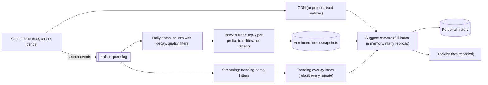

# 11 · Search autocomplete

**Prompt.** Design the suggestion box under a search bar: as the user types, show the 10 most useful completions within a fraction of a second. Support trending queries and Indian languages typed in Latin script.

**Basis.** Illustrative design. Techniques referenced (tries, finite-state transducers in Lucene, count-min sketch) are public and cited; no company's production autocomplete is described.

**Why it is asked.** The read path is tiny and must be extremely fast, so the interesting work is offline: how suggestions are built, ranked, refreshed and filtered. It also tests client-side thinking (debouncing, caching) that pure backend answers miss.

## 1. Requirements

**Functional**
1. Return up to 10 completions for a prefix, ranked by popularity with recency.
2. Trending queries appear within ~15 minutes.
3. Support Hindi and other Indian languages, including Latin-script typing ("dilli" → "दिल्ली") and native scripts.
4. Tolerate one typo for prefixes of 4+ characters.
5. Never suggest blocked or unsafe completions; remove a suggestion everywhere within minutes on request.
6. Light personalisation (the user's own recent searches first).

**Non-functional**
- End-to-end under ~100 ms at p99 so it feels instant; server budget under 20 ms.
- Availability 99.9% (search still works without suggestions).
- Cheap: this runs on every keystroke.

**Non-goals:** the search results page itself, spelling correction of full queries.

## 2. Estimates (illustrative)

| Quantity | Value |
|---|---|
| Searches | 100 million/day |
| Suggestion requests | ~4 per search after client debouncing → 400 million/day ≈ 4,600/s average, ~15,000/s peak |
| Distinct queries kept (after pruning rare ones) | 100 million |
| Average query length | 20 characters (Indic scripts: 3 bytes per character in UTF-8) |
| Distinct prefixes (shared prefixes collapse) | ~600 million (**rough**: ~30% of 2 billion prefix positions) |
| Precomputed top-10 per prefix | 10 × 4-byte query IDs + ~20-byte key ≈ 60 B → **~36 GB** |

**Decision.** 36 GB fits in memory on one large server. So do **not** shard by prefix (hot prefixes like "a" would overload one shard); **replicate** the whole index to every serving node and scale reads by adding replicas. 15,000/s across a dozen replicas is trivial.

## 3. API

```http
GET /v1/suggest?q=dill&lang=hi-Latn&limit=10&session=...
→ 200 { "prefix": "dill", "suggestions": [ {"text": "दिल्ली मेट्रो", "type": "query"}, {"text": "dilli haat", "type": "query"}, ... ] }
Cache-Control: public, max-age=300     # for unpersonalised prefixes
```

**Client rules.** Debounce keystrokes (~100–150 ms); cancel the in-flight request when a new key arrives; cache responses per prefix in the session; if the user types "delh" after "del", filter the cached "del" list locally before the server answers.

## 4. Data model

| Item | Content | Where |
|---|---|---|
| Query log | (timestamp, normalised query, language, region, clicked?) | Kafka → data lake |
| Query stats | query → decayed count, click-through, last seen | Batch tables, rebuilt daily |
| Trending counts | query → count in last 15 min (approximate) | Streaming job state (count-min sketch + heap) |
| Suggestion index | prefix → top-k query IDs + query dictionary | Immutable snapshot (trie or FST), loaded into memory |
| Blocklist | patterns and exact queries | Small, versioned; applied at build and at serve time |
| Personal history | user → last 50 queries | Key-value store or on device |

## 5. Architecture



## 6. Deep dives

### 6.1 Data structure

- **Trie with top-k at each node.** Walk the prefix (O(length)), read a precomputed list. Fast but memory-heavy if built naively with pointers.
- **Finite-state transducer (FST).** Lucene stores its suggester dictionaries as FSTs, which share both prefixes and suffixes and are far more compact than a pointer trie; Elasticsearch's completion suggester is built on this. Good for an immutable, rebuilt-periodically index.
- **Sorted array of queries + range lookup.** All queries sorted; a prefix is a contiguous range found by binary search; top-k in the range via a precomputed range-maximum structure. Simple and compact.

Any of these is fine if you explain the memory estimate and why the index is immutable and swapped atomically (build offline, ship a snapshot, flip a pointer).

### 6.2 Ranking

Score = popularity with time decay (for example, exponentially decayed counts with a half-life of a week) × quality signals (did people click results after this query?) + a boost for the user's own recent queries + locale match. Precompute the top 10–50 per prefix offline; at serve time merge personal history and trending overlay into that list and re-rank cheaply.

### 6.3 Freshness: trending overlay

A daily rebuild misses breaking news. A streaming job counts queries over the last 15 minutes. Exact counts for every query are expensive; a **count-min sketch** (Cormode and Muthukrishnan, 2005) gives approximate counts in fixed memory, and a heap keeps the heavy hitters. Every minute, queries whose recent rate far exceeds their baseline go into a small overlay index merged at serve time. Trending suggestions pass the same safety filters, plus a minimum distinct-user threshold so a few accounts cannot manufacture a trend.

### 6.4 Indian languages and transliteration

Users type Hindi, Bengali or Tamil words in Latin script with inconsistent spellings ("dilli", "delhi", "dehli"). At build time, generate Latin-script variants for native-script queries with a transliteration model and index them under the same query ID; normalise Unicode (NFC) and strip diacritics for matching. Remember UTF-8 sizes: Indic characters take 3 bytes, so a byte-length limit truncates Hindi queries three times sooner than English ones; limit by characters.

### 6.5 Safety and takedowns

Filter at build time (blocklists, classifiers, human review for high-traffic suggestions) **and** at serve time (a small blocklist hot-reloaded on every server), because a rebuild takes hours and a harmful suggestion must disappear in minutes. Log every takedown with a reason.

## 7. Failure modes

| Failure | Effect | Mitigation |
|---|---|---|
| Bad index build (empty, corrupted, unfiltered) | Wrong or harmful suggestions everywhere | Validate snapshot (size, sample queries, blocklist test) before rollout; canary replicas; instant rollback to previous version |
| Suggest servers down | Empty suggestion box | Search still works; client hides the box after a timeout |
| Trending manipulated | Abusive suggestion trends | Distinct-user thresholds, rate limits, classifiers, human review |
| Hot prefix overload | Latency spikes | Full replication; CDN caching for unpersonalised prefixes |
| Streaming job lag | Stale trending | Overlay simply ages out; base index unaffected |

## 8. Trade-offs

| Decision | Chosen | Rejected | Why |
|---|---|---|---|
| Scaling | Replicate the whole index | Shard by prefix | Index fits in memory; avoids hot shards |
| Computation | Precompute top-k offline | Compute at query time | Server budget < 20 ms |
| Freshness | Daily base + per-minute overlay | Continuous full rebuild | Cheap, safe, and fresh enough |
| Personalisation | Light merge at serve time | Per-user indexes | Cost and privacy |

## 9. Evolution

- **v1:** SQL `LIKE 'prefix%'` on a popular-queries table with an index, cached. Fine for small catalogues (station names).
- **v2:** offline-built in-memory trie or FST, replicated; client debouncing; CDN caching.
- **v3:** trending overlay; transliteration variants; learned ranking from click data; safety pipeline with human review.

## 10. What interviewers look for

| Level | Expected |
|---|---|
| New grad | Trie with top-k; a query-count table |
| SDE-2 | Offline build and online serving split; memory estimate; client debouncing and caching |
| Senior | Replicate-vs-shard argument; trending with approximate counting; safe rollout of index snapshots; multilingual handling |
| Staff | Abuse and policy process; experiment design for ranking; cost per million suggestions |

## References

- Elasticsearch, completion suggester — https://www.elastic.co/guide/en/elasticsearch/reference/current/search-suggesters.html
- Michael McCandless, "Using Finite State Transducers in Lucene" (2010) — https://blog.mikemccandless.com/2010/12/using-finite-state-transducers-in.html
- Cormode and Muthukrishnan, "An Improved Data Stream Summary: The Count-Min Sketch and its Applications" (Journal of Algorithms, 2005) — https://doi.org/10.1016/j.jalgor.2003.12.001
- Unicode Standard Annex #15, Unicode Normalization Forms — https://unicode.org/reports/tr15/
- [SWE401 lesson 7.2](../../../03_majors/software_engineering/year_4/SWE401_large_scale_system_design/README.md)

_Last reviewed: 2026-10_
