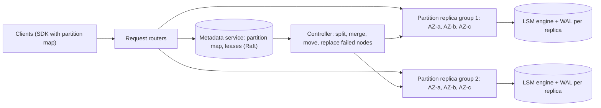

# 12 · Distributed key-value store

**Prompt.** Design a key-value store that scales to petabytes and millions of operations per second, survives machine and zone failures, and offers both fast eventually consistent reads and strongly consistent operations.

**Basis.** Two public designs anchor this case: Amazon's Dynamo paper (SOSP 2007: leaderless, consistent hashing, sloppy quorums) and the DynamoDB paper (USENIX ATC 2022: per-partition replication groups with Multi-Paxos, 89.2 million requests/s at peak during Prime Day 2021). The sizing below is illustrative.

**Why it is asked.** It is "CS212 as an interview": partitioning, replication, quorums, failure detection, repair and storage engines, with real trade-offs between two published designs.

## 1. Requirements

**Functional**
1. `put(key, value)`, `get(key)`, `delete(key)`; keys up to 1 KB, values up to 400 KB (illustrative limits).
2. Conditional write: `put if version == v` (compare-and-set).
3. Per-request read consistency: eventual (cheaper) or strong.
4. Optional TTL per item.

**Non-functional**
- p99 latency under 10 ms in a region for single-key operations.
- Durability: a write is acknowledged only after it is on disk on at least 2 of 3 replicas in different availability zones.
- Availability 99.99%; the loss of one zone is invisible to clients.
- Elastic: add capacity and rebalance online without downtime.

**Non-goals:** multi-key transactions, secondary indexes, SQL, cross-region replication (v3).

## 2. Estimates (illustrative)

| Quantity | Value |
|---|---|
| Operations | 10 million/s at peak, 90% reads |
| Average item | 1 KB |
| Data | 500 TB logical → 1.5 PB with 3 replicas |
| Node (NVMe) | 8 TB usable, kept ≤ 50% full for compaction and rebalancing headroom → 4 TB of data per node |
| Nodes | 1.5 PB ÷ 4 TB ≈ **375** (+ spares) |
| Load per node | 10 million ÷ 375 ≈ 27,000 ops/s (reads hit page cache or one SSD read ≈ 100 µs) |
| Network per node | ~27,000 × 1 KB ≈ 27 MB/s client traffic, plus replication and compaction |

**Decision.** Per-node load is comfortable; the hard parts are keeping it *even* (hot partitions), moving data safely when nodes join or fail, and tail latency during compaction and repair.

## 3. API

```text
Get(key, consistency = EVENTUAL | STRONG)          → {value, version} | NOT_FOUND
Put(key, value, ttl?, if_version?)                  → {version} | CONDITION_FAILED
Delete(key, if_version?)                            → ok | CONDITION_FAILED
```

Versions are returned on every read so clients can do optimistic concurrency.

## 4. Data model and storage engine

- **Logical:** opaque key → (value, version, expiry). Partition = range or hash bucket of keys.
- **On each replica: an LSM tree** (as in RocksDB, Cassandra, ScyllaDB). Writes go to a write-ahead log (fsync, batched) and an in-memory table; full tables flush to immutable sorted files; background **compaction** merges files and drops overwritten and expired items. Reads check memory, then files newest-first, using **Bloom filters** to skip files without the key.
- **Why LSM over B-tree here:** sequential writes and good compression for a write-heavy, key-lookup workload. **Cost:** write amplification from compaction, and read amplification without good Bloom filters; compaction competes with foreground traffic for disk.
- **Deletes are tombstones** until compaction removes them; a replica that misses a delete and is repaired later can resurrect data unless tombstones are kept longer than the repair window.

## 5. Architecture



## 6. Deep dives

### 6.1 Partitioning

| | Hash ring with virtual nodes (Dynamo) | Range partitions with split/merge (DynamoDB, Bigtable, CockroachDB) |
|---|---|---|
| Placement | `hash(key)` on a ring; each node owns many small virtual ranges | Sorted key ranges; a range splits when it grows too big or too hot |
| Balance | Statistical; virtual nodes smooth it | Explicit: split by size *or* load |
| Range scans | Not supported efficiently | Natural |
| Metadata | Small (ring tokens), can be gossiped | A partition map kept in a consensus-backed metadata service |

Choose range partitions with load-based splitting if you want hot-spot handling and scans; choose the ring for simplicity and no central metadata. The DynamoDB paper describes splitting partitions by load and adaptive capacity to cope with uneven access.

### 6.2 Replication: leaderless quorums or a leader per partition

**Leaderless (Dynamo, Cassandra).** N = 3 replicas; a write succeeds after W acknowledgements, a read after R responses. If R + W > N (for example W = 2, R = 2), every read overlaps the latest successful write. When a replica is down, Dynamo writes to the next healthy node with a **hint** (sloppy quorum, hinted handoff) and replays it later. Divergent replicas are repaired by **read repair** and by **anti-entropy** using Merkle trees, which find differing key ranges by exchanging hashes. Concurrent writes create conflicts, resolved with vector clocks (Dynamo returned siblings to the application) or last-writer-wins by timestamp (simpler, but silently drops one write).

**Leader per partition (DynamoDB per its 2022 paper; TiKV, CockroachDB).** Each partition's replicas form a consensus group (Multi-Paxos or Raft). The leader orders writes, replicates to a majority, and serves strongly consistent reads; followers can serve eventually consistent reads. Leader failure triggers an election (a few seconds of unavailability for that partition's writes).

| | Leaderless quorum | Leader + consensus |
|---|---|---|
| Write availability during failures | Higher (any W nodes, sloppy quorum) | Needs a majority and a leader |
| Strong reads and compare-and-set | Hard (Cassandra uses a separate Paxos path for lightweight transactions) | Natural on the leader |
| Conflicts | Possible; app or LWW resolves | None: single order per partition |
| Tail latency | Second-fastest of three replicas; can hedge | Leader's latency; leader hot spots |

For the requirements here (compare-and-set and strong reads), the **leader-per-partition** design is the better fit; say why.

### 6.3 Quorum latency arithmetic

With W = 2 of 3, a write waits for the second-fastest replica, so one slow replica does not hurt the p99. With W = 3 it waits for the slowest, and the p99 becomes the p99 of the worst of three disks. Cross-zone round trips inside a region add ~0.5–2 ms, which is why replicas sit in three zones of one region, not across regions.

### 6.4 Failure detection, membership and rebalancing

- **Detection:** heartbeats with a suspicion threshold (phi-accrual in Cassandra) or leases from the metadata service. Avoid flapping: declare a node dead only after sustained silence, and treat "slow" as a separate state.
- **Replacing a node:** the controller picks new replicas for each affected partition and streams data from a healthy replica, throttled so repair traffic does not hurt client latency.
- **Adding capacity:** move whole partitions (or virtual nodes) to new machines; never rehash everything.

### 6.5 Hot keys

A single key can exceed one partition's capacity (DynamoDB documents 3,000 reads and 1,000 writes per second per partition). Options: cache hot keys in front, read from followers for eventual reads, split a hot *range* by load, and for write-hot keys ask the application to shard the key (`counter#0..#9`) and sum on read.

## 7. Failure modes

| Failure | Effect | Mitigation |
|---|---|---|
| One node down | Its partitions lose a replica | Writes continue on 2 of 3; controller re-replicates within minutes |
| Zone down | One replica of every partition gone | Placement across 3 zones; quorums still met |
| Leader stuck but alive (GC pause) | Writes stall; split-brain risk | Leases with expiry; fencing on epoch numbers |
| Compaction backlog | Read amplification; p99 rises | Rate-limit writes per partition; capacity headroom; monitor pending compaction bytes |
| Metadata service outage | No routing changes | Routers cache the partition map; data path keeps working |
| Tombstone resurrection after long partition | Deleted data returns | Repair interval shorter than tombstone grace period |

## 8. Trade-offs

| Decision | Chosen | Rejected | Why |
|---|---|---|---|
| Replication | Leader per partition with consensus | Leaderless quorums | Compare-and-set and strong reads required |
| Partitioning | Ranges with load-based split | Hash ring | Hot-spot handling; future range scans |
| Engine | LSM | B-tree | Write-heavy key lookups; compression |
| Placement | 3 zones, 1 region | Cross-region sync | Latency; cross-region done asynchronously in v3 |

## 9. Evolution

- **v1:** a single RocksDB process with replication to a standby (primary-backup).
- **v2:** partitioned, 3-zone replica groups with Raft; metadata service; online splits and moves.
- **v3:** adaptive capacity for hot partitions; global tables with asynchronous cross-region replication and a conflict policy; backups and point-in-time restore from WAL archives.

## 10. What interviewers look for

| Level | Expected |
|---|---|
| New grad | Hash partitioning; replication for durability; a get/put API |
| SDE-2 | Consistent hashing with virtual nodes; quorum R + W > N; node failure handling |
| Senior | Leaderless vs leader-based trade-off tied to requirements; LSM internals and compaction; repair and tombstones; hot partitions |
| Staff | Operability (rebalancing safety, upgrades, backups), cost per GB and per million ops, blast radius (cells), and what *not* to offer (multi-key transactions) and why |

## References

- DeCandia et al., "Dynamo: Amazon's Highly Available Key-value Store" (SOSP 2007) — https://www.allthingsdistributed.com/files/amazon-dynamo-sosp2007.pdf
- Elhemali et al., "Amazon DynamoDB: A Scalable, Predictably Performant, and Fully Managed NoSQL Database Service" (USENIX ATC 2022) — https://www.usenix.org/conference/atc22/presentation/elhemali
- AWS, DynamoDB partition throughput limits — https://docs.aws.amazon.com/amazondynamodb/latest/developerguide/bp-partition-key-design.html
- Ongaro and Ousterhout, Raft (2014) — https://raft.github.io/raft.pdf
- Apache Cassandra documentation (architecture, lightweight transactions) — https://cassandra.apache.org/doc/latest/
- RocksDB wiki (LSM, compaction, Bloom filters) — https://github.com/facebook/rocksdb/wiki
- [CS211](../../../02_year_2_core_computer_science/semester_4/CS211_database_systems_internals/README.md) · [CS212](../../../02_year_2_core_computer_science/semester_4/CS212_distributed_systems_i/README.md) · [CSG303](../../../03_majors/computer_science_general/year_3/CSG303_distributed_systems_ii_consensus_replication/README.md)

_Last reviewed: 2026-10_
