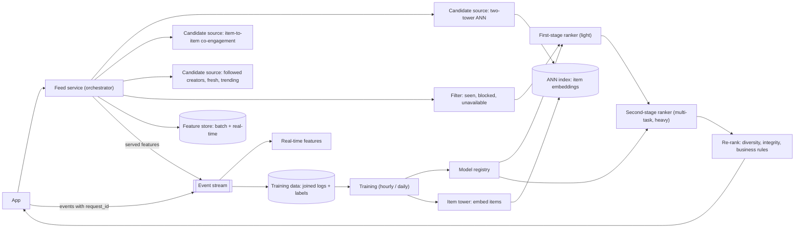

# 13 · Recommendation system: candidate generation and ranking

**Prompt.** Design the personalised home feed of a large content or shopping app: every time the user opens it, return a ranked page of items (videos, posts or products) from a catalogue of a hundred million.

**Basis.** The multi-stage pattern is public: YouTube's "Deep Neural Networks for YouTube Recommendations" (RecSys 2016) split candidate generation from ranking; Meta's 2023 post on Instagram Explore describes retrieval, a two-tower first-stage ranker, a multi-task second-stage ranker and a final re-ranking. The sizing and the specific architecture below are **illustrative**. The ML depth (losses, features, evaluation) is taught in [MLE302](../../../03_majors/machine_learning_engineering/year_3/MLE302_machine_learning_system_design/README.md) and [MLE403](../../../03_majors/machine_learning_engineering/year_4/MLE403_ranking_and_recommendation_systems_at_scale/README.md).

**Why it is asked.** It is the standard ML system design prompt. It tests the funnel (why you cannot score every item), latency budgets, feature freshness, logging for training, feedback loops, and evaluation.

## 1. Requirements

**Functional**
1. Return 50 ranked items per page; more pages on scroll.
2. Exclude items already seen, blocked creators, unavailable products.
3. New items become recommendable within an hour; new users get sensible results on their first session.
4. Diversity: no more than 2 consecutive items from the same creator or category.
5. Log every impression and interaction for training.

**Non-functional**
- Server latency p99 under 200 ms for the whole funnel.
- 100 million daily active users; 100 million items.
- Models retrained at least daily; lightweight models updated hourly.
- Business metric agreed up front (for example long-term retention or satisfied watch time, not raw clicks).

**Non-goals:** search ranking, ads auction (they reuse the same infrastructure).

## 2. Estimates (illustrative)

| Quantity | Value |
|---|---|
| Feed requests | 100 million DAU × 10 = 1 billion/day ≈ 11,600/s average, ~35,000/s peak |
| Retrieval | ~5,000 candidates per request from several sources |
| First-stage scoring (two-tower dot products, 64 dims) | 35,000 × 5,000 = 175 million dot products/s ≈ 22 GFLOP/s (cheap) |
| Second-stage scoring (heavy model) | top 500 → 35,000 × 500 = **17.5 million model inferences/s** (the cost centre) |
| Item embeddings for ANN | 100 million × 64 × 4 bytes ≈ 26 GB (fits in memory per replica) |
| Impression logs | 1 billion × 50 = 50 billion impressions/day × ~100 bytes ≈ 5 TB/day |

**Decision.** You cannot run the heavy model on 100 million items, or even on 5,000. The funnel exists because each stage is ~10–100× more expensive per item than the previous one, and must cut the candidate set by a similar factor.

## 3. API

```http
GET /v1/feed/home?cursor=..&context=app_open&device=android
→ { request_id, items: [{item_id, reason, position}], next_cursor }

POST /v1/events   [{request_id, item_id, position, event: impression|click|watch|like|hide, value, ts}]
```

The `request_id` ties every later interaction back to the exact model versions and features used for that response; without it you cannot build training data or debug.

## 4. Data model

| Data | Key | Store | Freshness |
|---|---|---|---|
| User features (long-term) | user_id | Online feature store (key-value) | Daily batch |
| User features (real-time: last 50 interactions, session) | user_id | In-memory store fed by stream | Seconds |
| Item features + counters | item_id | Online feature store | Minutes |
| Item embeddings | item_id → vector | ANN index (HNSW/IVF), replicated | Rebuilt daily, new items added incrementally |
| Seen set | user_id → recent item IDs (Bloom filter or capped list) | Key-value | Seconds |
| Logged features | request_id → features as served | Log → data lake | Used for training |

## 5. Architecture



## 6. Deep dives

### 6.1 The funnel

| Stage | Items in → out | Model | Budget (of ~200 ms) |
|---|---|---|---|
| Retrieval (several sources in parallel) | 100 million → ~5,000 | Two-tower ANN, co-engagement, heuristics | 30–40 ms |
| Filtering | 5,000 → ~3,000 | Bloom filters, rules | 5 ms |
| First-stage ranking | 3,000 → 500 | Two-tower or small model | 20 ms |
| Second-stage ranking | 500 → 100 | Multi-task network predicting P(click), P(like), P(watch long), P(hide) | 60–80 ms |
| Re-ranking | 100 → 50 | Rules and diversity | 5 ms |

Instagram Explore's published funnel follows the same shape: candidate sources select "hundreds of relevant items from a media pool of billions", a two-tower first stage handles thousands, and a heavier multi-task multi-label model scores the "100 best candidates from the first stage". YouTube's 2016 paper similarly narrowed "millions" of videos to "hundreds" in candidate generation before ranking.

### 6.2 Two-tower retrieval

A user tower turns user features into a vector; an item tower turns item features into a vector; the score is their dot product. Because item vectors do not depend on the user, they are computed offline (Instagram reports generating item embeddings daily and serving them through an approximate-nearest-neighbour service) and indexed with HNSW or IVF ([building_blocks.md §16](../building_blocks.md#16-vector-databases)). At request time only the user tower runs, then one ANN query returns the nearest items. New items get embeddings as soon as they are created, so they are retrievable within the hour.

### 6.3 Combining predictions: the value model

The heavy ranker predicts several outcomes. A **value model** combines them into one score, for example (Instagram's published form) `W_click × P(click) + W_like × P(like) − W_see_less × P(see less) + …`. The weights encode product priorities and are tuned by online experiments, not by offline accuracy. Say this explicitly: choosing the weights is a product decision with consequences (clickbait, creator incentives).

### 6.4 Training data and skew

- **Log features at serving time** with the request ID, and train on exactly those. Recomputing features later from tables leaks future information and causes training–serving skew.
- **Labels arrive late** (a purchase days after the click); join with a window and handle delayed labels.
- **Position bias:** items shown higher get more clicks regardless of quality; include position as a training feature and set it to a constant at serving, or use randomised exploration slots.
- **Feedback loops:** the model only learns about items it shows. Reserve a small share of slots for exploration (new and uncertain items) so the system does not collapse onto already-popular items.

### 6.5 Evaluation

Offline: recall@k for retrieval (did the item the user later engaged with appear in the 5,000?), NDCG or AUC per task for ranking. Online: A/B tests on the agreed business metric with guardrails (hides, reports, session length, creator diversity). Interleaving (Netflix, 2017) detects ranking differences with less traffic than A/B tests.

## 7. Failure modes

| Failure | Effect | Mitigation |
|---|---|---|
| Feature store slow | Ranking times out | Per-stage timeouts; default features; serve the first-stage ranking if the second stage times out |
| Bad model deployed | Engagement drops for everyone | Shadow scoring, canary by traffic share, automatic rollback on guardrail metrics |
| ANN index stale or corrupted | New items missing or garbage results | Validate recall on a probe set before swap; keep the previous index |
| Logging pipeline drops events | Biased training data next day | Monitor event volumes per type; block training if volumes deviate |
| Popularity collapse | Same items for everyone | Exploration slots; diversity constraints; monitor catalogue coverage |
| Whole service down | Empty home screen | Precomputed fallback feed per segment (popular in region and language) |

## 8. Trade-offs

| Decision | Chosen | Rejected | Why |
|---|---|---|---|
| Architecture | Multi-stage funnel | One model over all items | Cost: 17.5 million heavy inferences/s is already the budget |
| Retrieval | Several sources merged | Only embeddings | Coverage (fresh, social, trending) and robustness |
| Objective | Weighted multi-task value model | Single click model | Clicks alone reward clickbait |
| Precompute vs real-time | Real-time ranking, precomputed embeddings and fallbacks | Fully precomputed feeds | Freshness to the current session; precompute only where it is free (Instagram precomputes some sources off-peak) |

## 9. Evolution

- **v1:** popularity by region and language, plus "because you watched" item-to-item co-occurrence; no ML serving.
- **v2:** two-tower retrieval + one gradient-boosted or neural ranker; feature store; logging with request IDs; A/B testing.
- **v3:** multi-task heavy ranker, value model, real-time features, exploration, hourly retraining, interleaving experiments.

## 10. What interviewers look for

| Level | Expected |
|---|---|
| New grad (ML) | Collaborative filtering idea; a train/serve split; precision/recall |
| SDE-2 / MLE | Funnel with numbers; two-tower + ANN; feature store; offline vs online metrics |
| Senior | Latency budget per stage; logging and skew; delayed labels; position bias; feedback loops and exploration; safe model rollout |
| Staff | Objective design and its product consequences; experimentation strategy; cost per thousand requests; platform reuse across surfaces (home, search, ads) |

## References

- Covington, Adams and Sargin, "Deep Neural Networks for YouTube Recommendations" (RecSys 2016) — https://research.google/pubs/deep-neural-networks-for-youtube-recommendations/
- Meta Engineering, "Scaling the Instagram Explore recommendations system" (9 Aug 2023) — https://engineering.fb.com/2023/08/09/ml-applications/scaling-instagram-explore-recommendations-system/
- Netflix, "Interleaving in Online Experiments at Netflix" (29 Nov 2017) — https://medium.com/netflix-techblog/interleaving-in-online-experiments-at-netflix-a04ee392ec55
- Malkov and Yashunin, HNSW — https://arxiv.org/abs/1603.09320
- [MLE302](../../../03_majors/machine_learning_engineering/year_3/MLE302_machine_learning_system_design/README.md) · [MLE403](../../../03_majors/machine_learning_engineering/year_4/MLE403_ranking_and_recommendation_systems_at_scale/README.md)

_Last reviewed: 2026-10_
