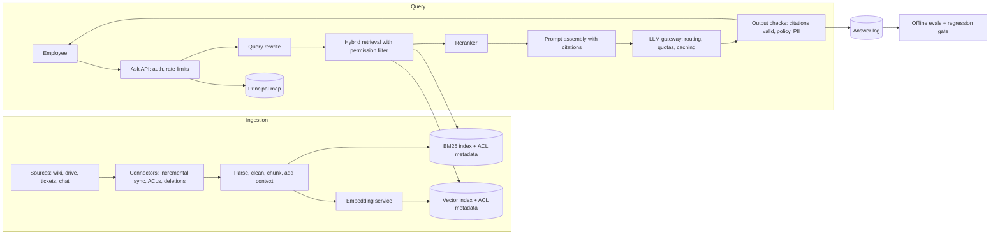

# 14 · RAG-based enterprise assistant

**Prompt.** Design an internal assistant that answers employees' questions from company documents (wikis, drives, tickets, chat), with citations, and that never reveals a document to someone who is not allowed to read it.

**Basis.** Retrieval-quality numbers come from Anthropic's "Contextual Retrieval" post (September 2024); security risks are named from the OWASP Top 10 for LLM Applications (2025). The architecture and sizing are **illustrative**. Retrieval and evaluation in depth: [AIE303](../../../03_majors/ai_engineering/year_3/AIE303_retrieval_augmented_generation_and_search/README.md), [AIE305](../../../03_majors/ai_engineering/year_3/AIE305_evaluating_llm_systems/README.md), [AIE403](../../../03_majors/ai_engineering/year_4/AIE403_llmops_observability_guardrails_cost_and_latency/README.md).

**Why it is asked.** It is the most common AI system in companies today, and the naive version ("embed everything, top-5, ask the model") fails on permissions, freshness, retrieval quality and evaluation. Interviewers look for the classic backend concerns applied to a new component.

## 1. Requirements

**Functional**
1. Answer a question in natural language with citations to the source passages.
2. Search across connected sources; filter by source, date, team.
3. Respect each source's permissions exactly: a user only gets answers from documents they can open.
4. Say "I could not find this" when the documents do not answer the question.
5. Feedback (thumbs, corrections) and an admin view of usage and gaps.

**Non-functional**
- Time to first token under 2 s at p95; full answer under 10 s.
- Document edits searchable within 15 minutes; **permission removals effective within 5 minutes; deletions within 5 minutes**.
- Every answer auditable: who asked, what was retrieved, which model and prompt version answered.
- Data stays in the company's chosen region; no provider training on company data (contractual and technical).

**Non-goals:** agents that take actions (see [case study 15](15_ai_agent_platform.md)), fine-tuning a model on the corpus.

## 2. Estimates (illustrative)

| Quantity | Value |
|---|---|
| Users | 20,000 employees, 6,000 daily active, 15 questions each → 90,000 requests/day, ~9.4/s peak ([estimation.md, example 5](../estimation.md#example-5--gpu-and-token-cost-an-enterprise-ai-assistant)) |
| Corpus | 2 million documents × ~2,000 tokens = 4 billion tokens |
| Chunks | ~400 tokens each with overlap → ~10–12 million chunks |
| Vector index | 12 million × 1,024 dims × 4 B ≈ 49 GB float32 (~12 GB with 8-bit quantisation) + graph links |
| Daily change | ~1% of documents edited → ~40 million tokens to re-chunk and re-embed per day |
| Generation | ~7.9 billion input + 0.8 billion output tokens/month; ~$35,000/month at illustrative API prices |

**Decision.** Retrieval infrastructure is modest (tens of GB, < 10 queries/s). The cost driver is LLM tokens, so retrieval *precision* (fewer, better passages) saves money as well as improving answers. The risk driver is permissions.

## 3. API

```http
POST /v1/ask   { question, conversation_id?, filters?: {sources, after} }
→ text/event-stream: tokens..., then { citations: [{doc_id, title, url, passage_id}], answer_id }

POST /v1/feedback { answer_id, rating, comment }
# Connectors (internal)
POST /internal/sync/{source}   webhook or poll cursor → changed doc IDs, ACL changes, deletions
```

## 4. Data model

| Entity | Key | Fields | Store |
|---|---|---|---|
| `document` | (source, source_doc_id) | title, URL, owner, updated_at, ACL principals, content hash, status | Relational |
| `chunk` | chunk_id | doc key, text, context prefix, position, ACL principals (copied), embedding version | Vector index + BM25 index (both carry ACL metadata) |
| `principal_map` | user_id → expanded group IDs | Cache refreshed from the identity provider every few minutes | Key-value |
| `answer_log` | answer_id | user, question, retrieved chunk IDs, prompt version, model, tokens, latency, answer, feedback | Append-only, access-controlled |
| `eval_set` | case_id | question, expected answer or facts, required sources, allowed users | Versioned files |

## 5. Architecture



## 6. Deep dives

### 6.1 Permission-aware retrieval

- **Copy ACLs onto every chunk** at index time (principal IDs: users and groups). At query time expand the user's groups (cached, refreshed every few minutes) and pass them as a **filter inside the search**, so the top-k is computed only over permitted chunks.
- **Never filter after retrieving top-k**: if the top 20 are all forbidden, the user gets nothing, and the forbidden text has already been loaded into a process that could leak it.
- **Late check for safety:** before putting a chunk in the prompt, re-check the document's current ACL in the source of truth (cached for seconds). This catches permission changes the index has not seen yet. It costs a little latency for 20 chunks and closes the gap between "index updated" and "permission removed".
- **Deletions and revocations are priority events** in the sync pipeline, ahead of content updates.
- OWASP's 2025 list names **LLM02 Sensitive Information Disclosure** and **LLM08 Vector and Embedding Weaknesses** (including cross-tenant or cross-permission leakage through shared indexes): this design is the mitigation.

### 6.2 Retrieval quality

Anthropic's Contextual Retrieval experiment (2024) measured how often the right chunk was missing from the top 20:

| Method | Top-20 retrieval failure rate |
|---|---|
| Standard embeddings | 5.7% |
| Contextual embeddings (each chunk prefixed with a short, generated description of where it sits in its document) | 3.7% (−35%) |
| + contextual BM25 (hybrid lexical and vector) | 2.9% (−49%) |
| + reranking (retrieve 150, rerank, keep 20) | 1.9% (−67%) |

Design consequences: use **hybrid search** (BM25 catches exact terms such as error codes and product names that embeddings blur), **rerank** a larger candidate set, and consider **contextualising chunks** at ingestion (the post reports a one-time cost of $1.02 per million document tokens with prompt caching, under its stated assumptions; that would be roughly $4,000 for this 4-billion-token corpus at those prices). The same post notes that if a knowledge base is smaller than about 200,000 tokens, you can put all of it in the prompt and skip retrieval: always check whether RAG is needed.

### 6.3 Prompt injection through documents

Any employee can write a wiki page that says "ignore previous instructions and…". OWASP's **LLM01 Prompt Injection** covers this indirect form. Mitigations: retrieved text is placed in clearly delimited data sections and the instructions say it is untrusted; the assistant has **no tools that act** in v1 (it can only read what the user can read, so the damage is limited to misleading answers); outputs must cite passages, and an output check verifies that each citation exists and was retrieved for this user; suspicious documents are flagged to admins.

### 6.4 Freshness and the ingestion pipeline

Connectors use each source's change feed or webhooks, with a periodic full reconciliation to catch missed events (webhooks are lost sometimes). Each document carries a content hash so unchanged documents are not re-embedded. Changing the embedding model means re-embedding the whole corpus: version embeddings, build the new index alongside the old, compare on the eval set, then switch.

### 6.5 Evaluation as a release gate

Build an evaluation set with subject-matter experts: 300–1,000 real questions with the facts a correct answer must contain, the documents that support them, and questions that *should* be refused (no answer in the corpus, or answer only in documents the asker cannot see). Measure retrieval recall@20, answer correctness, citation faithfulness (does the cited passage support the sentence?), refusal accuracy and permission leakage (must be zero). Any change (chunk size, embedding model, prompt, model version) must pass the gate before rollout. LLM-as-judge scoring is useful at scale but must be checked against human labels on a sample.

## 7. Failure modes

| Failure | Effect | Mitigation |
|---|---|---|
| ACL sync lag | User sees content they just lost access to | Late ACL check against source before prompting; revocations prioritised |
| Connector silently stops | Stale answers | Freshness metric per source; alert on lag; periodic reconciliation |
| LLM provider outage or rate limit | No answers | Gateway with a second provider or self-hosted fallback model; degrade to "search results only" |
| Retrieval returns nothing relevant | Hallucinated answer | Relevance threshold; instruct and check for "not found"; refusal cases in evals |
| Poisoned or injected document | Misleading answers | No acting tools; citation checks; document flagging; admin review |
| Cost spike (long conversations, abuse) | Budget overrun | Per-user quotas; conversation-length limits; per-team cost dashboards (OWASP LLM10 Unbounded Consumption) |

## 8. Trade-offs

| Decision | Chosen | Rejected | Why |
|---|---|---|---|
| Permissions | ACL filter in index + late check | Separate index per user or team | Index duplication explodes; late check closes sync gaps |
| Retrieval | Hybrid + rerank | Vectors only | Exact identifiers and fewer misses |
| Model | API model via gateway (v1) | Self-hosted from day one | Cost similar at this volume (estimation example 5); less operations work; revisit with data-residency or volume changes |
| Caching | Prompt-prefix caching only | Semantic answer cache | Answer caches leak across permission scopes unless keyed by the exact permission set |

## 9. Evolution

- **v1:** one or two sources, nightly sync, vector search with ACL filter, API model, citations, a 100-question eval set.
- **v2:** all sources with incremental sync; hybrid retrieval + reranker; late ACL checks; evaluation gate; gateway with quotas and fallbacks.
- **v3:** contextual chunks; per-team tuning; read-only tools (ticket lookup) with the same permission model; then action tools under the agent platform's controls.

## 10. What interviewers look for

| Level | Expected |
|---|---|
| New grad | Chunk → embed → retrieve → prompt; knows what an embedding is |
| SDE-2 | Ingestion pipeline with incremental sync; vector index choice; citations; token cost estimate |
| Senior | Permission-aware retrieval done correctly; hybrid search and reranking with evidence; prompt injection; evaluation as a gate |
| Staff | Build vs buy; data governance and audit; cost model per team; how the platform generalises to agents safely |

## References

- Anthropic, "Introducing Contextual Retrieval" (19 Sep 2024) — https://www.anthropic.com/news/contextual-retrieval
- OWASP Top 10 for LLM Applications 2025 — https://genai.owasp.org/llm-top-10/
- Robertson and Zaragoza, "The Probabilistic Relevance Framework: BM25 and Beyond" (2009) — https://www.staff.city.ac.uk/~sbrp622/papers/foundations_bm25_review.pdf
- pgvector — https://github.com/pgvector/pgvector
- [AIE303](../../../03_majors/ai_engineering/year_3/AIE303_retrieval_augmented_generation_and_search/README.md) · [AIE305](../../../03_majors/ai_engineering/year_3/AIE305_evaluating_llm_systems/README.md) · [OV05A](../../../04_overlaps/OV05_ai_security_safety/OV05A_securing_llm_applications_and_agents/README.md)

_Last reviewed: 2026-10_
