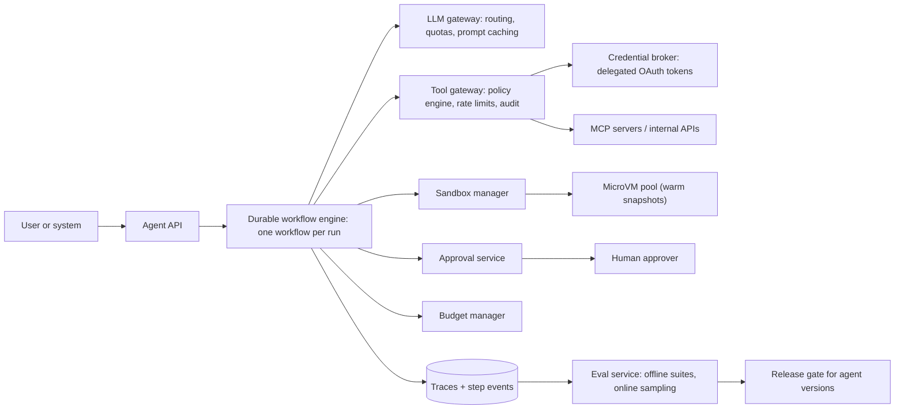

# 15 · AI agent platform

**Prompt.** Design an internal platform on which teams build and run AI agents: an LLM loops over plan → call a tool → observe → continue, for minutes or hours, running code in sandboxes and calling company systems. The platform must be safe, durable, observable and affordable.

**Basis.** Public building blocks: Firecracker microVMs (NSDI 2020), Temporal-style durable execution, the Model Context Protocol (MCP) authorization specification (2025-06-18), the OWASP Top 10 for LLM Applications (2025), and Anthropic's "Building effective agents" (December 2024). The overall architecture and sizing are **illustrative**. Depth: [AIE304](../../../03_majors/ai_engineering/year_3/AIE304_tool_use_and_ai_agents_loops_harnesses_memory/README.md), [OV12A](../../../04_overlaps/OV12_agent_infrastructure_platform/OV12A_running_agents_in_production_sandboxes_durable/README.md), [OV12B](../../../04_overlaps/OV12_agent_infrastructure_platform/OV12B_agent_evaluation_and_reliability_engineering/README.md).

**Why it is asked.** Agents combine every hard backend problem (long-running workflows, idempotent side effects, multi-tenant isolation, quotas) with new ones: a planner that can be manipulated by its inputs, and quality that must be measured statistically.

## 1. Requirements

**Functional**
1. Teams define an agent: model, instructions, tools, policies, budgets.
2. Start a run with a task; stream its steps; pause for human approval; resume; cancel.
3. Code execution and browsing in isolated sandboxes.
4. Tools: internal APIs and MCP servers, called with the *end user's* delegated permissions where needed.
5. Evaluate agents offline (task suites) and online (sampled traces), and gate releases on results.
6. Full trace of every step for debugging and audit.

**Non-functional**
- Sandbox ready in under 1 s at p95; strong isolation for untrusted, model-written code.
- A run survives worker crashes and deploys without repeating side effects.
- Hard budgets per run and per tenant (tokens, time, money).
- 10,000 concurrent runs (illustrative), runs of up to several hours.

**Non-goals:** training models; the agents' own business logic.

## 2. Estimates (illustrative)

| Quantity | Value |
|---|---|
| Concurrent runs | 10,000; average run 20 steps over 15 minutes → ~11 new runs/s |
| LLM calls | 10,000 runs × 20 steps ÷ 900 s ≈ **220 calls/s** |
| Context per call | grows to ~20,000 tokens → ~400,000 input tokens per run, most of them a repeated prefix (prompt caching matters) |
| Sandboxes | 1 per run, 1 vCPU / 2 GB → 10,000 vCPU, 20 TB RAM → ~100 hosts of 96 vCPU / 768 GB |
| Sandbox starts | ~11/s average, bursts of hundreds/s; Firecracker reports up to 150 microVMs/s per host |
| Workflow history | ~100 events per run; long runs can reach thousands |

**Decision.** The platform is I/O- and cost-bound, not compute-bound: most time is spent waiting for the model and tools. Design for many long-lived, mostly idle runs (durable state, not threads held open), and make LLM tokens and sandbox memory the metered resources.

## 3. API

```http
POST /v1/agents                 { name, model, instructions, tools[], policies, budgets }
POST /v1/runs                   Idempotency-Key  { agent_id, task, on_behalf_of } → { run_id }
GET  /v1/runs/{id}/events       (SSE stream: step_started, llm_output, tool_call, tool_result, approval_needed, done)
POST /v1/runs/{id}/approvals/{approval_id}   { decision: approve | reject, comment }
POST /v1/runs/{id}/cancel
POST /v1/evals                  { agent_version, suite_id } → { eval_run_id }
```

## 4. Data model

| Entity | Key | Store |
|---|---|---|
| `agent_version` | (agent_id, version) | Relational; immutable once published |
| `run` | run_id → agent_version, tenant, user, state, budget used | Workflow engine state + relational summary |
| `step_event` | (run_id, seq) → type, inputs, outputs (redacted), tokens, latency, cost | Append-only event store / trace backend |
| `approval` | approval_id → run, action, risk tier, approver, decision | Relational |
| `tool` | tool_id → schema, risk tier, auth mode, rate limit, owner | Registry |
| `grant` | (user, tool, scope) → delegated token reference | Credential broker (secrets never stored in run state) |
| `eval_result` | (agent_version, suite, case) → score, trace link | Analytics store |

## 5. Architecture



## 6. Deep dives

### 6.1 Durable execution

Run each agent as a **workflow**: deterministic orchestration code whose every external effect (LLM call, tool call, sandbox command, timer, approval wait) is an **activity** whose result is recorded in an event history. If a worker dies, another worker replays the history, skipping recorded activities, and continues from the last step; nothing is called twice because of the crash.

- **Side effects still need idempotency.** If the worker dies *during* a tool call, the activity is retried; the tool must accept an idempotency key (run_id + step) so the second call does not send a second email or create a second ticket ([building_blocks.md §12](../building_blocks.md#12-idempotency)).
- **Waiting is free.** Approval waits and timers are durable; a run can wait two days for a manager without holding a thread or a sandbox (snapshot and stop the sandbox while waiting).
- **History limits.** Temporal, for example, warns after 10,240 events and terminates a workflow whose history exceeds 51,200 events; long-running agents use *continue-as-new*, carrying a summarised state into a fresh workflow. Context-window summarisation and history compaction are the same problem at two layers.

### 6.2 Sandboxes

| Isolation | Start time | Strength | Use |
|---|---|---|---|
| Container (namespaces, cgroups, seccomp) | ~100s of ms | Shares the host kernel | Trusted code only |
| User-space kernel (gVisor) | ~100s of ms | Intercepts system calls | Medium risk |
| MicroVM (Firecracker) | < 125 ms boot, < 5 MiB overhead per VM, up to 150 VMs/s per host (Firecracker project) | Hardware virtualisation; used by AWS Lambda and Fargate | Untrusted, model-written code |

Model-written code is untrusted by definition: use microVMs. Keep a **warm pool** restored from snapshots so p95 start is well under a second. Rules: no credentials inside the sandbox (the tool gateway injects them on the way out); egress only through an allowlisting proxy; block cloud metadata endpoints; CPU, memory, disk and wall-time limits; ephemeral file systems with explicit artefact export.

### 6.3 Tool permissions

OWASP's 2025 list names **LLM06 Excessive Agency** (too much functionality, permission or autonomy) and **LLM01 Prompt Injection**, which for agents usually arrives through tool results: a web page, email or ticket containing instructions. Design:

1. **Least privilege per agent:** an explicit tool allowlist; each tool has a risk tier (read, reversible write, irreversible or external).
2. **Policy engine in the tool gateway**, outside the model: read tools run automatically; reversible writes need policy checks (scope, rate, target); irreversible actions (payments, deletions, messages outside the company) need **human approval** showing exactly what will happen.
3. **Delegated, audience-bound credentials.** When acting for a user, use OAuth tokens scoped to that user and that tool. The MCP authorization spec requires clients to use resource indicators (RFC 8707) so tokens are bound to the intended server, requires servers to validate the audience, and forbids passing a received token through to upstream APIs.
4. **Treat every tool output as untrusted data.** Avoid giving one agent run the combination of private data access, exposure to untrusted content, and the ability to send data out; Simon Willison calls this the "lethal trifecta" (2025). If a run needs all three, put approval on the outbound step.

### 6.4 Budgets and runaway loops

Agents fail by looping: the same tool call with the same arguments, or ever-growing context. Enforce per-run limits on steps, tokens, wall time and money in the budget manager (checked before every LLM and tool call), per-tenant quotas in the gateway, and loop detection (repeated identical actions). OWASP's **LLM10 Unbounded Consumption** is the risk being addressed.

### 6.5 Evaluation and release

Anthropic's guidance distinguishes **workflows** (predefined code paths) from **agents** (the model directs its own process) and recommends the simplest option that works; the platform should support both, because many "agents" are better as workflows. For agents:

- **Offline suites** per agent: realistic tasks with automatic graders (unit tests for code changes, checks on final state, rubric grading validated against human labels). Run each case several times; report success rate and consistency, because agents are stochastic.
- **Release gate:** a new model, prompt or tool version ships only if it does not regress on the suite and on cost per successful task.
- **Online:** sample traces for review; track task success, approval-rejection rate, tool error rate, cost and time per task; alert on drift after model provider updates.

## 7. Failure modes

| Failure | Effect | Mitigation |
|---|---|---|
| Worker crash mid-run | Run interrupted | Durable workflow replay; idempotent tool calls |
| LLM provider outage or throttling | All runs stall | Gateway failover to another model where evals allow; runs pause durably instead of failing |
| Prompt injection via a tool result | Unwanted action | Policy outside the model; approvals for risky actions; no secrets in context; egress control |
| Sandbox escape attempt | Host compromise risk | MicroVM isolation; minimal host; patched kernels; anomaly detection |
| Runaway loop | Cost spike | Budgets, loop detection, per-tenant quotas |
| Model update changes behaviour | Silent quality regression | Pinned model versions; eval gate before switching; canary runs |
| Approval fatigue | Humans approve everything | Fewer, clearer approvals (only irreversible actions); show diffs; measure rejection rates |

## 8. Trade-offs

| Decision | Chosen | Rejected | Why |
|---|---|---|---|
| Orchestration | Durable workflow engine | In-memory loop in a long-lived process | Crashes, deploys and multi-day waits |
| Isolation | MicroVMs with warm pools | Containers | Untrusted code; start-time cost solved by pooling |
| Safety control point | Policy engine in the tool gateway | Instructions in the prompt | Prompts can be overridden by injected text; gateways cannot |
| Autonomy | Approvals only for irreversible actions | Approve every step / approve nothing | Usable and safe |

## 9. Evolution

- **v1:** a library running the agent loop in a job queue, containers for code, a handful of read-only tools, logs.
- **v2:** durable workflows, microVM sandboxes, tool gateway with risk tiers and approvals, budgets, traces, offline eval suites.
- **v3:** delegated OAuth for MCP tools, multi-agent patterns where measured to help, online evaluation, cost-aware model routing, per-tenant isolation cells.

## 10. What interviewers look for

| Level | Expected |
|---|---|
| New grad | The agent loop; tool calling; why code must run in a sandbox |
| SDE-2 | Job/workflow orchestration; sandbox lifecycle; budgets; traces |
| Senior | Durable execution with idempotent side effects; isolation tiers with numbers; permission design outside the model; prompt injection via tools; eval-gated releases |
| Staff | Platform contracts for many teams; security review and audit; cost model; when to use workflows instead of agents; incident response for a misbehaving agent |

## References

- Agache et al., "Firecracker: Lightweight Virtualization for Serverless Applications" (NSDI 2020) — https://www.usenix.org/conference/nsdi20/presentation/agache ; Firecracker project — https://firecracker-microvm.github.io/
- Temporal documentation, Event History limits and Continue-As-New — https://docs.temporal.io/workflow-execution/event
- Model Context Protocol, Authorization (2025-06-18) — https://modelcontextprotocol.io/specification/2025-06-18/basic/authorization
- OWASP Top 10 for LLM Applications 2025 — https://genai.owasp.org/llm-top-10/
- Anthropic, "Building effective agents" (19 Dec 2024) — https://www.anthropic.com/engineering/building-effective-agents
- Simon Willison, "The lethal trifecta for AI agents" (16 Jun 2025) — https://simonwillison.net/2025/Jun/16/the-lethal-trifecta/
- gVisor — https://gvisor.dev/
- RFC 8707, Resource Indicators for OAuth 2.0 — https://www.rfc-editor.org/rfc/rfc8707

_Last reviewed: 2026-10_
