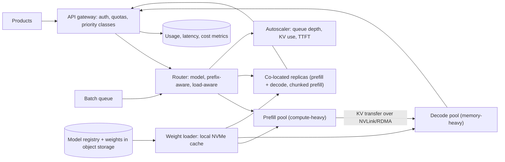

# 16 · LLM inference serving at scale

**Prompt.** Design a service that hosts several open-weight language models (8B- and 70B-class) for many internal products: interactive chat with streaming, and large offline batch jobs. Meet latency targets at the lowest cost per token.

**Basis.** Public research and specifications: Orca (OSDI 2022), vLLM/PagedAttention (SOSP 2023), SGLang (2024), DistServe (OSDI 2024), Sarathi-Serve (OSDI 2024), speculative decoding (ICML 2023), NVIDIA's H100 specifications and the Llama 3 paper's model configurations. The service design and traffic numbers are **illustrative**. Depth: [CLD404](../../../03_majors/cloud_engineering/year_4/CLD404_ai_infrastructure_in_the_cloud_gpus_inference/README.md), [MLE404](../../../03_majors/machine_learning_engineering/year_4/MLE404_efficient_inference_quantization_distillation/README.md), [BE403](../../../03_majors/backend_engineering/year_4/BE403_backends_for_ai_serving_llm_features_vector/README.md).

**Why it is asked.** It is the infrastructure question of the AI era. Classic intuitions fail: requests have wildly different costs, memory (not CPU) is the bottleneck, and batching changes latency and throughput together.

## 1. Requirements

**Functional**
1. Chat-completions-style API with streaming; several models and versions; optional fine-tuned adapters.
2. Two classes: **interactive** (latency SLOs) and **batch** (finish within 24 h, cheapest possible).
3. Per-tenant quotas in tokens per minute; priorities.
4. Prompt (prefix) caching for shared system prompts and documents.
5. Context up to 128,000 tokens for some models.

**Non-functional (interactive)**
- Time to first token (TTFT) p95 under 1 s for prompts up to 4,000 tokens.
- Time per output token (TPOT) p95 under 50 ms (at least 20 tokens/s per stream).
- Availability 99.9%; a GPU or node failure affects only requests on it.
- Cost per million tokens tracked per tenant.

**Non-goals:** training and fine-tuning pipelines; the products' prompts and evaluations.

## 2. Estimates (illustrative, for the 8B-class model)

| Quantity | Value |
|---|---|
| Interactive peak | 2,000 requests/s; average 2,000 input + 300 output tokens |
| Prefill load | 4 million input tokens/s × 2 × 8 × 10⁹ FLOPs/token ≈ **64 PFLOP/s** |
| Prefill GPUs | H100: ~989 TFLOPS dense 16-bit (half the 1,979 sparsity figure); at ~50% utilisation ≈ 0.5 PFLOP/s → **~128 GPUs**, ~64 if half of prompt tokens hit the prefix cache |
| Concurrent sequences (Little's law) | 300 tokens at ~30 tokens/s ≈ 10 s each → 2,000 × 10 = **20,000 in flight** |
| KV cache per sequence | 2,300 tokens × 128 KiB = ~290 MiB |
| KV per GPU | 80 GB − ~16 GB weights − overhead ≈ 55 GB → ~190 sequences per GPU |
| Decode GPUs | 20,000 ÷ 190 ≈ **105 GPUs** (memory-bound) |
| Total | **~170–230 H100s** at peak for one 8B model; a 70B model needs roughly 9× the compute and 2.5× the KV per token |

**Decision.** Prefill is compute-bound and decode is memory-bound, and both are large. The levers that matter most are therefore: prefix caching (removes prefill work), KV memory efficiency (more sequences per GPU), batching (more tokens per weight read), and routing requests to the smallest model that meets quality.

## 3. API

```http
POST /v1/chat/completions
{ "model": "chat-8b@2026-09", "messages": [...], "max_tokens": 512, "stream": true,
  "priority": "interactive", "cache_hint": "sys-prompt-v12" }
→ text/event-stream of token deltas; final usage { input_tokens, cached_tokens, output_tokens }

POST /v1/batches   { model, input_file, completion_window: "24h" } → { batch_id }
GET  /v1/models    → available models, context limits, prices
```

## 4. Data model

| Entity | Key | Store |
|---|---|---|
| `model_version` | model@version → weights URI, tensor-parallel size, quantisation, max context | Registry |
| `replica` | replica_id → model, GPUs, state, KV utilisation, queue depth, cached prefixes (hashes) | In-memory in the router, refreshed every ~100 ms |
| `tenant_quota` | tenant → tokens/min per class, max context | Config + token-bucket counters |
| `request_log` | request_id → tenant, model, tokens in/cached/out, TTFT, TPOT, replica | Metrics and billing pipeline |
| `batch_job` | batch_id → file, progress, results | Object storage + relational |

## 5. Architecture



## 6. Deep dives

### 6.1 Batching and scheduling

- **Static batching** waits for a batch to fill and for its longest request to finish: idle GPU slots and terrible tail latency.
- **Continuous (iteration-level) batching**: at every decode step, finished sequences leave and waiting ones join. Orca reported up to 36.9× throughput over FasterTransformer on GPT-3 175B at the same latency. Every modern server (vLLM, SGLang, TensorRT-LLM, TGI) does this.
- **Chunked prefill**: a 30,000-token prompt's prefill would stall every decoding sequence on that GPU for the duration; splitting prefill into chunks interleaved with decode steps keeps TPOT stable (Sarathi-Serve, OSDI 2024).
- **Priorities and preemption**: interactive requests preempt batch work; preempted sequences either swap their KV cache to CPU memory or recompute it later.

### 6.2 KV-cache memory

Using the [building_blocks.md formula](../building_blocks.md#17-llm-serving), a Llama-3-70B-class model needs 320 KiB per token at 16 bits, so one 128,000-token conversation needs **40 GiB** of KV cache: half an H100. Long-context requests must be priced and limited accordingly. Techniques:

- **Paged allocation** (vLLM): KV stored in fixed-size blocks, so memory is not reserved for the maximum length and fragmentation is near zero; vLLM reports 2–4× throughput over FasterTransformer and Orca at the same latency.
- **Prefix sharing** (SGLang's RadixAttention, vLLM prefix caching): requests with the same system prompt or document reuse its KV blocks; a cache hit skips that part of prefill entirely.
- **KV quantisation** (8-bit) halves KV memory, evaluated for quality loss.

### 6.3 Routing

1. **By model and version** (and adapter).
2. **Prefix-aware:** hash the first N tokens (or the `cache_hint`) and prefer the replica that already holds that prefix, with a load bound so one popular prompt does not overload one replica (consistent hashing with bounded load).
3. **Session affinity** for multi-turn chat: the previous turn's KV may still be cached on the same replica.
4. **Load-aware:** choose by outstanding *tokens* (prefill + expected decode), not request count; a 50,000-token request is not equal to a 50-token one.
5. **Spillover:** if no replica can meet TTFT, queue briefly, then shed lower-priority traffic before interactive traffic.

### 6.4 Disaggregating prefill and decode

Co-located prefill and decode interfere: long prefills stall decodes (TPOT spikes) and decode-heavy batches delay new prefills (TTFT spikes). DistServe (OSDI 2024) runs them on separate GPU pools and reported serving up to 7.4× more requests, or meeting 12.6× tighter SLOs, than the systems it compared against. The cost is moving the KV cache: a 2,000-token prompt on a 70B-class model produces 2,000 × 320 KiB ≈ 625 MiB of KV to transfer, which needs NVLink or RDMA-class bandwidth and careful placement. Use disaggregation when prompts are long and both TTFT and TPOT SLOs are strict; co-locate with chunked prefill otherwise.

### 6.5 Cost per million tokens

`cost per 1M output tokens ≈ (GPU cost per hour × GPUs per replica) ÷ (output tokens per hour per replica ÷ 10⁶)`

Utilisation dominates: a replica that is 30% busy costs 3× more per token than one at 90%. Levers: fill valleys with batch jobs (priority below interactive); speculative decoding to cut latency for interactive users (2–3× in the original paper, with identical outputs); quantisation (fewer GPUs per replica); **model cascades** (route easy requests to the 8B model and only escalate when needed, verified with evals); prompt caching discounts passed on to tenants so they structure prompts for reuse.

### 6.6 Cold starts and capacity

Loading 140 GB of 70B weights from object storage at ~1–2 GB/s takes minutes, and GPU capacity in a region may simply be unavailable at peak. Keep weights on local NVMe, keep warm standby replicas, scale ahead of known peaks (the same lesson as live streaming in [case study 10](10_live_video_streaming.md)), and spread across regions or providers for capacity, not only for failure.

## 7. Failure modes

| Failure | Effect | Mitigation |
|---|---|---|
| GPU or node failure | In-flight sequences on that replica lost | Health checks on GPU errors; drain and replace; clients retry idempotently (generation can restart) |
| KV memory exhausted | Preemption storms; TPOT collapses | Admission control on KV utilisation; per-tenant context limits; shed batch work first |
| Very long prompts from one tenant | Noisy neighbour | Token-based quotas; separate long-context pool |
| New model version regresses quality | Products degrade silently | Versioned models; canary by tenant; eval gates owned by products |
| Router's view stale | Hot replicas, cold others | Frequent load reports; power-of-two-choices among candidates |
| Region out of GPUs | Cannot scale | Multi-region capacity; batch deferral; smaller-model fallback |

## 8. Trade-offs

| Decision | Chosen | Rejected | Why |
|---|---|---|---|
| Batching | Continuous + chunked prefill | Static batches | Throughput and stable TPOT |
| Phases | Co-located by default, disaggregated for long-prompt strict-SLO models | Always disaggregate | KV transfer cost and complexity only pay off for some workloads |
| Routing | Prefix- and token-load-aware | Round robin | Cache reuse and fair load in tokens |
| Precision | 8-bit where evals pass | Always 16-bit | Half the memory and bandwidth per token |
| Classes | Interactive and batch on shared fleet with preemption | Separate fleets | Higher utilisation, lower cost |

## 9. Evolution

- **v1:** one model on one 8-GPU node with an open-source server (continuous batching, paged KV), behind a gateway with quotas.
- **v2:** multiple models; prefix-aware routing; autoscaling on KV utilisation and TTFT; batch class filling valleys; per-tenant cost reporting.
- **v3:** disaggregated pools for long-context models; speculative decoding; quantised variants; model cascades; multi-region capacity management.

## 10. What interviewers look for

| Level | Expected |
|---|---|
| New grad | Model behind an API; GPUs needed; streaming tokens |
| SDE-2 | TTFT vs TPOT; batching; KV cache exists and costs memory; quotas |
| Senior | KV arithmetic; continuous batching and chunked prefill; prefix-aware routing; autoscaling signals; cost per token formula |
| Staff | Fleet economics (utilisation, batch filling, cascades); capacity planning across regions and providers; disaggregation decision with numbers; model rollout governance |

## References

- Yu et al., "Orca: A Distributed Serving System for Transformer-Based Generative Models" (OSDI 2022) — https://www.usenix.org/conference/osdi22/presentation/yu
- Kwon et al., "Efficient Memory Management for Large Language Model Serving with PagedAttention" (SOSP 2023) — https://arxiv.org/abs/2309.06180
- Zheng et al., "SGLang: Efficient Execution of Structured Language Model Programs" (2024) — https://arxiv.org/abs/2312.07104
- Zhong et al., "DistServe: Disaggregating Prefill and Decoding for Goodput-optimized Large Language Model Serving" (OSDI 2024) — https://arxiv.org/abs/2401.09670
- Agrawal et al., "Taming Throughput-Latency Tradeoff in LLM Inference with Sarathi-Serve" (OSDI 2024) — https://arxiv.org/abs/2403.02310
- Leviathan, Kalman and Matias, "Fast Inference from Transformers via Speculative Decoding" (ICML 2023) — https://arxiv.org/abs/2211.17192
- NVIDIA H100 specifications — https://www.nvidia.com/en-us/data-center/h100/ ; "The Llama 3 Herd of Models" (2024) — https://arxiv.org/abs/2407.21783

_Last reviewed: 2026-10_
