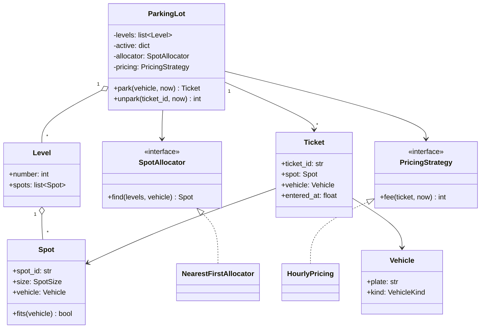

# LLD 01 · Parking lot

**Prompt.** Design a multi-level parking lot. Vehicles (motorcycles, cars, trucks) enter, get a spot that fits, receive a ticket, and pay on exit by duration and vehicle type.

## Clarifying questions (and the answers assumed here)

| Question | Assumed answer |
|---|---|
| Spot types? | Small (motorcycle), compact (car), large (truck); a smaller vehicle may use a larger spot |
| How is a spot chosen? | Nearest available on the lowest level first; must be swappable |
| Pricing? | Per started hour, rate by vehicle type; must be swappable (flat weekend rates later) |
| Payment methods, entry/exit gates, displays? | Out of scope for code; mention as extensions |
| Concurrency? | Several gates call `park` at the same time in one process |

## Class diagram



## Key decisions

- **Strategy pattern** for allocation and pricing: new rules are new classes; `ParkingLot` does not change.
- **Size ordering** (`SMALL < COMPACT < LARGE`) makes "fits" a comparison, not a table of special cases.
- **Money in integer rupees** (or paise), never floats.
- **One lock around allocate-and-occupy**, so two gates cannot assign the same spot. In a distributed version (several servers), the spot assignment becomes a conditional update in the database (`UPDATE spot SET vehicle=? WHERE id=? AND vehicle IS NULL`).
- **Injectable time** (`now` parameter) keeps the code testable.

## Python skeleton

```python
import math
import threading
import uuid
from dataclasses import dataclass, field
from enum import IntEnum
from typing import Optional


class SpotSize(IntEnum):
    SMALL = 1
    COMPACT = 2
    LARGE = 3


class VehicleKind(IntEnum):
    MOTORCYCLE = 1
    CAR = 2
    TRUCK = 3


NEEDS = {VehicleKind.MOTORCYCLE: SpotSize.SMALL, VehicleKind.CAR: SpotSize.COMPACT,
         VehicleKind.TRUCK: SpotSize.LARGE}


@dataclass(frozen=True)
class Vehicle:
    plate: str
    kind: VehicleKind


@dataclass
class Spot:
    spot_id: str
    size: SpotSize
    vehicle: Optional[Vehicle] = None

    def fits(self, v: Vehicle) -> bool:
        return self.vehicle is None and self.size >= NEEDS[v.kind]


@dataclass
class Level:
    number: int
    spots: list = field(default_factory=list)


@dataclass(frozen=True)
class Ticket:
    ticket_id: str
    spot: Spot
    vehicle: Vehicle
    entered_at: float


class SpotAllocator:
    def find(self, levels, vehicle) -> Optional[Spot]:
        raise NotImplementedError


class NearestFirstAllocator(SpotAllocator):
    """Lowest level first; within a level, the smallest spot that fits (saves big spots)."""
    def find(self, levels, vehicle):
        for level in sorted(levels, key=lambda l: l.number):
            candidates = [s for s in level.spots if s.fits(vehicle)]
            if candidates:
                return min(candidates, key=lambda s: s.size)
        return None


class PricingStrategy:
    def fee(self, ticket: Ticket, now: float) -> int:
        raise NotImplementedError


class HourlyPricing(PricingStrategy):
    def __init__(self, rate_per_hour: dict):
        self.rate = rate_per_hour

    def fee(self, ticket, now):
        hours = max(1, math.ceil((now - ticket.entered_at) / 3600))  # per started hour
        return hours * self.rate[ticket.vehicle.kind]


class LotFull(Exception):
    pass


class ParkingLot:
    def __init__(self, levels, allocator: SpotAllocator, pricing: PricingStrategy):
        self.levels, self.allocator, self.pricing = levels, allocator, pricing
        self.active = {}
        self._lock = threading.Lock()

    def park(self, vehicle: Vehicle, now: float) -> Ticket:
        with self._lock:  # find + occupy must be atomic
            spot = self.allocator.find(self.levels, vehicle)
            if spot is None:
                raise LotFull(vehicle.kind.name)
            spot.vehicle = vehicle
            ticket = Ticket(uuid.uuid4().hex, spot, vehicle, now)
            self.active[ticket.ticket_id] = ticket
            return ticket

    def unpark(self, ticket_id: str, now: float) -> int:
        with self._lock:
            ticket = self.active.pop(ticket_id)  # KeyError = unknown or already used ticket
            ticket.spot.vehicle = None
        return self.pricing.fee(ticket, now)


if __name__ == "__main__":
    lot = ParkingLot(
        [Level(0, [Spot("0-S1", SpotSize.SMALL), Spot("0-C1", SpotSize.COMPACT)]),
         Level(1, [Spot("1-L1", SpotSize.LARGE)])],
        NearestFirstAllocator(),
        HourlyPricing({VehicleKind.MOTORCYCLE: 20, VehicleKind.CAR: 50, VehicleKind.TRUCK: 120}),
    )
    bike = lot.park(Vehicle("KA01", VehicleKind.MOTORCYCLE), now=0)
    assert bike.spot.spot_id == "0-S1"                      # smallest fitting spot
    car = lot.park(Vehicle("KA02", VehicleKind.CAR), now=0)
    assert car.spot.spot_id == "0-C1"
    car2 = lot.park(Vehicle("KA03", VehicleKind.CAR), now=0)
    assert car2.spot.spot_id == "1-L1"                      # car may use a large spot
    try:
        lot.park(Vehicle("KA04", VehicleKind.TRUCK), now=0)
        raise AssertionError("expected LotFull")
    except LotFull:
        pass
    assert lot.unpark(car.ticket_id, now=3601) == 100       # 2 started hours x 50
    assert lot.park(Vehicle("KA05", VehicleKind.CAR), now=4000).spot.spot_id == "0-C1"
    print("parking lot ok")
```

## Extensions to discuss

- **Displays per level** showing free spots by size: an observer notified on park/unpark (or counters updated in the same lock).
- **EV charging spots:** a spot attribute plus an allocator that prefers EV spots for EVs and avoids them for others.
- **Reservations:** a spot state `RESERVED(until)` and an allocator that skips it.
- **Lost ticket:** look up by plate (keep a plate → ticket index) and charge a maximum fee.
- **Many gates on many servers:** move spots to a database and make occupy a conditional update; keep per-level free counts in a cache for displays.

## What interviewers look for

New grad: clean entities and a working `park`/`unpark`. SDE-1/2: strategies instead of conditionals, integer money, tests for full lot and pricing edges, the race between two gates and how the lock (or conditional update) prevents it.

_Last reviewed: 2026-10_
