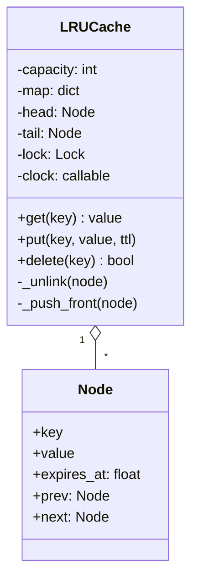

# LLD 02 · LRU cache

**Prompt.** Implement a fixed-capacity cache with `get(key)` and `put(key, value)` in O(1) time. When full, evict the least recently used entry. Make it safe for multiple threads; optionally support a per-entry time to live (TTL).

## Clarifying questions

| Question | Assumed answer |
|---|---|
| Capacity unit: entries or bytes? | Entries (bytes is an extension) |
| Does `get` count as use? | Yes; so does `put` of an existing key |
| Thread safety? | Yes, many readers and writers in one process |
| TTL? | Optional per entry; expired entries behave as missing |
| Eviction callback? | Yes, useful for metrics and write-back |

## Class diagram



## Key decisions

- **Hash map + doubly linked list.** The map finds a node in O(1); the list keeps recency order, and unlinking a known node is O(1). Sentinel head and tail nodes remove edge cases.
- **Most recent at the front, evict from the back.**
- **One lock** around every operation. Even `get` mutates (it moves the node), so a read-write lock does not help much. For high concurrency, shard: N independent caches selected by `hash(key) % N`, each with its own lock (this is how many production caches reduce contention).
- **Lazy TTL expiry** on access, plus eviction by LRU; a background sweeper is optional.
- Python's `OrderedDict` (`move_to_end`, `popitem(last=False)`) gives the same behaviour in a few lines. Interviewers usually want the linked list written by hand first, then accept `OrderedDict` as the production choice.

## Python skeleton

```python
import threading
import time
from typing import Any, Callable, Optional


class _Node:
    __slots__ = ("key", "value", "expires_at", "prev", "next")

    def __init__(self, key=None, value=None, expires_at=None):
        self.key, self.value, self.expires_at = key, value, expires_at
        self.prev = self.next = None


class LRUCache:
    def __init__(self, capacity: int, clock: Callable[[], float] = time.monotonic,
                 on_evict: Optional[Callable[[Any, Any], None]] = None):
        if capacity <= 0:
            raise ValueError("capacity must be positive")
        self.capacity, self.clock, self.on_evict = capacity, clock, on_evict
        self.map = {}
        self.head, self.tail = _Node(), _Node()      # sentinels: head.next is most recent
        self.head.next, self.tail.prev = self.tail, self.head
        self.lock = threading.Lock()

    def _unlink(self, node):
        node.prev.next, node.next.prev = node.next, node.prev

    def _push_front(self, node):
        node.prev, node.next = self.head, self.head.next
        self.head.next.prev = node
        self.head.next = node

    def _expired(self, node) -> bool:
        return node.expires_at is not None and self.clock() >= node.expires_at

    def get(self, key, default=None):
        with self.lock:
            node = self.map.get(key)
            if node is None:
                return default
            if self._expired(node):
                self._unlink(node)
                del self.map[key]
                return default
            self._unlink(node)
            self._push_front(node)
            return node.value

    def put(self, key, value, ttl: Optional[float] = None) -> None:
        expires_at = self.clock() + ttl if ttl is not None else None
        evicted = None
        with self.lock:
            node = self.map.get(key)
            if node is not None:
                node.value, node.expires_at = value, expires_at
                self._unlink(node)
                self._push_front(node)
                return
            if len(self.map) >= self.capacity:
                lru = self.tail.prev
                self._unlink(lru)
                del self.map[lru.key]
                evicted = (lru.key, lru.value)
            node = _Node(key, value, expires_at)
            self.map[key] = node
            self._push_front(node)
        if evicted and self.on_evict:                # call user code outside the lock
            self.on_evict(*evicted)

    def delete(self, key) -> bool:
        with self.lock:
            node = self.map.pop(key, None)
            if node is None:
                return False
            self._unlink(node)
            return True

    def __len__(self):
        return len(self.map)


if __name__ == "__main__":
    now = [0.0]
    evicted = []
    c = LRUCache(2, clock=lambda: now[0], on_evict=lambda k, v: evicted.append(k))
    c.put("a", 1); c.put("b", 2)
    assert c.get("a") == 1            # a becomes most recent
    c.put("c", 3)                     # evicts b (least recent)
    assert c.get("b") is None and evicted == ["b"]
    c.put("a", 10)                    # update moves a to front
    c.put("d", 4)                     # evicts c
    assert c.get("c") is None and c.get("a") == 10 and c.get("d") == 4
    c.put("t", 5, ttl=5)              # evicts a (d and a: a was used before d)
    now[0] = 4.9
    assert c.get("t") == 5
    now[0] = 5.0
    assert c.get("t") is None and len(c) == 1
    # concurrency smoke test: no exceptions, size bounded
    big = LRUCache(100)
    def worker(i):
        for j in range(2000):
            big.put((i, j % 150), j); big.get((i, (j * 7) % 150))
    ts = [threading.Thread(target=worker, args=(i,)) for i in range(8)]
    [t.start() for t in ts]; [t.join() for t in ts]
    assert len(big) == 100
    print("lru ok")
```

## Extensions to discuss

- **Capacity in bytes:** track the size of each value; evict until under the limit.
- **Sharded cache** for concurrency, as above.
- **Other policies:** LFU (frequency buckets, O(1) with a map of frequency → list); TinyLFU-style admission (used by Caffeine) keeps one-hit wonders out.
- **Distributed:** this class is one node; across nodes, keys are placed with consistent hashing ([building_blocks.md §7](../building_blocks.md#7-consistent-hashing)).
- **Stampede protection:** a `get_or_load(key, loader)` that lets one caller load a missing key while others wait.

## What interviewers look for

O(1) operations with the right data structures, sentinel nodes or careful edge cases, eviction order tested, and a sensible answer to "what about threads?" (a lock, then sharding). Mentioning that callbacks run outside the lock shows experience.

_Last reviewed: 2026-10_
