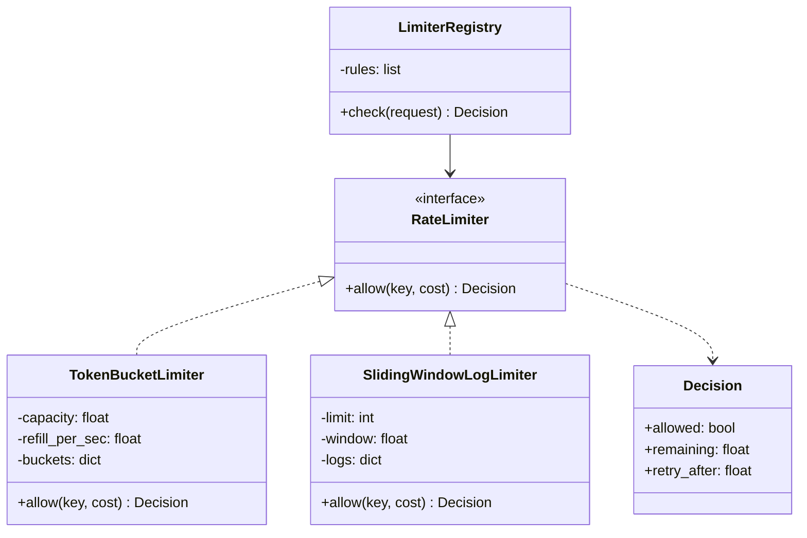

# LLD 03 · Rate limiter class design

**Prompt.** Design a rate-limiting library: callers ask `allow(key)` and get yes or no. Support at least two algorithms behind one interface, per-key state, configurable rules, and thread safety. (The distributed version is [case study 02](../case_studies/02_rate_limiter.md).)

## Clarifying questions

| Question | Assumed answer |
|---|---|
| Which algorithms? | Token bucket (bursts allowed) and sliding window log (exact); sliding window counter as an extension |
| Keys? | Any string: user ID, API key, IP, or a combination |
| Cost per request? | Default 1; expensive endpoints may cost more |
| Memory for idle keys? | Must not grow forever: evict idle keys |
| Time source? | Injected, so tests are deterministic |

## Class diagram



## Key decisions

- **Strategy pattern:** both algorithms implement `allow(key, cost)`; callers do not care which is used.
- **Lazy refill:** a token bucket stores `(tokens, last_refill)` and computes the refill on each call; there is no timer per key.
- **Striped locks:** one lock per key would need a map of locks that itself needs a lock; a fixed array of N locks selected by `hash(key) % N` is simple and bounded.
- **A `Decision` object** with `retry_after` lets the HTTP layer set `Retry-After` and `RateLimit` headers.
- **Idle-key eviction:** a token bucket that has been idle long enough to refill completely is identical to a new one, so it can be deleted.
- **Registry** maps request attributes to rules, so "login: 5 per 15 minutes per IP" and "API: 100/s per key" live in configuration.

## Python skeleton

```python
import threading
import time
from collections import deque
from dataclasses import dataclass
from typing import Callable


@dataclass(frozen=True)
class Decision:
    allowed: bool
    remaining: float
    retry_after: float  # seconds until the request would be allowed (0 if allowed)


class RateLimiter:
    def allow(self, key: str, cost: float = 1) -> Decision:
        raise NotImplementedError


class _Striped:
    def __init__(self, n=64):
        self._locks = [threading.Lock() for _ in range(n)]

    def for_key(self, key):
        return self._locks[hash(key) % len(self._locks)]


class TokenBucketLimiter(RateLimiter):
    def __init__(self, capacity: float, refill_per_sec: float, clock: Callable[[], float] = time.monotonic):
        self.capacity, self.rate, self.clock = capacity, refill_per_sec, clock
        self.buckets = {}  # key -> [tokens, last_refill]
        self.locks = _Striped()

    def allow(self, key, cost=1):
        with self.locks.for_key(key):
            now = self.clock()
            tokens, last = self.buckets.get(key, (self.capacity, now))
            tokens = min(self.capacity, tokens + (now - last) * self.rate)
            if tokens >= cost:
                self.buckets[key] = [tokens - cost, now]
                return Decision(True, tokens - cost, 0.0)
            self.buckets[key] = [tokens, now]
            return Decision(False, tokens, (cost - tokens) / self.rate)

    def evict_idle(self):
        """Drop buckets that would be full anyway (identical to a fresh bucket)."""
        now = self.clock()
        full_after = self.capacity / self.rate
        for key in list(self.buckets):
            with self.locks.for_key(key):
                b = self.buckets.get(key)
                if b and now - b[1] >= full_after:
                    del self.buckets[key]


class SlidingWindowLogLimiter(RateLimiter):
    """Exact: at most `limit` units in any window of `window` seconds. Memory grows with limit."""
    def __init__(self, limit: int, window: float, clock: Callable[[], float] = time.monotonic):
        self.limit, self.window, self.clock = limit, window, clock
        self.logs = {}  # key -> deque of timestamps (one entry per unit of cost)
        self.locks = _Striped()

    def allow(self, key, cost=1):
        with self.locks.for_key(key):
            now = self.clock()
            log = self.logs.setdefault(key, deque())
            while log and log[0] <= now - self.window:
                log.popleft()
            if len(log) + cost <= self.limit:
                log.extend([now] * int(cost))
                return Decision(True, self.limit - len(log), 0.0)
            oldest_needed = log[len(log) + int(cost) - self.limit - 1]
            return Decision(False, self.limit - len(log), oldest_needed + self.window - now)


class LimiterRegistry:
    """First matching rule wins; a rule is (predicate, key_fn, limiter)."""
    def __init__(self, rules):
        self.rules = rules

    def check(self, request: dict) -> Decision:
        for matches, key_fn, limiter in self.rules:
            if matches(request):
                return limiter.allow(key_fn(request))
        return Decision(True, float("inf"), 0.0)


if __name__ == "__main__":
    now = [0.0]
    clock = lambda: now[0]
    tb = TokenBucketLimiter(capacity=3, refill_per_sec=1, clock=clock)
    assert [tb.allow("k").allowed for _ in range(4)] == [True, True, True, False]
    d = tb.allow("k")
    assert not d.allowed and abs(d.retry_after - 1.0) < 1e-9
    now[0] = 1.5                                   # 1.5 tokens refilled
    assert tb.allow("k").allowed and not tb.allow("k").allowed
    assert tb.allow("other").allowed               # keys are independent
    now[0] = 100
    tb.evict_idle()
    assert tb.buckets == {}

    now[0] = 0.0
    sw = SlidingWindowLogLimiter(limit=2, window=10, clock=clock)
    assert sw.allow("ip").allowed
    now[0] = 5
    assert sw.allow("ip").allowed
    now[0] = 9
    d = sw.allow("ip")
    assert not d.allowed and abs(d.retry_after - 1.0) < 1e-9   # the t=0 entry leaves at t=10
    now[0] = 10
    assert sw.allow("ip").allowed

    reg = LimiterRegistry([
        (lambda r: r["path"] == "/login", lambda r: "login:" + r["ip"], SlidingWindowLogLimiter(5, 900, clock)),
        (lambda r: True, lambda r: "api:" + r["api_key"], TokenBucketLimiter(100, 100, clock)),
    ])
    assert reg.check({"path": "/login", "ip": "1.2.3.4", "api_key": "x"}).allowed
    print("rate limiter ok")
```

## Extensions to discuss

- **Sliding window counter** (two counters per key, weighted): near-exact with constant memory; Cloudflare reported 0.003% error on 400 million requests.
- **Concurrency limiter:** a semaphore per key with a release in `finally`.
- **Distributed store:** the same interface backed by Redis with an atomic script; the in-process version becomes the fallback when Redis is unreachable.
- **Fail-open versus fail-closed** per rule (login limits fail closed).

## What interviewers look for

Correct algorithms with lazy refill (no per-key timers), a clean interface with a decision object, thread safety with a bounded number of locks, memory control for idle keys, and deterministic tests through an injected clock.

_Last reviewed: 2026-10_
