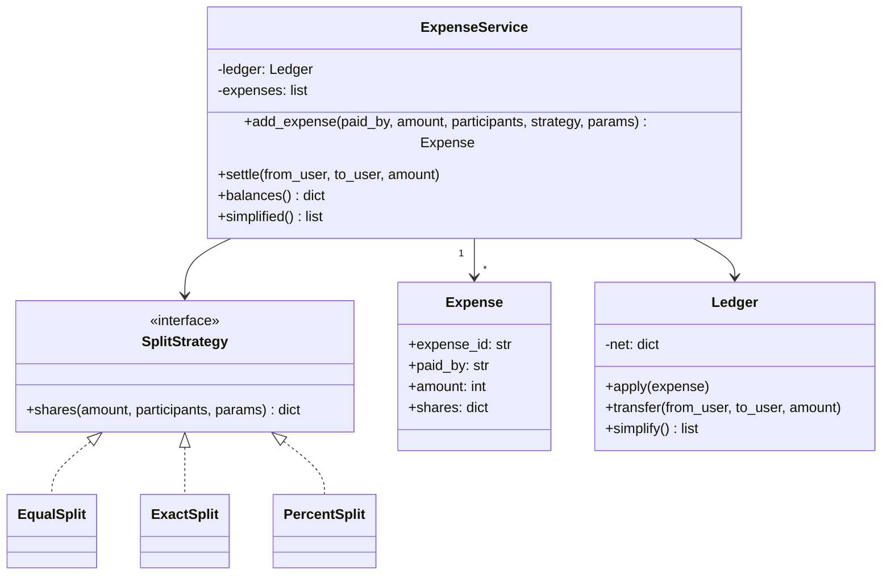

# LLD 04 · Splitwise (expense sharing)

**Prompt.** Design an app where friends record shared expenses and see who owes whom. Support equal, exact-amount and percentage splits, group balances, settling up, and a "simplify debts" view.

## Clarifying questions

| Question | Assumed answer |
|---|---|
| Currency? | One currency (INR), stored as integer paise |
| Who pays? | One payer per expense (multiple payers as an extension) |
| Rounding? | Leftover paise go to the first participants in a stable order, so totals always match |
| Simplify debts? | Yes: a list of transfers that settles all balances with at most n − 1 payments |
| Edit/delete expenses? | Extension: store expenses as an append-only log and recompute balances |

## Class diagram



## Key decisions

- **Integer paise.** `0.1 + 0.2 != 0.3` in floating point; money is always integers in the smallest unit.
- **Strategy per split type**, each validating its own input (exact amounts must sum to the total; percentages to 100).
- **Net balance per user** (positive: others owe them; negative: they owe). An expense of ₹300 paid by A for A, B, C adds +300 to A and subtracts each share. Pairwise "who owes whom" is derived, not stored.
- **Simplify debts greedily:** repeatedly match the largest debtor with the largest creditor. This settles everything in at most n − 1 transfers. Finding the true minimum number of transfers is a much harder combinatorial problem (it involves finding zero-sum subgroups), so production apps use a heuristic like this.
- **Append-only expenses** make edits and audit simple: an edit is a reversal plus a new expense.

## Python skeleton

```python
import heapq
import itertools
from dataclasses import dataclass


class SplitStrategy:
    def shares(self, amount: int, participants: list, params=None) -> dict:
        raise NotImplementedError


def _spread(amount, weights, participants):
    """Integer shares proportional to weights; leftover paise to earliest participants."""
    total_w = sum(weights)
    base = [amount * w // total_w for w in weights]
    for i in range(amount - sum(base)):
        base[i] += 1
    return dict(zip(participants, base))


class EqualSplit(SplitStrategy):
    def shares(self, amount, participants, params=None):
        return _spread(amount, [1] * len(participants), participants)


class ExactSplit(SplitStrategy):
    def shares(self, amount, participants, params=None):
        if sorted(params) != sorted(participants) or sum(params.values()) != amount:
            raise ValueError("exact shares must cover all participants and sum to the amount")
        return dict(params)


class PercentSplit(SplitStrategy):
    def shares(self, amount, participants, params=None):
        if sum(params[p] for p in participants) != 100:
            raise ValueError("percentages must sum to 100")
        return _spread(amount, [params[p] for p in participants], participants)


@dataclass(frozen=True)
class Expense:
    expense_id: int
    paid_by: str
    amount: int
    shares: dict


class Ledger:
    def __init__(self):
        self.net = {}

    def _add(self, user, delta):
        self.net[user] = self.net.get(user, 0) + delta

    def apply(self, e: Expense):
        self._add(e.paid_by, e.amount)
        for user, share in e.shares.items():
            self._add(user, -share)

    def transfer(self, from_user, to_user, amount):
        self._add(from_user, amount)    # paying reduces what you owe
        self._add(to_user, -amount)

    def simplify(self):
        creditors = [(-bal, u) for u, bal in self.net.items() if bal > 0]
        debtors = [(bal, u) for u, bal in self.net.items() if bal < 0]
        heapq.heapify(creditors); heapq.heapify(debtors)
        transfers = []
        while creditors and debtors:
            c_amt, c = heapq.heappop(creditors)
            d_amt, d = heapq.heappop(debtors)
            pay = min(-c_amt, -d_amt)
            transfers.append((d, c, pay))
            if -c_amt - pay:
                heapq.heappush(creditors, (c_amt + pay, c))
            if -d_amt - pay:
                heapq.heappush(debtors, (d_amt + pay, d))
        return transfers


class ExpenseService:
    def __init__(self):
        self.ledger, self.expenses, self._ids = Ledger(), [], itertools.count(1)

    def add_expense(self, paid_by, amount, participants, strategy: SplitStrategy, params=None):
        if amount <= 0:
            raise ValueError("amount must be positive")
        shares = strategy.shares(amount, participants, params)
        assert sum(shares.values()) == amount
        e = Expense(next(self._ids), paid_by, amount, shares)
        self.expenses.append(e)
        self.ledger.apply(e)
        return e

    def settle(self, from_user, to_user, amount):
        self.ledger.transfer(from_user, to_user, amount)

    def balances(self):
        return {u: b for u, b in self.ledger.net.items() if b != 0}

    def simplified(self):
        return self.ledger.simplify()


if __name__ == "__main__":
    s = ExpenseService()
    s.add_expense("A", 100_00, ["A", "B", "C"], EqualSplit())          # Rs 100 three ways
    e = s.expenses[-1]
    assert sorted(e.shares.values()) == [33_33, 33_33, 33_34] and sum(e.shares.values()) == 100_00
    s.add_expense("B", 60_00, ["A", "B"], ExactSplit(), {"A": 50_00, "B": 10_00})
    s.add_expense("C", 200_00, ["A", "B", "C"], PercentSplit(), {"A": 50, "B": 25, "C": 25})
    bal = s.balances()
    assert sum(bal.values()) == 0                                       # money is conserved
    # A: +100.00 - 33.34 - 50.00 - 100.00 ; B: -33.33 + 60.00 - 10.00 - 50.00 ; C: -33.33 + 200.00 - 50.00
    assert bal == {"A": -83_34, "B": -33_33, "C": 116_67}
    transfers = s.simplified()
    assert sorted(transfers) == [("A", "C", 83_34), ("B", "C", 33_33)]
    for debtor, creditor, amt in transfers:                             # applying them settles everything
        s.settle(debtor, creditor, amt)
    assert s.balances() == {}
    try:
        s.add_expense("A", 10_00, ["A", "B"], PercentSplit(), {"A": 60, "B": 30})
        raise AssertionError("expected ValueError")
    except ValueError:
        pass
    print("splitwise ok")
```

## Extensions to discuss

- **Groups:** the same ledger per group, plus an overall ledger per user pair.
- **Multiple payers:** an expense has `paid` and `owed` maps; net change per user is `paid − owed`.
- **Multi-currency:** keep balances per currency; convert only on settle, at a recorded rate.
- **Concurrency and storage:** expenses in a relational table; balances derived (or a materialised view updated in the same transaction).
- **Activity feed and notifications:** observers on expense creation.

## What interviewers look for

Integer money and rounding that conserves the total, strategies for split types with validation, a ledger with net balances, a correct greedy simplification, and tests that prove balances always sum to zero.

_Last reviewed: 2026-10_
