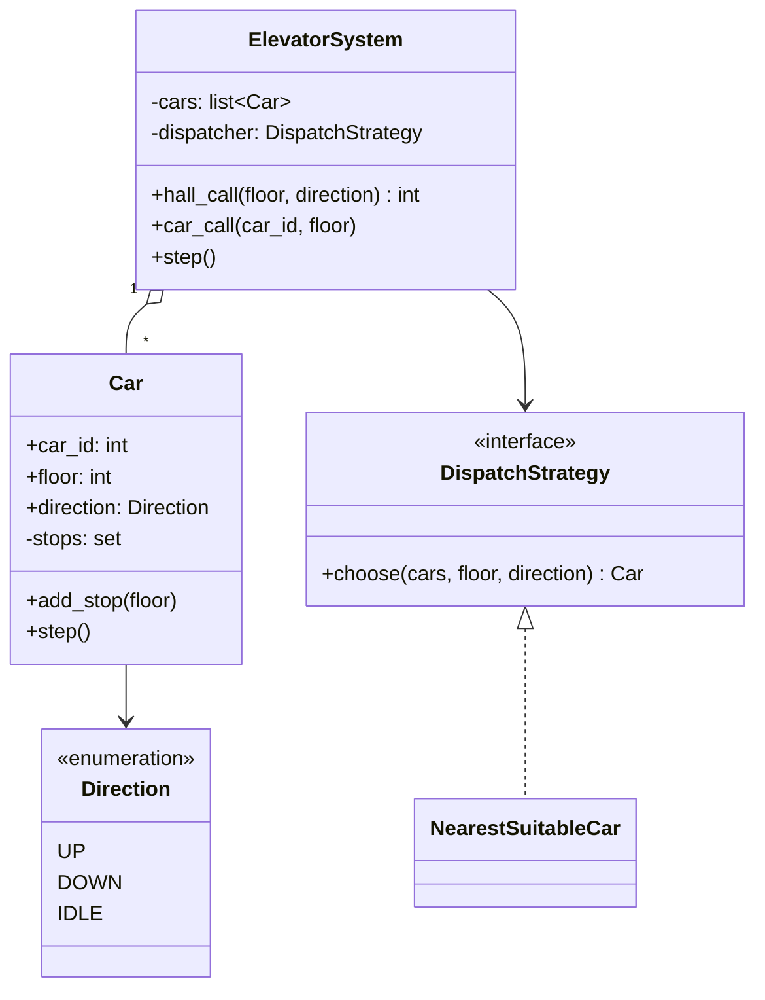

# LLD 05 · Elevator system

**Prompt.** Design the control software for a building with N floors and M elevator cars. People press up/down buttons on floors (hall calls) and floor buttons inside cars (car calls). Assign hall calls to cars and move cars efficiently.

## Clarifying questions

| Question | Assumed answer |
|---|---|
| Real time or simulation? | Discrete simulation: `step()` advances every car by one floor |
| Optimisation goal? | Low average wait; no starvation |
| Capacity, weight sensors, emergency mode? | Out of scope for code; discuss as states |
| Door timing? | A stop is one step with doors open (simplified) |

## Class diagram



## Key decisions

- **Each car runs the LOOK algorithm:** keep moving in the current direction while there are stops ahead; reverse when none remain ahead; go idle when there are no stops. It is the elevator version of disk-arm scheduling and avoids starvation that "always nearest stop" causes.
- **Dispatch is a strategy:** the cost of serving a hall call is the distance if the car is idle or already moving towards the floor in the same direction; otherwise the distance to finish its current run and come back. Other strategies (zoning, destination dispatch, energy saving) plug in without changing cars.
- **State lives in the car** (floor, direction, stops); the system only routes calls.
- **Concurrency:** in a real controller, calls arrive asynchronously; protect each car's stop set with a lock or process all events in one control loop (single-threaded event loop is common in embedded controllers).

## Python skeleton

```python
from enum import Enum


class Direction(Enum):
    UP = 1
    DOWN = -1
    IDLE = 0


class Car:
    def __init__(self, car_id: int, floors: int, start: int = 0):
        self.car_id, self.floor, self.top = car_id, start, floors - 1
        self.direction = Direction.IDLE
        self.stops = set()
        self.opened_at = []                      # floors where doors opened (for tests and logs)

    def add_stop(self, floor: int):
        if not 0 <= floor <= self.top:
            raise ValueError("no such floor")
        if floor == self.floor and self.direction == Direction.IDLE:
            self.opened_at.append(floor)         # already here: just open doors
            return
        self.stops.add(floor)
        if self.direction == Direction.IDLE:
            self.direction = Direction.UP if floor > self.floor else Direction.DOWN

    def _ahead(self):
        return [s for s in self.stops if (s - self.floor) * self.direction.value > 0]

    def step(self):
        if not self.stops:
            self.direction = Direction.IDLE
            return
        if not self._ahead():                    # LOOK: reverse only when nothing is ahead
            self.direction = Direction.DOWN if self.direction == Direction.UP else Direction.UP
        self.floor += self.direction.value
        if self.floor in self.stops:
            self.stops.remove(self.floor)
            self.opened_at.append(self.floor)
        if not self.stops:
            self.direction = Direction.IDLE


class DispatchStrategy:
    def choose(self, cars, floor, direction):
        raise NotImplementedError


class NearestSuitableCar(DispatchStrategy):
    def choose(self, cars, floor, direction):
        def cost(c: Car):
            d = floor - c.floor
            if c.direction == Direction.IDLE:
                return abs(d)
            if d * c.direction.value >= 0 and c.direction == direction:
                return abs(d)                    # on the way, same direction
            far = max(c.stops, key=lambda s: s * c.direction.value, default=c.floor)
            return abs(far - c.floor) + abs(far - floor) + 0.5   # finish the run, come back
        return min(cars, key=lambda c: (cost(c), c.car_id))


class ElevatorSystem:
    def __init__(self, floors: int, n_cars: int, dispatcher: DispatchStrategy):
        self.cars = [Car(i, floors) for i in range(n_cars)]
        self.dispatcher = dispatcher

    def hall_call(self, floor: int, direction: Direction) -> int:
        car = self.dispatcher.choose(self.cars, floor, direction)
        car.add_stop(floor)
        return car.car_id

    def car_call(self, car_id: int, floor: int):
        self.cars[car_id].add_stop(floor)

    def step(self, n: int = 1):
        for _ in range(n):
            for car in self.cars:
                car.step()


if __name__ == "__main__":
    sys_ = ElevatorSystem(floors=10, n_cars=2, dispatcher=NearestSuitableCar())
    assert sys_.hall_call(5, Direction.UP) == 0          # tie broken by id
    sys_.step(5)
    c0, c1 = sys_.cars
    assert c0.floor == 5 and c0.opened_at == [5] and c0.direction == Direction.IDLE
    sys_.car_call(0, 8)                                   # passenger goes to 8
    assert sys_.hall_call(3, Direction.UP) == 1           # car 0 is heading away; car 1 is closer
    sys_.step(3)
    assert c0.floor == 8 and c0.opened_at == [5, 8]
    assert c1.floor == 3 and c1.opened_at == [3]

    car = Car(9, floors=10, start=5)                      # LOOK order: up first, then down
    car.add_stop(7); car.add_stop(2)
    for _ in range(10):
        car.step()
    assert car.opened_at == [7, 2] and car.direction == Direction.IDLE
    print("elevator ok")
```

## Extensions to discuss

- **States beyond direction:** `DOORS_OPEN`, `MAINTENANCE`, `EMERGENCY` (go to ground floor, ignore calls), `OVERLOADED` (doors stay open). A state pattern keeps each state's rules separate.
- **Destination dispatch:** passengers enter their destination in the lobby and are grouped into cars by destination, reducing stops (used in many tall buildings).
- **Re-assignment:** if a car is delayed (doors held), re-run dispatch for its unserved hall calls.
- **Metrics:** average and p95 wait time from hall call to door opening; simulate morning up-peak and evening down-peak traffic.

## What interviewers look for

A clear split between per-car movement (LOOK) and system-level dispatch (strategy), correct direction and reversal logic, tests that demonstrate the order of stops, and a sensible discussion of states and starvation.

_Last reviewed: 2026-10_
