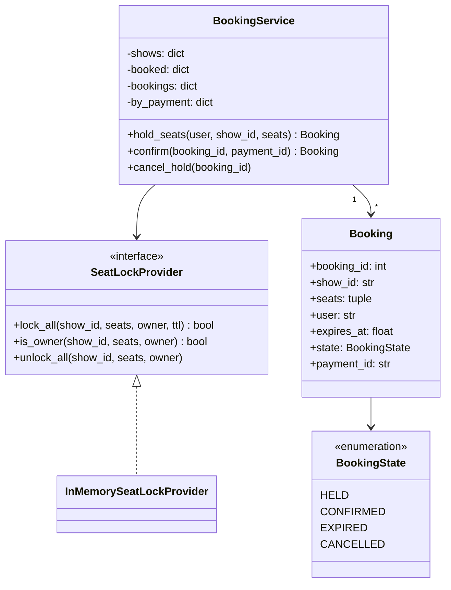

# LLD 06 · BookMyShow-style seat locking

**Prompt.** Design the seat-selection and booking core of a movie-ticket app: a user picks seats for a show, the seats are held while they pay, and the booking is confirmed on payment. Two users must never get the same seat. The scaled-up version of this problem is [case study 09](../case_studies/09_tatkal_flash_booking.md).

## Clarifying questions

| Question | Assumed answer |
|---|---|
| Partial holds? | No: a request for 3 seats holds all 3 or none |
| Hold duration? | Fixed (for example 10 minutes), configurable |
| Payment? | External gateway; confirmation arrives with a `payment_id`, possibly more than once |
| What if payment succeeds after the hold expired? | Confirm only if the seats are still free; otherwise fail and refund |
| One process or many? | Design the lock behind an interface; in-memory now, Redis or the database in production |

## Class diagram



## Key decisions

- **All-or-nothing holds.** Check every requested seat, then lock every seat, inside one critical section. Never lock seats one by one with separate calls: two users each holding half of a pair is a classic bug.
- **Locks expire by time (TTL)**, so abandoned checkouts free their seats without a cleanup job. An expired lock is treated as absent.
- **The lock provider is an interface.** In production the same contract is implemented by a database conditional update (`UPDATE show_seat SET held_by=?, held_until=? WHERE show_id=? AND seat_id IN (...) AND (held_until < now() OR held_by IS NULL) AND booked = false`, checking that the row count equals the number of seats) or by a Redis script that sets all seat keys with `NX` and an expiry atomically.
- **Idempotent confirmation.** Payment gateways retry callbacks; the `payment_id` is unique, and a repeated confirmation returns the existing booking.
- **Sorted seat order** everywhere, so any per-seat locking in a database cannot deadlock.

## Python skeleton

```python
import itertools
import threading
import time
from dataclasses import dataclass
from enum import Enum
from typing import Optional


class BookingState(Enum):
    HELD = "HELD"
    CONFIRMED = "CONFIRMED"
    EXPIRED = "EXPIRED"
    CANCELLED = "CANCELLED"


class SeatUnavailable(Exception):
    pass


@dataclass
class Booking:
    booking_id: int
    show_id: str
    seats: tuple
    user: str
    expires_at: float
    state: BookingState = BookingState.HELD
    payment_id: Optional[str] = None


class SeatLockProvider:
    def lock_all(self, show_id, seats, owner, ttl) -> bool: raise NotImplementedError
    def is_owner(self, show_id, seats, owner) -> bool: raise NotImplementedError
    def unlock_all(self, show_id, seats, owner) -> None: raise NotImplementedError


class InMemorySeatLockProvider(SeatLockProvider):
    def __init__(self, clock=time.monotonic):
        self.clock, self.locks, self._mu = clock, {}, threading.Lock()   # (show, seat) -> (owner, expires_at)

    def _holder(self, key):
        v = self.locks.get(key)
        return v[0] if v and v[1] > self.clock() else None

    def lock_all(self, show_id, seats, owner, ttl):
        with self._mu:
            keys = [(show_id, s) for s in seats]
            if any(self._holder(k) not in (None, owner) for k in keys):
                return False
            expires = self.clock() + ttl
            for k in keys:
                self.locks[k] = (owner, expires)
            return True

    def is_owner(self, show_id, seats, owner):
        with self._mu:
            return all(self._holder((show_id, s)) == owner for s in seats)

    def unlock_all(self, show_id, seats, owner):
        with self._mu:
            for s in seats:
                if self.locks.get((show_id, s), (None,))[0] == owner:
                    del self.locks[(show_id, s)]


class BookingService:
    def __init__(self, shows: dict, locks: SeatLockProvider, clock=time.monotonic, hold_seconds=600):
        self.shows = shows                                 # show_id -> set of seat ids
        self.booked = {sid: set() for sid in shows}
        self.bookings, self.by_payment = {}, {}
        self.locks, self.clock, self.hold = locks, clock, hold_seconds
        self._ids, self._mu = itertools.count(1), threading.Lock()

    def hold_seats(self, user, show_id, seats) -> Booking:
        seats = tuple(sorted(set(seats)))
        if not seats or not set(seats) <= self.shows[show_id]:
            raise ValueError("unknown seats")
        with self._mu:                                     # booked-check + lock as one step
            if set(seats) & self.booked[show_id]:
                raise SeatUnavailable("already booked")
            booking_id = next(self._ids)
            if not self.locks.lock_all(show_id, seats, booking_id, self.hold):
                raise SeatUnavailable("held by someone else")
            b = Booking(booking_id, show_id, seats, user, self.clock() + self.hold)
            self.bookings[booking_id] = b
            return b

    def confirm(self, booking_id, payment_id) -> Booking:
        with self._mu:
            if payment_id in self.by_payment:              # gateway retried the callback
                return self.bookings[self.by_payment[payment_id]]
            b = self.bookings[booking_id]
            if b.state == BookingState.CONFIRMED:
                return b
            if b.state != BookingState.HELD or not self.locks.is_owner(b.show_id, b.seats, booking_id):
                b.state = BookingState.EXPIRED
                raise SeatUnavailable("hold expired: refund payment " + payment_id)
            self.booked[b.show_id].update(b.seats)
            b.state, b.payment_id = BookingState.CONFIRMED, payment_id
            self.by_payment[payment_id] = booking_id
            self.locks.unlock_all(b.show_id, b.seats, booking_id)
            return b

    def cancel_hold(self, booking_id):
        with self._mu:
            b = self.bookings[booking_id]
            if b.state == BookingState.HELD:
                b.state = BookingState.CANCELLED
                self.locks.unlock_all(b.show_id, b.seats, booking_id)


if __name__ == "__main__":
    now = [0.0]
    clock = lambda: now[0]
    svc = BookingService({"show1": {"A1", "A2", "A3", "A4"}}, InMemorySeatLockProvider(clock), clock)
    b1 = svc.hold_seats("u1", "show1", ["A2", "A1"])
    try:
        svc.hold_seats("u2", "show1", ["A2", "A3"])        # overlaps A2: whole request fails
        raise AssertionError("expected SeatUnavailable")
    except SeatUnavailable:
        pass
    b2 = svc.hold_seats("u2", "show1", ["A3"])             # A3 was not left locked by the failure
    assert svc.confirm(b1.booking_id, "pay-1").state == BookingState.CONFIRMED
    assert svc.confirm(b1.booking_id, "pay-1") is b1      # duplicate callback is harmless
    try:
        svc.hold_seats("u3", "show1", ["A1"])
        raise AssertionError("expected SeatUnavailable")
    except SeatUnavailable:
        pass
    now[0] = 601                                           # u2's hold expires
    try:
        svc.confirm(b2.booking_id, "pay-2")
        raise AssertionError("expected SeatUnavailable")
    except SeatUnavailable:
        assert b2.state == BookingState.EXPIRED
    assert svc.hold_seats("u4", "show1", ["A3"]).state == BookingState.HELD

    winners = []                                           # 20 users race for A4
    def try_hold(u):
        try:
            winners.append(svc.hold_seats(u, "show1", ["A4"]).user)
        except SeatUnavailable:
            pass
    threads = [threading.Thread(target=try_hold, args=(f"r{i}",)) for i in range(20)]
    [t.start() for t in threads]; [t.join() for t in threads]
    assert len(winners) == 1
    print("seat locking ok")
```

## Extensions to discuss

- **Distributed locks:** with Redis, expiry-based locks can be lost (failover, long pauses), so the database must still enforce "a seat is booked once" with a unique constraint on (show_id, seat_id) in the bookings table. The lock improves user experience; the constraint guarantees correctness.
- **Seat map updates to other users:** publish hold/release events so open seat maps grey out seats within a second.
- **Fairness and abuse:** limit holds per user and per show; CAPTCHA for bulk holds.
- **Payment after expiry:** the refund path must be automatic and reconciled with the gateway's settlement report.

## What interviewers look for

All-or-nothing holds, TTL-based expiry, an idempotent confirm keyed by payment ID, a clear answer to "two users click the same seat at the same moment", and the insight that a lock is not a substitute for a uniqueness constraint in the database.

_Last reviewed: 2026-10_
