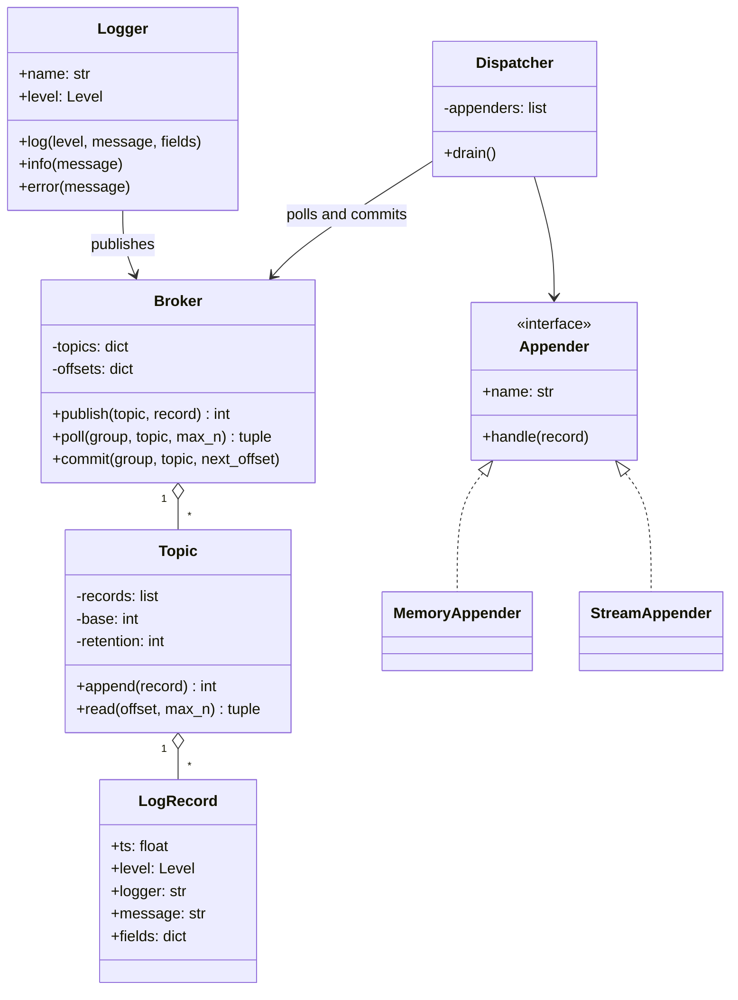

# LLD 07 · Logger and pub-sub

**Prompt.** Design a logging library with levels and multiple outputs (console, file, remote), where slow outputs must not slow the application. Build it on a small in-process publish-subscribe broker that other components can also use.

Two problems are often asked separately ("design a logger", "design a pub-sub system"); here the logger is the first client of the broker, which shows how the pieces fit.

## Clarifying questions

| Question | Assumed answer |
|---|---|
| Levels? | DEBUG < INFO < WARN < ERROR; per-logger threshold |
| Outputs? | Several appenders, each with its own formatter, independent progress and failures |
| Delivery guarantee? | At-least-once per appender: a failed appender retries the same records later |
| Ordering? | Per topic, in publish order |
| Memory bound? | Topic keeps the last N records (retention); a lagging consumer skips what was dropped |
| Synchronous or background? | The application only appends to the topic; a dispatcher (in a background thread in production, called directly in tests) delivers to appenders |

## Class diagram



## Key decisions

- **A topic is an append-only log with offsets**, like a tiny Kafka partition. Each subscriber (consumer group) keeps its own committed offset, so a slow or failing appender does not block the others.
- **Commit after handling** gives at-least-once delivery: if an appender fails mid-batch, the uncommitted records are delivered again next time. Appenders should therefore be idempotent (or tolerate duplicates); a remote log sink can deduplicate by offset.
- **Retention bounds memory.** When the topic trims old records, its base offset moves; a lagging consumer resumes at the base (it loses the oldest records rather than crashing the app). Production loggers make the same choice explicitly: drop, block, or sample under pressure.
- **Observer pattern** for appenders; **strategy** for formatters.
- **Level check before building the record**, so disabled debug logging is nearly free.

## Python skeleton

```python
import io
import json
import threading
import time
from dataclasses import dataclass, field
from enum import IntEnum


class Level(IntEnum):
    DEBUG = 10
    INFO = 20
    WARN = 30
    ERROR = 40


@dataclass(frozen=True)
class LogRecord:
    ts: float
    level: Level
    logger: str
    message: str
    fields: dict = field(default_factory=dict)


class Topic:
    def __init__(self, retention: int):
        self.records, self.base, self.retention = [], 0, retention
        self._mu = threading.Lock()

    def append(self, record) -> int:
        with self._mu:
            self.records.append(record)
            offset = self.base + len(self.records) - 1
            overflow = len(self.records) - self.retention
            if overflow > 0:
                del self.records[:overflow]
                self.base += overflow
            return offset

    def read(self, offset: int, max_n: int):
        with self._mu:
            start = max(offset, self.base)         # older records were dropped by retention
            i = start - self.base
            return start, self.records[i:i + max_n]


class Broker:
    def __init__(self, retention: int = 10_000):
        self.retention, self.topics, self.offsets = retention, {}, {}
        self._mu = threading.Lock()

    def _topic(self, name) -> Topic:
        with self._mu:
            return self.topics.setdefault(name, Topic(self.retention))

    def publish(self, topic: str, record) -> int:
        return self._topic(topic).append(record)

    def poll(self, group: str, topic: str, max_n: int = 100):
        with self._mu:
            offset = self.offsets.get((group, topic), 0)
        return self._topic(topic).read(offset, max_n)

    def commit(self, group: str, topic: str, next_offset: int):
        with self._mu:
            self.offsets[(group, topic)] = next_offset


class Appender:
    name = "appender"

    def handle(self, record: LogRecord):
        raise NotImplementedError


class MemoryAppender(Appender):
    def __init__(self, name="memory"):
        self.name, self.records = name, []

    def handle(self, record):
        self.records.append(record)


class StreamAppender(Appender):
    def __init__(self, stream, name="stream", formatter=None):
        self.name, self.stream = name, stream
        self.format = formatter or (lambda r: json.dumps(
            {"ts": r.ts, "level": r.level.name, "logger": r.logger, "msg": r.message, **r.fields}))

    def handle(self, record):
        self.stream.write(self.format(record) + "\n")


class Dispatcher:
    """One consumer group per appender. Run drain() in a loop on a background thread in production."""
    def __init__(self, broker: Broker, topic: str, appenders):
        self.broker, self.topic, self.appenders = broker, topic, appenders

    def drain(self, batch: int = 100):
        for a in self.appenders:
            while True:
                start, records = self.broker.poll(a.name, self.topic, batch)
                if not records:
                    break
                try:
                    for i, r in enumerate(records):
                        a.handle(r)
                except Exception:
                    self.broker.commit(a.name, self.topic, start + i)  # keep progress; retry the failed one
                    break
                self.broker.commit(a.name, self.topic, start + len(records))


class Logger:
    def __init__(self, name: str, broker: Broker, level=Level.INFO, topic="logs", clock=time.time):
        self.name, self.broker, self.level, self.topic, self.clock = name, broker, level, topic, clock

    def log(self, level: Level, message: str, **fields):
        if level < self.level:                        # cheap early exit
            return None
        return self.broker.publish(self.topic, LogRecord(self.clock(), level, self.name, message, fields))

    def debug(self, m, **f): return self.log(Level.DEBUG, m, **f)
    def info(self, m, **f): return self.log(Level.INFO, m, **f)
    def warn(self, m, **f): return self.log(Level.WARN, m, **f)
    def error(self, m, **f): return self.log(Level.ERROR, m, **f)


if __name__ == "__main__":
    broker = Broker(retention=5)
    log = Logger("orders", broker, level=Level.INFO, clock=lambda: 1.0)
    assert log.debug("ignored") is None
    log.info("order placed", order_id=7)
    log.error("payment failed", order_id=7)

    class Flaky(Appender):
        name = "flaky"
        def __init__(self):
            self.seen, self.fail_once = [], True
        def handle(self, r):
            if r.level == Level.ERROR and self.fail_once:
                self.fail_once = False
                raise IOError("sink down")
            self.seen.append(r.message)

    mem, flaky, out = MemoryAppender(), Flaky(), io.StringIO()
    d = Dispatcher(broker, "logs", [mem, StreamAppender(out), flaky])
    d.drain()
    assert [r.message for r in mem.records] == ["order placed", "payment failed"]
    assert flaky.seen == ["order placed"]                 # failed on the error record
    assert '"level": "ERROR"' in out.getvalue()
    d.drain()                                             # retry delivers the failed record
    assert flaky.seen == ["order placed", "payment failed"]

    for i in range(10):                                   # retention: only the last 5 remain
        log.info(f"m{i}")
    late = MemoryAppender("late")
    Dispatcher(broker, "logs", [late]).drain()
    assert [r.message for r in late.records] == ["m5", "m6", "m7", "m8", "m9"]
    print("logger pub-sub ok")
```

## Extensions to discuss

- **Background dispatch:** a thread that calls `drain()` when notified (condition variable) or every 100 ms; flush on shutdown.
- **Back-pressure policy** per topic: drop oldest (as here), block the producer, or sample DEBUG first.
- **Partitions:** several topics or partitions keyed by logger name for parallel consumers while keeping per-key order.
- **Remote sink:** batch records, compress, retry with backoff, deduplicate by (host, offset) on the server.
- **Structured fields and correlation IDs:** add request ID and trace ID automatically from context (OpenTelemetry).

## What interviewers look for

Separation of producing from delivering, per-subscriber progress (offsets) so one slow output cannot block others, an explicit delivery guarantee with its consequence (duplicates), bounded memory, and levels that are cheap when disabled.

_Last reviewed: 2026-10_
