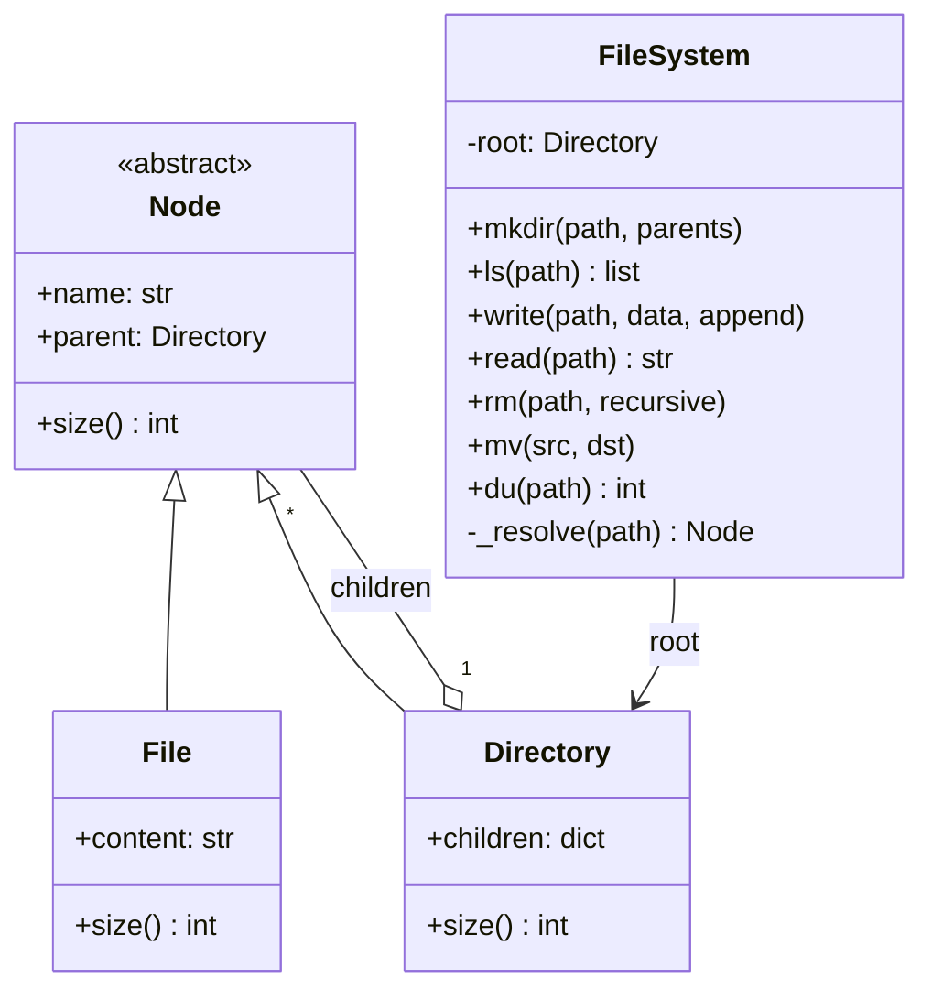

# LLD 08 · In-memory file system

**Prompt.** Design an in-memory, Unix-like file system: create directories (`mkdir -p`), list (`ls`), write and append files, read, remove, move, and report sizes.

## Clarifying questions

| Question | Assumed answer |
|---|---|
| Paths? | Absolute, `/`-separated; `.` and `..` supported |
| File content? | Text (bytes as an extension) |
| `ls` on a file? | Returns the file's name, as Unix does |
| Remove a non-empty directory? | Only with `recursive=True` |
| Permissions, links, concurrency? | Extensions to discuss |

## Class diagram



## Key decisions

- **Composite pattern:** `File` and `Directory` share a `Node` base; `size()` on a directory sums its children recursively, and callers treat both uniformly.
- **One path resolver** normalises `.`, `..` and repeated slashes, then walks from the root; every operation uses it, so path bugs are fixed in one place.
- **Errors use Python's built-in exceptions** with Unix meaning: `FileNotFoundError`, `NotADirectoryError`, `IsADirectoryError`, `FileExistsError`, and `OSError` for a non-empty directory.
- **Children in a dict** for O(1) lookup by name; `ls` sorts on output.
- **Moving a directory into its own subtree is rejected** (it would detach a cycle from the tree).

## Python skeleton

```python
class Node:
    def __init__(self, name, parent=None):
        self.name, self.parent = name, parent

    def size(self) -> int:
        raise NotImplementedError


class File(Node):
    def __init__(self, name, parent=None, content=""):
        super().__init__(name, parent)
        self.content = content

    def size(self):
        return len(self.content.encode("utf-8"))


class Directory(Node):
    def __init__(self, name, parent=None):
        super().__init__(name, parent)
        self.children = {}

    def size(self):
        return sum(child.size() for child in self.children.values())


def _parts(path: str):
    if not path.startswith("/"):
        raise ValueError("absolute paths only")
    out = []
    for p in path.split("/"):
        if p in ("", "."):
            continue
        if p == "..":
            if out:
                out.pop()
        else:
            out.append(p)
    return out


class FileSystem:
    def __init__(self):
        self.root = Directory("")

    def _resolve(self, parts) -> Node:
        node = self.root
        for i, name in enumerate(parts):
            if not isinstance(node, Directory):
                raise NotADirectoryError("/" + "/".join(parts[:i]))
            node = node.children.get(name)
            if node is None:
                raise FileNotFoundError("/" + "/".join(parts[:i + 1]))
        return node

    def _parent_dir(self, parts) -> Directory:
        if not parts:
            raise PermissionError("cannot modify the root itself")
        parent = self._resolve(parts[:-1])
        if not isinstance(parent, Directory):
            raise NotADirectoryError("/" + "/".join(parts[:-1]))
        return parent

    def mkdir(self, path, parents=True):
        node = self.root
        for i, name in enumerate(_parts(path)):
            child = node.children.get(name)
            if child is None:
                if not parents and i < len(_parts(path)) - 1:
                    raise FileNotFoundError(name)
                child = node.children[name] = Directory(name, node)
            elif not isinstance(child, Directory):
                raise FileExistsError(name + " is a file")
            node = child

    def ls(self, path="/"):
        node = self._resolve(_parts(path))
        return [node.name] if isinstance(node, File) else sorted(node.children)

    def write(self, path, data: str, append=False):
        parts = _parts(path)
        parent = self._parent_dir(parts)
        node = parent.children.get(parts[-1])
        if isinstance(node, Directory):
            raise IsADirectoryError(path)
        if node is None:
            node = parent.children[parts[-1]] = File(parts[-1], parent)
        node.content = node.content + data if append else data

    def read(self, path) -> str:
        node = self._resolve(_parts(path))
        if isinstance(node, Directory):
            raise IsADirectoryError(path)
        return node.content

    def rm(self, path, recursive=False):
        parts = _parts(path)
        parent = self._parent_dir(parts)
        node = self._resolve(parts)
        if isinstance(node, Directory) and node.children and not recursive:
            raise OSError("directory not empty: " + path)
        del parent.children[node.name]

    def mv(self, src, dst):
        sp, dp = _parts(src), _parts(dst)
        node = self._resolve(sp)
        if isinstance(node, Directory) and dp[:len(sp)] == sp:
            raise OSError("cannot move a directory into itself")
        try:                                       # moving into an existing directory keeps the name
            target = self._resolve(dp)
            if isinstance(target, Directory):
                dp = dp + [node.name]
            else:
                raise FileExistsError(dst)
        except FileNotFoundError:
            pass
        new_parent = self._parent_dir(dp)
        if dp[-1] in new_parent.children:
            raise FileExistsError(dst)
        del self._parent_dir(sp).children[node.name]
        node.name, node.parent = dp[-1], new_parent
        new_parent.children[node.name] = node

    def du(self, path="/") -> int:
        return self._resolve(_parts(path)).size()


if __name__ == "__main__":
    fs = FileSystem()
    fs.mkdir("/home/asha/notes")
    fs.write("/home/asha/notes/todo.txt", "buy milk\n")
    fs.write("/home/asha/notes/todo.txt", "call bank\n", append=True)
    assert fs.read("/home/asha/./notes/../notes/todo.txt") == "buy milk\ncall bank\n"
    assert fs.ls("/home/asha") == ["notes"] and fs.ls("/home/asha/notes/todo.txt") == ["todo.txt"]
    fs.write("/home/asha/hello.txt", "नमस्ते")          # 6 Devanagari code points, 18 bytes
    assert fs.du("/home/asha/hello.txt") == 18 and fs.du("/") == 19 + 18
    for bad, exc in [(lambda: fs.read("/home/asha"), IsADirectoryError),
                     (lambda: fs.read("/nope"), FileNotFoundError),
                     (lambda: fs.ls("/home/asha/hello.txt/x"), NotADirectoryError),
                     (lambda: fs.rm("/home"), OSError),
                     (lambda: fs.mv("/home", "/home/asha/inside"), OSError)]:
        try:
            bad()
            raise AssertionError("expected " + exc.__name__)
        except exc:
            pass
    fs.mkdir("/archive")
    fs.mv("/home/asha/notes", "/archive")               # into an existing directory
    assert fs.ls("/archive/notes") == ["todo.txt"] and fs.ls("/home/asha") == ["hello.txt"]
    fs.mv("/archive/notes/todo.txt", "/archive/done.txt")  # rename
    assert fs.read("/archive/done.txt").startswith("buy")
    fs.rm("/archive", recursive=True)
    assert fs.ls("/") == ["home"]
    print("file system ok")
```

## Extensions to discuss

- **Metadata:** timestamps, owner and permission bits checked in `_resolve` and on writes.
- **Hard and symbolic links:** inodes separate from names (a name maps to an inode; several names can share one); symbolic links resolved with a loop limit.
- **Concurrency:** a lock per directory for structure changes and per file for content, acquired in path order to avoid deadlocks; or one global lock for simplicity.
- **Search:** `find` by name pattern with a depth-first walk; an index by name for speed.
- **Persistence:** a write-ahead log of operations replayed on start (the same idea as a journaling file system).

## What interviewers look for

A clean composite model, one correct path resolver, the right errors for each misuse, `mkdir -p` semantics, and careful `mv` (into an existing directory, rename, and refusing to move a directory into itself).

_Last reviewed: 2026-10_
