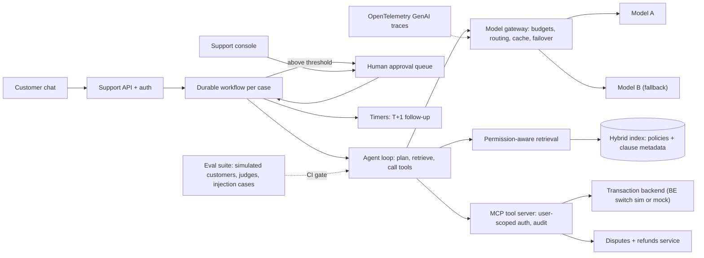

# AIE · Flagship project: a durable, evaluated payments-support agent platform

| Major | Level | Time | Budget | Builds on |
|---|---|---|---|---|
| [AI Engineering: LLM Applications and Agents](../../03_majors/ai_engineering/README.md) | L3 → L4 | MVP 2–3 weeks · v1 6–8 weeks · scale-up 4+ weeks | Laptop; ≤ ₹3,000 of model API usage in total (local models allowed) | AIE303 P2, AIE304 P2, AIE305 P2, AIE403 P2, AIE401 P3, AIE404 P2 |

You build the AI agent that handles payment-support conversations for an illustrative Indian payments app: "my UPI payment failed but money was debited", "refund my order", "why was I charged twice". The agent retrieves the right policy with permission checks, looks up transactions through tools, opens disputes and proposes refunds, waits days for reversal deadlines without losing state, asks a human to approve anything above a threshold, and resists instructions hidden in merchant names, transaction notes and documents. Around it you build what makes an agent shippable: an evaluation suite with simulated customers and calibrated judges that gates every change in CI, a model gateway with budgets, routing and failover, tracing, and a written launch decision. The company, its policies and customers are an **illustrative scenario**; the transaction backend can be your [BE flagship](BE_backend_engineering.md) switch simulator or a simple mock.

## 1. The problem and why it matters

Agents are moving from demos into production work. In the 2026 Stack Overflow survey, 26.2% of respondents used AI agents or automated workflows at work ([market map](../01_market_map/README.md)), and payments are a live frontier: Razorpay, NPCI and OpenAI piloted agentic UPI payments in October 2025 ([Razorpay](https://razorpay.com/newsroom/razorpay-npci-and-openai-come-together-to-launch-agentic-payments-ushering-in-ai-driven-commerce-at-national-scale/)). The engineering problems are well documented. τ-bench measured agents on simulated customer-service tasks with domain policies and showed that consistency across repeated trials (its pass^k metric) is much lower than single-trial success ([Yao et al., 2024](https://arxiv.org/abs/2406.12045)). Prompt injection remains the top risk for LLM applications ([OWASP LLM01](https://genai.owasp.org/llmrisk/llm01-prompt-injection/)), and agent-specific risks such as tool misuse and excessive agency have their own list ([OWASP Agentic Top 10, 2026](https://genai.owasp.org/resource/owasp-top-10-for-agentic-applications-for-2026/)).

Payments support also has hard rules to follow. The RBI requires failed UPI transfers to be auto-reversed by T+1 and sets compensation for delays ([RBI, 2019](https://www.rbi.org.in/Scripts/NotificationUser.aspx?Id=11693)), so an agent that promises the wrong timeline or refunds twice causes real harm. AI engineers are hired to make systems like this reliable: grounded answers, safe tools, durable workflows, measured quality and controlled cost ([AIE role page](../01_market_map/roles/AIE_ai_engineering.md)).

## 2. What you build

- **Permission-aware retrieval** (AIE303): a corpus of public rules (RBI circular above) plus the company's own refund, dispute and fee policies that you write; documents tagged customer-visible or internal; merchant-specific documents visible only to that merchant's support staff; hybrid search with reranking; answers cite clauses.
- **Tools through MCP** ([Model Context Protocol](https://modelcontextprotocol.io/specification/2026-07-28)): read-only transaction lookup, dispute creation, refund proposal, customer notification; each tool with typed inputs, authorisation tied to the end user, rate limits and audit logs ([MCP security best practices](https://modelcontextprotocol.io/docs/2026-07-28/tutorials/security/security_best_practices)).
- **Durable agent workflows** (AIE304): each case runs as a workflow on [Temporal](https://docs.temporal.io/workflows) or a similar engine, so it survives crashes, waits for timers (for example "check again after T+1"), retries tools idempotently and pauses for human approval.
- **Human approval**: refunds above a threshold, policy exceptions and any action the agent is unsure about go to an approval queue with the evidence attached; approvers can edit or reject.
- **Evaluation suite** (AIE305): 200+ scenarios with a simulated customer (an LLM playing a persona with a hidden goal), ground-truth end states, policy checks and pass^k reliability; retrieval tests; LLM judges for groundedness and tone calibrated against human labels; 60+ injection cases; all run in CI as a regression gate.
- **Model gateway** (AIE403): one internal API for all model calls with per-tenant budgets, routing (a small model for classification, a larger one for complex cases), caching, timeouts, provider failover, and traces following the [OpenTelemetry GenAI conventions](https://opentelemetry.io/docs/specs/semconv/gen-ai/).
- **Support console** (AIE404): a simple UI for human agents showing the conversation, the agent's plan, tool calls, citations and pending approvals.
- **Launch decision**: a written go/no-go with eval results, risks, a staged rollout plan and rollback criteria.

Follow a simple design first and add autonomy only where evals show it pays ([Anthropic, Building effective agents](https://www.anthropic.com/engineering/building-effective-agents)).

## 3. Scope tiers

| Tier | Time | Scope |
|---|---|---|
| **MVP** | 2–3 weeks | Retrieval with citations and permission filters; read-only transaction tool; single-turn and short multi-turn answers; 50-scenario eval run locally; traces |
| **v1** | 6–8 weeks | Dispute and refund tools via MCP; durable workflows with timers and approvals; simulated-customer eval suite with pass^k; calibrated judges; injection suite; CI gate; gateway with budgets, routing and failover; support console; launch decision; ADRs, demo, write-up |
| **Scale-up** | 4+ weeks | Hindi and Hinglish conversations with their own eval slice; a fine-tuned small model for intent classification compared with prompting (AIE402); multi-agent hand-off to a specialist dispute agent with measured benefit or no benefit |

## 4. Requirements

**Functional**

1. Answer policy questions with clause-level citations; say "I don't know" or escalate when the corpus does not cover the question.
2. Look up the customer's own transactions only; never reveal other customers' or merchants' data.
3. Open a dispute or propose a refund through tools; refunds above ₹2,000 (illustrative threshold) or outside policy require human approval.
4. Track each case durably across days, including scheduled follow-ups after reversal deadlines.
5. Hand over to a human with a summary when the customer asks, when confidence is low, or when the case is out of scope.

**Non-functional**

| Concern | Requirement |
|---|---|
| Reliability | Task success and pass^k reported on the scenario suite; regression gate in CI |
| Safety | No unapproved refunds; no cross-customer data; injection cases do not trigger tools or leak data |
| Durability | Worker crashes at any step cause no lost or duplicated actions |
| Latency | p95 time to first token ≤ 2 s; p95 turn completion ≤ 8 s excluding human waits |
| Cost | Cost per resolved case reported; hard budget per tenant per day; graceful degradation when budgets run out |
| Availability | Provider outage triggers failover to a second model within 5 s |
| Observability | Every turn traced with model, tokens, tools, latency and cost; prompts versioned |
| Privacy | Personal data minimised in prompts and logs; retention configured |

## 5. Reference architecture

ADRs to write: workflow engine; agent pattern (fixed workflow, router or open loop) per case type; retrieval design and permission filtering; tool authorisation model; approval thresholds; eval design and judge calibration; gateway routing and failover; prompt versioning; data retention.

## 6. Milestones and deliverables

| Week | Milestone | Deliverable |
|---|---|---|
| 1 | Design | Design doc draft; policy corpus written; 50 scenarios; ADR-001 to ADR-003 |
| 2 | Retrieval | Permission-aware hybrid retrieval with citations; retrieval tests |
| 3 | **MVP** | Read-only agent; eval run; traces; first cost and latency numbers |
| 4 | Tools | MCP server with dispute and refund tools; authorisation and audit |
| 5 | Durability | Workflows with timers and approvals; crash tests |
| 6 | Evals | 200+ scenarios with simulated customers; judges calibrated against 150 human labels; injection suite; CI gate |
| 7 | Gateway and console | Budgets, routing, failover; support console |
| 8 | **v1** | Launch decision memo, eval report, ADRs, `AI_USE.md`, demo, write-up |

## 7. Acceptance criteria

| Criterion | Target | Evidence |
|---|---|---|
| Task success | ≥ 80% of 200 held-out scenarios reach the correct end state; pass^3 reported | Eval report |
| Policy safety | 0 refunds above threshold or outside policy without approval across all eval runs | Audit log analysis |
| Permissions | 0 leaks in 200 permission tests (other customers, other merchants, internal documents) | Test report |
| Groundedness | ≥ 95% of policy claims supported by the cited clause, judged by a calibrated judge | Eval report |
| Judge calibration | Judge agreement with human labels ≥ 85% on 150 items; Cohen's kappa reported | Calibration report |
| Injection | 0 of 60 injection cases cause an unauthorised tool call, policy breach or data leak | Eval report |
| Durability | 50 worker kills at random steps: 0 lost cases, 0 duplicate refunds, all workflows resume | Chaos test log |
| Failover and latency | Provider outage drill: failover ≤ 5 s; p95 turn ≤ 8 s during the drill | Gateway metrics |
| Cost | Cost per resolved case and per 1,000 conversations reported; budget cap enforced in a test | Cost report |
| CI gate | A planted prompt regression and a planted retrieval regression both block the merge | CI history |
| Launch decision | Memo with go/no-go, risks, staged rollout and rollback criteria, reviewed by a peer | Memo and review note |

## 8. Data plan

| Data | Source | Licence | Use |
|---|---|---|---|
| Public rules | RBI failed-transaction turnaround circular and other public RBI and NPCI documents | Public documents; cite version dates | Retrieval corpus |
| Company policies | Written by you (refunds, disputes, fees, escalation) | Yours | Retrieval corpus and policy checks |
| Transactions and customers | Synthetic, from your generator or the BE flagship simulator | Yours | Tools and scenarios |
| Scenarios and labels | Written by you and a peer; personas for the simulated customer | Yours | Evaluation |
| Injection cases | Written by you from the OWASP categories, describing the attack goal at a high level and checking the defence | Yours | Defensive evaluation |

No real customer data is used. Synthetic phone numbers and UPI IDs use clearly fake formats.

## 9. Compute and cost

Everything runs on a laptop: the workflow engine, vector store, MCP server, gateway and console in Docker. Model usage is capped at ₹3,000 for the whole project with hard limits in the gateway; use a small local model for classification and for most eval iterations, and a hosted model for final runs. Report the cost of a full eval run and keep it affordable enough to run on every merge (for example by running a fast subset per merge and the full suite nightly).

## 10. AI-use policy

- **You may delegate:** UI code, Dockerfiles, MCP server boilerplate from your tool specs, synthetic data generators, first drafts of scenario descriptions (reviewed), documentation drafts.
- **You must write and verify yourself:** tool authorisation, the approval logic and thresholds, workflow code that touches money, permission filtering in retrieval, eval scenarios' ground truth and human labels, the judge rubrics, and the launch decision.
- **Verify AI output by:** the eval suite and CI gate; reading every tool call in a sample of transcripts; checking judge outputs against your labels; crash tests after any workflow change.
- **Record:** `AI_USE.md`, including the agent's worst failures in evaluation and how design changes (not just prompt edits) fixed them.

## 11. Write-up and demo checklist

- [ ] README with the results table (task success, pass^k, safety, cost, latency) and one-command start
- [ ] Design doc, 10+ ADRs, eval report, judge calibration report, launch decision memo
- [ ] `AI_USE.md`
- [ ] Demo (2 minutes): a "money debited but payment failed" case; the agent cites the T+1 rule, opens a dispute and schedules a follow-up; kill the worker and show the case resume; a merchant name containing an injected instruction has no effect; a large refund waits for approval; the cost and trace view
- [ ] Write-up: "What it took to trust an agent with refunds"

## 12. What it signals to employers

You can build an agent that is grounded, permission-safe, durable and measured, and you can say with evidence when it is ready to launch and when it is not. That is the core of AI engineering roles, and it is far more convincing than a chatbot demo.

## 13. Stretch goals toward L4 and L5

- **L4:** a governed agent platform slice (AIE401 P3): tool registry, per-tool policies, tenant isolation and audit, used by a second agent built by a peer.
- **L4:** Hindi and Hinglish support with its own eval slice and a measured comparison of approaches.
- **L5:** a study of utility versus security for agents that read untrusted content (AIE501 P2): vary defences, measure task success and attack success on your suite, and publish the suite and results.

## Sources

All checked October 2026.

- Yao et al., *τ-bench: A Benchmark for Tool-Agent-User Interaction in Real-World Domains* (2024). https://arxiv.org/abs/2406.12045
- Razorpay, NPCI and OpenAI agentic payments (Oct 2025). https://razorpay.com/newsroom/razorpay-npci-and-openai-come-together-to-launch-agentic-payments-ushering-in-ai-driven-commerce-at-national-scale/
- RBI, Harmonisation of turnaround time for failed transactions (2019). https://www.rbi.org.in/Scripts/NotificationUser.aspx?Id=11693
- OWASP GenAI, LLM01 Prompt Injection. https://genai.owasp.org/llmrisk/llm01-prompt-injection/ ; Top 10 for Agentic Applications for 2026. https://genai.owasp.org/resource/owasp-top-10-for-agentic-applications-for-2026/
- Model Context Protocol specification (2026-07-28). https://modelcontextprotocol.io/specification/2026-07-28 ; security best practices. https://modelcontextprotocol.io/docs/2026-07-28/tutorials/security/security_best_practices
- Temporal documentation, workflows. https://docs.temporal.io/workflows
- OpenTelemetry semantic conventions for generative AI. https://opentelemetry.io/docs/specs/semconv/gen-ai/
- Anthropic, *Building effective agents*. https://www.anthropic.com/engineering/building-effective-agents
- Stack Overflow 2026 survey figures as summarised in the [market map](../01_market_map/README.md).

_Last reviewed: 2026-10_
