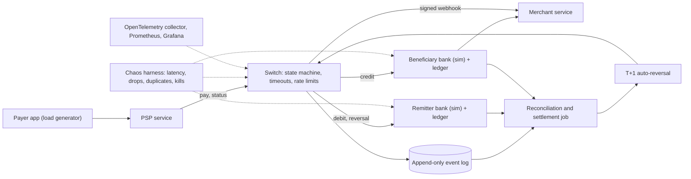

# BE · Flagship project: a UPI-style payment switch you can break

| Major | Level | Time | Budget | Builds on |
|---|---|---|---|---|
| [Backend Engineering](../../03_majors/backend_engineering/README.md) | L3 → L4 | MVP 2–3 weeks · v1 6–8 weeks · scale-up 4+ weeks | Laptop with 16 GB RAM; ₹0 required | BE301 P3, BE303 P3, BE304 P3, BE401 P2 and P3, BE402 P3, BE403 P3, BE404 P3 |

You build a teaching simulation of a real-time, account-to-account payment network: a payer's app backend, a central switch, at least two simulated banks with double-entry ledgers, a merchant, and a daily reconciliation and settlement process. Then you prove that money is never created or lost when networks time out, messages arrive twice, a bank goes down mid-payment, or clients flood the switch with status checks. The design is inspired by public descriptions of UPI. It is **not** NPCI's design, uses no real bank or customer data and connects to nothing real.

## 1. The problem and why it matters

India's Unified Payments Interface (UPI) processed 24.07 billion transactions worth ₹29.37 lakh crore in September 2026, about 802 million a day ([DD News, 2 Oct 2026](https://ddindia.co.in/2026/10/upi-transactions-surge-23-to-24-07-billion-in-september-npci/)). At that scale, unhappy paths are daily events. On 12 April 2025 UPI was disrupted for hours; NPCI attributed it to some banks flooding the switch with "check transaction status" requests, including for old transactions ([Outlook Money](https://www.outlookmoney.com/banking/upi-outage-attributed-to-surge-in-api-calls-from-banks-says-npci); [IANS, 29 Apr 2025](https://ianslive.in/npci-directs-banks-to-limit-check-transaction-api-usage-to-avoid-upi-outage--20250429145943)). NPCI then set hard rules: the first status check no earlier than 90 seconds after a transaction, at most three checks within two hours, and API response times cut from 30 seconds to 10–15 seconds from 16 June 2025 ([IANS](https://ianslive.in/npci-directs-banks-to-limit-check-transaction-api-usage-to-avoid-upi-outage--20250429145943); [MediaNama, Jun 2025](https://www.medianama.com/2025/06/223-npci-upi-changes-transaction-speed-fraud-prevention/)). The RBI requires failed UPI transfers to be auto-reversed by T+1 ([RBI, 2019](https://www.rbi.org.in/Scripts/NotificationUser.aspx?Id=11693)).

The engineering behind these rules is the core of backend work that AI does not do reliably: idempotency (Stripe's public design uses client-supplied idempotency keys so a retried request never charges twice; [Stripe blog](https://stripe.com/blog/idempotency), [Stripe API docs](https://docs.stripe.com/api/idempotent_requests), and an [IETF draft](https://datatracker.ietf.org/doc/draft-ietf-httpapi-idempotency-key-header/) standardising the header), timeouts with an "unknown" outcome, immutable double-entry ledgers ([Stripe Ledger, 2024](https://stripe.dev/blog/ledger-stripe-system-for-tracking-and-validating-money-movement)) and reconciliation. The [BE role page](../01_market_map/roles/BE_backend_engineering.md) lists exactly these as "growing in value", because AI writes the happy path well and money lives in the unhappy paths.

## 2. What you build

- **PSP service** (the payer's app backend): accepts a pay request with an idempotency key, resolves a virtual payment address (VPA) through the switch, and exposes status to the app.
- **Switch**: routes by VPA handle, drives each payment through an explicit state machine, enforces per-hop timeouts, rate-limits status checks to the rules above, and writes an append-only event log.
- **Bank simulators** (at least two; configurable latency, error rate, crash points): each holds accounts in PostgreSQL with a double-entry ledger, debit and credit APIs that are idempotent, and a "reversal" API.
- **Merchant service**: receives signed webhooks (HMAC with timestamp and replay window) and must not ship an order twice.
- **Reconciliation and settlement**: a daily job that matches the switch log against each bank's ledger, produces settlement files, raises exceptions, and auto-reverses unresolved debits by T+1 on a simulated clock.
- **Chaos harness**: injects latency, drops, duplicates, reorderings and process kills (for example with Toxiproxy and `docker kill`) and checks invariants after every run.
- **Optional AI piece (BE403)**: a read-only "explain this payment" endpoint that turns a transaction's event log into a plain-language timeline for support staff, grounded only on that log, with a small eval set.

The payment state machine is the heart of the project: `CREATED → DEBIT_PENDING → DEBITED → CREDIT_PENDING → SUCCESS`, with `DEEMED` (outcome unknown after a timeout), `REVERSAL_PENDING → REVERSED` and `FAILED`. You write its transition table by hand and test it exhaustively.

## 3. Scope tiers

| Tier | Time | Scope |
|---|---|---|
| **MVP** | 2–3 weeks | PSP, switch, two banks; person-to-person push payments; idempotency keys; state machine; ledgers; timeouts and status checks; unit, property and integration tests; `docker compose up` runs everything; one load number |
| **v1** | 6–8 weeks | Merchant payments with signed webhooks; reconciliation, settlement files and T+1 auto-reversal; chaos suite; load test at target throughput; OpenTelemetry traces, metrics and SLO dashboards; mTLS between services; design doc, ADRs, runbooks, one real postmortem; optional AI explainer with evals |
| **Scale-up** | 4+ weeks | Event backbone with transactional outbox and change data capture (BE304); partitioned switch; active-passive failover drill across two "regions"; 10× spike test with load shedding (BE402); a TLA+ model or deterministic simulation of the state machine |

## 4. Requirements

**Functional**

1. Pay by VPA, with amount limits and a reason string; reject unknown VPAs.
2. Every mutating request carries an idempotency key; a repeat with the same key and body returns the original result; a repeat with a different body is rejected.
3. Status query by transaction ID, rate-limited per the rules in section 1 (time may be scaled in tests).
4. Reversal of a debited payment whose credit failed or is unknown, idempotent and auditable.
5. Merchant webhooks signed, retried with backoff, and deduplicated by the receiver.
6. Daily reconciliation producing matched, mismatched and missing records, and a settlement file per bank.
7. An operator API to view a payment's full event history.

**Non-functional**

| Concern | Requirement |
|---|---|
| Correctness | The sum of all ledger balances is constant across any run; every payment reaches a terminal state by T+1 (simulated) |
| Throughput | Sustain 500 payments per second end to end on the reference laptop (record the hardware) |
| Latency | Switch p99 ≤ 300 ms excluding injected bank delay; per-hop timeouts configurable (default 10 s) |
| Availability | The switch keeps accepting payments while one bank is down; affected payments fail fast or go `DEEMED`, never hang |
| Security | mTLS between services; webhook HMAC with a 5-minute replay window; no full VPA, account number or name in logs; secrets outside the repo |
| Observability | One trace per payment across all services; RED metrics per service; an SLO and burn-rate alert for payment success |
| Cost | Runs fully on a laptop; any cloud load test is capped at ₹1,000 and torn down the same day |

## 5. Reference architecture

Key decisions to record as ADRs: the database and isolation level for ledgers; where idempotency records live and how long they are kept; the timeout and retry policy per hop; whether the switch is synchronous or event-driven; the clock used for T+1; and how you prove ledger invariants.

## 6. Milestones and deliverables

| Week | Milestone | Deliverable |
|---|---|---|
| 1 | Design | Design doc draft, state-machine table, ADR-001 (stack), invariant list, test plan |
| 2 | Happy path | P2P payment end to end; ledgers; idempotency; property tests on the ledger |
| 3 | **MVP** | Timeouts, `DEEMED` handling, status checks with limits; first load number; tagged release |
| 4 | Merchants | Signed webhooks, receiver dedup, replay-window tests |
| 5 | Money closes | Reconciliation, settlement files, T+1 reversal on a simulated clock |
| 6 | Break it | Chaos suite of at least 10 named experiments with hypotheses and results |
| 7 | Operate it | Traces, dashboards, SLO and alert; mTLS; runbooks; one real postmortem |
| 8 | **v1** | Load test report, design doc final, 8+ ADRs, `AI_USE.md`, demo video, write-up |

## 7. Acceptance criteria

| Criterion | Target | Evidence |
|---|---|---|
| Money conservation | 0 violations across 1,000,000 randomised payments with faults injected | Invariant checker output in CI and in the chaos report |
| Exactly-once effect | 0 double debits when every request is retried 1–5 times at random | Property test plus chaos run logs |
| Terminal states | 100% of payments terminal by simulated T+1; 0 stuck in `PENDING` | Reconciliation report |
| Reconciliation | 100% of planted mismatches (at least 20 kinds) detected and classified | Planted-fault test suite |
| Throughput and latency | 500 payments/s for 10 minutes; switch p99 ≤ 300 ms | k6 report and hardware file |
| Bank outage | With one bank down for 5 minutes, unaffected payments keep p99 within target | Chaos experiment with dashboard screenshots |
| Status-check limits | A client exceeding the limit gets HTTP 429 with `Retry-After`; switch latency unaffected | Load test with a misbehaving client |
| Tests | ≥ 85% line coverage on switch and ledger modules; mutation score ≥ 70% on the ledger | Coverage and mutation reports in CI |
| Security | Secret scanning and dependency scanning pass; webhook replay rejected; no PII in a 1-hour log sample | CI logs and a log-scan script |
| AI explainer (if built) | ≥ 90% of 50 hand-labelled timelines judged correct; 0 invented events | Eval report |

## 8. Data plan

| Data | Source | Licence | Use |
|---|---|---|---|
| Synthetic users, VPAs, accounts, merchants | Your generator (seeded) | Yours | All functional and load tests; VPAs use a reserved fake handle such as `@sim` |
| Traffic shape | Hour-of-day and amount distributions you define, scaled to the monthly totals in [NPCI's product statistics](https://www.npci.org.in/what-we-do/upi/product-statistics) | Public aggregate figures | Calibrate load profiles; never treat as transaction-level data |
| Rules | RBI turnaround-time circular; NPCI rules as reported | Public documents | Requirements and test cases |

No real phone numbers, account numbers or names are used anywhere. If you demo with a real payment gateway's sandbox, use test mode only.

## 9. Compute and cost

Everything runs in Docker on one laptop with 16 GB RAM: PostgreSQL, the services, Toxiproxy, an OpenTelemetry collector, Prometheus, Grafana and k6. The scale-up tier adds Kafka or Redpanda, which needs about 2–4 GB more. A cloud load test is optional; cap it at ₹1,000, set a budget alert first, and destroy everything the same day.

## 10. AI-use policy

- **You may delegate:** request and response types, HTTP handlers around your core functions, Dockerfiles and Compose files, k6 scripts, synthetic data generators, Grafana dashboard JSON, first drafts of docs.
- **You must write and verify yourself:** the state-machine transition table and its code, idempotency storage and comparison logic, ledger posting rules, reconciliation matching, the timeout and retry policy, and the chaos hypotheses. These are what a panel will ask you to change live.
- **Verify AI output by:** property-based tests on ledger invariants, mutation testing on the ledger module, reviewing every diff that touches `switch/` or `ledger/`, and re-running the chaos suite after each AI-assisted change.
- **Record:** `AI_USE.md` with at least three cases where generated code was wrong (for example, a retry that was not idempotent) and the commit that fixed each.

## 11. Write-up and demo checklist

- [ ] README with the results table and one command to run
- [ ] Design doc with the state machine, failure model and alternatives considered
- [ ] 8+ ADRs, a chaos report (hypothesis, injection, observation, fix for each experiment) and one postmortem
- [ ] Load test report with hardware, settings and raw output
- [ ] `AI_USE.md`
- [ ] Demo (2 minutes): one payment traced end to end; kill the beneficiary bank mid-payment; show `DEEMED`, then reversal at simulated T+1; show reconciliation is clean
- [ ] Write-up: "How my payment switch survives duplicates, timeouts and bank outages", with numbers

## 12. What it signals to employers

You can reason about consistency, idempotency and partial failure, which payments, fintech, commerce and platform teams interview for directly; you test the unhappy paths instead of assuming them away; you operate what you build with traces and SLOs; and you can explain a design under questioning. It also maps cleanly onto the classic system-design prompt "design a payment system", which you can now answer from experience.

## 13. Stretch goals toward L4 and L5

- **L4:** a TLA+ specification of the payment state machine, model-checked for "no double debit" and "eventual terminal state"; a two-region active-passive failover drill with a measured recovery time; multi-tenant PSPs with per-tenant rate limits and noisy-neighbour tests.
- **L4:** a "durable execution" version of the switch on Temporal or a similar engine (BE501), compared with your hand-written state machine on code size, failure behaviour and latency.
- **L5:** a deterministic simulation testing framework in the style of FoundationDB ([SIGMOD 2021](https://www.foundationdb.org/files/fdb-paper.pdf)) that finds a planted bug your chaos suite missed, written up as a short paper with the seed that reproduces it.

## Sources

All checked October 2026.

- DD News, UPI September 2026 statistics (2 Oct 2026). https://ddindia.co.in/2026/10/upi-transactions-surge-23-to-24-07-billion-in-september-npci/
- NPCI, UPI product statistics. https://www.npci.org.in/what-we-do/upi/product-statistics
- Outlook Money, UPI outage cause. https://www.outlookmoney.com/banking/upi-outage-attributed-to-surge-in-api-calls-from-banks-says-npci ; IANS (29 Apr 2025). https://ianslive.in/npci-directs-banks-to-limit-check-transaction-api-usage-to-avoid-upi-outage--20250429145943
- MediaNama, response-time reductions from 16 Jun 2025. https://www.medianama.com/2025/06/223-npci-upi-changes-transaction-speed-fraud-prevention/
- RBI, Harmonisation of turnaround time for failed transactions (2019). https://www.rbi.org.in/Scripts/NotificationUser.aspx?Id=11693
- Stripe, *Designing robust and predictable APIs with idempotency*. https://stripe.com/blog/idempotency ; idempotent requests. https://docs.stripe.com/api/idempotent_requests ; *Ledger* (2024). https://stripe.dev/blog/ledger-stripe-system-for-tracking-and-validating-money-movement
- IETF, *The Idempotency-Key HTTP Header Field* (draft). https://datatracker.ietf.org/doc/draft-ietf-httpapi-idempotency-key-header/
- Zhou et al., *FoundationDB: A Distributed Unbundled Transactional Key Value Store* (SIGMOD 2021). https://www.foundationdb.org/files/fdb-paper.pdf

_Last reviewed: 2026-10_
