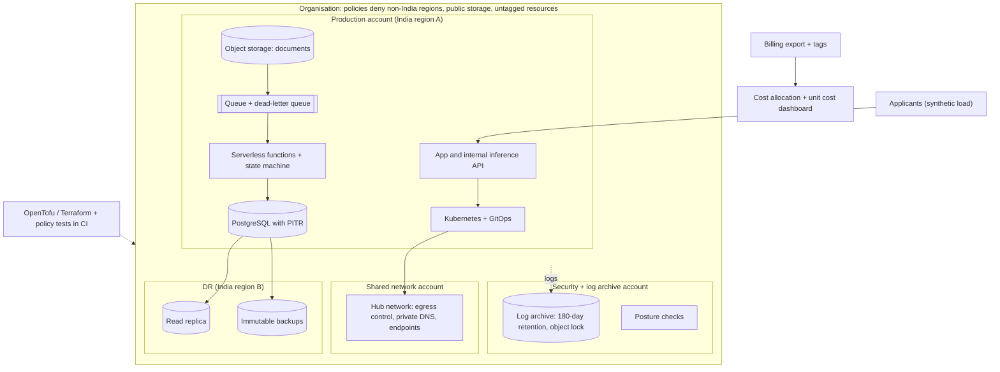

# CLD · Flagship project: a regulated fintech's cloud foundation, built as code and proven under failure

| Major | Level | Time | Budget | Builds on |
|---|---|---|---|---|
| [Cloud Engineering](../../03_majors/cloud_engineering/README.md) | L3 → L4 | MVP 2–3 weeks · v1 6–8 weeks · scale-up 4+ weeks | Laptop plus ≤ ₹4,000 of cloud spend in total (free credits count) | CLD301 P3, CLD302 P3, CLD303 P3, CLD304 P3, CLD305 P3, CLD401 P3, CLD403 P3, CLD404 P3 |

You build the cloud foundation for an illustrative Indian fintech that processes loan applications and payments: a multi-account landing zone with guardrails, a private network, a Kubernetes platform, a database with a proven disaster-recovery plan, an event-driven document workflow, an AI inference path with SLOs, and cost allocation down to cost per application. Everything is code, everything can be destroyed and recreated in under an hour, and the regulatory constraints (data in India, logs kept and protected, incidents reportable quickly) are enforced by policy rather than promised in a document. You then defend the design in front of a panel, as a cloud architect would in an architecture review. The company and its workloads are an **illustrative scenario**.

## 1. The problem and why it matters

Cloud engineers in regulated industries are judged on whether the platform is safe by default, recoverable and affordable, not on how many services they know. In India the rules are concrete:

- Payment-system data must be stored only in India ([RBI, 6 Apr 2018](https://www.rbi.org.in/Scripts/NotificationUser.aspx?Id=11244)).
- CERT-In's directions require listed cyber incidents to be reported within 6 hours and ICT system logs to be kept for a rolling 180 days within Indian jurisdiction ([CERT-In, 28 Apr 2022](https://www.cert-in.org.in/PDF/CERT-In_Directions_70B_28.04.2022.pdf)).
- The DPDP Rules, 2025 phase in duties for personal data, including breach notification and erasure, over 18 months from November 2025 ([PIB](https://www.pib.gov.in/PressReleasePage.aspx?PRID=2190014); [rules text](https://www.meity.gov.in/static/uploads/2025/11/53450e6e5dc0bfa85ebd78686cadad39.pdf)).

Cost is the other constant. Indian engineering teams publish their cost work, for example Swiggy's migration of Kubernetes workloads to Arm-based instances ([Swiggy Bytes](https://bytes.swiggy.com/how-swiggy-migrated-its-k8s-workload-to-graviton-d2643bbc7871)), and the FinOps community's FOCUS specification standardises billing data so costs can be allocated to teams and units of work ([FOCUS](https://focus.finops.org/)). AI tools now draft infrastructure code and diagrams quickly; what they do not provide is a defensible design, tested guardrails, a DR plan that has actually been rehearsed, or a bill that matches the forecast.

## 2. What you build

Choose one hyperscaler (AWS, Azure or Google Cloud) and its India regions, and record the choice in ADR-001.

- **Landing zone**: separate accounts or projects for security and log archive, shared networking, staging and production; single sign-on with role-based access; organisation policies that deny resources outside India regions, deny public storage, require encryption and require tags (owner, cost centre, expiry).
- **Network**: hub-and-spoke or shared VPC, private subnets only for workloads, private endpoints for managed services, controlled egress, private DNS, and a documented, cost-aware choice about NAT.
- **Kubernetes platform**: a managed cluster (or k3s on small VMs to save money) with GitOps (Argo CD or Flux), autoscaling measured under load, network policies, and workload identity instead of static keys.
- **Data**: managed PostgreSQL with point-in-time recovery, a replica in the second India region, backups copied to an immutable (object-locked) store, and a rehearsed restore.
- **Event-driven workflow**: loan documents uploaded to object storage trigger a queue, serverless functions extract and validate fields, a state machine tracks each application, and failures land in a dead-letter queue with alerts (CLD401).
- **AI inference path**: a small document-classification or summarisation model served from an India region (self-hosted on CPU or a managed model endpoint where the model is available in-region), behind an internal API with SLOs, scale-to-zero and a cost per 1,000 requests (CLD404).
- **Security and logging**: central log archive with 180-day retention and object lock, posture checks, least-privilege roles, secrets in a managed vault.
- **Cost**: tagging enforced by policy, billing export, a cost-allocation dashboard by team and environment, unit cost per loan application, and an anomaly alert (CLD403).

## 3. Scope tiers

| Tier | Time | Scope |
|---|---|---|
| **MVP** | 2–3 weeks | Landing zone (3 accounts), network, policies with tests, budget alerts, a single-service app on a managed runtime, central logging; `apply` and `destroy` both scripted and timed |
| **v1** | 6–8 weeks | Kubernetes platform with GitOps; database with cross-region replica and immutable backups; DR drill; event-driven workflow; inference path with SLOs; cost allocation and unit economics; architecture review pack, ADRs, demo, write-up; panel defence |
| **Scale-up** | 4+ weeks | Second cloud for backups only, with an exit plan (CLD402); confidential computing for the document workflow; a migration of a deliberately "legacy" VM workload with proven equivalence |

## 4. Requirements

**Functional**

1. An engineer gets access through SSO and a role; there are no long-lived personal keys.
2. A new service is deployed by a pull request to the GitOps repository, with no console clicks.
3. A loan document goes from upload to validated record with status visible, and failures are retried or parked visibly.
4. The inference API classifies a document or summarises it, within SLO, from inside the network.
5. Every resource is tagged; a dashboard shows cost per environment, per service and per loan application.

**Non-functional**

| Concern | Requirement |
|---|---|
| Residency | Data-bearing resources only in India regions, enforced by organisation policy and verified by a script |
| Recoverability | Database RPO ≤ 5 minutes and RTO ≤ 30 minutes, measured in a rehearsed drill |
| Logs | Centralised; retention ≥ 180 days; deletion blocked by object lock for the retention period |
| Security | No public data stores; no admin ports open to the internet; workload identity everywhere; posture checks in CI and in the account |
| Reproducibility | Empty account to running platform in ≤ 45 minutes; `destroy` leaves 0 billable resources |
| Availability | App SLO 99.5% during test windows; zero failed requests during a node pool upgrade beyond 0.1% |
| Cost | Total project spend ≤ ₹4,000; idle cost of the full platform reported per day; unit cost per application computed from billing data |

## 5. Reference architecture

ADRs to write: cloud and regions; account structure; network topology and NAT choice; managed Kubernetes versus k3s; database engine and DR strategy; serverless versus containers for the workflow; inference hosting; tagging and cost-allocation model.

## 6. Milestones and deliverables

| Week | Milestone | Deliverable |
|---|---|---|
| 1 | Design | Architecture review pack draft (CLD301 P3 template); ADR-001 to ADR-004; budget alerts set |
| 2 | Landing zone | Accounts, SSO, policies, policy tests with planted misconfigurations |
| 3 | **MVP** | Network, central logging, one service; timed apply and destroy |
| 4 | Platform | Kubernetes with GitOps, workload identity, autoscaling measured |
| 5 | Data and DR | PITR, replica, immutable backups; first DR drill with RPO and RTO measured |
| 6 | Workflow | Event-driven document pipeline with duplicates and spike tests |
| 7 | AI and cost | Inference path with SLOs; billing export, allocation dashboard, unit cost, anomaly alert |
| 8 | **v1** | Second DR drill, review pack final, 10+ ADRs, demo, write-up, panel defence |

## 7. Acceptance criteria

| Criterion | Target | Evidence |
|---|---|---|
| Guardrails | 100% of 20 planted misconfigurations (wrong region, public bucket, open admin port, unencrypted disk, missing tags, static keys) blocked in CI or by organisation policy | Policy test report |
| Rebuild | Empty account to running platform ≤ 45 minutes; destroy leaves 0 billable resources | Timed logs; inventory script output |
| DR | RPO ≤ 5 min and RTO ≤ 30 min in two drills, one unannounced (triggered by a peer) | Drill reports with timestamps |
| Immutability | An admin role cannot delete backups or logs within retention | Recorded failed deletion attempt |
| Residency | Script lists every data-bearing resource and its region; 0 outside India | Report in CI |
| Workflow correctness | 0 double-processed documents with 10% duplicate delivery; all poison messages in the DLQ with an alert | Test run output |
| Upgrade safety | Node pool upgrade with ≤ 0.1% failed requests under load | Load test and dashboard export |
| Inference SLO | p95 latency target set and met in a 1-hour test; scale-to-zero verified; cost per 1,000 requests reported | Load test and billing data |
| Cost | Total ≤ ₹4,000; unit cost per application reconciles with the bill within 10%; planted cost spike triggers the anomaly alert | Billing export and alert screenshot |

## 8. Data plan

| Data | Source | Licence | Use |
|---|---|---|---|
| Loan applications and documents | Synthetic generator producing realistic PDFs and images with fake names and identifiers | Yours | Workflow and inference tests |
| Load | Synthetic traffic scripts (k6 or Locust) | Yours | Autoscaling, upgrade and SLO tests |
| Billing | Your own cloud billing export | Yours | Cost allocation and unit economics |
| Regulations | RBI, CERT-In and DPDP texts linked above | Public | Requirements and policies |

No real identity documents or personal data are used. Synthetic identifiers must not match real formats closely enough to be mistaken for real ones.

## 9. Compute and cost

Do most work locally: OpenTofu plans and policy tests, kind or k3d for Kubernetes and GitOps, LocalStack-style emulators for early workflow tests. Use the cloud in timed sessions. Managed Kubernetes control planes, NAT gateways, load balancers, public IPv4 addresses and GPUs bill by the hour, so create them only in a session, tag them with an expiry and run a destroy job at the end. Set budget alerts at 50%, 80% and 100% of ₹4,000 before creating anything. Record the free-tier or credit terms on the day you start, because they change.

## 10. AI-use policy

- **You may delegate:** first drafts of modules and diagrams, translating a design between providers, explaining an IAM or policy evaluation result, generating planted misconfigurations, dashboards and documentation drafts.
- **You must write and verify yourself:** organisation policies and their tests, IAM role definitions, network routing and security groups, the DR runbook, the tagging and allocation model, and every number in the review pack.
- **Verify AI output by:** policy tests in CI, `plan` review for every change, a second engineer's review of IAM changes, and running the DR drill rather than trusting a script you have not executed.
- **Record:** `AI_USE.md`, including any generated infrastructure that was insecure or costly by default (for example, a public endpoint or an idle NAT) and how you caught it.

## 11. Write-up and demo checklist

- [ ] Architecture review pack: context, requirements, design, alternatives, risks, compliance mapping, cost model
- [ ] 10+ ADRs, two DR drill reports, policy test report, cost report with unit economics
- [ ] `AI_USE.md`
- [ ] Demo (2 minutes): a pull request blocked by policy; empty account to running app (time-lapse); a DR drill restoring the database in the second region; the cost dashboard showing cost per application
- [ ] Write-up: "A regulated cloud foundation for under ₹4,000"
- [ ] Panel defence: 30 minutes, with a peer playing the security reviewer

## 12. What it signals to employers

You can design a cloud estate that is safe by default, prove recoverability with drills, enforce regulation through code, and talk about cost in units the business understands. These are the skills of a cloud or platform engineer who can be trusted with production accounts, and they transfer across providers.

## 13. Stretch goals toward L4 and L5

- **L4:** an exit plan with backups in a second provider and a timed restore there; a written portability analysis of which services lock you in and at what cost (CLD402).
- **L4:** a self-service module catalogue that another student uses to create a compliant service account without your help, with their feedback.
- **L5:** a measurement study, for example the real cost and recovery-time trade-offs of three DR patterns for a small regulated workload, published with scripts and billing data (CLD501).

## Sources

All checked October 2026.

- RBI, *Storage of Payment System Data* (6 Apr 2018). https://www.rbi.org.in/Scripts/NotificationUser.aspx?Id=11244
- CERT-In, Directions under section 70B (28 Apr 2022). https://www.cert-in.org.in/PDF/CERT-In_Directions_70B_28.04.2022.pdf
- PIB, DPDP Rules notified (14 Nov 2025). https://www.pib.gov.in/PressReleasePage.aspx?PRID=2190014 ; DPDP Rules, 2025 (MeitY). https://www.meity.gov.in/static/uploads/2025/11/53450e6e5dc0bfa85ebd78686cadad39.pdf
- Swiggy Bytes, *How Swiggy migrated its K8s workload to Graviton*. https://bytes.swiggy.com/how-swiggy-migrated-its-k8s-workload-to-graviton-d2643bbc7871
- FinOps Foundation, FOCUS specification. https://focus.finops.org/
- OpenTofu documentation. https://opentofu.org/docs/

_Last reviewed: 2026-10_
