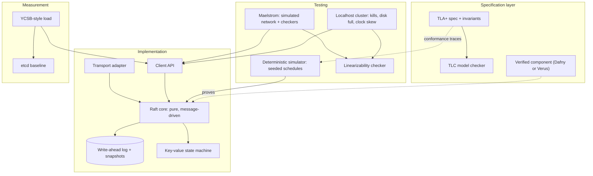

# CSG · Flagship project: a verified, fault-tested replicated key-value store, written up as a paper

| Major | Level | Time | Budget | Builds on |
|---|---|---|---|---|
| [Computer Science (Theory, Systems and Research)](../../03_majors/computer_science_general/README.md) | L3 → L5 | MVP 2–3 weeks · v1 6–8 weeks · scale-up 6+ weeks | Laptop; ₹0 required | CSG303 P3, CSG401 P3, CSG302 P3 or CSG301 P3, RES502 |

You take one system component through the full research-engineering loop: specify it formally, model-check the specification, implement it, verify one critical piece mechanically, test the implementation under injected faults, measure it against a widely used baseline on the same hardware, and write it up as a short paper with an artifact anyone can run. The default component is a linearizable, replicated key-value store based on the Raft consensus algorithm, because the problem is well specified, the failure modes are subtle and the published baselines are open source. Two alternative tracks (a verified compiler pass, or an engineered solver) are listed in section 13.

## 1. The problem and why it matters

Replicated state machines sit under most infrastructure people depend on: configuration stores, coordination services and the metadata layers of databases. etcd, the store behind Kubernetes, uses a Raft library ([etcd-io/raft](https://github.com/etcd-io/raft)). Raft was designed to be understandable and comes with a precise description and a TLA+ specification ([Raft site](https://raft.github.io/); [raft.tla](https://github.com/ongardie/raft.tla)).

Getting consensus right is hard enough that industry uses research methods for it. AWS engineers reported using TLA+ to find subtle design bugs before shipping ([Newcombe et al., CACM 2015](https://lamport.azurewebsites.net/tla/formal-methods-amazon.pdf)); FoundationDB built its reliability on deterministic simulation testing ([Zhou et al., SIGMOD 2021](https://www.foundationdb.org/files/fdb-paper.pdf)); and Jepsen's Maelstrom lets anyone test toy distributed systems against a simulated network with real consistency checkers ([Maelstrom](https://github.com/jepsen-io/maelstrom)). A student who has used all three on one system can talk credibly with infrastructure, database and research teams, and has a strong base for graduate applications.

## 2. What you build

- **Formal specification** in TLA+ (or P) of your protocol variant: leader election, log replication, commit rule, plus one extension you choose (linearizable reads via a read index, leader leases, or membership changes). Safety invariants: election safety, log matching, leader completeness and state-machine safety.
- **Implementation** in Go, Rust or another language you can defend: a Raft core with a deterministic, message-driven design (no hidden threads or clocks inside the core), a write-ahead log with fsync discipline, snapshots, and a key-value state machine with `get`, `put` and `compare-and-set`.
- **Mechanically verified component**: one function or module proved correct with Dafny, Verus or a TLA+ refinement mapping (for example, the log-truncation and commit-index advancement rule).
- **Fault testing** at three levels: Maelstrom with partitions and crashes; your own deterministic simulator that runs thousands of seeded schedules per minute; and a real three-node deployment on localhost with process kills, disk-full and clock-skew injection, checked with a linearizability checker such as [Porcupine](https://github.com/anishathalye/porcupine) or Jepsen's checkers.
- **Measurement harness** comparing your store with etcd on the same machine under YCSB-style workloads, plus a reproduction of one quantitative claim from the Raft paper (for example, how leader-election time depends on the randomised timeout range).
- **Paper and artifact**: a 6–8-page workshop-style paper and a repository that regenerates every figure with one command.

## 3. Scope tiers

| Tier | Time | Scope |
|---|---|---|
| **MVP** | 2–3 weeks | TLA+ spec of basic Raft model-checked with TLC on 3 servers; leader election and log replication implemented; passes Maelstrom's linearizable key-value workload without faults; one throughput number |
| **v1** | 6–8 weeks | Snapshots and log compaction; one extension (read index, leases or membership change) in both spec and code; deterministic simulator; Maelstrom with partitions; localhost fault tests; one mechanically verified component; etcd comparison; paper draft and artifact |
| **Scale-up** | 6+ weeks | A second extension; a planted-bug study measuring which testing method finds which bug; artifact evaluation by a peer; submission to a student research competition or workshop |

## 4. Requirements

**Functional**

1. Linearizable `get`, `put` and `compare-and-set` from any client to any node (redirects to the leader).
2. Survives the crash and restart of any minority of nodes without losing acknowledged writes.
3. Snapshots bound log size; a lagging follower catches up from a snapshot.
4. The chosen extension works in specification and implementation, with tests for its edge cases.

**Non-functional**

| Concern | Requirement |
|---|---|
| Safety | No violation of the four safety invariants in model checking; no linearizability anomaly in any test run |
| Determinism | The core is a pure state machine driven by messages and ticks, so any simulator failure replays from its seed |
| Durability | Acknowledged writes are fsynced (or the paper states precisely when they are not and measures the difference) |
| Performance | Throughput and latency reported against etcd on identical hardware, with variance across at least 5 runs |
| Reproducibility | One command reproduces every figure on a laptop in under 2 hours; versions, seeds and hardware recorded |

## 5. Reference architecture

A strong design links the layers: the simulator can export traces that are checked against the TLA+ specification (trace validation), and the verified component is the same code the implementation runs, not a copy.

## 6. Milestones and deliverables

| Week | Milestone | Deliverable |
|---|---|---|
| 1 | Specify | TLA+ spec of basic Raft; TLC run on 3 servers; a planted bug and its counterexample trace |
| 2 | Core | Election and replication in a deterministic core; unit tests from the spec's actions |
| 3 | **MVP** | Maelstrom linearizable workload passes; first throughput figure; tagged release |
| 4 | Durability | WAL with fsync, snapshots, catch-up; crash-restart tests |
| 5 | Simulate | Deterministic simulator with seeded network and disk faults; nightly run of 10,000+ seeds |
| 6 | Extend and verify | Extension in spec and code; one component mechanically verified |
| 7 | Measure | etcd comparison and Raft-paper reproduction with variance; localhost fault campaign |
| 8 | **v1** | Paper draft, artifact README, `AI_USE.md`, demo video, write-up for a general engineering audience |

## 7. Acceptance criteria

| Criterion | Target | Evidence |
|---|---|---|
| Model checking | 0 invariant violations for 3 servers with bounded terms and log length; state count and run time reported | TLC output |
| Planted bugs | Each of 5 planted protocol bugs is caught by at least one method; the paper reports which | Bug-study table |
| Linearizability | 0 anomalies across 200 Maelstrom runs with partitions and 200 localhost runs with kills | Checker reports |
| Simulation | ≥ 100,000 seeds explored; every failure reproducible from its seed | Simulator logs |
| Verification | The verified component checks with no assumed lemmas beyond documented axioms | Verifier output in CI |
| Performance | Throughput and p50/p99 latency vs etcd for at least 3 workloads, 5 runs each, with error bars | Benchmark scripts and raw data |
| Reproduction | The chosen Raft-paper claim reproduced or the difference explained | Paper section and script |
| Artifact | A peer reproduces all figures from a clean checkout in under 2 hours | Peer's signed reproduction note |

## 8. Data plan

This project needs workloads, not datasets. Use YCSB-style workload mixes (read-heavy, update-heavy, read-modify-write) generated by your harness or by an open-source YCSB implementation; record the generator version and seeds. All traces, logs and measurements you produce are published with the artifact under an open licence. Cite every baseline's version and configuration (etcd release, flags, fsync settings).

## 9. Compute and cost

A laptop is enough. TLC on a 3-server model with small bounds runs in minutes to hours; set bounds deliberately and report state counts. Maelstrom needs a Java runtime. The etcd comparison runs both systems on localhost under identical conditions; report the CPU, disk type and OS. No cloud is required; if you add a multi-machine experiment, keep it under ₹1,500 with same-day teardown.

## 10. AI-use policy

- **You may delegate:** test harness plumbing, plotting scripts, Maelstrom and benchmark drivers, Dockerfiles, LaTeX formatting, literature search (with every citation checked against the original).
- **You must write and verify yourself:** the TLA+ specification and its invariants, the Raft core's state transitions, the verified component and its proof annotations, the interpretation of every measurement, and every claim in the paper.
- **Verify AI output by:** model checking any specification change, running the simulator on every core change, reading the original papers for every cited claim, and re-running the artifact from a clean checkout.
- **Record:** `AI_USE.md` and a statement in the paper's acknowledgements or methods section that follows the venue's AI policy.

## 11. Write-up and demo checklist

- [ ] Paper: problem, design, specification, verification, testing method, evaluation, threats to validity, related work
- [ ] Artifact README with one command, expected outputs and hardware
- [ ] Bug-study table and the counterexample traces
- [ ] `AI_USE.md`
- [ ] Demo (2 minutes): a planted bug found by TLC with its trace; the fixed system under Maelstrom partitions; one simulator failure replayed from its seed; the etcd comparison chart
- [ ] A plain-language write-up: "What model checking found that tests did not"

## 12. What it signals to employers

You can reason precisely about concurrency and failure, use formal methods as an engineering tool rather than an academic exercise, build test infrastructure that finds bugs humans miss, and present results with honest error bars. Infrastructure, database and storage teams, research labs and graduate programmes all look for this combination. It also shows you can use AI where it helps without handing over the parts that need proof.

## 13. Stretch goals toward L4 and L5

- **L4:** add membership changes (joint consensus or single-server changes) in spec and code, with the simulator extended to reconfigure during faults.
- **L5:** run a planted-bug study comparing model checking, deterministic simulation, Maelstrom and real-network fault injection on a fixed bug set; report detection rates and costs. This is a publishable student contribution if done carefully.
- **Alternative track A (CSG302):** a verified or translation-validated optimisation pass in a small compiler, measured on a benchmark suite against a baseline compiler at the same optimisation level.
- **Alternative track B (CSG301):** an engineered solver for an NP-hard problem with certified optimality gaps, measured on a public benchmark library against a published solver.

## Sources

All checked October 2026.

- Raft consensus algorithm site and paper. https://raft.github.io/ ; TLA+ specification. https://github.com/ongardie/raft.tla
- etcd Raft library. https://github.com/etcd-io/raft
- Newcombe et al., *How Amazon Web Services Uses Formal Methods* (CACM, 2015). https://lamport.azurewebsites.net/tla/formal-methods-amazon.pdf
- Zhou et al., *FoundationDB* (SIGMOD 2021). https://www.foundationdb.org/files/fdb-paper.pdf
- Jepsen, Maelstrom (EPL-1.0). https://github.com/jepsen-io/maelstrom
- Porcupine linearizability checker. https://github.com/anishathalye/porcupine

_Last reviewed: 2026-10_
