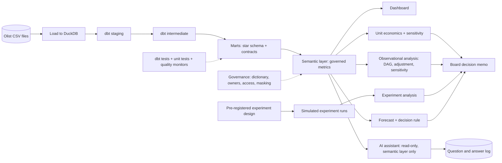

# DAN · Flagship project: the analytics function of a marketplace, from raw tables to a board decision

| Major | Level | Time | Budget | Builds on |
|---|---|---|---|---|
| [Data Analysis and Analytics](../../03_majors/data_analysis/README.md) | L3 → L4 | MVP 2–3 weeks · v1 6–8 weeks · scale-up 4+ weeks | Laptop; ≤ ₹1,500 of model API usage | DAN302 P3, DAN304 P3, DAN305 P3, DAN401 P3, DAN402 P3, DAN404 P3 |

You become the one-person analytics team of an online marketplace and answer a real business question end to end: **should the marketplace invest in faster, more reliable delivery for its slowest regions, and if so where first?** To answer it you build a tested dimensional model with a governed semantic layer, measure unit economics, design an experiment and analyse it correctly, turn a forecast into a capacity decision, put an evaluated and guarded AI analytics assistant on top of the governed metrics, and write a two-page decision memo with honest uncertainty. The data is real: about 100,000 orders from a Brazilian e-commerce marketplace published by Olist. The business decisions, costs and the experiment are an **illustrative scenario** built on that data.

## 1. The problem and why it matters

Analytics roles that only produce reports are the most exposed to AI; roles that own metrics, experiments and decisions are holding up better ([DAN role page](../01_market_map/roles/DAN_data_analysis.md)). US data and analytics postings stood at 63.1 on Indeed's index in October 2026, below February 2020 ([market map](../01_market_map/README.md#10-where-sources-disagree)), so applicants need evidence that they change decisions, not that they can build a dashboard.

Text-to-SQL assistants are now common inside companies: Swiggy described Hermes, its text-to-SQL system ([Swiggy Bytes](https://medium.com/swiggy-bytes/hermes-a-text-to-sql-solution-at-swiggy-81573fb4fb6e)), and Uber described QueryGPT ([Uber](https://www.uber.com/blog/query-gpt/)). Public benchmarks such as [BIRD](https://bird-bench.github.io/) show these systems still make errors on realistic schemas, and a wrong number delivered fluently is worse than no number. The analyst's job moves toward owning the definitions the assistant uses, testing the data underneath it, and checking its answers. Delivery promises are a good subject because they connect operations, customer experience and money, the same trade-off Indian food and commerce platforms discuss publicly ([Swiggy, delivery time at cart](https://medium.com/swiggy-bytes/predicting-food-delivery-time-at-cart-cda23a84ba63)).

## 2. What you build

- **Analytics engineering** (DAN304): raw Olist tables loaded into DuckDB; a dbt project with staging, intermediate and mart layers; a star schema (order items, orders, payments, reviews as facts; customers, sellers, products, geography, dates as dimensions); data tests, unit tests for tricky logic, and model contracts on public models ([dbt docs](https://docs.getdbt.com/docs/build/semantic-models)).
- **Semantic layer**: 15+ governed metrics (gross merchandise value, on-time delivery rate, delivery delay, review score, repeat-purchase rate, freight share, contribution margin per order) defined once and used everywhere.
- **Unit economics** (DAN305): contribution margin per order by region and category, with every assumption that is not in the data (commission rate, delivery cost, refund cost) listed, sourced or labelled as illustrative, and a sensitivity table.
- **Observational analysis**: the relationship between late delivery, review score and repeat purchase, with a causal diagram, an adjustment set, and sensitivity analysis; claims stated as associational unless the design supports more.
- **Experiment** (DAN302): a pre-registered design for a test of a delivery change (for example, a more conservative delivery-date promise, or a delivery subsidy in selected regions), with power analysis, guardrail metrics, a sample-ratio-mismatch check and an analysis plan; analysed on simulated outcomes with a planted effect, run many times to show the method recovers the truth.
- **Forecast to decision** (DAN402): weekly order forecasts by region with prediction intervals, turned into a capacity or staffing decision with explicit costs of over- and under-provisioning.
- **AI analytics assistant** (DAN401): answers questions only through the semantic layer and approved marts, read-only with row limits, shows the SQL and the metric definitions it used, refuses or flags undefined metrics, never returns personal columns; evaluated on a held-out question set with gold answers.
- **Governance** (DAN404): data dictionary, metric owners, quality monitors, role-based access with masking of personal columns, and a short note on the privacy duties this data would carry in India under the DPDP Rules, 2025 (and in Brazil under its own law), clearly marked as a learning exercise.
- **Decision memo and dashboard**: a two-page memo for the board and a small dashboard that supports it.

## 3. Scope tiers

| Tier | Time | Scope |
|---|---|---|
| **MVP** | 2–3 weeks | DuckDB + dbt star schema with tests; 8 governed metrics; delivery and review analysis with a first chart set; a one-page draft memo |
| **v1** | 6–8 weeks | Full semantic layer; unit economics with sensitivity; observational analysis with causal diagram; pre-registered experiment and simulation study; forecast-to-decision; AI assistant with evaluation; governance layer; two-page memo, dashboard, demo, write-up |
| **Scale-up** | 4+ weeks | A second dataset joined through the same semantic layer (for example an Indian public dataset for a regional comparison); incremental models; a metric-change review process with an approval workflow |

## 4. Requirements

**Functional**

1. Rebuild every model from raw files with one command.
2. Every chart and every number in the memo comes from the semantic layer or a versioned query.
3. The experiment design is written and committed before any outcome data (simulated) is generated.
4. The forecast feeds a decision rule with stated costs, not just a chart.
5. The assistant answers a business question with SQL, definitions used and a caveat when data is missing.

**Non-functional**

| Concern | Requirement |
|---|---|
| Correctness | Semantic-layer metrics reconcile with independent raw SQL within 0.1% |
| Data quality | Tests on keys, relationships, accepted values and freshness assumptions; failures block the build |
| Reproducibility | Full rebuild in ≤ 5 minutes on a laptop; seeds and versions pinned |
| Assistant safety | Read-only; allowlisted schemas; row limits; personal columns masked; every answer logged |
| Communication | Memo readable in five minutes by a non-specialist; uncertainty stated in plain words |

## 5. Reference architecture

ADRs to write: warehouse engine; modelling approach and grain of each fact; metric definitions with edge cases (cancelled orders, multiple sellers per order, multiple payments); assumptions for unit economics; experiment design and analysis method; forecast method; assistant guardrails; access model.

## 6. Milestones and deliverables

| Week | Milestone | Deliverable |
|---|---|---|
| 1 | Understand | Data profile; questions list; ADR-001 (stack); metric definitions draft |
| 2 | Model | Star schema with tests and contracts |
| 3 | **MVP** | 8 metrics; delivery and review analysis; draft memo |
| 4 | Money | Unit economics with sensitivity; full semantic layer |
| 5 | Cause and test | Observational analysis; pre-registered experiment; simulation study |
| 6 | Forecast | Forecast with backtests; decision rule with costs |
| 7 | Assistant and governance | AI assistant with 150-question set (120 held out); governance layer |
| 8 | **v1** | Memo, dashboard, ADRs, `AI_USE.md`, demo, write-up |

## 7. Acceptance criteria

| Criterion | Target | Evidence |
|---|---|---|
| Model quality | 100% of public models tested (unique, not null, relationships, accepted values); ≥ 5 unit tests on complex logic; contracts enforced | dbt test output |
| Reconciliation | All 15+ metrics match independent raw SQL within 0.1% | Reconciliation script |
| Rebuild | ≤ 5 minutes from raw on the reference laptop | Timed log |
| Experiment method | Pre-registration committed before simulated outcomes; in 200 simulations the 95% interval covers the planted effect in 93–97% of runs; power analysis matches simulation | Git history and simulation report |
| Observational honesty | Causal diagram, adjustment set and a sensitivity analysis; no causal wording without a design that supports it | Peer review note |
| Forecast | Rolling-origin backtest over ≥ 12 weeks; beats seasonal naive on MASE; decision rule minimises stated expected cost | Backtest report |
| Assistant accuracy | ≥ 80% execution accuracy on 120 held-out questions | Eval report |
| Assistant safety | 0 queries outside allowed schemas; 0 personal columns returned; 100% of undefined-metric questions refused or flagged | Eval report and query log |
| Memo | A non-technical reader states the recommendation, its main risk and the confidence level correctly | Reader's note |

## 8. Data plan

| Data | Source | Licence | Use |
|---|---|---|---|
| Orders, items, payments, reviews, customers, sellers, products, geolocation | [Brazilian E-Commerce Public Dataset by Olist](https://www.kaggle.com/datasets/olistbr/brazilian-ecommerce): about 100,000 orders, 2016–2018, anonymised | CC BY-NC-SA 4.0 | Everything; portfolio use is non-commercial; publish derived data under the same licence with attribution |
| Cost assumptions | Your sourced or labelled assumptions | Yours | Unit economics and decision costs |
| Simulated experiment outcomes | Your simulator built on the real baseline distributions | Yours | Method validation |
| Assistant question set | Written by you and a peer, with gold SQL and answers | Yours | Evaluation |

The data is anonymised, but customer zip-code prefixes and free-text reviews still deserve care: mask them for the assistant and do not try to re-identify anyone.

## 9. Compute and cost

DuckDB, dbt, Python and a lightweight dashboard tool run on any laptop with 8 GB RAM. The assistant uses a hosted model capped at ₹1,500 in total, or a small local model; cache answers and log token use per question.

## 10. AI-use policy

- **You may delegate:** first-draft staging models, documentation of columns, chart code, SQL for exploratory questions (always checked), memo formatting, and drafting assistant evaluation questions for you to verify.
- **You must write and verify yourself:** grain and metric definitions, unit-economics assumptions, the causal diagram and adjustment set, the experiment design and analysis plan, the forecast's decision rule, the assistant's guardrails and gold answers, and every claim in the memo.
- **Verify AI output by:** reconciliation scripts; running generated SQL against small hand-checked cases; comparing assistant answers with gold answers; asking a peer to challenge the memo's claims.
- **Record:** `AI_USE.md`, including generated SQL that returned plausible but wrong numbers (for example, double counting order items) and how you caught it.

## 11. Write-up and demo checklist

- [ ] README with the decision question, the answer and the results table
- [ ] Two-page decision memo and supporting dashboard
- [ ] Metric dictionary, pre-registration, simulation study, forecast report, assistant eval report
- [ ] 8+ ADRs and `AI_USE.md`
- [ ] Demo (2 minutes): the question; one metric traced from raw rows to the memo; the experiment simulation showing the method works; the assistant answering one question correctly and refusing an undefined metric; the recommendation
- [ ] Write-up: "Should a marketplace pay for faster delivery? An end-to-end analysis"

## 12. What it signals to employers

You can own a business question from data to decision: model data so numbers are trustworthy, design experiments that are valid, separate correlation from causation, turn forecasts into decisions with costs, and make an AI assistant useful without letting it invent numbers. That is the profile of an analyst or analytics engineer who sits with decision-makers rather than behind a report queue.

## 13. Stretch goals toward L4 and L5

- **L4:** a metrics governance process: change requests, review, versioned definitions and an impact report showing which dashboards and assistant answers each change affects.
- **L4:** a regional comparison with an Indian public dataset through the same semantic layer, with a note on what transfers and what does not.
- **L5:** an evaluation of text-to-SQL assistants with and without a semantic layer on your question set and a public benchmark, measuring accuracy and the kinds of errors each makes (DAN501).

## Sources

All checked October 2026.

- Olist, *Brazilian E-Commerce Public Dataset* (Kaggle; CC BY-NC-SA 4.0). https://www.kaggle.com/datasets/olistbr/brazilian-ecommerce
- Swiggy Bytes, *Hermes: a text-to-SQL solution at Swiggy*. https://medium.com/swiggy-bytes/hermes-a-text-to-sql-solution-at-swiggy-81573fb4fb6e ; *Predicting food delivery time at cart* (11 Aug 2023). https://medium.com/swiggy-bytes/predicting-food-delivery-time-at-cart-cda23a84ba63
- Uber, *QueryGPT*. https://www.uber.com/blog/query-gpt/
- BIRD benchmark. https://bird-bench.github.io/
- dbt documentation: semantic models. https://docs.getdbt.com/docs/build/semantic-models ; model contracts. https://docs.getdbt.com/docs/collaborate/govern/model-contracts ; unit tests. https://docs.getdbt.com/docs/build/unit-tests
- DuckDB documentation. https://duckdb.org/docs/

_Last reviewed: 2026-10_
