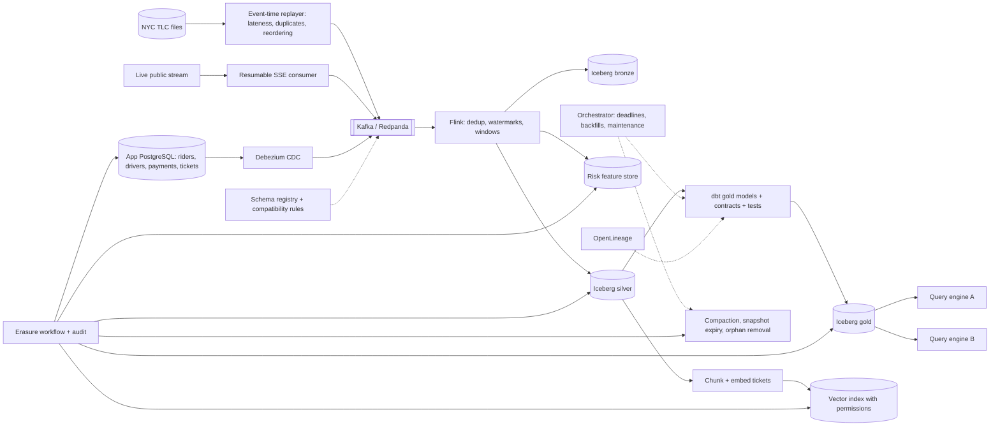

# DEN · Flagship project: a real-time mobility and payments lakehouse on public data, with contracts and erasure

| Major | Level | Time | Budget | Builds on |
|---|---|---|---|---|
| [Data Engineering](../../03_majors/data_engineering/README.md) | L3 → L4 | MVP 2–3 weeks · v1 6–8 weeks · scale-up 4+ weeks | Laptop with 16 GB RAM (32 GB is comfortable); ≤ ₹1,000 of model API usage; optional cloud ≤ ₹2,000 | DEN303 P3, DEN304 P3, DEN305 P3, DEN401 P3, DEN402 P3, DEN403 P3, DEN404 P3 |

You build the data platform of an illustrative ride-hailing company. Real trip records are replayed as a live event stream at the speed and messiness of production (late, duplicated and out-of-order events); the company's own application database (synthetic riders, drivers and payments) is captured with change data capture (CDC); and one genuinely live public stream is ingested to practise operating a source you do not control. Everything lands in an open table-format lakehouse, is shaped into tested models with data contracts and freshness objectives, feeds real-time payment-risk features and a retrieval index for an AI support assistant, and honours a person's request to erase their data across every layer, including files, snapshots and embeddings. An employer can run it, break it and inspect it.

## 1. The problem and why it matters

"Big Data Specialists" are the fastest-growing job to 2030 in the World Economic Forum's employer survey, and "Data Warehousing Specialists" are sixth ([DEN role page](../01_market_map/roles/DEN_data_engineering.md)). The work has moved from nightly batch jobs to platforms that must be fresh within minutes, correct under replays and failures, cheap enough to run, and compliant with privacy law. In India, the DPDP Rules, 2025 phase in duties including erasure and breach notification ([PIB, Nov 2025](https://www.pib.gov.in/PressReleasePage.aspx?PRID=2190014)); erasure is hard in a lakehouse because deleted rows survive in old files and snapshots until maintenance removes them ([Iceberg maintenance](https://iceberg.apache.org/docs/latest/maintenance/)).

AI changes the platform's customers rather than removing the work: retrieval systems need fresh, permission-aware data, and a deleted person must disappear from the vector index too. Assistants write SQL and pipeline code quickly, but they do not design event-time semantics, contracts between teams, idempotent backfills or erasure that actually deletes. Those are the skills this flagship proves.

## 2. What you build

- **Replayed trip stream**: [NYC TLC trip records](https://www.nyc.gov/site/tlc/about/tlc-trip-record-data.page) emitted by event time into Kafka or Redpanda with a configurable speed-up, plus injected lateness (up to an hour), duplicates and reordering.
- **Live public stream**: [Wikimedia EventStreams](https://wikitech.wikimedia.org/wiki/Event_Platform/EventStreams_HTTP_Service) (server-sent events of wiki edits, with a 15-minute connection timeout and resumption by `Last-Event-ID`) or, if you obtain access, real-time transit data from [Open Transit Data Delhi](https://otd.delhi.gov.in/). Its job is to make you handle reconnects, schema drift and quiet periods on a source you do not control.
- **Application database and CDC**: PostgreSQL holding synthetic riders, drivers, payments and support tickets, captured with [Debezium](https://debezium.io/) through an outbox pattern where appropriate (DEN305).
- **Lakehouse**: [Apache Iceberg](https://iceberg.apache.org/spec/) tables on local S3-compatible storage behind a REST catalog; bronze (raw), silver (cleaned, deduplicated, conformed) and gold (business models) layers; merge-on-read upserts from CDC; scheduled compaction, snapshot expiry and orphan-file removal.
- **Stream processing** (DEN303): Apache Flink (or Spark Structured Streaming) jobs with event-time windows and watermarks that compute payment-risk features (payment velocity per rider and card, trip-payment mismatches, unusual pickup patterns) into a low-latency feature store.
- **Orchestration with deadlines** (DEN304): Dagster or Airflow running daily finance and operations models with a hard deadline, idempotent partitioned backfills and alerting.
- **Contracts and quality** (DEN401): producer schemas in a registry with compatibility rules, dbt model contracts and tests on gold models, freshness objectives per table, and an incident process for a broken contract.
- **AI data path** (DEN403): support tickets chunked and embedded into a vector index with permission metadata and freshness tracking; erasure propagates into the index.
- **Governance and erasure** (DEN404): purpose and personal-data tags on columns, masking by role, retention schedules, lineage with [OpenLineage](https://openlineage.io/), and an erasure workflow with an audit trail.
- **Cost programme** (DEN402): storage and compute per table, the small-file problem measured and fixed, and the same tables queried by two engines (for example DuckDB and Trino or Spark) with results compared.

## 3. Scope tiers

| Tier | Time | Scope |
|---|---|---|
| **MVP** | 2–3 weeks | Trip replay into Kafka; bronze and silver Iceberg tables with deduplication and event-time handling; one gold table; data tests; freshness measured; one-command start |
| **v1** | 6–8 weeks | CDC from the app database; streaming risk features; orchestration with deadlines and backfills; contracts and incident drill; live public stream; AI data path; erasure across all layers; lineage; cost report; ADRs, demo, write-up |
| **Scale-up** | 4+ weeks | Deploy to a cloud object store with a managed catalog and compare cost; a second consumer team with its own contract; column-level lineage-driven access control; branch-and-merge data testing with Iceberg branches |

## 4. Requirements

**Functional**

1. Every event is processed by event time with a documented lateness policy; late data within the window corrects aggregates; later data goes to a side output.
2. Replays and restarts never produce duplicates in silver or gold.
3. CDC captures inserts, updates and deletes, including schema changes that the contract allows.
4. Risk features update within seconds of a payment event.
5. Daily gold models are complete by the deadline or an alert fires before it is missed.
6. An erasure request removes a person's personal data from every table, every file after maintenance, the feature store and the vector index, and leaves an audit record.

**Non-functional**

| Concern | Requirement |
|---|---|
| Freshness | Streaming silver tables p95 ≤ 5 minutes from event; risk features p99 ≤ 10 seconds |
| Correctness | Gold trip counts and revenue reconcile with the source files within 0.01% for a replayed month |
| Recoverability | Kill any streaming component; recovery without data loss or duplicates |
| Contracts | Breaking schema changes are blocked at the producer; compatible changes flow without downtime |
| Erasure | Completed across all layers within an internal objective of 24 hours, verified at the file level |
| Cost | Storage and compute reported per table; file counts and sizes within targets after compaction |
| Security and privacy | Personal columns tagged and masked for non-privileged roles; secrets outside the repository |

## 5. Reference architecture

ADRs to write: broker choice; event-time and lateness policy; deduplication keys; table format and catalog; merge-on-read versus copy-on-write; orchestrator; contract format and compatibility mode; feature store; erasure design (including how embeddings are found and removed); maintenance schedule.

## 6. Milestones and deliverables

| Week | Milestone | Deliverable |
|---|---|---|
| 1 | Design | Design doc draft; event-time policy; ADR-001 to ADR-004; Compose skeleton |
| 2 | Stream in | Replayer, broker, bronze and silver with dedup and watermarks |
| 3 | **MVP** | Gold table, tests, freshness measured; reconciliation script |
| 4 | CDC | Debezium from PostgreSQL; schema registry and contracts; schema-change drill |
| 5 | Real time | Risk features with latency measured; kill-and-recover tests |
| 6 | Orchestrate | Deadlines, backfills, maintenance jobs; live public stream |
| 7 | AI and erasure | Ticket embeddings with permissions; erasure across every layer verified at file level |
| 8 | **v1** | Lineage, cost report, contract incident postmortem, ADRs, `AI_USE.md`, demo, write-up |

## 7. Acceptance criteria

| Criterion | Target | Evidence |
|---|---|---|
| Freshness | Silver p95 ≤ 5 minutes; risk features p99 ≤ 10 seconds at the target replay rate | Freshness dashboard export |
| Exactly-once effect | 0 duplicates in silver and gold after 10 kill-and-restart runs of streaming jobs and 3 full replays | Dedup audit query output |
| Reconciliation | Gold monthly trip counts and fares within 0.01% of the source files | Reconciliation report |
| Lateness | Late events within the window correct aggregates; later events land in a side table, counted | Late-data test report |
| Contracts | A breaking producer change is rejected; an additive change flows with no downtime; one contract incident handled with a postmortem | CI logs and postmortem |
| Deadlines and backfills | Daily deadline met on ≥ 95% of 14 consecutive days; a one-month backfill run twice gives identical results | Orchestrator history and checksum comparison |
| Erasure | 20 erasure requests completed within 24 hours; after maintenance, a file-level scan finds 0 remaining copies in tables, snapshots, feature store or vector index | Erasure audit log and scan output |
| Permissions | 0 leaks across 100 permission tests on retrieval | Test report |
| Cost and files | File count per table reduced by ≥ 90% by compaction; query time before and after reported; storage and compute per table reported | Cost report |
| Multi-engine | Two engines return identical results on 10 gold queries | Comparison script |

## 8. Data plan

| Data | Source | Licence or terms | Use |
|---|---|---|---|
| Taxi and for-hire trips | [NYC TLC trip record data](https://www.nyc.gov/site/tlc/about/tlc-trip-record-data.page) (monthly Parquet files) | NYC open data terms; cite the TLC | Replayed trip stream and reconciliation |
| Live public events | [Wikimedia EventStreams](https://wikitech.wikimedia.org/wiki/Event_Platform/EventStreams_HTTP_Service) | Wikimedia terms of use; the service is meant for small-scale external tools, so consume only what you need | Operating an uncontrolled live source |
| Delhi transit (optional) | [Open Transit Data Delhi](https://otd.delhi.gov.in/) static and real-time datasets | Accept the portal's terms and conditions before use | India-specific live mobility feed |
| Riders, drivers, payments, support tickets | Your synthetic generator, linked to replayed trips | Yours | CDC, risk features, erasure and AI path |

All personal data is synthetic. Erasure is tested on synthetic people with known identifiers so you can prove complete removal.

## 9. Compute and cost

On a 16 GB laptop, run a trimmed stack: Redpanda (lighter than Kafka), one Flink job manager and task manager, PostgreSQL with Debezium, a REST catalog, local S3-compatible storage, DuckDB for queries, and Dagster; add Trino or Spark only for the multi-engine test. Replay a few days of trips at speed for development and a full month for reconciliation. Embeddings use a small local model or a hosted API capped at ₹1,000. An optional cloud deployment for cost comparison stays under ₹2,000 with budget alerts and same-day teardown.

## 10. AI-use policy

- **You may delegate:** connector and job boilerplate, Compose files, dbt staging models, test scaffolds, dashboard queries, documentation drafts.
- **You must write and verify yourself:** the event-time and lateness policy, deduplication keys and logic, the CDC merge logic, contract definitions and compatibility rules, the erasure workflow and its verification scan, the maintenance schedule, and the reconciliation method.
- **Verify AI output by:** the reconciliation and dedup audits after every change, kill-and-restart tests, the erasure scan, and reviewing every diff that touches streaming state or merge logic.
- **Record:** `AI_USE.md`, including generated code that mishandled event time or produced duplicates on replay.

## 11. Write-up and demo checklist

- [ ] README with the results table and one-command start (with a trimmed profile for small laptops)
- [ ] Design doc, 10+ ADRs, contract incident postmortem, erasure report, cost report
- [ ] `AI_USE.md`
- [ ] Demo (2 minutes): replay with late and duplicate events; kill the Flink task manager and show zero duplicates after recovery; push a breaking schema change and watch it blocked; submit an erasure request and show the file-level scan coming back clean, including the vector index
- [ ] Write-up: "Deleting one person from a lakehouse, for real"

## 12. What it signals to employers

You can build streaming and batch pipelines that stay correct under replays and failures, agree contracts between producers and consumers, meet deadlines, control cost, serve AI systems with fresh and permission-aware data, and implement privacy duties that most platforms only promise. That is senior-track data engineering evidence.

## 13. Stretch goals toward L4 and L5

- **L4:** a cloud deployment with a managed catalog, a cost comparison with the local design, and a migration plan between them (DEN402).
- **L4:** write-audit-publish with Iceberg branches: new data is validated on a branch and published only when contracts pass.
- **L5:** a measurement study of erasure in open table formats: time and cost to physically remove data under different table layouts, delete modes and maintenance schedules, published with the harness (DEN501).

## Sources

All checked October 2026.

- NYC Taxi and Limousine Commission, trip record data. https://www.nyc.gov/site/tlc/about/tlc-trip-record-data.page
- Wikimedia, EventStreams HTTP Service. https://wikitech.wikimedia.org/wiki/Event_Platform/EventStreams_HTTP_Service
- Open Transit Data, Delhi. https://otd.delhi.gov.in/
- Apache Iceberg, table spec and maintenance. https://iceberg.apache.org/spec/ ; https://iceberg.apache.org/docs/latest/maintenance/
- Debezium. https://debezium.io/ ; OpenLineage. https://openlineage.io/
- PIB, DPDP Rules notified (14 Nov 2025). https://www.pib.gov.in/PressReleasePage.aspx?PRID=2190014
- WEF fastest-growing jobs, as summarised on the [DEN role page](../01_market_map/roles/DEN_data_engineering.md).

_Last reviewed: 2026-10_
