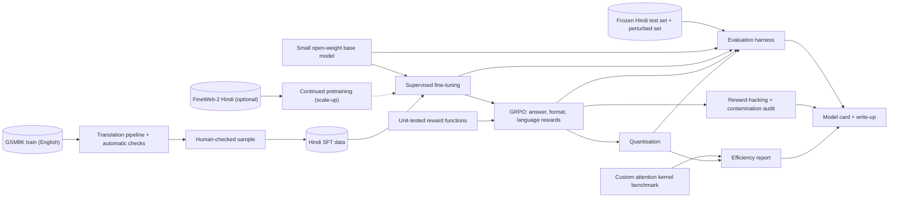

# DLR · Flagship project: a small Hindi maths-reasoning model, trained, post-trained, audited and made efficient

| Major | Level | Time | Budget | Builds on |
|---|---|---|---|---|
| [Deep Learning](../../03_majors/deep_learning/README.md) | L3 → L5 | MVP 2–3 weeks · v1 6–8 weeks · scale-up 6+ weeks | Free GPU quotas (Kaggle, Colab) plus ≤ ₹5,000 of rented GPU time; laptop | DLR303 P2, DLR304 P3, DLR401 P3, DLR403 P3, DLR404 P3 |

You take a small open-weight language model and make it reliably solve school-level maths word problems written in Hindi, then prove what you did. The loop is the one frontier labs run at much larger scale: build and clean the data, fine-tune with supervision, post-train with reinforcement learning against verifiable rewards (the answer is checkable), evaluate on a held-out test set you built and verified yourself, audit for reward hacking and contamination, make the model cheaper to run with quantisation and a custom kernel, and publish a model card and a technical write-up. A strong panel will respect it because every number can be reproduced and every claim is tested against a baseline.

## 1. The problem and why it matters

Reinforcement learning with verifiable rewards is now a standard way to improve reasoning: DeepSeekMath introduced Group Relative Policy Optimization (GRPO) ([arXiv 2402.03300](https://arxiv.org/abs/2402.03300)) and DeepSeek-R1 showed reasoning behaviour emerging from large-scale RL ([arXiv 2501.12948](https://arxiv.org/abs/2501.12948)); open libraries such as TRL implement GRPO ([TRL docs](https://huggingface.co/docs/trl/grpo_trainer)). Benchmarks also show how fragile reasoning can be: GSM-Symbolic found that changing names and numbers in grade-school problems changes model accuracy ([arXiv 2410.05229](https://arxiv.org/abs/2410.05229)).

Indian languages are a real gap and a national priority. The IndiaAI Mission was approved in March 2024 with ₹10,371.92 crore over five years ([PIB](https://www.pib.gov.in/PressReleaseIframePage.aspx?PRID=2012355)), and Sarvam AI was selected in April 2025 to build a sovereign model ([Sarvam](https://www.sarvam.ai/blogs/indias-sovereign-llm)). The widely used multilingual maths benchmark MGSM covers ten languages including Bengali and Telugu but not Hindi ([Shi et al., 2022](https://arxiv.org/abs/2210.03057)), so a carefully built and verified Hindi test set is itself a contribution. Deep learning roles are few and research-heavy ([DLR role page](../01_market_map/roles/DLR_deep_learning.md)); a project that runs the full loop honestly on a small budget is the kind of evidence those teams look for.

## 2. What you build

- **Base model choice**: a small open-weight model (roughly 0.3–2 billion parameters) whose licence allows fine-tuning and redistribution, for example a SmolLM model ([SmolLM3](https://huggingface.co/blog/smollm3)); record the licence in ADR-001.
- **Data**: training problems from [GSM8K](https://huggingface.co/datasets/openai/gsm8k) (MIT licence) translated into Hindi with a pipeline you build (machine translation plus automated checks: number preservation, answer consistency, language identification), a human-checked sample, and optional Hindi web text from [FineWeb-2](https://huggingface.co/datasets/HuggingFaceFW/fineweb-2) (ODC-By) for a fluency stage.
- **Held-out Hindi test set**: at least 300 problems written or translated by you, checked independently by a second fluent speaker, with numeric answers, and a perturbed variant set (names and numbers changed) in the style of GSM-Symbolic.
- **Supervised fine-tuning (SFT)**: full or LoRA fine-tuning on Hindi solutions with step-by-step reasoning (DLR401).
- **RL with verifiable rewards**: GRPO with a reward for a correct final answer, a format reward, and a language reward (reasoning in Hindi); multiple seeds (DLR401 P3, DLR403 P3).
- **Reward-hacking and contamination audit** (DLR403): tests for answer-only outputs, multiple hedged answers, length inflation, language switching and memorised test items; n-gram overlap checks between training data and the test set.
- **Efficiency pass** (DLR404): 4-bit or 8-bit quantisation with accuracy measured; inference throughput on a laptop CPU; and your FlashAttention-style kernel from DLR404 P3 benchmarked at the model's sequence lengths, with correctness checks for forward and backward passes ([FlashAttention](https://arxiv.org/abs/2205.14135)).
- **Release**: model weights (where the base licence allows), training and evaluation code, the test set (if your translation and source licences allow), a model card ([Mitchell et al.](https://arxiv.org/abs/1810.03993)) and a data card.

## 3. Scope tiers

| Tier | Time | Scope |
|---|---|---|
| **MVP** | 2–3 weeks | Base model chosen; translation pipeline; 150-problem verified Hindi test set; baseline and SFT evaluated with confidence intervals; English regression check |
| **v1** | 6–8 weeks | 300+ problem test set plus perturbed variants; GRPO with 3 seeds; reward-hacking and contamination audit; quantised model; kernel benchmark; model card; release; write-up and demo |
| **Scale-up** | 6+ weeks | A short continued-pretraining stage on Hindi text with a tokeniser-efficiency study; a second Indian language; a workshop-style paper |

## 4. Requirements

**Functional**

1. One script trains each stage from a config file and logs metrics, checkpoints and the exact data versions.
2. One script evaluates any checkpoint on the Hindi test set, the perturbed set and the English test set with the same prompt template and decoding settings.
3. The reward functions are unit-tested on hand-written good and bad outputs before training.
4. The released model runs locally with a documented command, including the quantised version.

**Non-functional**

| Concern | Requirement |
|---|---|
| Honest evaluation | Test set frozen and hashed before any training; never used for tuning; contamination checked |
| Statistics | Accuracy reported with 95% bootstrap intervals; RL results over ≥ 3 seeds with mean and spread |
| Reproducibility | Configs, seeds, library versions, GPU type and hours recorded; evaluation numbers reproducible from released checkpoints |
| Budget | Total compute within free quotas plus ≤ ₹5,000; GPU hours reported per stage |
| Language quality | ≥ 95% of reasoning outputs identified as Hindi; a fluent reviewer rates a sample |
| Safety and licences | Base model, data and outputs used within their licences; model card lists limitations and intended use |

## 5. Reference architecture

ADRs to write: base model and licence; translation method and checks; test-set construction and freezing; prompt template and decoding; SFT method (full or LoRA); reward design; RL hyperparameters and stopping; quantisation method; release policy.

## 6. Milestones and deliverables

| Week | Milestone | Deliverable |
|---|---|---|
| 1 | Plan | ADR-001 to ADR-003; compute plan; evaluation harness on the base model; first 50 test problems |
| 2 | Data | Translation pipeline with checks; 150-problem verified test set frozen and hashed |
| 3 | **MVP** | SFT run; evaluation with intervals; English regression check |
| 4 | Rewards | Reward functions with unit tests; first GRPO run; learning curves |
| 5 | RL at scale | GRPO with 3 seeds; test set extended to 300+ with perturbed variants |
| 6 | Audit | Reward-hacking and contamination audit; fixes and re-runs if needed |
| 7 | Efficiency | Quantisation; laptop throughput; kernel benchmark and correctness tests |
| 8 | **v1** | Model card, data card, release, `AI_USE.md`, demo, write-up |

## 7. Acceptance criteria

| Criterion | Target | Evidence |
|---|---|---|
| Test set | ≥ 300 problems, each verified by two people; frozen hash committed before training; 0 problems with n-gram overlap above threshold with any training data | Test-set card and contamination report |
| SFT gain | Hindi accuracy above the base model with non-overlapping 95% intervals | Evaluation report |
| RL gain | GRPO mean accuracy above SFT across 3 seeds, with spread reported | Evaluation report and curves |
| Robustness | Accuracy on the perturbed set reported; gap to the original set stated with intervals | Evaluation report |
| No regression | English GSM8K test accuracy within 2 points of the base model, or the trade-off documented | Evaluation report |
| Audit | ≥ 5 hacking hypotheses each tested with a metric; any exploit found is fixed and the run repeated | Audit report |
| Language | ≥ 95% of reasoning outputs in Hindi; fluent-reviewer rating on 50 samples | Language report |
| Quantisation | 4-bit model within 2 points of full precision on the Hindi test set; laptop tokens per second reported | Efficiency report |
| Kernel | Forward and backward outputs match the reference within tolerance; speed-up versus the reference implementation reported on the GPU used | Kernel benchmark |
| Reproducibility | A peer reproduces the evaluation numbers from the released checkpoint within 1 point | Peer note |

## 8. Data plan

| Data | Source | Licence | Use |
|---|---|---|---|
| Maths word problems | [GSM8K](https://huggingface.co/datasets/openai/gsm8k) | MIT | Translated SFT and RL training data; English regression test |
| Hindi web text (optional) | [FineWeb-2](https://huggingface.co/datasets/HuggingFaceFW/fineweb-2) | ODC-By | Continued pretraining in the scale-up tier |
| Multilingual reference (optional) | MGSM ([paper](https://arxiv.org/abs/2210.03057)) | Check the dataset card | Bengali or Telugu extension |
| Hindi test set | Written or translated by you and a reviewer | Yours; respect the source licence if translated | Held-out evaluation |
| Base model | A small open-weight model, for example from the SmolLM family | Model licence (record it) | Starting point |

Do not include personal data. If you use a translation model or API, check that its terms allow using outputs for training.

## 9. Compute and cost

Kaggle notebooks offer free P100 or two T4 GPUs with a weekly quota shown in your account and sessions of up to 12 hours ([Kaggle docs](https://www.kaggle.com/docs/notebooks)); Colab's free tier has usage limits that are not published ([Colab FAQ](https://research.google.com/colaboratory/faq.html)). Plan around checkpoints so runs survive session limits. LoRA SFT and GRPO on a sub-2B model fit these GPUs with small batch sizes; use rented GPUs (≤ ₹5,000 in total) for the multi-seed RL runs if needed, and log every hour.

## 10. AI-use policy

- **You may delegate:** boilerplate training and evaluation scripts using standard libraries, plotting, data-loading code, first drafts of the model card's structure, translation drafts (always checked by the pipeline and a human sample).
- **You must write and verify yourself:** the test set and its verification, the contamination checks, the reward functions and their unit tests, the evaluation protocol, the kernel's core logic and its correctness tests, the audit hypotheses, and every claim in the write-up.
- **Verify AI output by:** unit tests on rewards and answer extraction; re-computing a sample of evaluation results by hand; numerical gradient checks for the kernel; independent reproduction by a peer.
- **Record:** `AI_USE.md`, including generated evaluation or reward code that scored wrong answers as correct and how you found it.

## 11. Write-up and demo checklist

- [ ] README with the results table (base, SFT, GRPO, quantised; Hindi, perturbed, English) and compute used
- [ ] Model card, data card, test-set card, audit report, efficiency report
- [ ] Released checkpoint and one-command evaluation
- [ ] `AI_USE.md`
- [ ] Demo (2 minutes): the same Hindi problem answered by the base, SFT and GRPO models; a perturbed version; one reward hack found during training and how it was fixed; the quantised model running on a laptop
- [ ] Write-up: "Teaching a small model to reason in Hindi for under ₹5,000"

## 12. What it signals to employers

You can run the modern training loop end to end on a budget: data, SFT, RL with verifiable rewards, evaluation with statistics, auditing for hacks and contamination, efficiency work down to a kernel, and responsible release. That combination is what applied research and model teams screen for, and the Indian-language angle shows you can find a real gap and fill it carefully.

## 13. Stretch goals toward L4 and L5

- **L4:** continued pretraining on Hindi text with a tokeniser study (tokens per word before and after) and its effect on cost and accuracy.
- **L4:** extend to a second Indian language and measure cross-lingual transfer from the Hindi RL stage.
- **L5:** a controlled study of one question, for example how reward design (answer-only versus answer plus language and format) affects reasoning quality and hacking at small scale, written as a workshop paper with the code, test set and seeds released (DLR501).

## Sources

All checked October 2026.

- Shao et al., *DeepSeekMath* (GRPO). https://arxiv.org/abs/2402.03300 ; DeepSeek-AI, *DeepSeek-R1*. https://arxiv.org/abs/2501.12948
- Hugging Face TRL, GRPO trainer. https://huggingface.co/docs/trl/grpo_trainer
- Mirzadeh et al., *GSM-Symbolic*. https://arxiv.org/abs/2410.05229 ; Shi et al., *Language Models are Multilingual Chain-of-Thought Reasoners* (MGSM). https://arxiv.org/abs/2210.03057
- PIB, IndiaAI Mission approval (Mar 2024). https://www.pib.gov.in/PressReleaseIframePage.aspx?PRID=2012355 ; Sarvam AI, *India's sovereign LLM* (Apr 2025). https://www.sarvam.ai/blogs/indias-sovereign-llm
- GSM8K dataset (MIT). https://huggingface.co/datasets/openai/gsm8k ; FineWeb-2 (ODC-By). https://huggingface.co/datasets/HuggingFaceFW/fineweb-2 ; SmolLM3. https://huggingface.co/blog/smollm3
- Dao et al., *FlashAttention*. https://arxiv.org/abs/2205.14135 ; Mitchell et al., *Model Cards for Model Reporting*. https://arxiv.org/abs/1810.03993
- Kaggle notebooks documentation. https://www.kaggle.com/docs/notebooks ; Google Colab FAQ. https://research.google.com/colaboratory/faq.html

_Last reviewed: 2026-10_
