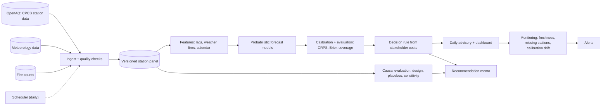

# DSC · Flagship project: an air-quality decision system with probabilistic forecasts and a causal evaluation

| Major | Level | Time | Budget | Builds on |
|---|---|---|---|---|
| [Data Science](../../03_majors/data_science/README.md) | L3 → L4 | MVP 2–3 weeks · v1 6–8 weeks · scale-up 4+ weeks | Laptop; free data APIs; ≤ ₹500 per month for a small scheduled job | DSC303 P3, DSC304 P3, DSC305 P3, DSC401 P2 and P3, DSC404 P3 |

You build the data science behind one recurring public decision in Delhi-NCR: **when should an organisation responsible for many people (an illustrative school network or city health office) issue a pollution advisory and move activities indoors?** You frame the decision with a stakeholder, build probabilistic forecasts of fine particulate matter (PM2.5) for the next 24–72 hours from real monitoring-station data, choose the advisory threshold by the cost of false alarms against missed episodes, evaluate the effect of a past pollution-control intervention with a causal design, deploy the forecast as a monitored daily service, and write a recommendation that states its uncertainty honestly. The stakeholder and their costs are an **illustrative scenario**; the data and the intervention you evaluate are real.

## 1. The problem and why it matters

In Delhi-NCR, the Commission for Air Quality Management ([CAQM](https://caqm.nic.in/)) runs the Graded Response Action Plan (GRAP), which triggers restrictions as the air-quality index worsens. Decisions like these depend on the probability that pollution crosses a category boundary, not on a single forecast number, and acting too late and acting too often both have costs. Public station data from the Central Pollution Control Board's monitors are available through [OpenAQ](https://docs.openaq.org/).

This is the shape of data science that employers value and AI does not replace: framing a decision, choosing a loss function that reflects real costs, producing calibrated probabilities, establishing causal effects rather than correlations, and communicating uncertainty to people who must act. Booking.com's study of 150 deployed models found that model accuracy gains did not necessarily translate into business value, and that the whole loop from problem framing to measurement matters ([summary of Bernardi et al., KDD 2019](https://blog.acolyer.org/2019/10/07/150-successful-machine-learning-models/)). The US Bureau of Labor Statistics projects data scientists to grow 35% from 2025 to 2035, while current postings are weak ([DSC role page](../01_market_map/roles/DSC_data_science.md)): the candidates who stand out show judgement on real decisions.

## 2. What you build

- **Decision framing**: a one-page brief written with a peer playing the stakeholder: the decision, who acts, lead time needed, the actions available, the relative costs of a false alarm and a missed episode (elicited, then varied in sensitivity analysis), and how success will be judged.
- **Reproducible panel** (DSC303): an hourly and daily station panel for Delhi-NCR assembled from OpenAQ, with meteorology and agricultural fire counts joined by time and place, documented missingness and station changes, built by one command.
- **Probabilistic forecasts** (DSC401): 24-, 48- and 72-hour forecasts of station and city-level PM2.5 as predictive distributions (quantile regression, gradient boosting with quantile loss, or a probabilistic time-series model), compared with persistence, climatology and seasonal baselines.
- **Calibration and decision rule** (DSC305): reliability diagrams, interval coverage, Brier score for exceedance of the advisory threshold, and a decision rule that minimises expected cost given the stakeholder's cost ratio, with a decision curve showing how the choice changes as costs vary.
- **Causal evaluation** (DSC304): estimate the effect of one past intervention (for example a vehicle-restriction scheme or a GRAP stage invocation) on PM2.5 using a design you justify (synthetic control, difference-in-differences against comparison cities, or regression discontinuity in time with meteorological adjustment), with placebo tests; where a published study exists, replicate its estimate first and then extend it.
- **Deployed artefact** (DSC404): a scheduled daily job that fetches data, produces forecasts and an advisory recommendation, publishes a small dashboard, and monitors itself (data freshness, missing stations, calibration drift), with a model card.
- **Recommendation memo**: what the stakeholder should do, how confident you are, what would change your mind.

## 3. Scope tiers

| Tier | Time | Scope |
|---|---|---|
| **MVP** | 2–3 weeks | Decision brief; reproducible panel for one season; 24-hour city-level probabilistic forecast beating persistence on CRPS; first reliability diagram; draft decision rule |
| **v1** | 6–8 weeks | Station-level 24–72 hour forecasts; full calibration and decision analysis; causal evaluation with placebo tests; deployed daily service with monitoring for 4 weeks; model card; memo, demo, write-up |
| **Scale-up** | 4+ weeks | A second city with different pollution drivers; a hierarchical model sharing strength across stations; spatial interpolation for neighbourhoods without monitors, with honest uncertainty |

## 4. Requirements

**Functional**

1. One command rebuilds the panel from source APIs, with a data quality report.
2. Every forecast is a distribution with stated quantiles; every advisory recommendation shows its probability and the threshold used.
3. The decision rule is derived from stated costs and can be recomputed for different cost ratios.
4. The causal analysis states its estimand, design, assumptions, placebo results and limits.
5. The daily service publishes by a fixed time and alerts on its own failures.

**Non-functional**

| Concern | Requirement |
|---|---|
| Honest evaluation | Time-ordered splits only; a final held-out season never used for tuning |
| Calibration | Nominal 80% and 90% intervals cover within ±3 percentage points on the held-out season |
| Skill | CRPS and Brier skill positive against persistence and climatology, reported with bootstrap intervals |
| Reproducibility | Pinned environment, seeds, data snapshots with checksums |
| Reliability | Daily job succeeds on ≥ 95% of days over 4 weeks; failures alert within one hour |
| Communication | Memo and dashboard understood by a non-specialist reader |

## 5. Reference architecture

ADRs to write: forecast target and resolution; model family; evaluation metrics and split; decision rule and cost elicitation; causal design and comparison units; deployment platform; monitoring thresholds.

## 6. Milestones and deliverables

| Week | Milestone | Deliverable |
|---|---|---|
| 1 | Frame | Decision brief; data inventory; ADR-001; evaluation plan with the held-out season fixed |
| 2 | Panel | Reproducible panel with quality report |
| 3 | **MVP** | City-level 24-hour probabilistic forecast; baselines; reliability diagram |
| 4 | Forecast | Station-level 24–72 hour forecasts; model comparison |
| 5 | Decide | Decision rule, decision curve, sensitivity to cost ratio |
| 6 | Cause | Causal design, replication if available, placebo tests |
| 7 | Deploy | Daily job, dashboard, monitoring, model card; 4-week run begins |
| 8 | **v1** | Held-out evaluation, memo, ADRs, `AI_USE.md`, demo, write-up (the 4-week run may finish after week 8) |

## 7. Acceptance criteria

| Criterion | Target | Evidence |
|---|---|---|
| Panel | Rebuilds from source in one command; missingness and station changes documented | Build log and quality report |
| Forecast skill | CRPS skill > 0 against persistence and climatology at 24, 48 and 72 hours on the held-out season, with bootstrap intervals | Evaluation report |
| Calibration | 80% and 90% interval coverage within ±3 points; reliability diagram for exceedance probabilities | Evaluation report |
| Decision value | Expected cost of your rule lower than "always advise", "never advise" and a fixed-threshold rule on the point forecast, across the elicited cost range | Decision analysis |
| Causal rigour | Estimand and design pre-specified; at least two placebo tests (in time and in units); sensitivity analysis; replication within the published interval or the difference explained | Causal report |
| Service | ≥ 95% on-time daily runs over 4 weeks; planted data outage detected within one hour | Run log and alert record |
| Monitoring | Calibration drift metric computed weekly with a documented action threshold | Monitoring dashboard |
| Communication | A peer playing the stakeholder can state the recommendation, the probability behind it and the main caveat | Review note |

## 8. Data plan

| Data | Source | Licence or terms | Use |
|---|---|---|---|
| Air-quality measurements (PM2.5, PM10 and others) | [OpenAQ API](https://docs.openaq.org/) (CPCB and other stations); a free API key is needed | OpenAQ terms of use; licences are set by each original data provider and shown per location; record them | Target and lagged features |
| Meteorology | NOAA Global Historical Climatology Network daily ([AWS open data](https://registry.opendata.aws/noaa-ghcn/)) or an equivalent open reanalysis product | Open data terms of the provider | Weather features |
| Agricultural fires | NASA FIRMS active fire data ([FIRMS](https://firms.modaps.eosdis.nasa.gov/)); a free key is needed | NASA open data terms | Seasonal driver feature |
| Intervention dates | Official orders and press releases (CAQM, Delhi government) | Public | Causal design |
| Published estimate to replicate | A peer-reviewed study of the intervention you choose | Cite it | Replication target |

Station data have gaps, calibration changes and relocations. Document every cleaning rule and its effect on results.

## 9. Compute and cost

Everything runs on a laptop with 8–16 GB RAM: a few years of hourly data for Delhi-NCR stations is small. The daily service can run on a free scheduled CI job or a small VM (≤ ₹500 per month), writing static files to free hosting.

## 10. AI-use policy

- **You may delegate:** API client code, data-cleaning boilerplate, plotting, dashboard layout, first drafts of the model card and memo formatting, literature search (verify every paper).
- **You must write and verify yourself:** the decision brief and cost elicitation, the evaluation design and split, the decision rule, the causal design, its assumptions and placebo tests, the interpretation of every result, and the memo's recommendation.
- **Verify AI output by:** checking generated cleaning code on hand-inspected samples; re-deriving the decision rule on paper; comparing replication numbers with the published paper; peer review of the causal argument.
- **Record:** `AI_USE.md`, including suggestions that would have leaked future information into features or overstated causal claims.

## 11. Write-up and demo checklist

- [ ] README with the decision, the results table and a link to the live dashboard
- [ ] Decision brief, evaluation report, decision analysis, causal report, model card, memo
- [ ] 8+ ADRs and `AI_USE.md`
- [ ] Demo (2 minutes): the stakeholder's question; tomorrow's forecast as a probability; the decision curve; the causal estimate with its placebo test; the monitoring alert from a planted outage
- [ ] Write-up: "When should a school move recess indoors? Forecasts, costs and causes"

## 12. What it signals to employers

You frame problems as decisions, evaluate models by what errors cost, produce calibrated probabilities, run a credible causal analysis, ship and monitor a real artefact, and communicate uncertainty without hiding behind jargon. These are the skills that separate a data scientist who changes decisions from one who produces notebooks.

## 13. Stretch goals toward L4 and L5

- **L4:** a hierarchical Bayesian model across stations with partial pooling, and a comparison of its calibration with your v1 models on the held-out season.
- **L4:** a second city and a written guide on what transfers between cities and what must be re-estimated.
- **L5:** an extension of a published causal estimate with a new design or new data, written up as a short paper with code and data release (DSC501).

## Sources

All checked October 2026.

- Commission for Air Quality Management in NCR and Adjoining Areas. https://caqm.nic.in/
- OpenAQ documentation. https://docs.openaq.org/
- Adrian Colyer's summary of Bernardi et al., *150 successful machine learning models: 6 lessons learned at Booking.com* (KDD 2019). https://blog.acolyer.org/2019/10/07/150-successful-machine-learning-models/
- NOAA GHCN on the Registry of Open Data on AWS. https://registry.opendata.aws/noaa-ghcn/
- NASA FIRMS. https://firms.modaps.eosdis.nasa.gov/
- US BLS projections as summarised on the [DSC role page](../01_market_map/roles/DSC_data_science.md).

_Last reviewed: 2026-10_
