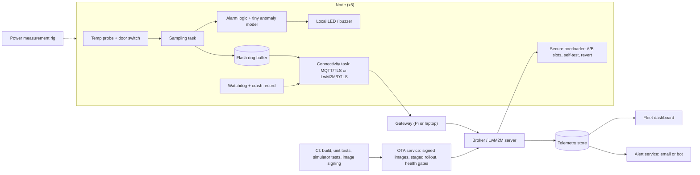

# EMB · Flagship project: a battery-powered cold-chain sensor fleet with secure OTA and on-device anomaly detection

| Major | Level | Time | Budget | Builds on |
|---|---|---|---|---|
| [Embedded Systems and IoT](../../03_majors/embedded_systems_iot/README.md) | L3 → L4 | MVP 2–3 weeks · v1 6–8 weeks · scale-up 4+ weeks | ≤ ₹6,000 of hardware for 5 nodes, sensors, batteries and a current sensor; laptop or Raspberry Pi as gateway; free cloud tier | EMB301 P3, EMB302 P3, EMB304 P3, EMB401 P3, EMB402 P3 |

You build and run a small fleet (at least five nodes) of battery-powered temperature monitors for refrigerators and freezers, the kind used to keep vaccines, medicines or food within a safe range. Each node runs real-time operating system firmware, samples a calibrated temperature probe and a door sensor, sleeps most of the time, sends telemetry over MQTT or LwM2M through a gateway, stores data locally when the network is down, detects anomalies such as a failing compressor or a door left open with a tiny on-device model, and raises alarms. Firmware updates are signed, delivered over the air into A/B slots and rolled back automatically if the new image fails. You measure the power budget and project multi-year battery life, collect crash and reset telemetry from the field, and write a threat model and test report. The nodes run on real fridges at home or in a lab for weeks, so the data is real.

## 1. The problem and why it matters

India runs one of the largest digital cold-chain monitoring programmes. The electronic Vaccine Intelligence Network (eVIN), an initiative of the Ministry of Health and Family Welfare implemented with UNDP support, uses SIM-enabled temperature loggers at cold-chain points that alert technicians when temperatures go out of range; UNDP reports it in all districts with about 25,000 temperature loggers installed ([UNDP project page](https://www.undp.org/india/projects/improving-vaccination-systems-evin); [UNDP blog, eVIN to Co-WIN](https://www.undp.org/india/blog/evin-co-win-digitizing-indias-immunization-programme)). The same problem appears in pharmacies, food distribution and laboratories.

Connected devices are under new rules. The EU Cyber Resilience Act entered into force on 10 December 2024, with reporting obligations from 11 September 2026 and main obligations from 11 December 2027; ETSI EN 303 645 is the consumer-IoT security baseline (v3.1.3, September 2024); and India's Telecommunication Engineering Centre published a Code of Practice for Securing Consumer IoT (TEC 31318:2021) aligned with it ([EMB major](../../03_majors/embedded_systems_iot/README.md); [European Commission](https://digital-strategy.ec.europa.eu/en/policies/cyber-resilience-act); [ETSI](https://www.etsi.org/deliver/etsi_en/303600_303699/303645/)). Embedded work is judged on physics and failure: microamps, flash wear, brown-outs, radio dropouts and updates that must never brick a device in the field. AI can draft drivers and boilerplate; it cannot measure your sleep current or guarantee your bootloader recovers from a power cut.

## 2. What you build

- **Node hardware**: a low-power microcontroller board with a radio (for example ESP32-C6 or Raspberry Pi Pico 2 W; [prices checked by the EMB major](../../03_majors/embedded_systems_iot/README.md)), a waterproof temperature probe or digital sensor calibrated against a reference thermometer, a reed switch for the door, a battery, and a current sensor or power profiler for measurement.
- **Firmware** (EMB301, EMB302): on an RTOS such as [Zephyr](https://docs.zephyrproject.org/) (or the vendor's FreeRTOS-based SDK), with tasks for sampling, alarm logic, storage, connectivity and update; deep sleep between samples; a watchdog; a flash ring buffer for store-and-forward; reset-reason and fault capture with a small crash record uploaded on next connection.
- **Secure boot and OTA** (EMB402): a bootloader such as [MCUboot](https://docs.mcuboot.com/) (or the vendor's secure-boot and OTA scheme) with signed images, A/B slots, a post-update self-test that confirms or reverts the image, and anti-rollback counters; per-device identity and keys provisioned at setup; staged rollout across the fleet with health gates.
- **Connectivity and backend** (EMB304): MQTT over TLS or LwM2M over DTLS to a broker or server via a gateway (laptop or Raspberry Pi); time synchronisation; a fleet backend storing telemetry; a dashboard with last-seen, battery, firmware version, temperature history, alarms and crash reports; alert delivery by email or a messaging bot.
- **On-device anomaly model** (EMB401): a tiny model (for example a quantised 1D convolutional network or a one-class model) running on the node over a window of recent readings, detecting door-left-open, compressor failure (slow warming) and sensor faults, so alarms fire locally even without connectivity.
- **Power budget**: measured current in each state (sleep, sample, inference, radio), a duty-cycle model, and a battery-life projection with derating, validated by a multi-day measurement.
- **Threat model and test report**: assets, attackers, entry points (radio, debug ports, update channel, gateway, cloud), mitigations mapped to ETSI EN 303 645 provisions, and a test report covering every acceptance criterion.

## 3. Scope tiers

| Tier | Time | Scope |
|---|---|---|
| **MVP** | 2–3 weeks | One node on an RTOS: calibrated sampling, deep sleep, MQTT telemetry through a gateway, dashboard, threshold alarm; sleep and active current measured; CI build with a simulator test |
| **v1** | 6–8 weeks | Five nodes for 2+ weeks on real fridges; store-and-forward; crash and reset telemetry; secure boot; signed A/B OTA with rollback and staged rollout; on-device anomaly model; power budget validated; threat model and test report; ADRs, demo, write-up |
| **Scale-up** | 4+ weeks | A custom PCB or a bare module to reach the projected sleep current; LwM2M device management; a cellular or LoRa variant; a field trial at a real pharmacy or lab with written permission |

## 4. Requirements

**Functional**

1. Sample temperature every 5 minutes (configurable) and the door on change; batch uploads every 15 minutes, or immediately on alarm.
2. Raise an alarm when temperature leaves a configurable band for a configurable time, or when the model detects an anomaly, even while offline (local LED or buzzer, then upload).
3. Keep at least 7 days of readings in flash when the network is down and upload them in order when it returns.
4. Accept only signed firmware; confirm a new image only after a self-test; otherwise revert on the next boot.
5. Report reset reasons, fault records, battery level and firmware version to the backend.

**Non-functional**

| Concern | Requirement |
|---|---|
| Battery life | Projected ≥ 2 years on the chosen battery with 20% derating, from measured state currents and a validated duty-cycle model |
| Accuracy | Within ±0.5 °C of a reference thermometer after calibration across 0–30 °C and freezer range |
| Alarm latency | Local alarm within one sample period; alert delivered within 2 minutes when connected |
| Data completeness | ≥ 99.9% of readings delivered across a 24-hour gateway outage |
| Update safety | No bricked device across power cuts at random points during update |
| Security | Unique credentials per device; no default passwords; debug ports locked in production builds; signed images; TLS or DTLS |
| Real-time behaviour | Measured worst-case response for alarm and sampling tasks; stack high-water marks recorded |

## 5. Reference architecture

ADRs to write: microcontroller and radio; RTOS; bootloader and slot layout; protocol (MQTT or LwM2M); time sync; storage format and wear levelling; model choice and size budget; key provisioning; rollout policy.

## 6. Milestones and deliverables

| Week | Milestone | Deliverable |
|---|---|---|
| 1 | Bring-up | Board bring-up, sensor calibration plan, ADR-001 to ADR-003, power measurement rig working |
| 2 | Low power | RTOS tasks, deep sleep, sampling; state currents measured |
| 3 | **MVP** | One node to dashboard with threshold alarm; CI with simulator test (for example Wokwi or Renode) |
| 4 | Resilience | Store-and-forward; watchdog; crash records; gateway-outage test |
| 5 | Secure update | Secure boot, signed A/B OTA, self-test and revert; power-cut trials |
| 6 | Fleet | Five nodes deployed on real fridges and freezers; staged rollout; dashboard |
| 7 | On-device model | Labelled events recorded; model trained, quantised, deployed; energy per inference measured |
| 8 | **v1** | 72-hour power validation, threat model, test report, ADRs, `AI_USE.md`, demo, write-up (fleet keeps running) |

## 7. Acceptance criteria

| Criterion | Target | Evidence |
|---|---|---|
| Power | State currents measured; ≥ 72-hour average current measured; projected life ≥ 2 years with 20% derating (or module-level evidence if the dev board's USB circuitry prevents it, stated honestly) | Power report with raw traces |
| Accuracy | ±0.5 °C against the reference at 3+ temperature points | Calibration table |
| Alarms | Planted excursions (door open, fridge unplugged) raise a local alarm within one sample period and a remote alert within 2 minutes, 10 of 10 | Test log |
| Store-and-forward | ≥ 99.9% of readings delivered in order after a 24-hour gateway outage | Completeness query |
| OTA safety | 100 power cuts at random points during update: 0 bricked nodes; 10 of 10 deliberately failing images reverted; 10 of 10 unsigned images rejected; an older signed image blocked by anti-rollback | Trial log |
| Fleet run | 5 nodes running ≥ 14 days; uptime and gaps reported per node | Dashboard export |
| Crash telemetry | Every planted fault (watchdog reset, hard fault, brown-out) captured with reason and context | Crash report sample |
| Anomaly model | Recall ≥ 90% on recorded door and warming events at ≤ 1 false alarm per node per week; model ≤ 50 KB flash; inference time and energy reported | Model report |
| Security | Threat model; ETSI EN 303 645 provision checklist with evidence; 0 hard-coded credentials in the repository or images | Checklist and scan output |

## 8. Data plan

| Data | Source | Licence | Use |
|---|---|---|---|
| Temperature and door telemetry | Your own nodes on real fridges and freezers (home, hostel or lab with permission) | Yours | All evaluation, model training, power validation |
| Labelled events | Door openings, power-offs and simulated faults you perform and log with timestamps | Yours | Model training and evaluation |
| Reference measurements | A calibrated reference thermometer | Yours | Calibration |
| Standards | ETSI EN 303 645, TEC 31318:2021, Cyber Resilience Act summaries | Public | Threat model and checklist |

No personal data is collected. If you deploy at a pharmacy or lab, get written permission and do not record anything beyond temperature, door state and device health.

## 9. Compute and cost

Hardware within ₹6,000: five wireless boards (roughly ₹730–1,210 each at the prices the EMB major lists; compatible ESP32-C6 boards cost less), sensors and reed switches, battery holders and batteries, and an INA219-class current sensor (a dedicated power profiler is better if your lab has one). The gateway is a laptop or Raspberry Pi. The backend runs in Docker on the gateway or on a free cloud tier. Simulators (Wokwi, Renode, QEMU) let you run firmware tests in CI without hardware.

## 10. AI-use policy

- **You may delegate:** driver scaffolding from datasheets (checked against the datasheet), build-system configuration, backend and dashboard code, test harness plumbing, documentation drafts.
- **You must write and verify yourself:** the power state machine and duty-cycle model, interrupt and task priorities, the storage format and recovery logic, the bootloader configuration and self-test, key provisioning, alarm logic, and the model's evaluation.
- **Verify AI output by:** measuring current after every change to power-related code; running power-cut and outage trials; reading register settings against the datasheet; simulator tests in CI.
- **Record:** `AI_USE.md`, including generated code that looked right but raised sleep current or misconfigured a peripheral.

## 11. Write-up and demo checklist

- [ ] README with the results table, bill of materials with prices and dates, wiring diagrams and flashing instructions
- [ ] Power report, calibration table, OTA trial log, fleet report, model report, threat model, test report
- [ ] 8+ ADRs and `AI_USE.md`
- [ ] Demo (2 minutes): open a fridge door and watch the local and remote alarm; unplug the gateway for an hour and show the backlog arrive in order; push a deliberately broken firmware and watch it revert; cut power mid-update and show the node still boots; the current trace in sleep
- [ ] Write-up: "Five fridges, two weeks, zero bricked devices"

## 12. What it signals to employers

You can build devices that survive the field: low power you have measured, firmware that recovers from faults, secure updates that cannot brick a fleet, telemetry that tells you what went wrong, and a small model that runs within a microcontroller's budget. Embedded, IoT, automotive and medical-device teams screen for exactly this, and the regulatory context shows you understand where the industry is going.

## 13. Stretch goals toward L4 and L5

- **L4:** a custom PCB or bare-module build that reaches the projected sleep current, with a design review and a manufacturing test procedure.
- **L4:** a fleet management layer with LwM2M (remote configuration, firmware objects, observation) and a written support playbook another engineer can follow.
- **L5:** a measurement study of energy cost per useful alarm across sampling rates, radio protocols and on-device versus cloud anomaly detection, published with traces and code (EMB501).

## Sources

All checked October 2026.

- UNDP India, *Improving Vaccination Systems: eVIN* (project page). https://www.undp.org/india/projects/improving-vaccination-systems-evin ; *eVIN to Co-WIN: digitizing India's immunization programme* (blog). https://www.undp.org/india/blog/evin-co-win-digitizing-indias-immunization-programme
- European Commission, Cyber Resilience Act. https://digital-strategy.ec.europa.eu/en/policies/cyber-resilience-act
- ETSI EN 303 645 versions. https://www.etsi.org/deliver/etsi_en/303600_303699/303645/
- TEC 31318:2021 and board prices as cited in the [EMB major](../../03_majors/embedded_systems_iot/README.md).
- Zephyr Project documentation. https://docs.zephyrproject.org/ ; MCUboot documentation. https://docs.mcuboot.com/
- Wokwi documentation. https://docs.wokwi.com/ ; Renode. https://antmicro.com/platforms/renode/ ; Interrupt (embedded engineering blog). https://interrupt.memfault.com/

_Last reviewed: 2026-10_
