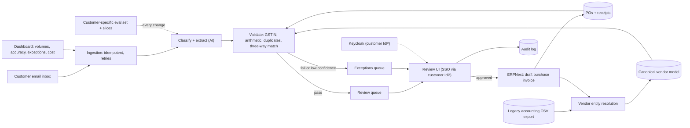

# FDE · Flagship project: deploy an AI invoice workflow into a customer's messy systems, and prove it paid off

| Major | Level | Time | Budget | Builds on |
|---|---|---|---|---|
| [Forward Deployed Engineering](../../03_majors/forward_deployed_engineering/README.md) | L3 → L4 | MVP 2–3 weeks · v1 6–8 weeks · scale-up 4+ weeks | Laptop; ≤ ₹2,000 of model API usage (or local models) | FDE302 P2, FDE303 P2, FDE304 P2, FDE401 P2, FDE305 |

You run a complete customer deployment from first conversation to handover. The customer is either a **real organisation that agrees in writing** (a small business, a college accounts office or an NGO), or a **simulated customer** played by classmates who follow written role briefs with hidden constraints. The problem is one almost every company has: supplier invoices arrive as PDFs and scans by email, and a small accounts-payable team types them into the ERP, chasing duplicates, vendor-name mismatches, tax errors and purchase-order mismatches. You do discovery, write a pilot charter with measurable success criteria, integrate with an open-source ERP, an email inbox, enterprise single sign-on and a legacy CSV export, resolve vendor identities across sources, deploy an AI extraction-and-validation workflow with a customer-specific evaluation set, pass a security review, measure the outcome against a timed baseline, and hand over to support. The simulated company and its numbers are an **illustrative scenario**.

## 1. The problem and why it matters

Forward deployed engineers exist because buying AI is easy and getting value from it inside a real organisation is hard. Surveyed organisations widely use AI, but agent deployment is "in the single digits across nearly all business functions" ([AI Index 2026, via the market map](../01_market_map/README.md)). OpenAI's postings say its FDEs "own discovery, technical scoping, system design, build, and production rollout" ([FDE major](../../03_majors/forward_deployed_engineering/README.md); [OpenAI careers](https://openai.com/careers/search/?q=forward%20deployed)). Palantir, which built the model, contrasts "one capability, many customers" for product engineers with "one customer, many capabilities" for forward deployed engineers ([Palantir blog](https://blog.palantir.com/dev-versus-delta-demystifying-engineering-roles-at-palantir-ad44c2a6e87)). In India, NASSCOM reports providers moving "away from FTE delivery to outcome-based, risk-sharing constructs" ([NASSCOM 2026](https://nasscom.in/knowledge-center/publications/technology-sector-india-strategic-review-2026)), which rewards engineers who can show a measured result inside a client's systems.

Invoice processing is a good proving ground: the documents are messy, the stakes are financial, India's GST identifiers (GSTINs) make vendor matching tractable but error-prone, and success is measurable in minutes per invoice and errors avoided. AI tools can extract fields; the hard parts are the ones an FDE owns: finding the real constraint, integrating with systems that were not designed for it, earning the security team's approval, and changing how people work.

## 2. What you build

- **Discovery notes** (FDE302): interviews with at least five stakeholders (finance head, accounts-payable clerks, IT and security, procurement, an auditor), process maps of the current workflow, a measured baseline (time per invoice, error and rework rates), and the real problem statement, which is often not the one in the first request.
- **Pilot charter**: scope, out of scope, success metrics with targets agreed before building, data access and handling, security requirements, timeline, roles and an exit criterion.
- **Integrations** (FDE303): an email inbox (IMAP) for incoming invoices; [ERPNext](https://github.com/frappe/erpnext) (GPL-3.0, self-hosted) as the customer's ERP through its REST API, creating draft purchase invoices linked to purchase orders and receipts; single sign-on for the review UI through [Keycloak](https://www.keycloak.org/) acting as the customer's identity provider; and a legacy accounting export that only produces CSV files on a schedule.
- **Entity resolution and canonical model** (FDE401): vendors appear differently in the ERP, the legacy export and on invoices; resolve them using GSTIN, PAN-derived fields, names and addresses into one canonical vendor record with match confidence and a human review queue.
- **AI workflow** (FDE304): classify each attachment, extract header fields and line items, validate (GSTIN format and check digit, tax arithmetic, totals, duplicate detection, three-way match against purchase order and goods receipt), and route: post as draft, or send to an exceptions queue with the reason. Humans approve every posting during the pilot.
- **Customer-specific evaluation set**: at least 300 documents with labels, sliced by vendor, layout, scan quality and language, run on every change.
- **Security review pack**: data-flow diagram, data classification, where data is stored and processed (India region or on the customer's premises), access control, logging and retention, model-provider terms, a threat model including prompt injection through invoice text, DPDP considerations, and answers to a standard vendor security questionnaire.
- **Outcome measurement**: a timed trial comparing the baseline process with the assisted process, with the same documents and at least three operators.
- **Handover**: runbook, monitoring dashboard, known issues, a training session for users, a support model, and "field notes" for the product team listing what should be productised.

## 3. Scope tiers

| Tier | Time | Scope |
|---|---|---|
| **MVP** | 2–3 weeks | Discovery notes and baseline; pilot charter signed off; email-to-ERP draft invoice path for clean PDFs; 100-document eval set; first accuracy and time numbers |
| **v1** | 6–8 weeks | SSO; legacy CSV integration; vendor entity resolution; validations and three-way match; exceptions queue; 300+ document eval set with slices; security review pack passed; timed outcome trial; handover; ADRs, demo, write-up |
| **Scale-up** | 4+ weeks | A second "customer" with different systems, reusing what you can and measuring the reuse; a change request mid-pilot handled with a revised charter; productising one field pattern as a reusable connector |

## 4. Requirements

**Functional**

1. Every invoice that arrives by email is ingested exactly once, even if the email is re-sent or the job restarts.
2. Extracted invoices become draft purchase invoices in the ERP, linked to the right vendor, purchase order and receipt where they exist.
3. Any validation failure or low-confidence field goes to the exceptions queue with a reason and the source region highlighted.
4. Reviewers sign in through the customer's SSO; their approvals and edits are audited.
5. Vendor matches below a confidence threshold require human confirmation and update the canonical record.

**Non-functional**

| Concern | Requirement |
|---|---|
| Accuracy | Field-level accuracy and exception rates measured on the customer-specific eval set, by slice |
| Safety | No invoice posted without human approval during the pilot; no posting with mismatched totals or tax arithmetic |
| Security and residency | Data stays on the customer's premises or in an India region; least-privilege service accounts; audit log; model-provider terms reviewed |
| Reliability | Idempotent ingestion; retries with backoff; failures visible on a dashboard |
| Cost | Cost per invoice reported and compared with the baseline's labour cost assumption |
| Handover | A support engineer can operate and fix common issues using only the runbook |

## 5. Reference architecture

ADRs to write: deployment location (customer premises or cloud region); model choice and data terms; extraction approach (layout-aware model, LLM, or both); validation rules; matching method and thresholds; ERP integration pattern; SSO protocol; handling of the legacy export; approval policy for the pilot.

## 6. Milestones and deliverables

| Week | Milestone | Deliverable |
|---|---|---|
| 1 | Discovery | Five interview notes; process map; baseline measurement plan; ADR-001 |
| 2 | Charter | Pilot charter signed by the customer (or the simulated sponsor); baseline measured |
| 3 | **MVP** | Email-to-ERP draft path; 100-document eval set; first numbers shown to the customer |
| 4 | Identity and legacy | SSO; legacy CSV integration; vendor entity resolution with review queue |
| 5 | Validation | Validations, duplicate detection, three-way match, exceptions queue |
| 6 | Security | Security review pack; review meeting with the customer's IT (or a peer playing it); fixes |
| 7 | Outcome | Eval set to 300+; timed trial against the baseline; cost per invoice |
| 8 | **v1** | Handover pack and training; field notes; ADRs; `AI_USE.md`; demo; write-up |

## 7. Acceptance criteria

| Criterion | Target | Evidence |
|---|---|---|
| Discovery | ≥ 5 stakeholder interviews; problem statement and success metrics agreed in a signed charter before build | Notes and charter |
| Ingestion | 0 duplicates and 0 losses across 500 emails including re-sends and restarts | Ingestion test report |
| Extraction | Header fields (GSTIN, number, date, totals, tax) ≥ 95% accurate; line items ≥ 90%; reported per vendor and scan-quality slice | Eval report |
| Validation | 100% of planted duplicates and arithmetic errors caught; 0 postings with mismatched totals | Planted-error test |
| Entity resolution | Vendor match precision ≥ 98% and recall ≥ 95% on labelled pairs | Matching report |
| Outcome | Median handling time per invoice reduced by ≥ 50% against the measured baseline in a trial with ≥ 3 operators and 100 invoices; error rate not worse than baseline | Trial report with raw timings |
| Security | Security pack approved by the customer's IT (or a peer reviewer with a checklist); all high findings closed | Review record |
| Handover | A peer acting as support resolves 3 planted issues using only the runbook | Peer's log |
| Cost | Cost per invoice reported with assumptions; within the charter's target | Cost report |

## 8. Data plan

| Data | Source | Licence | Use |
|---|---|---|---|
| ERP and master data | ERPNext demo company plus your seeded vendors, purchase orders and receipts | GPL-3.0 software; your data | Integration and three-way match |
| Invoices (simulated customer) | Synthetic PDFs and scans generated from 20+ layouts with realistic noise (rotation, stamps, handwriting, low resolution), Hindi and English text | Yours | Eval set and trials |
| Invoices (real customer) | The customer's documents, under a written data agreement | The customer's; never published | Their eval set and trial; publish only aggregate results |
| Legacy export | CSV files you generate with the quirks of an old accounting system (encodings, inconsistent names) | Yours | Integration and entity resolution |

With a real customer: personal and business data stay in their environment, the agreement states purpose, retention and deletion, and your public repository contains only synthetic examples and aggregate numbers.

## 9. Compute and cost

ERPNext, Keycloak, the pipeline and the review UI run in Docker on a laptop or on the customer's machine. Use a hosted model capped at ₹2,000 for the whole project, or a local document model if the customer requires on-premises processing; record the choice and its accuracy trade-off in an ADR. No paid cloud resources are required.

## 10. AI-use policy

- **You may delegate:** API client and mapping code from documentation, synthetic invoice generation, UI scaffolding, summaries of interview notes (you check against your own notes), first drafts of the security questionnaire answers and runbook.
- **You must write and verify yourself:** the problem statement and charter, validation rules, matching thresholds, the approval policy, the security review pack's claims, the trial design and its analysis, and anything you say to the customer.
- **Verify AI output by:** the customer-specific eval set on every change; checking generated integration code against the ERP's real behaviour in a test company; having the customer (or role-player) review the security pack.
- **Customer data:** never paste real customer documents into tools the data agreement does not allow.
- **Record:** `AI_USE.md`, including generated mappings that broke on the customer's real data.

## 11. Write-up and demo checklist

- [ ] README with the outcome table (baseline versus assisted), architecture, and how to run the simulated deployment
- [ ] Discovery notes (anonymised), charter, security review pack, eval report, trial report, handover pack, field notes
- [ ] 8+ ADRs and `AI_USE.md`
- [ ] Demo (2 minutes): an invoice arrives by email; the vendor is matched despite a different spelling; a tax mismatch goes to exceptions; a reviewer signs in through SSO and approves; the draft appears in the ERP; the before-and-after timing chart
- [ ] Write-up: "From discovery to handover: one AI deployment, measured"

## 12. What it signals to employers

You can walk into an unfamiliar organisation, find the real problem, integrate with systems you did not choose, satisfy security and compliance, measure value honestly and leave something others can run. That is the forward deployed engineer's job, and it is the evidence AI companies, SaaS firms and GCCs hiring for deployment roles look for.

## 13. Stretch goals toward L4 and L5

- **L4:** a second deployment for a different "customer" with a different ERP or identity provider, reusing components and reporting what fraction of the work was reusable.
- **L4:** turn one field pattern (for example the vendor resolver or the ERP connector) into a documented, versioned product component another team adopts.
- **L5:** a study of how customer-specific evaluation sets differ from public benchmarks in predicting deployment success, across two or more deployments (FDE501).

## Sources

All checked October 2026.

- OpenAI careers, "forward deployed" search. https://openai.com/careers/search/?q=forward%20deployed
- Palantir, *Dev versus Delta: demystifying engineering roles at Palantir*. https://blog.palantir.com/dev-versus-delta-demystifying-engineering-roles-at-palantir-ad44c2a6e87
- NASSCOM, *Technology Sector in India: Strategic Review 2026*. https://nasscom.in/knowledge-center/publications/technology-sector-india-strategic-review-2026
- Stanford HAI, AI Index 2026, as summarised in the [market map](../01_market_map/README.md). https://hai.stanford.edu/assets/files/ai_index_report_2026.pdf
- ERPNext (GPL-3.0). https://github.com/frappe/erpnext ; Keycloak. https://www.keycloak.org/
- PIB, DPDP Rules notified (14 Nov 2025). https://www.pib.gov.in/PressReleasePage.aspx?PRID=2190014

_Last reviewed: 2026-10_
