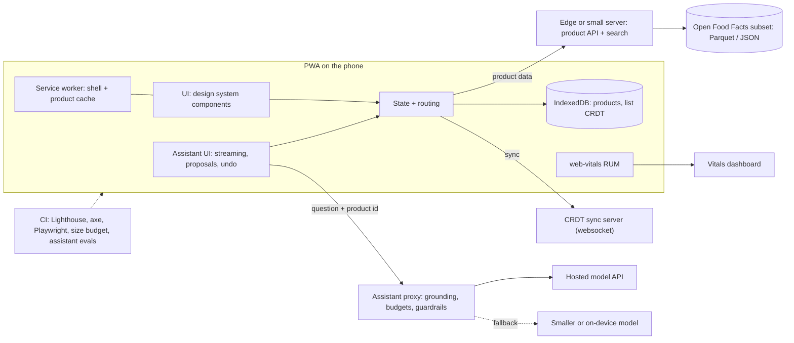

# FE · Flagship project: a fast, accessible, multilingual food-label app with an evaluated AI assistant

| Major | Level | Time | Budget | Builds on |
|---|---|---|---|---|
| [Frontend Engineering](../../03_majors/frontend_engineering/README.md) | L3 → L4 | MVP 2–3 weeks · v1 6–8 weeks · scale-up 4+ weeks | Laptop, one low-end Android phone, free static hosting; ≤ ₹2,000 of model API usage | FE302 P3, FE303 P3, FE304 P3, FE403 P3, FE404 P3 |

You build a progressive web app (PWA) that helps people understand packaged food: scan or search a product, read its ingredients, allergens and nutrition clearly in English, Hindi and one more Indian language, compare products, and keep a shared family shopping list that works offline. An AI assistant answers questions about a product using only that product's data, streams its answer, renders structured components instead of walls of text, and asks for approval before it changes anything. The app runs on real product data from Open Food Facts and is used by at least 15 real people who agreed to test it. The emphasis is what frontend employers pay for now: speed on cheap phones and bad networks, accessibility you can prove, and AI interfaces that are honest and controllable.

## 1. The problem and why it matters

Most of the web fails basic accessibility checks: 95.9% of the top million home pages had detectable WCAG failures in 2026 ([WebAIM Million](https://webaim.org/projects/million/)). Many Indian users browse on low-cost Android phones over unreliable connections, where heavy JavaScript turns into slow loading and sluggish taps. Google's Core Web Vitals define "good" as a largest contentful paint (LCP) within 2.5 s, interaction to next paint (INP) within 200 ms and cumulative layout shift (CLS) within 0.1, measured at the 75th percentile of real visits ([web.dev](https://web.dev/articles/vitals)); Indian products such as redBus and The Economic Times have published case studies on improving INP ([redBus](https://web.dev/case-studies/redbus-inp), [The Economic Times](https://web.dev/case-studies/economic-times-inp)).

AI makes the gap wider, not smaller. Generated UI code reproduces the web's accessibility and security mistakes (in Veracode's 2025 study, AI-generated code introduced risky security flaws in 45% of tests; [Veracode](https://www.veracode.com/resources/analyst-reports/2025-genai-code-security-report/)), and AI features add new interface problems: streaming text that screen readers cannot follow, actions taken without consent, and confident answers with no source. Food labels are a good domain because the data is real and messy, the stakes are personal (allergies, diabetes), and the product data is written by volunteers, so it must be treated as untrusted input to the model.

## 2. What you build

- **Search and scan**: barcode scanning with the Barcode Detection API where the browser supports it and a JavaScript decoder as fallback; text search with typo tolerance over a locally indexed subset.
- **Product page**: ingredients with allergens highlighted, a nutrition table per 100 g and per serving, additives and processing indicators where the data has them, data completeness shown honestly ("ingredients not provided").
- **Comparison**: two to four products side by side with accessible tables and charts.
- **Shared shopping list**: real-time collaboration between family members using a CRDT library (for example Yjs or Automerge), working offline and merging on reconnect (FE404).
- **Design system**: tokens, themes (light, dark, high contrast), and accessible components with documented keyboard and screen-reader behaviour (FE303).
- **Offline and performance**: a service worker caching the app shell and recently viewed products; route-level code splitting; image strategy; a performance budget enforced in CI; real-user monitoring with the `web-vitals` library (FE304).
- **AI assistant** (FE403): grounded only on the current product's data and a short nutrition glossary you write; streamed answers announced politely to assistive technology; generative UI that renders a comparison table or allergen card component; any action (add to list, suggest a data correction) shown as a proposal the user approves or rejects, with undo; refusal of medical advice with a pointer to professionals; a smaller on-device or cheaper fallback model when offline or over budget.
- **Internationalisation**: English, Hindi and one more language for all interface text, with correct fonts, number formats and line breaking.

## 3. Scope tiers

| Tier | Time | Scope |
|---|---|---|
| **MVP** | 2–3 weeks | Search, scan and product page on a local subset of Open Food Facts; two languages; app shell offline; Lighthouse CI and axe checks in CI; deployed; first field vitals from 5 testers |
| **v1** | 6–8 weeks | Comparison; shared offline list with CRDT merge; third language; design system v1 with conformance evidence; AI assistant with streaming, generative UI, approvals and eval set; 15+ real testers; usability study; design doc, ADRs, demo, write-up |
| **Scale-up** | 4+ weeks | On-device model fallback via WebGPU; voice input in Hindi; contributing approved corrections back to Open Food Facts through its documented process; a micro-frontend or framework migration experiment with measured cost |

## 4. Requirements

**Functional**

1. Find a product by barcode or name in under three interactions.
2. Show allergens prominently and never claim "allergen-free" when the data is missing.
3. Compare products with keyboard-operable, screen-reader-friendly tables.
4. Shared list edits by two people offline merge without lost items when both reconnect.
5. The assistant answers only from product data and the glossary, cites the field it used, says "the label data does not say" when unsure, and never acts without approval.
6. All interface text available in three languages, switchable without reload.

**Non-functional**

| Concern | Requirement |
|---|---|
| Speed (field, p75) | LCP ≤ 2.5 s, INP ≤ 200 ms, CLS ≤ 0.1 on the testers' real devices |
| Speed (lab) | Product page LCP ≤ 3.0 s on the reference low-end phone over throttled 3G-class network |
| Weight | Initial JavaScript ≤ 150 KB compressed; budget enforced in CI |
| Accessibility | WCAG 2.2 AA for all core flows, evaluated with WCAG-EM and manual screen-reader testing (TalkBack, NVDA or VoiceOver) |
| Offline | Shell, last 50 products and the list usable with no network |
| AI cost and latency | First streamed token p95 ≤ 2 s; monthly model spend capped with a hard limit and graceful degradation |
| Privacy | No accounts required for reading; list sharing via link with revocation; analytics without personal identifiers |
| Security | Content Security Policy; product text rendered as text, never as HTML; secrets only on the server proxy |

## 5. Reference architecture

The assistant proxy builds the prompt from structured product fields, never sends raw HTML, strips instructions found in product text, enforces per-user and global budgets, and logs prompts and outputs (without personal data) for evaluation.

## 6. Milestones and deliverables

| Week | Milestone | Deliverable |
|---|---|---|
| 1 | Foundations | Design doc draft; ADR-001 (framework and rendering strategy); data subset pipeline; design tokens |
| 2 | Core flows | Search, scan, product page; i18n in two languages; CI with budgets and axe |
| 3 | **MVP** | Offline shell; deployed; 5 testers; first field vitals |
| 4 | Collaboration | Shared list with CRDT, offline merge tests |
| 5 | Design system | Components documented; WCAG-EM evaluation; screen-reader test log |
| 6 | Assistant | Grounded, streaming assistant with generative UI and approvals; 150-question eval set |
| 7 | Real users | 15+ testers, task-based usability study with 5 sessions; fixes from findings |
| 8 | **v1** | Vitals report, accessibility conformance report, eval report, ADRs, demo, write-up |

## 7. Acceptance criteria

| Criterion | Target | Evidence |
|---|---|---|
| Field vitals | p75 LCP ≤ 2.5 s, INP ≤ 200 ms, CLS ≤ 0.1 over at least 500 page views from real testers | RUM dashboard export |
| Lab performance | Lab LCP ≤ 3.0 s on the reference phone and throttled network; JS ≤ 150 KB | Lighthouse CI history; bundle report |
| Accessibility | 0 automated axe violations on core pages; WCAG-EM report with manual checks; all core tasks completed with a screen reader | Conformance report and test videos |
| Offline merge | 100% of 200 randomised two-device offline edit sequences converge with no lost items | Playwright property test |
| Assistant groundedness | ≥ 95% of 150 eval answers supported by product fields; 0 invented allergen claims | Eval report with human-checked sample |
| Injection resistance | 0 of 30 planted instruction-bearing product texts change assistant behaviour or trigger actions | Eval report |
| Approvals | 0 state changes without explicit approval across the E2E suite | Playwright tests |
| Usability | 5 moderated sessions; task success ≥ 80% on the three core tasks after fixes | Usability report |
| Tests | Component and E2E coverage on core flows; visual regression on the design system | CI reports |

## 8. Data plan

| Data | Source | Licence | Use |
|---|---|---|---|
| Product database | [Open Food Facts](https://world.openfoodfacts.org/data) JSONL or Parquet export, filtered to products sold in India plus a sample of others | Database: ODbL; contents: DbCL; images: CC BY-SA | Local subset served by your API; attribute Open Food Facts in the app |
| Live product lookups | Open Food Facts read API | Same | Products missing from your subset; follow the API documentation's usage rules |
| Nutrition glossary | Written by you from public sources you cite | Yours (cite sources) | Assistant grounding |
| Usage and vitals | Your testers, with consent | Yours; no personal identifiers | Field metrics and usability findings |

ODbL is share-alike for the database: if you publish a derived database, publish it under ODbL too. Do not scrape other sites.

## 9. Compute and cost

Development on a laptop; testing on one low-end Android phone (borrowed is fine) plus browser throttling. Host the static app and a small API on a free tier of any static host or edge platform. Model usage: cap at ₹2,000 in total with a server-side hard limit, cache answers per product and question, and use the cheaper fallback model first where evals allow it.

## 10. AI-use policy

- **You may delegate:** component scaffolding from your design-system specs, translation drafts (checked by a fluent speaker), Storybook stories, Playwright test scaffolds, CSS refactors, documentation drafts.
- **You must write and verify yourself:** the accessibility behaviour of interactive components (focus management, ARIA, live regions for streaming), the service-worker caching strategy, the CRDT integration and merge tests, the assistant's grounding and approval logic, and the eval set.
- **Verify AI output by:** axe and manual screen-reader checks on every generated component; performance budgets in CI; reviewing every diff that touches the service worker or assistant proxy; native-speaker review of translations.
- **Record:** `AI_USE.md`, including generated components that failed accessibility review and what you changed.

## 11. Write-up and demo checklist

- [ ] README with the results table (field vitals, accessibility, eval scores) and a live link
- [ ] Design doc, 8+ ADRs, accessibility conformance report, eval report, usability report
- [ ] `AI_USE.md`
- [ ] Demo (2 minutes): scan a real product on a low-end phone; switch to Hindi; use TalkBack to hear an allergen; ask the assistant a question and approve an "add to list" proposal; go offline, edit the list on two devices, reconnect and show the merge
- [ ] Write-up: "Making a food-label app fast on a cheap phone and honest with AI"

## 12. What it signals to employers

You can ship a product real people use, measure performance where it matters (in the field, on cheap devices), prove accessibility instead of claiming it, build offline-first and collaborative state correctly, and design AI interfaces with grounding, consent and evaluation. That combination is rare among applicants whose portfolios are landing pages and dashboards.

## 13. Stretch goals toward L4 and L5

- **L4:** a performance regression system that bisects a vitals regression to a commit automatically, and a written frontend performance policy someone else could adopt.
- **L4:** contribute an accessibility or performance improvement upstream to an open-source component library you used, with the before and after evidence.
- **L5:** a small study of streaming AI responses and screen-reader users (with ethics approval and consent), comparing announcement strategies, written up with honest limitations.

## Sources

All checked October 2026.

- WebAIM, *The WebAIM Million* (2026). https://webaim.org/projects/million/
- web.dev, *Web Vitals*. https://web.dev/articles/vitals ; case studies: redBus https://web.dev/case-studies/redbus-inp and The Economic Times https://web.dev/case-studies/economic-times-inp
- W3C, WCAG 2.2. https://www.w3.org/TR/WCAG22/ ; WCAG-EM. https://www.w3.org/WAI/test-evaluate/conformance/wcag-em/
- Veracode, *2025 GenAI Code Security Report*. https://www.veracode.com/resources/analyst-reports/2025-genai-code-security-report/
- Open Food Facts, data and licences. https://world.openfoodfacts.org/data

_Last reviewed: 2026-10_
