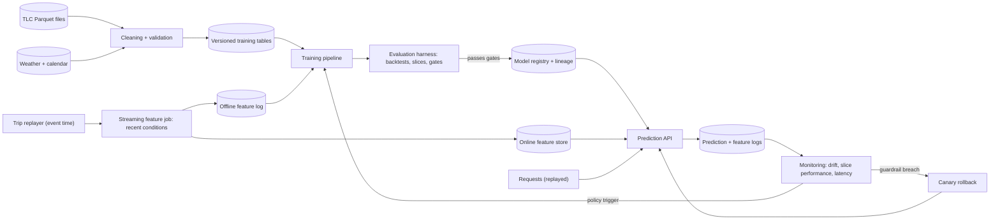

# MLE · Flagship project: a production ETA service, from raw trips to a monitored, retrained model

| Major | Level | Time | Budget | Builds on |
|---|---|---|---|---|
| [Machine Learning Engineering](../../03_majors/machine_learning_engineering/README.md) | L3 → L4 | MVP 2–3 weeks · v1 6–8 weeks · scale-up 4+ weeks | Laptop with 16 GB RAM; ₹0 required; optional cloud ≤ ₹2,000 | MLE302 P2 or P3, MLE303 P3, MLE304 P3, MLE401 P3, MLE404 P2 |

You build the estimated-time-of-arrival (ETA) service of an illustrative ride-hailing or delivery company: at the moment a customer requests a trip, predict how long it will take, and give a promise time that is rarely broken. The data is real: years of New York City taxi trip records. You take it from raw files to a real-time prediction API with leak-free, time-ordered evaluation, point-in-time-correct features, slice and fairness analysis, prediction intervals, shadow and canary rollout with automatic rollback, drift monitoring, a retraining policy chosen by backtest, and a cost report. Because the data spans the COVID-19 period, you can test your monitoring and retraining against a real, sudden change in the world rather than a simulated one.

## 1. The problem and why it matters

ETA prediction is a core model in mobility and delivery. Uber has described its deep-learning ETA system and the post-processing it applies to routing-engine estimates ([Uber, DeepETA, Feb 2022](https://www.uber.com/blog/deepeta-how-uber-predicts-arrival-times/); [DeeprETA paper](https://arxiv.org/abs/2206.02127)), and Swiggy has written about predicting delivery time at the cart and about keeping ETAs consistent across regions ([Swiggy Bytes, Aug 2023](https://medium.com/swiggy-bytes/predicting-food-delivery-time-at-cart-cda23a84ba63); [Swiggy Bytes, Oct 2026](https://medium.com/swiggy-bytes/solving-regional-consistency-of-delivery-eta-with-a-deep-probabilistic-framework-8d82d6abdf41)). The problem has everything an ML engineering interview probes: features that are easy to leak from the future, asymmetric costs (late is worse than early), slices where the model is quietly worse, latency budgets, and a world that changes.

Most of the effort in production ML is outside the model: data dependencies, feedback loops, configuration and monitoring ([Sculley et al., NeurIPS 2015](https://papers.nips.cc/paper/5656-hidden-technical-debt-in-machine-learning-systems)). AI assistants can now write training scripts and even tune models; what employers still pay for is the system around the model and the judgement about when a model is safe to ship ([MLE role page](../01_market_map/roles/MLE_machine_learning_engineering.md)).

## 2. What you build

- **Data pipeline** (MLE303): raw [TLC trip records](https://www.nyc.gov/site/tlc/about/tlc-trip-record-data.page) to cleaned, versioned training tables with documented filters (impossible durations, zero distances, clock errors), joined with weather and calendar data.
- **Point-in-time features**: request-time features only (pickup and drop-off zones, time, day, weather at request), plus "recent conditions" features such as rolling median duration per zone pair over the previous 15 or 60 minutes, computed from a replayed stream so they use only data available at prediction time ([point-in-time joins](https://docs.feast.dev/getting-started/concepts/point-in-time-joins)).
- **Models**: a strong baseline (historical median by zone pair and hour), gradient-boosted trees, and optionally a small neural model; quantile models or a distributional model for the promise time.
- **Evaluation harness** (MLE304): rolling-origin monthly backtests; mean absolute error and percentage errors; interval coverage; a business metric (share of trips later than the promised time); slice analysis by borough, hour, distance band and airport trips; a fairness view comparing error and lateness across neighbourhoods; release gates that block a model that regresses any important slice.
- **Serving**: a real-time API with an online feature lookup, model loaded from a registry, request logging for monitoring, p99 latency budget.
- **Release process** (MLE401): shadow mode, then canary to a fraction of traffic with guardrail metrics and automatic rollback.
- **Monitoring and retraining**: input drift, prediction drift and, once actuals arrive, performance by slice; a retraining policy (scheduled, drift-triggered or both) chosen by replaying history through it.
- **Cost work** (MLE404): cost per million predictions and per retrain; a compressed or simplified model that keeps every slice within tolerance.

## 3. Scope tiers

| Tier | Time | Scope |
|---|---|---|
| **MVP** | 2–3 weeks | One year of trips; cleaning pipeline; baseline and gradient-boosted model; time-ordered evaluation; slice report; batch scoring; a leakage test in CI |
| **v1** | 6–8 weeks | Point-in-time recent-conditions features; prediction intervals and promise time; real-time API; model registry; shadow and canary with rollback; drift monitoring; retraining policy backtested across 2019–2021; cost report and compressed model; model card, ADRs, demo, write-up |
| **Scale-up** | 4+ weeks | A road-network or graph feature from open map data; multi-city transfer to a second open trip dataset; online learning or rapid recalibration compared with full retraining |

## 4. Requirements

**Functional**

1. Given a request (pickup zone, drop-off zone, timestamp), return a point ETA and a promise time (for example the 85th percentile) with the model version.
2. Features at serving time are identical in definition to training features (one feature definition, two paths, tested for skew).
3. New models go through gates, shadow and canary before full traffic; rollback is automatic on guardrail breach.
4. Monitoring compares live inputs and outcomes with training distributions and alerts on breaches.
5. Retraining runs from raw data with recorded lineage (data version, code version, parameters, metrics).

**Non-functional**

| Concern | Requirement |
|---|---|
| Leakage | No feature uses information after the request time; enforced by tests including a planted leak |
| Accuracy | Beats the zone-pair-by-hour median baseline on MAE in every month of the held-out period |
| Promise quality | Promise time met for 83–87% of trips when targeting the 85th percentile |
| Slices | No slice (borough × hour band) has MAE above 1.5 times overall without a documented reason and mitigation |
| Latency | p99 ≤ 50 ms at 200 requests/s on the reference laptop, including feature lookup |
| Training-serving skew | Feature values from both paths match on a sample of 10,000 requests |
| Reproducibility | Any registered model rebuilt from its lineage record |

## 5. Reference architecture

ADRs to write: prediction target and filters; promise percentile and why; feature definitions and the point-in-time strategy; model family; evaluation split; release gates and slice tolerances; canary guardrails; drift metrics and thresholds; retraining policy; serving stack.

## 6. Milestones and deliverables

| Week | Milestone | Deliverable |
|---|---|---|
| 1 | Design | ML system design doc (MLE302 style); target definition; evaluation plan; ADR-001 |
| 2 | Data | Cleaning pipeline with validation; baseline; leakage test |
| 3 | **MVP** | Gradient-boosted model; backtest; slice report; batch scoring |
| 4 | Features | Streaming recent-conditions features; online and offline stores; skew test |
| 5 | Serve | Prediction API, registry, latency test; intervals and promise time |
| 6 | Release | Release gates, shadow, canary, automatic rollback drills |
| 7 | Monitor and retrain | Drift monitoring; replay 2019–2021 through candidate retraining policies |
| 8 | **v1** | Cost report and compressed model; model card; ADRs; `AI_USE.md`; demo; write-up |

## 7. Acceptance criteria

| Criterion | Target | Evidence |
|---|---|---|
| Leakage | A planted future-information feature fails CI; point-in-time test passes on 10,000 sampled requests | CI log and test report |
| Accuracy | Beats baseline MAE in every month of the held-out quarter, with bootstrap intervals | Backtest report |
| Promise | 85th-percentile promise met for 83–87% of held-out trips overall and within ±5 points in every borough | Calibration table |
| Slices and fairness | Slice table published; any slice over 1.5× overall MAE has a mitigation tried and documented | Slice report |
| Latency | p99 ≤ 50 ms at 200 requests/s | Load test report |
| Skew | 100% of sampled online and offline feature values match within tolerance | Skew report |
| Canary | 5 of 5 planted bad models rolled back automatically before full rollout | Release logs |
| Drift | The March 2020 shift detected within 7 replayed days; alert raised | Monitoring replay output |
| Retraining policy | At least three policies compared on accuracy and compute cost over the 2019–2021 replay; choice justified | Policy report |
| Cost | Cost per million predictions and per retrain reported; compressed model ≥ 40% cheaper or faster with ≤ 2% MAE loss on every slice | Cost report |

## 8. Data plan

| Data | Source | Licence or terms | Use |
|---|---|---|---|
| Taxi trips (yellow, green and for-hire vehicles) | [NYC TLC trip record data](https://www.nyc.gov/site/tlc/about/tlc-trip-record-data.page), monthly Parquet, with the taxi zone lookup | NYC open data terms; cite the TLC | Training, replay, evaluation |
| Weather | NOAA GHCN daily via the [Registry of Open Data on AWS](https://registry.opendata.aws/noaa-ghcn/) or another open weather source | Provider's open data terms | Features |
| Calendar | Public holiday lists you compile | Yours | Features |

Start with a sample (for example one borough or 10% of trips) for development and scale up for final evaluation. The trip data contains no rider identities; do not attempt to link trips to people.

## 9. Compute and cost

A 16 GB laptop handles a sampled year comfortably with Polars or DuckDB and gradient-boosted trees; full multi-year evaluation runs overnight. Serving, feature store, registry (for example MLflow) and monitoring run in Docker. No GPU is needed. An optional cloud deployment for a realistic latency test stays under ₹2,000 with same-day teardown.

## 10. AI-use policy

- **You may delegate:** data loading and cleaning code (with your validation rules), plotting, hyperparameter search scripts, API boilerplate, Dockerfiles, dashboard code, documentation drafts.
- **You must write and verify yourself:** the target and filter definitions, every feature's time semantics, the evaluation split and gates, slice tolerances, canary guardrails, drift thresholds, the retraining policy comparison and the model card's claims.
- **Verify AI output by:** the leakage and skew tests, comparing generated feature code with hand-computed values on small samples, and re-running the full backtest after any change to features or training.
- **Record:** `AI_USE.md`, including at least one generated feature or split that leaked future information and how the tests caught it.

## 11. Write-up and demo checklist

- [ ] README with the results table and one-command local stack
- [ ] ML system design doc, evaluation report, slice and fairness report, retraining policy report, cost report, model card
- [ ] 10+ ADRs and `AI_USE.md`
- [ ] Demo (2 minutes): a live prediction with its promise time; the slice table; a planted bad model rolled back during canary; the March 2020 replay setting off drift alerts and the retraining policy responding
- [ ] Write-up: "Shipping an ETA model that survives a pandemic"

## 12. What it signals to employers

You can run the whole ML lifecycle: honest evaluation, point-in-time features, safe releases, monitoring that notices real change, and retraining decided by evidence, with costs in view. Ranking, pricing, fraud and logistics teams interview exactly for this.

## 13. Stretch goals toward L4 and L5

- **L4:** a reusable evaluation and release-gate library adopted by a second model (for example fare prediction) with no code changes beyond configuration.
- **L4:** a road-graph feature from open map data, with a measured gain per slice and its serving cost.
- **L5:** a reproduction of a published ETA or travel-time method on TLC data, compared with your system under the same splits and slices, released with code (MLE501).

## Sources

All checked October 2026.

- Uber, *DeepETA: How Uber Predicts Arrival Times Using Deep Learning* (10 Feb 2022). https://www.uber.com/blog/deepeta-how-uber-predicts-arrival-times/ ; DeeprETA paper. https://arxiv.org/abs/2206.02127
- Swiggy Bytes, *Predicting Food Delivery Time at Cart* (11 Aug 2023). https://medium.com/swiggy-bytes/predicting-food-delivery-time-at-cart-cda23a84ba63 ; *Solving Regional Consistency of Delivery ETA with a Deep Probabilistic Framework* (8 Oct 2026). https://medium.com/swiggy-bytes/solving-regional-consistency-of-delivery-eta-with-a-deep-probabilistic-framework-8d82d6abdf41
- Sculley et al., *Hidden Technical Debt in Machine Learning Systems* (NeurIPS 2015). https://papers.nips.cc/paper/5656-hidden-technical-debt-in-machine-learning-systems
- NYC TLC trip record data. https://www.nyc.gov/site/tlc/about/tlc-trip-record-data.page ; NOAA GHCN on AWS. https://registry.opendata.aws/noaa-ghcn/
- Feast, point-in-time joins. https://docs.feast.dev/getting-started/concepts/point-in-time-joins

_Last reviewed: 2026-10_
