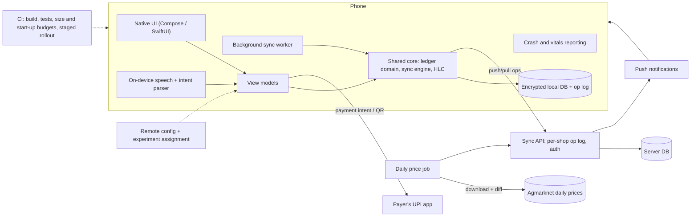

# MOB · Flagship project: an offline-first ledger and price app for small traders, built for low-end Android

| Major | Level | Time | Budget | Builds on |
|---|---|---|---|---|
| [Mobile Engineering](../../03_majors/mobile_engineering/README.md) | L3 → L4 | MVP 2–3 weeks · v1 6–8 weeks · scale-up 4+ weeks | Laptop, one low-end Android phone (2–3 GB RAM), Google Play developer registration; iOS needs a Mac and an Apple developer account | MOB301/302/303 P3, MOB304 P3, MOB305 P3, MOB401 P3, MOB402 P3, MOB403 P3, MOB404 P3 |

You build and ship a mobile app for small traders, such as a vegetable wholesaler or a kirana shop: a credit ledger ("who owes me what"), UPI payment requests for amounts due, daily mandi prices for the commodities they trade, and reminders. It must work fully offline, sync between two or more devices of the same shop without losing an entry, start fast on a cheap phone, and use little data and battery. One feature uses on-device AI: a Hindi voice entry such as "Ramesh ko paanch sau udhaar" becomes a draft ledger entry the user confirms. You ship it to at least 20 real testers through store testing tracks, measure crashes, start-up, size and engagement, run one valid experiment, and break the sync on purpose.

## 1. The problem and why it matters

Mobile work is judged on hardware you do not control: a phone with 2 GB of RAM, a nearly full disk, aggressive battery savers and an old OS ([MOB major](../../03_majors/mobile_engineering/README.md)). Google Play treats a user-perceived crash rate above 1.09% or an ANR ("app not responding") rate above 0.47% as bad behaviour that can reduce an app's visibility ([Android vitals](https://developer.android.com/topic/performance/vitals)). Payments are part of everyday apps: UPI processed 24.07 billion transactions in September 2026, and NPCI ended person-to-person "collect requests" from 1 October 2025 while merchant flows continue ([StartupTalky](https://startuptalky.com/upi-transactions-september-2026/); [Business Today](https://www.businesstoday.in/personal-finance/banking/story/npci-to-tighten-upi-rules-peer-to-peer-collect-feature-to-end-in-october-489244-2025-08-13)), so apps launch the payer's UPI app through payment intents and links.

Small-business ledger apps exist in India (for example [Khatabook](https://khatabook.com/) and [OkCredit](https://okcredit.in/)), which makes the domain easy for a panel to understand and hard to fake: every rupee must add up across devices and offline edits. Mandi prices are published on the government's [Agmarknet](https://agmarknet.gov.in/) portal, so the price feature uses real public data. AI tools generate screens quickly; the hard, valued parts are lifecycles, background limits, offline sync and conflicts, performance on low-end devices, and release safety.

## 2. What you build

- **Ledger**: customers and suppliers, credit and payment entries, running balances, notes and photos of paper bills. Entries are **append-only**: an edit is a reversal plus a new entry, so the balance is always derived and auditable.
- **Payment requests**: for an amount due, generate a UPI payment link or QR code payable to the trader's own UPI ID, following NPCI's published linking format; mark the entry paid only when the trader confirms receipt (no fake "auto-confirmed" states).
- **Mandi prices**: daily modal, minimum and maximum prices for the trader's chosen commodities and markets, synced as small deltas, with price alerts through push notifications.
- **Multi-device sync**: an operation log per device, a sync server, hybrid logical clocks for ordering, deterministic conflict rules, and convergence tests (MOB304).
- **Sign-in**: passkeys through the platform credential manager, with a recovery path (MOB305).
- **On-device voice entry** (MOB402): on-device speech recognition plus a small intent parser that extracts name, amount and direction in Hindi and English; the result is always a draft to confirm.
- **Release engineering** (MOB401): CI builds, baseline profiles for start-up, size and start-up budgets that fail the build, crash and ANR reporting, staged rollout and remote feature flags.
- **Experiment** (MOB404): one A/B test (for example two onboarding flows) with a pre-registered metric and an honest analysis given the small sample.
- **Second platform**: iOS through a shared core (Kotlin Multiplatform, Flutter or React Native) if you have a Mac; otherwise a second target of the shared core, stated clearly in the README.

## 3. Scope tiers

| Tier | Time | Scope |
|---|---|---|
| **MVP** | 2–3 weeks | Android app: ledger offline with local database, balances, one-device backup sync, mandi prices for 3 commodities; CI build; internal testing track with 5 testers; start-up and size measured |
| **v1** | 6–8 weeks | Multi-device sync with convergence tests; UPI payment requests; passkeys; push alerts; voice entry with eval; release pipeline with budgets and staged rollout; 20+ testers for 3+ weeks; experiment; second platform; system design doc, ADRs, demo, write-up |
| **Scale-up** | 4+ weeks | Shop staff roles and permissions; encrypted end-to-end backup; receipt OCR on device; Android widget and wear notification; accessibility audit with TalkBack users |

## 4. Requirements

**Functional**

1. Add a customer and an entry in under 10 seconds with no network.
2. Balances and history identical on every device of the shop after sync.
3. Generate a payment link or QR for any due amount; share through the system share sheet only when the user chooses.
4. Daily prices for chosen commodities and markets, with alerts when a price crosses a user-set threshold.
5. Voice entry produces a draft with name, amount and direction; nothing is saved without confirmation.
6. Export the ledger as PDF or CSV.

**Non-functional**

| Concern | Requirement |
|---|---|
| Start-up | Cold start p90 ≤ 1.5 s on the reference low-end phone, measured with Macrobenchmark |
| Size | Download size ≤ 15 MB; the speech model is downloaded on demand on Wi-Fi |
| Stability | Crash-free sessions ≥ 99.5%; ANR rate below Play's 0.47% threshold |
| Offline | Every ledger feature works offline; sync resumes within 30 s of connectivity |
| Data and battery | Typical daily price sync ≤ 100 KB; background work only through WorkManager (or the iOS equivalent) with constraints |
| Security | Local database encrypted with keys in the platform keystore; no personal data in logs or analytics; checked against the [OWASP MASVS](https://mas.owasp.org/MASVS/) |
| Accessibility | Touch targets, contrast and TalkBack labels on all core screens; Hindi and English interface |

## 5. Reference architecture

ADRs to write: shared-core choice; local database and encryption; operation-log format and conflict rules; why entries are append-only; background work policy; how the speech model is shipped; experiment assignment and analysis plan.

## 6. Milestones and deliverables

| Week | Milestone | Deliverable |
|---|---|---|
| 1 | Design | System design doc draft (MOB403 style); ADR-001 (stack); data model; test plan; reference phone chosen |
| 2 | Offline ledger | Local DB, entries, balances; unit and property tests on balance derivation |
| 3 | **MVP** | Prices, single-device backup; CI; internal track with 5 testers; start-up and size measured |
| 4 | Sync | Op log, HLC, multi-device sync; randomised convergence tests; fault injection on the sync API |
| 5 | Payments and identity | Payment links and QR; passkeys; push alerts |
| 6 | On-device AI | Voice entry; eval set of 200 consented utterances; latency and memory measured |
| 7 | Ship and measure | Release pipeline with budgets and staged rollout; 20+ testers; experiment live; second platform build |
| 8 | **v1** | Vitals report, experiment analysis, sync failure report, ADRs, `AI_USE.md`, demo, write-up |

## 7. Acceptance criteria

| Criterion | Target | Evidence |
|---|---|---|
| Convergence | 1,000 randomised 3-device offline edit sequences converge; 0 lost or duplicated entries; equal balances | Property test report |
| Sync under faults | 0 lost entries with the sync API dropping, duplicating and reordering 20% of requests | Fault-injection test output |
| Start-up | Cold start p90 ≤ 1.5 s on the reference phone, with and without baseline profiles reported | Macrobenchmark results |
| Size | Download size ≤ 15 MB, enforced in CI | CI size report |
| Stability | ≥ 99.5% crash-free sessions over ≥ 1,000 sessions; ANR below 0.47% | Crash reporting export |
| Data use | Daily price sync ≤ 100 KB typical | Network profiler capture |
| Voice entry | ≥ 90% of 200 utterances parsed correctly (name, amount, direction); 100% require confirmation | Eval report |
| Real testers | 20+ testers, 3+ weeks; retention and feature use reported honestly | Analytics summary |
| Experiment | Pre-registered metric; analysis states power and uncertainty; no claims beyond the data | Experiment report |
| Security | MASVS checklist with evidence; local data unreadable without the keystore key | Checklist and a test on a rooted emulator |

## 8. Data plan

| Data | Source | Licence or terms | Use |
|---|---|---|---|
| Mandi prices | [Agmarknet](https://agmarknet.gov.in/) daily market reports, downloaded by your server once a day | Check the terms on the portal and on any [data.gov.in](https://www.data.gov.in/) resource you use; cite the source in the app | Price screens and alerts |
| Ledger data | Your testers' own entries | Theirs; consent form; deletion on request | Real usage |
| Voice eval set | 200 utterances recorded by consenting testers | Consent covers evaluation only; not published unless consent allows | On-device AI evaluation |
| Synthetic shops | Your generator | Yours | Load and sync tests |

Testers' ledgers contain personal data of third parties (their customers). Keep it on device and on your sync server only, encrypt it, let testers delete everything, and follow the DPDP Rules, 2025 for notices and erasure. Payment tests use only your own UPI ID and token amounts, or a payment gateway's test mode.

## 9. Compute and cost

A laptop with Android Studio and an emulator, plus one physical low-end phone. Google Play developer registration is a one-time fee; Apple's developer programme is an annual fee (check current prices). Sync server and price job on a free tier or a small VM (≤ ₹500 per month). Crash reporting and push notifications on free tiers. No paid model APIs are needed: the voice feature runs on device.

## 10. AI-use policy

- **You may delegate:** screen layouts from your designs, view-model boilerplate, network clients from your API spec, test scaffolds, Gradle and CI configuration, translations (checked by a fluent speaker), store listing drafts.
- **You must write and verify yourself:** the sync engine (op log, clocks, conflict rules), balance derivation, the encryption and key handling, background work scheduling, the voice intent parser's evaluation, and the experiment's analysis plan.
- **Verify AI output by:** convergence property tests; running on the low-end phone (not only the emulator); profiling start-up and memory after AI-assisted changes; reviewing every diff in the shared core.
- **Record:** `AI_USE.md` with cases where generated code behaved differently on a real low-end device than on the emulator.

## 11. Write-up and demo checklist

- [ ] README with the results table, store testing links and the reference phone's specs
- [ ] System design doc, 8+ ADRs, sync failure report, experiment report, vitals report
- [ ] `AI_USE.md` and a privacy notice for testers
- [ ] Demo (2 minutes): on the cheap phone in airplane mode, add an entry by voice; edit on a second phone also offline; reconnect both and show identical balances; generate a payment QR; show the start-up and crash dashboards
- [ ] Write-up: "Making every rupee add up on two offline phones"

## 12. What it signals to employers

You can ship to real users through store tracks, handle offline sync and conflicts correctly, meet performance budgets on cheap hardware, integrate payments and identity safely, run AI on device within memory and battery limits, and measure what you ship. Most mobile portfolios stop at screens; this one shows the engineering underneath.

## 13. Stretch goals toward L4 and L5

- **L4:** a staged rollout drill: ship a build with a planted regression behind a flag, detect it from vitals, halt the rollout and roll back, with a postmortem.
- **L4:** a written mobile platform guide (architecture, budgets, release process) that a second developer follows to add a feature without help.
- **L5:** a measured comparison of two sync designs (op-log with HLC versus a CRDT library) on convergence time, data use and battery on low-end hardware, written up with the test harness released.

## Sources

All checked October 2026.

- Android Developers, *Android vitals* (bad-behaviour thresholds). https://developer.android.com/topic/performance/vitals
- StartupTalky, UPI transactions in September 2026 (NPCI data). https://startuptalky.com/upi-transactions-september-2026/
- Business Today, NPCI to end P2P collect requests from 1 Oct 2025 (13 Aug 2025). https://www.businesstoday.in/personal-finance/banking/story/npci-to-tighten-upi-rules-peer-to-peer-collect-feature-to-end-in-october-489244-2025-08-13
- Agmarknet. https://agmarknet.gov.in/ ; Open Government Data Platform India. https://www.data.gov.in/
- OWASP Mobile Application Security Verification Standard. https://mas.owasp.org/MASVS/
- PIB, DPDP Rules, 2025 notified (14 Nov 2025). https://www.pib.gov.in/PressReleasePage.aspx?PRID=2190014

_Last reviewed: 2026-10_
