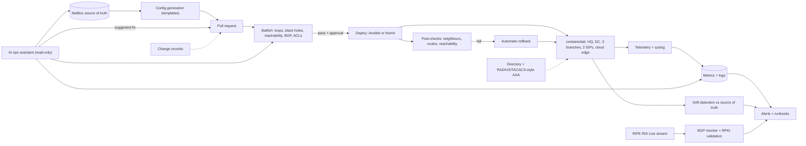

# NET · Flagship project: network-as-code for a multi-branch enterprise, with pre-change verification and live BGP monitoring

| Major | Level | Time | Budget | Builds on |
|---|---|---|---|---|
| IT Infrastructure and Network Engineering ([role page](../01_market_map/roles/NET_it_infrastructure_networking.md)) | L3 → L4 | MVP 2–3 weeks · v1 6–8 weeks · scale-up 4+ weeks | Laptop with 16 GB RAM running Linux or WSL2; ₹0 required; ≤ ₹1,000 of model API usage | NET301–NET305, NET401–NET404 projects |

You design, build and operate the network of an illustrative Indian retail chain (a head office, a data centre, three branches and a cloud network) entirely as code. A source of truth holds every device, interface, address and VLAN; configurations are generated from it; every change is verified by a network model before it touches a device, deployed by a pipeline with automatic rollback, and recorded as a change. Branches have two WAN links with fast failover and an encrypted tunnel to the cloud; staff and payment terminals are segmented; administrators sign in through central identity. Streaming telemetry feeds dashboards and alerts, an AI operations assistant helps diagnose faults without being allowed to change anything, and a live feed of real Internet routing data watches the company's (illustrative) prefixes for hijacks and leaks. The company and its addressing are an **illustrative scenario**; the routing software, verification tools and BGP data are real.

## 1. The problem and why it matters

Network outages are usually caused by changes. On 4 October 2021, a command issued during routine maintenance on Meta's backbone unintentionally took down its connections, a bug in an audit tool failed to stop it, and DNS servers then withdrew their BGP advertisements, taking Facebook, Instagram and WhatsApp offline for hours ([Meta engineering](https://engineering.fb.com/2021/10/05/networking-traffic/outage-details/)). Network devices are also prime targets, which is why CISA issued an emergency directive in 2025 to identify and mitigate potential compromise of Cisco devices ([CISA ED 25-03](https://www.cisa.gov/news-events/directives/ed-25-03-identify-and-mitigate-potential-compromise-cisco-devices)), and Indian rules require organisations to keep ICT system logs for 180 days and report incidents within 6 hours ([CERT-In, 2022](https://www.cert-in.org.in/PDF/CERT-In_Directions_70B_28.04.2022.pdf)).

The role is moving from typing commands to engineering systems. The US Bureau of Labor Statistics projects network and computer systems administrators to decline 4% from 2025 to 2035 while network architects grow 8% ([market map](../01_market_map/README.md#5-which-roles-are-growing)), and vendor certifications work best paired with automation projects ([NET role page](../01_market_map/roles/NET_it_infrastructure_networking.md)). Open tools now make the whole practice available on a laptop: [containerlab](https://containerlab.dev/) for virtual topologies, [FRRouting](https://frrouting.org/) as a routing stack, [NetBox](https://github.com/netbox-community/netbox) as a source of truth and [Batfish](https://www.batfish.org/) for pre-change verification.

## 2. What you build

- **Design** (NET301, NET304, NET404): addressing plan, VLANs and VRFs, routing design (OSPF or IS-IS inside, BGP at the edges and to the cloud), branch WAN design with two providers and failover, segmentation for point-of-sale, staff, guest and management traffic, and a written high-level and low-level design.
- **Lab topology**: containerlab with FRRouting nodes (and optionally other freely available network operating system images), Linux hosts as clients and servers, a simulated "Internet" and two provider edges per branch.
- **Source of truth**: NetBox populated by script with sites, devices, interfaces, IP addresses, VLANs and circuits; nothing configured that is not in it.
- **Configuration generation and deployment** (NET303): templates rendered from the source of truth, pushed with Ansible or Nornir, post-change checks (neighbours up, routes present, reachability matrix), automatic rollback on failure, and drift detection that flags any manual change.
- **Pre-change verification**: every pull request runs Batfish against the proposed configurations: routing loops, black holes, unintended reachability, broken BGP sessions, ACLs that block required flows, and a required-reachability matrix that must stay true.
- **WAN and cloud**: BFD-assisted failover between the two branch links, an IPsec tunnel from the data centre to the cloud network (strongSwan or similar), and policy routing that sends payment traffic over the preferred path.
- **Identity and access** (NET302): central directory (Samba AD or FreeIPA) with RADIUS or TACACS+-style authentication for device administration, role-based command authorisation, and logged sessions.
- **Operations** (NET305, NET403): streaming or polled telemetry into Prometheus and Grafana, syslog to a central store with 180-day retention configured, alerts for BGP session loss, link failure and drift, change records linked to pull requests, and runbooks.
- **AI operations assistant**: read-only access to telemetry, logs, the source of truth and Batfish queries; produces a diagnosis with evidence for an injected fault; any suggested change becomes a pull request that goes through the same verification and approval.
- **Live BGP monitoring**: a consumer for [RIPE RIS Live](https://ris-live.ripe.net/) that watches a list of real prefixes you choose (public prefixes of a few large networks, used read-only) and alerts on origin changes, more-specific announcements and RPKI-invalid routes, checked with a validator such as [Routinator](https://github.com/NLnetLabs/routinator); a write-up of what good BGP hygiene looks like ([RFC 7454](https://www.rfc-editor.org/rfc/rfc7454); [MANRS](https://www.manrs.org/)).

## 3. Scope tiers

| Tier | Time | Scope |
|---|---|---|
| **MVP** | 2–3 weeks | Head office, data centre and one branch in containerlab; NetBox as source of truth; generated configs deployed by script; Batfish check in CI with a reachability matrix; basic telemetry and a BGP-down alert |
| **v1** | 6–8 weeks | Three branches with dual WAN and fast failover; IPsec to cloud; segmentation; central device authentication; rollback and drift detection; change records; 15 planted bad changes caught; AI assistant evaluated on injected faults; RIS Live monitor; HLD/LLD, ADRs, demo, write-up |
| **Scale-up** | 4+ weeks | EVPN-VXLAN fabric in the data centre; zero-touch provisioning of a new branch from the source of truth; IPv6 dual stack; intent checks expressed as tests owned by application teams |

## 4. Requirements

**Functional**

1. A new branch is added by adding it to the source of truth and merging a pull request; nothing else is manual.
2. Every change is verified by Batfish and post-change checks; failed checks trigger rollback.
3. Point-of-sale terminals reach only the payment gateway and required services; guests reach only the Internet.
4. Branch traffic survives the loss of either WAN link; payment traffic prefers the designated link.
5. Administrators authenticate centrally; every session and command is logged.
6. Alerts fire for BGP session loss, link failure, configuration drift and suspicious BGP announcements for watched prefixes.

**Non-functional**

| Concern | Requirement |
|---|---|
| Change safety | 100% of changes verified before deployment; automatic rollback on failed post-checks |
| Convergence | Branch failover ≤ 3 seconds with BFD; IPsec re-establishment ≤ 30 seconds |
| Reproducibility | The whole lab rebuilt from Git in ≤ 15 minutes |
| Observability | BGP session loss alerted within 30 seconds; telemetry retained per the documented policy |
| Security | Management plane reachable only from the management network; no shared local admin passwords; configuration backups versioned |
| Assistant safety | Read-only credentials; changes only through pull requests and approval |

## 5. Reference architecture

ADRs to write: interior routing protocol; addressing and VRF design; WAN failover method; segmentation model; source-of-truth data model; automation framework; verification gates and the reachability matrix; telemetry stack; AAA design; assistant permissions.

## 6. Milestones and deliverables

| Week | Milestone | Deliverable |
|---|---|---|
| 1 | Design | HLD draft, addressing plan, ADR-001 to ADR-003, lab skeleton |
| 2 | Source of truth | NetBox populated by script; templates for core devices |
| 3 | **MVP** | Generated configs deployed; Batfish in CI; reachability matrix; first alert |
| 4 | Branches and WAN | Three branches, dual WAN, BFD failover measured; IPsec to cloud |
| 5 | Security | Segmentation tests; central AAA; management-plane restrictions; log retention |
| 6 | Safety | Post-checks, rollback, drift detection; 15 planted bad changes |
| 7 | Operations | Telemetry, alerts, runbooks; AI assistant with 20 injected faults; RIS Live monitor |
| 8 | **v1** | LLD, change log, ADRs, `AI_USE.md`, demo, write-up |

## 7. Acceptance criteria

| Criterion | Target | Evidence |
|---|---|---|
| Source of truth | 100% of devices, interfaces, addresses and VLANs in NetBox; configs generated only from it | SoT export and generator tests |
| Verification | 15 of 15 planted bad changes (loop, black hole, ACL blocking payments, broken BGP session, unintended guest-to-POS reachability, and others) blocked before deployment | CI history |
| Rollback | 5 of 5 changes that pass verification but fail post-checks (for example a provider-side fault) rolled back automatically | Pipeline logs |
| Drift | A manual CLI change detected and alerted within 5 minutes | Alert record |
| Failover | Branch failover ≤ 3 s measured with continuous probes; IPsec back within 30 s | Measurement logs |
| Segmentation | Reachability matrix of all zone pairs tested on every change; 0 unexpected flows | Test report |
| AAA | Device logins only through central identity; per-role command limits enforced; sessions logged | Test log |
| Alerts | BGP session loss alerted within 30 s in 5 of 5 trials | Alert history |
| Assistant | Correct diagnosis with evidence in ≥ 70% of 20 injected faults; 0 changes outside the pull-request path | Eval report and audit log |
| BGP monitor | Replayed historical incidents or planted test events for watched prefixes detected within 60 s; RPKI status shown for each alert | Monitor log |
| Rebuild | Lab rebuilt from Git in ≤ 15 minutes, twice | Timed log |

## 8. Data plan

| Data | Source | Licence or terms | Use |
|---|---|---|---|
| Topology, addressing, configurations | Your design, in NetBox and Git | Yours | Everything in the lab |
| Live BGP updates | [RIPE RIS Live](https://ris-live.ripe.net/) | RIPE NCC terms of use | BGP monitoring |
| Historical BGP data (optional) | RIPE RIS archives or the RouteViews project | Their terms of use | Replaying known incidents for tests |
| RPKI data | Validated by Routinator from the public RPKI repositories | Open source software; public repositories | Route origin validation |
| Fault scenarios | Written by you and a peer | Yours | Assistant evaluation and runbooks |

Monitoring public BGP data is passive and legal. Do not announce routes on the real Internet, and do not probe networks you do not own.

## 9. Compute and cost

containerlab runs on Linux or Windows with WSL2. FRRouting nodes are light, so a 16 GB laptop runs 15–20 nodes plus NetBox, Batfish and the monitoring stack; heavier network operating system images need more memory, so size the lab accordingly. No cloud spend is needed: the "cloud network" can be a lab segment; if you connect a real cloud VPC over IPsec, keep it under ₹1,000 with same-day teardown. The assistant uses a hosted model capped at ₹1,000 or a local model.

## 10. AI-use policy

- **You may delegate:** first drafts of configuration templates, Ansible or Nornir boilerplate, NetBox import scripts, dashboard JSON, runbook drafts, explanations of unfamiliar protocol behaviour (checked against standards and documentation).
- **You must write and verify yourself:** the addressing and routing design, the segmentation policy and reachability matrix, the verification gates, rollback conditions, AAA roles, the assistant's permissions and fault scenarios, and the BGP monitor's alert logic.
- **Verify AI output by:** Batfish on every generated change, post-change checks, packet captures for failover and segmentation claims, and comparing generated templates with the source-of-truth model.
- **Record:** `AI_USE.md`, including generated configurations that Batfish rejected and why.

## 11. Write-up and demo checklist

- [ ] README with the results table, topology diagram and one-command lab build
- [ ] HLD, LLD, reachability matrix, change log, runbooks, assistant eval report, BGP monitor report
- [ ] 8+ ADRs and `AI_USE.md`
- [ ] Demo (2 minutes): a pull request that would break payment traffic, blocked by Batfish; a good change deployed to all branches; a WAN link cut with continuous pings showing failover; a manual CLI change caught as drift; the assistant diagnosing an injected fault; a RIS Live alert for a watched prefix
- [ ] Write-up: "Making network changes boring: source of truth, verification and rollback"

## 12. What it signals to employers

You can run a network the way modern infrastructure teams do: as code, verified before deployment, observable, segmented and centrally controlled, with AI help that cannot make unreviewed changes. Enterprises, data-centre operators, ISPs and managed-service providers hire network automation and network reliability engineers for exactly this, and it pairs well with the vendor certifications many screens still ask for.

## 13. Stretch goals toward L4 and L5

- **L4:** an EVPN-VXLAN data-centre fabric with multi-tenancy, verified and deployed the same way, and a migration plan from the v1 design.
- **L4:** zero-touch provisioning: a new branch comes up from an empty device using only the source of truth, timed end to end.
- **L5:** a study comparing pre-change verification (model-based) with post-change testing on a corpus of realistic faulty changes, measuring which catches what and at what cost (NET501).

## Sources

All checked October 2026.

- Meta Engineering, *More details about the October 4 outage* (5 Oct 2021). https://engineering.fb.com/2021/10/05/networking-traffic/outage-details/
- CISA, Emergency Directive 25-03. https://www.cisa.gov/news-events/directives/ed-25-03-identify-and-mitigate-potential-compromise-cisco-devices
- CERT-In, Directions (28 Apr 2022). https://www.cert-in.org.in/PDF/CERT-In_Directions_70B_28.04.2022.pdf
- US BLS projections as summarised in the [market map](../01_market_map/README.md) and the [NET role page](../01_market_map/roles/NET_it_infrastructure_networking.md).
- containerlab. https://containerlab.dev/ ; FRRouting. https://frrouting.org/ ; NetBox. https://github.com/netbox-community/netbox ; Batfish. https://www.batfish.org/
- RIPE RIS Live. https://ris-live.ripe.net/ ; Routinator. https://github.com/NLnetLabs/routinator
- RFC 7454, *BGP Operations and Security*. https://www.rfc-editor.org/rfc/rfc7454 ; MANRS. https://www.manrs.org/

_Last reviewed: 2026-10_
