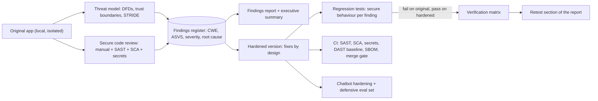

# OFF · Flagship project: the secure rebuild of a vulnerable-by-design application

| Major | Level | Time | Budget | Builds on |
|---|---|---|---|---|
| Ethical Hacking and Offensive Security (Authorized Testing) ([role page](../01_market_map/roles/OFF_ethical_hacking_offensive_security.md)) | L3 → L4 | MVP 2–3 weeks · v1 6–8 weeks · scale-up 4+ weeks | Laptop; ₹0 required (≤ ₹1,000 if the LLM feature uses a hosted model) | OFF301, OFF302, OFF305, OFF402, OFF403, OFF404 projects |

This flagship is **defensive application security**. You take an application that was built to be insecure for training, threat-model it, review its code the way a professional secure-code reviewer would, write a findings report, and then build and prove a hardened version: every fix has a regression test, every control maps to a published standard, and security checks run in CI so the flaws cannot return. It is the work that turns testing skill into reduced risk, which is what clients and employers pay for. All work happens on your own local copy. The project contains no attack recipes, no payloads and no exploit code, and its public write-up describes weakness classes, impact and fixes, not how to abuse them.

## 1. The problem and why it matters

Organisations do not buy vulnerability lists; they buy fewer vulnerabilities. Penetration testers and application security engineers who can explain root causes, propose fixes developers accept, and verify those fixes are worth far more than those who can only run scanners. Generated code makes this more urgent: in Veracode's 2025 tests, AI-generated code "introduced risky security flaws in 45% of tests" ([Veracode](https://www.veracode.com/resources/analyst-reports/2025-genai-code-security-report/)), and CISA's [Secure by Design](https://www.cisa.gov/securebydesign) programme asks software makers to eliminate whole classes of vulnerability rather than patch instances.

The standards to work against are current and public: the [OWASP Application Security Verification Standard](https://owasp.org/www-project-application-security-verification-standard/) reached version 5.0.0 on 30 May 2025 ([release](https://github.com/OWASP/ASVS/releases/tag/v5.0.0_release)), the [OWASP Top 10:2025](https://top10.owasp.org/2025) was released in November 2025 ([The Register](https://www.theregister.com/2025/11/11/new_owasp_top_ten_broken/)), and the [OWASP API Security Top 10 (2023)](https://owasp.org/API-Security/editions/2023/en/0x11-t10/) and [OWASP Top 10 for LLM Applications](https://genai.owasp.org/llm-top-10/) cover APIs and AI features. [OWASP Juice Shop](https://owasp.org/www-project-juice-shop/) (MIT licence) is a deliberately insecure, modern web application with an API, a single-page front end and a chatbot, built for exactly this kind of legal practice.

## 2. What you build

Choose the target and record it in ADR-001:

- **Option A (recommended):** a fork of OWASP Juice Shop, run only on your machine.
- **Option B:** a small, deliberately vulnerable "merchant portal" written by a classmate, with a sealed list of planted weaknesses you have not seen, so your review can be scored.

Then deliver:

- **Threat model**: system context, data-flow diagrams with trust boundaries, assets, STRIDE threats per element, abuse cases, and mitigations, kept as code with [OWASP Threat Dragon](https://owasp.org/www-project-threat-dragon/) or [pytm](https://github.com/OWASP/pytm) (SAR302 method).
- **Secure code review**: a manual review of authentication, session management, authorisation, input handling, file handling, cryptography, error handling, logging and the chatbot, supported by static analysis, dependency (software composition) analysis and secret scanning. Every finding has a CWE, an ASVS 5.0 requirement, a severity with rationale (CVSS or the OWASP Risk Rating, plus a [SSVC](https://www.cisa.gov/resources-tools/resources/stakeholder-specific-vulnerability-categorization-ssvc) decision), location, impact, root cause and recommended fix.
- **Findings report**: executive summary for non-specialists, scope and rules of engagement (your own local instance), methodology, findings, positive observations, and a retest section (OFF305).
- **Hardened version**: fixes by design rather than by patching symptoms: a deny-by-default authorisation layer, parameterised data access, context-aware output encoding, safe file handling, hardened session and token handling, rate limits on sensitive endpoints, a strict Content Security Policy, secrets moved out of code, dependency upgrades, and security event logging.
- **Verification**: for each finding, a regression test that states the secure behaviour (for example, "a customer requesting another customer's basket receives 403 and an audit event is written"); it fails on the original and passes on the hardened version. These tests check defences; they are not attack scripts.
- **Secure pipeline**: CI with static analysis, dependency and secret scanning, a passive DAST baseline scan against the locally built app, a software bill of materials, and a merge gate on new high-severity findings (SAR305).
- **LLM feature hardening** (OFF403): a threat model for the chatbot, defences against prompt injection and data leakage from the OWASP LLM Top 10, and a defensive evaluation set measuring policy violations before and after hardening.
- **Disclosure practice**: a vulnerability disclosure policy and a `security.txt` file ([RFC 9116](https://www.rfc-editor.org/rfc/rfc9116)) for the hardened app, and a short note on responsible disclosure (OFF404).

## 3. Scope tiers

| Tier | Time | Scope |
|---|---|---|
| **MVP** | 2–3 weeks | Threat model; review of authentication, session and access control; 10 findings with CWE and ASVS mapping; 5 fixes with regression tests; CI with static analysis and secret scanning |
| **v1** | 6–8 weeks | Full review; 20+ findings across 8+ weakness classes; findings report; hardened version with 90%+ of high and critical findings fixed and tested; DAST baseline and SBOM; chatbot hardening with evaluation; disclosure policy; ADRs, demo, write-up |
| **Scale-up** | 4+ weeks | ASVS Level 2 verification for the whole app; a design-level fix that removes a weakness class everywhere (for example, a typed query layer); contribute a documentation or test improvement upstream to the training project, following its contribution guide |

## 4. Requirements

**Functional (of the hardened app)**

1. All original features still work.
2. Every API endpoint enforces authentication and object-level authorisation through one shared mechanism.
3. Security-relevant events (failed logins, permission denials, admin actions) are logged in a structured, tamper-evident way without secrets or personal data.
4. The chatbot never reveals other users' data or system prompts and never performs actions outside its documented scope.

**Non-functional (of the project)**

| Concern | Requirement |
|---|---|
| Legality and scope | Only your local instance; written scope in `SCOPE.md`; never test a hosted or shared instance |
| Publication safety | Public report and repository describe weakness class, location, impact, fix and verification only; no payloads, exploit steps or weaponised code |
| Traceability | Finding → CWE → ASVS requirement → fix commit → regression test, for every finding |
| Regression safety | The app's functional tests still pass after hardening |
| Pipeline | Security checks run on every pull request; new high-severity findings block merges |

## 5. Reference architecture

ADRs to write: target choice and scope; review method and tools; severity model; authorisation design; session and token design; output-encoding strategy; chatbot guardrail design; pipeline gates.

## 6. Milestones and deliverables

| Week | Milestone | Deliverable |
|---|---|---|
| 1 | Scope and model | `SCOPE.md`; architecture recovery; threat model v1; review plan |
| 2 | Review I | Authentication, session and access-control review; first findings |
| 3 | **MVP** | 10 findings mapped; 5 fixes with regression tests; CI with SAST and secrets |
| 4 | Review II | Input, file, crypto, error handling, dependencies; findings register complete |
| 5 | Harden | Design-level fixes; verification matrix |
| 6 | Pipeline | DAST baseline, SBOM, merge gate; false-positive triage notes for the tools |
| 7 | AI feature | Chatbot threat model, guardrails, defensive evaluation before and after |
| 8 | **v1** | Findings report with retest, disclosure policy, ADRs, `AI_USE.md`, demo, write-up |

## 7. Acceptance criteria

| Criterion | Target | Evidence |
|---|---|---|
| Threat model | DFDs with trust boundaries; ≥ 25 threats, each with a mitigation, a control and a test or an accepted-risk note | Threat model files |
| Review coverage | 100% of authentication, session, authorisation, input, file, crypto and chatbot code reviewed manually | Review log by file |
| Findings | ≥ 20 distinct findings across ≥ 8 CWE classes, each mapped to ASVS 5.0 | Findings register |
| Recall (scored) | For option A, findings compared with the project's documented challenge categories; for option B, with the sealed list; recall reported honestly | Comparison table |
| Fixes | ≥ 90% of high and critical findings fixed; each fix has a regression test that fails on the original and passes on the hardened version | Verification matrix and CI run |
| No regressions | 100% of the app's functional tests pass | CI report |
| Pipeline | 0 high-severity tool findings on the main branch; SAST false-positive rate measured on a sample | CI logs and triage notes |
| Chatbot | Policy violations on a 50-case defensive evaluation set reduced to 0 from a measured baseline | Eval report |
| Report quality | A peer reviewer confirms each finding is understandable, reproducible from the private test suite, and contains no public exploit detail | Review note |

## 8. Data plan

| Data | Source | Licence | Use |
|---|---|---|---|
| Training application | [OWASP Juice Shop](https://owasp.org/www-project-juice-shop/) source, or a classmate's app | MIT, or the classmate's licence | Review and hardening target |
| Standards | ASVS 5.0, Top 10:2025, API Security Top 10 (2023), LLM Top 10, [OWASP Cheat Sheets](https://cheatsheetseries.owasp.org/) | Creative Commons (OWASP) | Requirements, fixes and mapping |
| Weakness taxonomy | CWE | Public | Classification |
| Chatbot evaluation set | Written by you: benign questions plus defensive probes that check policy boundaries | Yours | Before-and-after measurement |

No real user data and no third-party systems are involved.

## 9. Compute and cost

Everything runs locally in containers on an isolated Docker network with no port exposed beyond localhost. Open-source or free-tier tools cover static analysis, dependency scanning, secret scanning, passive DAST and SBOM generation. If the hardened chatbot uses a hosted model, cap spend at ₹1,000; a small local model is also acceptable.

## 10. AI-use policy

- **You may delegate:** summarising unfamiliar code, drafting report sections from your notes, generating unit-test scaffolds for regression tests you specify, triaging large static-analysis outputs into candidate lists, and formatting the findings register.
- **You must write and verify yourself:** the threat model, every finding's analysis (root cause, impact, severity), every fix in authentication, authorisation, session and encoding code, the chatbot guardrails, and the final report's conclusions.
- **Verify AI output by:** confirming every candidate finding in the code and with a test on your local instance before it enters the register; reviewing every fix diff; re-running the full verification matrix after any AI-assisted change. AI tools also produce plausible but wrong findings; record your false-positive rate.
- **Never:** ask AI tools to produce exploit payloads or attack procedures, and never paste the code of systems you are not authorised to review into external tools.
- **Record:** `AI_USE.md` with cases where AI suggested an insecure fix or a false finding.

## 11. Write-up and demo checklist

- [ ] README with the results table, scope statement and how to run the verification matrix
- [ ] Threat model, findings report (public, redacted of exploit detail), verification matrix
- [ ] 8+ ADRs, disclosure policy, `security.txt`, `AI_USE.md`
- [ ] Demo (2 minutes): one access-control finding explained by root cause; the shared authorisation layer that fixes the class; its regression test failing on the original and passing on the hardened build; a pull request blocked by the pipeline
- [ ] Write-up: "From 20 findings to a secure build: fixing classes, not instances"

## 12. What it signals to employers

You can find weaknesses through code review and threat modelling, explain them to developers and executives, and fix them in a way that lasts, with tests and pipeline gates as proof. Penetration-testing firms, product security teams and application security roles all need people who close the loop from finding to verified fix. It also shows judgement: the work is scoped, legal and safe to publish.

## 13. Stretch goals toward L4 and L5

- **L4:** a secure-coding guide and reusable library for the app's stack (authorisation middleware, encoding helpers, safe file handling) adopted by a second project, with before-and-after review results.
- **L4:** an ASVS Level 2 verification of the whole hardened app by a peer, with disagreements resolved in writing.
- **L5:** a measurement study of how well static analysis tools and AI reviewers find the weakness classes in your verification matrix, with recall, precision and cost per true finding, published with the harness and without exploit detail (OFF501).

## Sources

All checked October 2026.

- Veracode, *2025 GenAI Code Security Report* (updated Oct 2025). https://www.veracode.com/resources/analyst-reports/2025-genai-code-security-report/
- CISA, Secure by Design. https://www.cisa.gov/securebydesign ; SSVC. https://www.cisa.gov/resources-tools/resources/stakeholder-specific-vulnerability-categorization-ssvc
- OWASP ASVS project and 5.0.0 release (30 May 2025). https://owasp.org/www-project-application-security-verification-standard/ ; https://github.com/OWASP/ASVS/releases/tag/v5.0.0_release
- OWASP Top 10:2025. https://top10.owasp.org/2025 ; The Register (11 Nov 2025). https://www.theregister.com/2025/11/11/new_owasp_top_ten_broken/
- OWASP API Security Top 10 (2023). https://owasp.org/API-Security/editions/2023/en/0x11-t10/ ; OWASP Top 10 for LLM Applications. https://genai.owasp.org/llm-top-10/
- OWASP Juice Shop (MIT). https://owasp.org/www-project-juice-shop/ ; OWASP Threat Dragon. https://owasp.org/www-project-threat-dragon/ ; pytm. https://github.com/OWASP/pytm ; OWASP Cheat Sheet Series. https://cheatsheetseries.owasp.org/
- RFC 9116, *A File Format to Aid in Security Vulnerability Disclosure*. https://www.rfc-editor.org/rfc/rfc9116

_Last reviewed: 2026-10_
