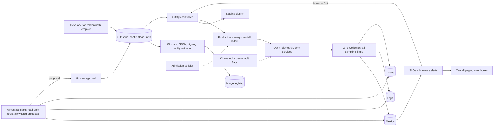

# OPS · Flagship project: run a microservices shop like an SRE team

| Major | Level | Time | Budget | Builds on |
|---|---|---|---|---|
| [DevOps, SRE and Platform Engineering](../../03_majors/devops_sre_platform_engineering/README.md) | L3 → L4 | MVP 2–3 weeks · v1 6–8 weeks · scale-up 4+ weeks | Laptop with 16 GB RAM (32 GB is comfortable); ≤ ₹2,000 of model API usage | OPS301 P3, OPS303 P3, OPS304 P3, OPS305 P2, OPS401 P3, OPS402 P3, OPS403 P3 |

You take a realistic, polyglot microservices application, the [OpenTelemetry Demo](https://opentelemetry.io/docs/demo/) "astronomy shop", and operate it as if you were its SRE and platform team. You build the delivery pipeline with progressive rollout and safe configuration changes, the telemetry pipeline on a budget, service-level objectives (SLOs) with burn-rate alerts, GitOps for three environments, a small internal developer platform, and an AI operations assistant that investigates incidents and proposes guarded fixes. Then a peer injects faults you do not know about, you run a two-week on-call rotation against synthetic traffic, and you write postmortems. The point is not the tools; it is showing that you can keep a system inside its error budget and learn from failure.

## 1. The problem and why it matters

Many recent large outages came from fast, wide pushes of configuration or data rather than code: CrowdStrike's July 2024 content update ([root cause analysis](https://www.crowdstrike.com/wp-content/uploads/2024/08/Channel-File-291-Incident-Root-Cause-Analysis-08.06.2024.pdf)), Google Cloud's globally replicated policy change in June 2025 ([incident report](https://status.cloud.google.com/incidents/ow5i3PPK96RduMcb1SsW)) and Cloudflare's doubled feature file in November 2025 ([Cloudflare](https://blog.cloudflare.com/18-november-2025-outage/)). Meanwhile AI adoption is positively related to delivery throughput but still negatively related to delivery stability ([DORA 2025](https://cloud.google.com/blog/products/ai-machine-learning/announcing-the-2025-dora-report)), and only 20% of AI users use it for "deploying, operating, or troubleshooting production systems" ([Stack Overflow, Oct 2026](https://stackoverflow.blog/2026/10/06/the-results-of-the-2026-developer-survey-are-here/)). Operating production well is a skill that grows in value as more code is generated.

The OpenTelemetry Demo is the right base: about a dozen services in several languages, instrumented with OpenTelemetry, with built-in [feature flags](https://opentelemetry.io/docs/demo/feature-flags/) that inject realistic faults such as failing payments, a leaking cache and CPU spikes. Google's SRE books describe the methods you will apply: [SLOs](https://sre.google/sre-book/service-level-objectives/), [alerting on SLOs](https://sre.google/workbook/alerting-on-slos/), [error budget policies](https://sre.google/workbook/error-budget-policy/) and [canarying releases](https://sre.google/workbook/canarying-releases/).

## 2. What you build

- **Clusters and GitOps**: a local Kubernetes setup (kind or k3d) with dev, staging and production environments, all state in Git and reconciled by Argo CD or Flux ([OpenGitOps principles](https://opengitops.dev/)); the whole estate rebuilt from Git in under 30 minutes.
- **Delivery pipeline**: CI with tests, image signing and a software bill of materials; progressive delivery with canary analysis against SLO metrics and automatic rollback (OPS301).
- **Safe configuration changes**: every configuration or feature-flag change is validated (schema, size, semantic checks), staged (one environment, then a fraction of production) and automatically halted on SLO burn, the lesson of the incidents above.
- **Telemetry pipeline on a budget**: OpenTelemetry Collector, metrics, logs and traces backends, tail-based sampling and cardinality limits, with the storage cost per day measured (OPS303).
- **SLOs and alerting**: SLOs for browsing and checkout, multi-window, multi-burn-rate alerts, an error budget policy, dashboards and runbooks (OPS304).
- **Platform layer**: a golden-path template that creates a new service with CI, deployment, telemetry, SLO and alerts by default, plus admission policies (Kyverno or Gatekeeper) that block unsafe manifests (OPS401).
- **Chaos and game days**: scheduled and blind fault injection with the demo's flags and a chaos tool, following [principles of chaos engineering](https://principlesofchaos.org/) (OPS402).
- **AI operations assistant**: first read-only (queries metrics, logs, traces and Kubernetes state through tools such as a [Kubernetes MCP server](https://github.com/containers/kubernetes-mcp-server)), then allowed to propose actions from an allowlist (roll back, scale, toggle a flag) that a human approves; every step logged and evaluated (OPS403).

## 3. Scope tiers

| Tier | Time | Scope |
|---|---|---|
| **MVP** | 2–3 weeks | Demo running under GitOps in one environment; telemetry pipeline; two SLOs with burn-rate alerts; one canary release with automatic rollback; first blind fault found from alerts alone |
| **v1** | 6–8 weeks | Three environments; safe config pipeline; golden path and admission policies; telemetry budget; error budget policy; game day with 3 blind scenarios; 14-day on-call; AI assistant with evaluation; postmortems, ADRs, demo, write-up |
| **Scale-up** | 4+ weeks | Multi-cluster failover; capacity plan and rehearsal for a 5× sale event (OPS404); eBPF-based zero-code instrumentation comparison; supply-chain hardening to a stated SLSA level |

## 4. Requirements

**Functional**

1. Any change (code, configuration, flag, infrastructure) reaches production only through Git and the pipeline.
2. A bad release or configuration is halted automatically when it burns error budget faster than the policy allows.
3. Every alert links to a runbook and a dashboard; every page is either actionable or removed.
4. A developer creates a new service with telemetry, SLO and alerts in one command.
5. The assistant answers "what is wrong and why" with evidence links, and can propose but never execute an action without approval.

**Non-functional**

| Concern | Requirement |
|---|---|
| Reliability | Checkout SLO 99.5% and browse SLO 99.9% over 28-day windows (scaled to the test period) |
| Detection | p50 time to detect an SLO-affecting fault ≤ 5 minutes |
| Noise | ≤ 2 non-actionable pages per on-call week |
| Recovery | Rebuild the whole estate from Git in ≤ 30 minutes |
| Telemetry cost | Stored telemetry ≤ a stated GB per day, with sampling rates documented |
| Security | Signed images, admission policies, no cluster-admin for the assistant, secrets out of Git (sealed or external) |
| Assistant safety | Read-only by default; actions only from an allowlist, only with approval, all audited |

## 5. Reference architecture

ADRs to write: GitOps tool and repository layout; canary analysis metrics and thresholds; configuration validation and staging rules; telemetry backends and sampling; SLO choice and windows; error budget policy; assistant permissions and evaluation method.

## 6. Milestones and deliverables

| Week | Milestone | Deliverable |
|---|---|---|
| 1 | Baseline | Demo under GitOps; ADR-001 to ADR-003; architecture doc draft |
| 2 | Observe | Telemetry pipeline; dashboards; SLO definitions with rationale |
| 3 | **MVP** | Burn-rate alerts; one canary with rollback; first blind fault detected and written up |
| 4 | Safe change | Config validation and staged rollout; planted bad-config trials |
| 5 | Platform | Golden path; admission policies; three environments |
| 6 | Assistant | Read-only investigation agent; 30-incident evaluation set; then guarded proposals |
| 7 | Game day and on-call | Game day with 3 blind scenarios; on-call rotation begins (14 days, may overlap week 8) |
| 8 | **v1** | Postmortems, DORA-style delivery metrics, telemetry cost report, assistant eval report, demo, write-up |

## 7. Acceptance criteria

| Criterion | Target | Evidence |
|---|---|---|
| Canary safety | 10 of 10 planted bad releases rolled back automatically within 10 minutes; error budget consumed per incident reported | Rollout logs and SLO dashboard |
| Config safety | 10 of 10 planted bad configurations (oversized, malformed, semantically wrong) blocked in validation or halted at the first stage | Pipeline logs |
| Detection | 100% of SLO-affecting blind faults paged; p50 detection ≤ 5 minutes | Game day and on-call log |
| Noise | ≤ 2 non-actionable pages per week during on-call | Paging history |
| Rebuild | Estate rebuilt from Git in ≤ 30 minutes, twice | Timed recordings |
| Delivery metrics | ≥ 20 production deployments with deployment frequency, lead time, change failure rate and recovery time reported | Metrics script output |
| Telemetry cost | Daily stored volume within the stated budget at the test load | Storage report |
| Golden path | A peer creates a new service that passes all policies and has working SLO alerts in ≤ 30 minutes | Peer's timed log |
| Assistant | Correct root cause in ≥ 70% of 30 held-out incidents (compare with your own unaided baseline); 0 actions outside the allowlist; 0 actions without approval; cost and time per investigation reported | Eval report and audit log |

## 8. Data plan

| Data | Source | Licence | Use |
|---|---|---|---|
| Application | [OpenTelemetry Demo](https://opentelemetry.io/docs/demo/) | Apache 2.0 (check the repository) | The system you operate |
| Traffic | The demo's load generator, reshaped to a daily cycle and sale spikes | Same | SLOs, alerts, capacity |
| Faults | Demo feature flags plus your chaos scenarios; blind scenarios written by a peer | Yours | Game days and assistant evaluation |
| Incident evaluation set | 30+ recorded incidents (telemetry snapshots, ground-truth root cause, correct action) | Yours | Assistant evaluation; keep 10 held out |

## 9. Compute and cost

The demo needs about 16 GB of RAM with all services; trim services or run fewer replicas on smaller machines and say so. Everything else runs locally. The assistant's model usage is capped at ₹2,000 in total with a hard limit; cache tool results and use a smaller model for routine queries. No cloud is required; an optional cloud run of the full stack should be under ₹1,500 with same-day teardown.

## 10. AI-use policy

- **You may delegate:** Helm and Kustomize boilerplate, dashboard JSON, PromQL and LogQL drafts (tested against data), runbook drafts, pipeline YAML, chaos scenario scaffolds.
- **You must write and verify yourself:** SLO definitions and alert thresholds, the error budget policy, canary analysis criteria, configuration validation rules, admission policies, the assistant's permission model and allowlist, and the incident evaluation set with its ground truth.
- **Verify AI output by:** unit-testing alert rules against recorded data (for example with `promtool test rules`), dry-running policies against planted bad manifests, and replaying incidents through the assistant before trusting it.
- **Record:** `AI_USE.md`, including generated queries or alerts that looked right but fired wrongly, and the assistant's worst mistakes during evaluation.

## 11. Write-up and demo checklist

- [ ] README with the results table and one-command bootstrap
- [ ] Architecture doc, 8+ ADRs, error budget policy, runbooks, telemetry cost report
- [ ] At least three postmortems from game day and on-call
- [ ] Assistant eval report and audit log sample; `AI_USE.md`
- [ ] Demo (2 minutes): push a bad config; watch it halt at the first stage; a peer flips a hidden fault; the page arrives; the assistant proposes a rollback with evidence; you approve; SLO recovers
- [ ] Write-up: "Two weeks on call for a shop I did not write"

## 12. What it signals to employers

You can operate software you did not write, which is most of the job; you think in SLOs and error budgets rather than uptime slogans; you have built release safety for both code and configuration; you can build a platform others use; and you have put an AI assistant into operations with guardrails and evidence instead of hype. Few graduates can show an on-call log and postmortems from a system with blind faults.

## 13. Stretch goals toward L4 and L5

- **L4:** a capacity plan and rehearsal for a 5× sale event, with load tests, autoscaling limits, a degradation plan and a cost forecast (OPS404).
- **L4:** multi-cluster active-passive failover with GitOps and a measured recovery time; a written disaster-recovery plan a peer executes without you.
- **L5:** a study of bounded autonomy for remediation agents: compare read-only, propose-only and auto-execute-within-limits modes on the same incident set, measuring resolution time, errors and near-misses (OPS501).

## Sources

All checked October 2026.

- OpenTelemetry Demo and feature flags. https://opentelemetry.io/docs/demo/ ; https://opentelemetry.io/docs/demo/feature-flags/
- CrowdStrike, Channel File 291 root cause analysis (6 Aug 2024). https://www.crowdstrike.com/wp-content/uploads/2024/08/Channel-File-291-Incident-Root-Cause-Analysis-08.06.2024.pdf
- Google Cloud incident report (Jun 2025). https://status.cloud.google.com/incidents/ow5i3PPK96RduMcb1SsW
- Cloudflare, 18 November 2025 outage. https://blog.cloudflare.com/18-november-2025-outage/
- Google Cloud / DORA, 2025 report announcement. https://cloud.google.com/blog/products/ai-machine-learning/announcing-the-2025-dora-report
- Stack Overflow blog, 2026 survey results (6 Oct 2026). https://stackoverflow.blog/2026/10/06/the-results-of-the-2026-developer-survey-are-here/
- Google SRE book and workbook: SLOs, alerting on SLOs, error budget policy, canarying. https://sre.google/sre-book/service-level-objectives/ ; https://sre.google/workbook/alerting-on-slos/ ; https://sre.google/workbook/error-budget-policy/ ; https://sre.google/workbook/canarying-releases/
- OpenGitOps. https://opengitops.dev/ ; Principles of Chaos Engineering. https://principlesofchaos.org/ ; Kubernetes MCP server. https://github.com/containers/kubernetes-mcp-server

_Last reviewed: 2026-10_
