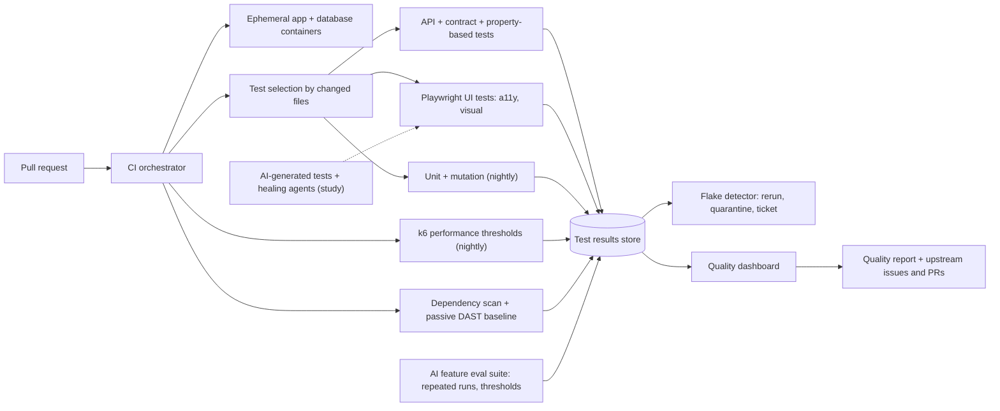

# QAE · Flagship project: a quality engineering programme for a real open-source application

| Major | Level | Time | Budget | Builds on |
|---|---|---|---|---|
| Software Quality and Test Engineering ([role page](../01_market_map/roles/QAE_software_quality_test_engineering.md)) | L3 → L4 | MVP 2–3 weeks · v1 6–8 weeks · scale-up 4+ weeks | Laptop with 16 GB RAM; ≤ ₹1,500 of model API usage | QAE301–QAE305, QAE401–QAE404 projects |

You act as the quality engineering lead for a real, actively maintained open-source web application, for example [ERPNext](https://github.com/frappe/erpnext) or another application with an API, a public issue tracker and a contributing guide. You write a risk-based test strategy, design tests with named techniques, build API, UI, accessibility, performance and mutation testing into a fast and trustworthy CI pipeline, manage flaky tests, measure what AI-generated tests and self-healing tools are really worth, evaluate an AI feature despite non-deterministic output, and report quality to "leadership" with metrics that drive decisions. The real users are the project's maintainers: you file reproducible bug reports and at least one fix upstream, and their responses are part of your evidence.

## 1. The problem and why it matters

Testing roles are changing faster than most. US projections for software quality assurance analysts and testers are +6% for 2025–2035, slower than software developers (+10%), and the [QAE role page](../01_market_map/roles/QAE_software_quality_test_engineering.md) reads NASSCOM's projected hiring shift "from volume to skill mix" as pointing to fewer manual-testing roles and more automation and quality-engineering roles (an analysis, not a measurement). AI tools now generate test code and repair broken locators: Playwright ships test agents that plan, generate and heal tests ([Playwright docs](https://playwright.dev/docs/test-agents)). That makes the human questions more important, not less: which risks matter, whether a generated test checks anything meaningful, whether a "healed" test is now hiding a real bug, and how to test features whose output is different every time.

Large engineering organisations treat test infrastructure, flakiness and test-suite health as engineering problems with owners and metrics ([Software Engineering at Google, testing chapters](https://abseil.io/resources/swe-book); [Google Testing Blog on flaky tests](https://testing.googleblog.com/2016/05/flaky-tests-at-google-and-how-we.html)). AI-generated application code also raises the bar for verification: in Veracode's 2025 tests, AI-generated code introduced risky security flaws in 45% of cases ([Veracode](https://www.veracode.com/resources/analyst-reports/2025-genai-code-security-report/)). A quality engineer who can show measured improvements on a real codebase stands out from candidates who list tools.

## 2. What you build

- **Test strategy** (QAE301, QAE404): product risk analysis for the application (or one major module, such as invoicing with taxes and discounts), mapping each risk to test levels and types, and stating what you will not automate and why.
- **Designed tests**: equivalence partitions, boundary values, decision tables, state-transition and pairwise designs for the chosen module, each test traced to a technique and a risk.
- **API tests** (QAE302): functional and contract tests against the app's REST API, plus property-based API testing from its schema (for example with [Schemathesis](https://schemathesis.readthedocs.io/)) on your local instance only.
- **UI tests**: Playwright tests for the critical user journeys with fixtures, isolated test data, parallel runs, accessibility checks with [axe](https://github.com/dequelabs/axe-core-npm/tree/develop/packages/playwright) and visual regression on key screens.
- **Performance tests** (QAE303): [k6](https://grafana.com/docs/k6/latest/) scenarios for three journeys with thresholds, a capacity point, and one bottleneck profiled with evidence.
- **CI and test infrastructure** (QAE304): containerised app and database per run, sharding, test selection by changed files, flaky-test detection with automatic quarantine and tickets, and a test-results dashboard.
- **Mutation testing**: mutation score of one module measured before and after your work, with a mutation tool for the app's language (for example mutmut for Python or [StrykerJS](https://stryker-mutator.io/) for JavaScript).
- **AI in testing, measured** (QAE401): generate tests with an AI assistant and with Playwright's agents for a fixed set of features; compare them with your hand-written tests on validity, mutation kills, flakiness, run time and review effort; plant UI bugs and measure how often self-healing hides them.
- **Testing an AI feature** (QAE402): add or choose an LLM feature (for example a "summarise this document" button) and build an evaluation suite that handles non-determinism with repeated runs, scoring rubrics and statistical pass thresholds, using a tool such as [promptfoo](https://www.promptfoo.dev/docs/intro/).
- **Security and accessibility checks** (QAE403): a passive DAST baseline scan against your local build, dependency scanning, and an accessibility audit of core pages against WCAG 2.2.
- **Quality dashboard and report** (QAE404): escaped defects, flake rate, pipeline duration, mutation score, coverage of risks, and delivery metrics, with a one-page quality report and recommendations.
- **Upstream contributions**: reproducible bug reports with minimal steps, environment and evidence, and at least one pull request that fixes a bug and adds its test.

## 3. Scope tiers

| Tier | Time | Scope |
|---|---|---|
| **MVP** | 2–3 weeks | App running locally in containers; risk analysis; 30 designed tests for one module; 20 API tests; 10 UI tests in CI; first flake and duration numbers; first upstream bug report |
| **v1** | 6–8 weeks | Full strategy; 80+ API and 30+ UI journey tests; accessibility and visual checks; performance tests; mutation testing; flaky-test management; AI-generated-test study; AI feature evaluation; DAST baseline; dashboard and quality report; 5+ upstream reports and 1+ PR; ADRs, demo, write-up |
| **Scale-up** | 4+ weeks | Contract tests between two services of the app or its integrations; test-impact analysis from coverage maps; a cross-browser and mobile-viewport matrix; mentoring a peer to add tests using your framework |

## 4. Requirements

**Functional**

1. Any contributor can run the full suite locally with one command and get the same results as CI.
2. Every test is traceable to a risk and, for designed tests, to a technique.
3. Flaky tests are detected automatically, quarantined with a ticket, and do not block merges while quarantined.
4. Performance tests fail the pipeline when thresholds are breached.
5. The AI feature's evaluation produces a pass or fail decision with stated confidence, not a single anecdotal run.

**Non-functional**

| Concern | Requirement |
|---|---|
| Speed | Pull-request pipeline ≤ 10 minutes with sharding; full nightly suite ≤ 45 minutes |
| Trust | Flake rate < 1% of test runs over 50 consecutive CI runs (after quarantine) |
| Strength | Mutation score on the chosen module ≥ 70%, or a measured improvement of at least 20 points from the baseline |
| Isolation | Each test creates and cleans its own data; tests run in any order |
| Accessibility | 0 automated axe violations on the core pages you own tests for; manual checks recorded |
| Ethics | All dynamic and property-based testing runs only on your local instance; security issues found go privately through the project's disclosure process |

## 5. Reference architecture

ADRs to write: target application and version; test levels per risk; test data strategy; UI test architecture; flake policy; selection strategy; mutation tool and scope; performance thresholds; AI feature evaluation method; what to report upstream and how.

## 6. Milestones and deliverables

| Week | Milestone | Deliverable |
|---|---|---|
| 1 | Understand | App running locally; architecture notes; risk analysis; ADR-001 |
| 2 | Design | Designed tests for one module; API test framework |
| 3 | **MVP** | UI tests in CI; first flake and duration numbers; first upstream bug report |
| 4 | Breadth | 80+ API tests, property-based run, 30+ UI journeys, accessibility and visual checks |
| 5 | Infrastructure | Sharding, selection, flake detection and quarantine, dashboard |
| 6 | Depth | Mutation testing; performance tests and one profiled bottleneck; DAST baseline |
| 7 | AI | AI-generated-test study with planted bugs; AI feature evaluation suite |
| 8 | **v1** | Quality report, upstream PR, ADRs, `AI_USE.md`, demo, write-up |

## 7. Acceptance criteria

| Criterion | Target | Evidence |
|---|---|---|
| Risk coverage | ≥ 20 risks, each mapped to tests; untested risks listed with reasons | Strategy document |
| Designed tests | ≥ 60 tests with technique and risk recorded | Test catalogue |
| Suite size and speed | ≥ 80 API and ≥ 30 UI tests; PR pipeline ≤ 10 minutes | CI history |
| Flakiness | < 1% flaky runs over 50 consecutive CI runs; every quarantined test has a ticket and an owner | Flake report |
| Mutation | ≥ 70% score on the chosen module, or +20 points over the measured baseline | Mutation reports before and after |
| Performance | Thresholds for 3 journeys; capacity point stated; one bottleneck explained with profiler evidence | Performance report |
| AI-generated tests | For a fixed feature set: validity rate, mutation kills, flakiness, run time and review minutes compared with hand-written tests | Study report |
| Self-healing risk | On 20 planted UI bugs, the share hidden by healing reported | Study report |
| AI feature | Eval suite with ≥ 100 cases, ≥ 5 runs each; pass threshold with a confidence interval; a planted regression detected | Eval report |
| Upstream | ≥ 5 reproducible bug reports filed; maintainers' responses recorded; ≥ 1 PR with a test submitted (merged is a bonus, not a requirement) | Issue and PR links |
| Reporting | One-page quality report that a non-specialist can act on, reviewed by a peer | Report and review note |

## 8. Data plan

| Data | Source | Licence | Use |
|---|---|---|---|
| Application | ERPNext (GPL-3.0) or another open-source app, at a pinned version | Its licence | System under test |
| Test data | Your factories and fixtures; demo data shipped with the app where available | Yours or the app's | All tests |
| CI results history | Your pipeline | Yours | Flakiness, duration and trend metrics |
| AI feature eval cases | Written by you with expected properties | Yours | AI feature evaluation |

Use no real personal or business data. When filing upstream issues, follow the project's templates and code of conduct, and report security issues privately.

## 9. Compute and cost

The app, its database and the test tools run in Docker on a 16 GB laptop; free CI minutes for public repositories cover the pipeline if you shard sensibly and run heavy suites nightly. Model usage for AI-generated tests and the AI feature is capped at ₹1,500; run repeated evaluations with a small local model where it is good enough.

## 10. AI-use policy

- **You may delegate:** test scaffolding, page objects, fixtures, data factories, k6 script drafts, dashboard code, and (as part of the study) generated tests that are clearly labelled.
- **You must write and verify yourself:** the risk analysis, test design and expected results, flake policy, performance thresholds, the AI-generated-test study design and its conclusions, the AI feature's rubrics and thresholds, and every upstream bug report.
- **Verify AI output by:** mutation testing (a test that kills no mutants is suspect), running generated tests against planted bugs, reading every assertion, and checking healed locators against the intended element.
- **Record:** `AI_USE.md`, including generated tests that passed while checking nothing and healed tests that hid real bugs.

## 11. Write-up and demo checklist

- [ ] README with the results table and one-command local run
- [ ] Test strategy, test catalogue, flake report, mutation reports, performance report, AI study, AI feature eval report, quality report
- [ ] Links to upstream issues and pull requests
- [ ] 8+ ADRs and `AI_USE.md`
- [ ] Demo (2 minutes): a pull request where test selection runs only relevant tests; a flaky test detected and quarantined; a mutant surviving and the new test that kills it; a planted UI bug hidden by a self-healing tool and caught by your assertion; the dashboard
- [ ] Write-up: "What AI-generated tests are really worth: measurements from a real codebase"

## 12. What it signals to employers

You can lead quality on a real codebase: decide what to test from risk, design tests deliberately, build fast and trustworthy pipelines, measure test strength rather than counting tests, use AI testing tools critically, and communicate quality in terms leaders act on. Upstream contributions show you can work with real maintainers. This profile fits SDET, quality engineering and developer-productivity roles.

## 13. Stretch goals toward L4 and L5

- **L4:** a test platform another team adopts: shared fixtures, a flake service and dashboards, with their feedback and adoption metrics.
- **L4:** contract testing between the app and an integration (for example a payment or email provider mock), with versioned contracts in CI.
- **L5:** a study of AI test generation or self-healing across two or more open-source codebases, measuring fault detection with mutation analysis and planted bugs, published with the harness (QAE501).

## Sources

All checked October 2026.

- QAE role page (BLS projections and NASSCOM skill-mix shift). [QAE role page](../01_market_map/roles/QAE_software_quality_test_engineering.md)
- Playwright, test agents. https://playwright.dev/docs/test-agents
- Winters, Manshreck and Wright, *Software Engineering at Google* (free online). https://abseil.io/resources/swe-book
- Google Testing Blog, *Flaky Tests at Google and How We Mitigate Them* (May 2016). https://testing.googleblog.com/2016/05/flaky-tests-at-google-and-how-we.html
- Veracode, *2025 GenAI Code Security Report*. https://www.veracode.com/resources/analyst-reports/2025-genai-code-security-report/
- ERPNext (GPL-3.0). https://github.com/frappe/erpnext ; Schemathesis. https://schemathesis.readthedocs.io/ ; axe-core for Playwright. https://github.com/dequelabs/axe-core-npm/tree/develop/packages/playwright ; k6 documentation. https://grafana.com/docs/k6/latest/ ; StrykerJS. https://stryker-mutator.io/ ; promptfoo. https://www.promptfoo.dev/docs/intro/

_Last reviewed: 2026-10_
