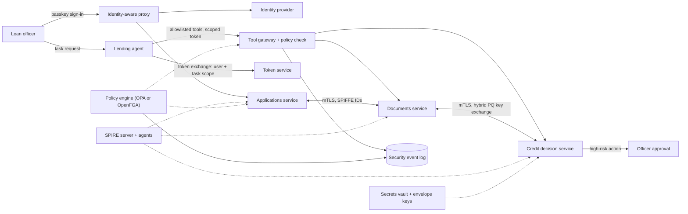

# SAR · Flagship project: a security architecture dossier and zero-trust reference slice for an agent-enabled fintech

| Major | Level | Time | Budget | Builds on |
|---|---|---|---|---|
| Security Architecture ([role page](../01_market_map/roles/SAR_security_architecture.md)) | L3 → L4 | MVP 2–3 weeks · v1 6–8 weeks · scale-up 4+ weeks | Laptop with 16 GB RAM; ≤ ₹1,500 of model API usage | SAR301 P3, SAR302 P3, SAR303 P3, SAR304 P3, SAR305, SAR403 |

You act as the security architect for an illustrative Indian digital-lending company that is adding an AI agent to help loan officers: it reads application documents, queries internal services and drafts decisions. You produce two things that must agree with each other. The first is an **architecture dossier**: context, data classification, threat model, security requirements, reference architecture, control mapping, risk register, decision records and a migration roadmap, including a post-quantum cryptography plan. The second is a **working reference slice**: a few services and the agent, running locally, that implement the architecture's key controls (workload identity with mutual TLS, policy-as-code authorisation, phishing-resistant user sign-in, scoped and short-lived delegation for the agent, secrets management and a hybrid post-quantum key exchange on one link), with tests that prove each control. The company is an **illustrative scenario**.

## 1. The problem and why it matters

Security architects are hired to make decisions that hold for years and to show why they hold. Three changes make that harder now. First, zero trust replaced perimeter thinking: NIST SP 800-207 defines an architecture where no implicit trust is granted based on network location ([NIST, 2020](https://csrc.nist.gov/pubs/sp/800/207/final)), and CISA's [Zero Trust Maturity Model](https://www.cisa.gov/zero-trust-maturity-model) gives stages to plan against; companies publish what this takes in practice, for example Monzo's network isolation across its services ([Monzo](https://monzo.com/blog/we-built-network-isolation-for-1-500-services)). Second, AI agents act on behalf of users with tools and data access, which creates new risks such as excessive agency and tool misuse ([OWASP Top 10 for Agentic Applications, 2026](https://genai.owasp.org/resource/owasp-top-10-for-agentic-applications-for-2026/); [MCP security best practices](https://modelcontextprotocol.io/docs/2026-07-28/tutorials/security/security_best_practices)). Third, the cryptography must change: NIST published its first post-quantum standards, ML-KEM, ML-DSA and SLH-DSA, as FIPS 203, 204 and 205 in August 2024 ([FIPS 203](https://csrc.nist.gov/pubs/fips/203/final)), and has published guidance on crypto agility ([NIST CSWP 39](https://www.nist.gov/news-events/news/2025/12/nist-publishes-cswp-39-considerations-achieving-crypto-agility)).

For an Indian lender, regulation adds concrete duties: personal-data obligations under the DPDP Rules, 2025 ([PIB](https://www.pib.gov.in/PressReleasePage.aspx?PRID=2190014)), incident reporting within 6 hours to CERT-In ([Directions, 2022](https://www.cert-in.org.in/PDF/CERT-In_Directions_70B_28.04.2022.pdf)), and RBI's cyber-security expectations for regulated entities ([DSCI brief on the 2026 directions](https://www.dsci.in/files/content/knowledge-centre/2026/dsci-brief-on-rbi-cybersecurity-commercial-banks-directions-2026.pdf)). AI tools can draft threat lists and control mappings quickly; they cannot decide which risks the business accepts, or prove that the design and the running system match.

## 2. What you build

**The dossier** (SAR301 P3 is its template):

- Business context, scope, assets and a data classification aligned with DPDP categories.
- Threat model of the platform and the agent: data-flow diagrams with trust boundaries; STRIDE for security, LINDDUN for privacy, and agent-specific threats (prompt injection through documents, tool misuse, confused deputy, excessive permissions, memory poisoning) using the SAR302 P3 method.
- Security requirements, each testable, each traced to threats.
- Reference architecture at two levels: enterprise (identity, network, data protection, logging, key management) and solution (the lending workflow and the agent).
- Control mapping to [NIST CSF 2.0](https://www.nist.gov/cyberframework) functions and to the regulatory duties above, with the evidence each control produces.
- Risk register with owners, treatment and residual risk; 12+ ADRs; a 12-month roadmap.
- Post-quantum plan (SAR304): a cryptographic inventory, a "harvest now, decrypt later" exposure analysis, a priority order for migration, and crypto-agility requirements.
- Resilience design (SAR404): recovery objectives, immutable backups and a ransomware recovery outline.

**The reference slice**:

- Three services (applications, documents, credit decision) and the agent, on a local Kubernetes cluster or Docker Compose.
- Workload identity with [SPIFFE/SPIRE](https://spiffe.io/docs/latest/spiffe-about/overview/) and mutual TLS on every call; deny-by-default service-to-service policy.
- Policy-as-code authorisation (for example OPA or relationship-based authorisation with [OpenFGA](https://openfga.dev/docs)), with unit tests for policies.
- User sign-in through an open-source identity provider with passkeys, and an identity-aware proxy in front of internal tools.
- Agent delegation with OAuth 2.0 token exchange ([RFC 8693](https://www.rfc-editor.org/rfc/rfc8693)): the agent receives a short-lived token scoped to the user, the task and specific tools; high-risk actions require human approval; tool calls are logged.
- Secrets in an open-source vault ([OpenBao](https://openbao.org/)), with rotation; field-level encryption for sensitive identifiers using envelope encryption.
- One internal link using a hybrid post-quantum key exchange through a library that implements ML-KEM ([Open Quantum Safe](https://openquantumsafe.org/) or a TLS library with ML-KEM support), with the latency overhead measured.
- Security event logs suitable for a SOC, including authorisation denials and agent actions.

## 3. Scope tiers

| Tier | Time | Scope |
|---|---|---|
| **MVP** | 2–3 weeks | Context, data classification and threat model; two services with SPIFFE identities, mTLS and deny-by-default policy; 20 negative tests passing; ADR-001 to ADR-004 |
| **v1** | 6–8 weeks | Full dossier; three services and the agent with scoped delegation and approvals; passkey sign-in; vault and field encryption; hybrid PQ key exchange on one link; control mapping with evidence; peer architecture review; demo and write-up |
| **Scale-up** | 4+ weeks | Machine-readable control evidence (for example [OSCAL](https://pages.nist.gov/OSCAL/)); multi-cluster trust domains; continuous authorisation using shared signals; a tabletop exercise with a peer team against the design |

## 4. Requirements

**Functional (slice)**

1. No service accepts a request without a valid workload identity, and policy decides every call.
2. Users sign in with passkeys; administrative access requires step-up authentication.
3. The agent can call only allowlisted tools, only with a token derived from the requesting user, only for that task, and never beyond the user's own permissions.
4. Credit-decision actions proposed by the agent require a loan officer's approval.
5. Sensitive identifiers are encrypted at the field level; keys are never in code or images.
6. All denials and agent actions produce structured security events.

**Non-functional**

| Concern | Requirement |
|---|---|
| Traceability | Threat → requirement → control → test or evidence, for every high and critical threat |
| Credential lifetime | Workload certificates and agent tokens ≤ 1 hour; no long-lived static secrets |
| Overhead | mTLS plus policy check adds ≤ 5 ms p99 per hop on the reference laptop |
| PQ readiness | Inventory covers every key, certificate, protocol and library in the slice; the hybrid link works and its overhead is measured |
| Reviewability | Dossier readable by an engineer in 60 minutes; diagrams as code |

## 5. Reference architecture

ADRs to write: trust domains and identity issuance; policy engine and model; user authentication and step-up; agent delegation and approval thresholds; secrets and key hierarchy; field encryption; PQ migration order and hybrid choice; logging schema; accepted residual risks.

## 6. Milestones and deliverables

| Week | Milestone | Deliverable |
|---|---|---|
| 1 | Context | Scope, assets, data classification, DFDs; ADR-001 (method) |
| 2 | Threats | Threat model including agent threats; requirements v1 |
| 3 | **MVP** | Two services with SPIFFE, mTLS, policy; 20 negative tests; overhead measured |
| 4 | Users | Passkey sign-in, identity-aware proxy, step-up |
| 5 | Agent | Token exchange, tool gateway, approvals, defensive evaluation set |
| 6 | Data and keys | Vault, rotation, field encryption; crypto inventory |
| 7 | PQ and mapping | Hybrid key exchange link; PQ roadmap; CSF 2.0 and regulatory mapping with evidence |
| 8 | **v1** | Peer review with the SAR301 template; risk register; roadmap; `AI_USE.md`; demo; write-up |

## 7. Acceptance criteria

| Criterion | Target | Evidence |
|---|---|---|
| Threat model | ≥ 40 threats, ≥ 10 agent-specific; every high or critical threat traced to a control and a test or evidence item | Traceability matrix |
| Deny by default | 100% of 50 negative tests pass (missing identity, wrong identity, wrong policy, expired token) | Test report |
| Credentials | Certificate and token lifetimes ≤ 1 hour; 0 static secrets in code, images or Git history | Config and scanner output |
| Agent scope | 0 of 40 defensive test cases (malicious document content, over-broad requests, cross-user requests) produce an out-of-scope tool call; 100% of high-risk actions wait for approval | Eval report and audit log |
| Overhead | mTLS plus policy ≤ 5 ms p99 per hop | Benchmark output |
| PQ | Inventory complete; hybrid link working; handshake overhead measured; roadmap prioritised by data lifetime | Inventory file, measurements, roadmap |
| Mapping | Every requirement mapped to CSF 2.0 and to a regulatory duty where one applies, with evidence location | Mapping table |
| Review | Two peer reviewers; all high findings fixed or risk-accepted with an owner | Review records |

## 8. Data plan

| Data | Source | Licence | Use |
|---|---|---|---|
| Loan applications and documents | Synthetic generator, including documents with embedded instructions to test the agent | Yours | Slice and agent evaluation |
| Standards and rules | NIST SP 800-207, FIPS 203–205, CSWP 39, CSF 2.0; OWASP agentic and LLM guidance; DPDP, CERT-In and RBI texts | Public | Requirements and mapping |
| Architecture evidence | Generated by your tests and scanners | Yours | Control evidence |

No real customer data or credentials are used.

## 9. Compute and cost

A laptop runs the slice (kind or Docker Compose, SPIRE, the identity provider, the policy engine, the vault and the services). The agent can use a hosted model capped at ₹1,500 or a small local model. No cloud spend is required.

## 10. AI-use policy

- **You may delegate:** first-draft threat lists for you to prune and extend, diagram drafts, control-mapping tables for you to check against the standards' text, policy unit-test scaffolds, document formatting.
- **You must write and verify yourself:** trust-boundary decisions, the security requirements, the authorisation model and policies, the agent's delegation and approval design, the key hierarchy, the PQ priorities, every risk acceptance, and the final recommendations.
- **Verify AI output by:** checking every mapping against the standard's actual wording; testing every policy with positive and negative cases; running the slice's negative tests after every change; having peers challenge the threat model.
- **Record:** `AI_USE.md`, including generated threats that were wrong for this system and mappings that cited the wrong control.

## 11. Write-up and demo checklist

- [ ] README with the results table and one-command slice start
- [ ] Dossier (30–50 pages including diagrams), traceability matrix, risk register, 12+ ADRs, PQ roadmap
- [ ] Peer review records and responses; `AI_USE.md`
- [ ] Demo (2 minutes): a service without identity is refused; the agent reads a document with a hidden instruction and cannot exceed its scope; a high-risk action waits for approval; the hybrid PQ link handshake and its measured overhead; one ADR on screen
- [ ] Write-up: "Designing zero trust for an AI agent that touches loan decisions"

## 12. What it signals to employers

You can produce architecture that is both reasoned and real: a dossier a review board can approve and a running slice that proves the key controls. You handle the newest problems (agent delegation, post-quantum migration) with current standards, and you trace every decision from threat to evidence. That is the core of security architect and senior product-security roles.

## 13. Stretch goals toward L4 and L5

- **L4:** machine-readable control evidence generated in CI and a dashboard of control health; continuous authorisation that revokes sessions on risk signals.
- **L4:** run a tabletop exercise with a peer team against your design, change the architecture based on findings, and document the before and after.
- **L5:** a study measuring how much agent-specific controls (scoped delegation, tool allowlists, approval thresholds) reduce harmful actions in a defensive evaluation suite, against task success, published with the suite (SAR501).

## Sources

All checked October 2026.

- NIST SP 800-207, *Zero Trust Architecture* (2020). https://csrc.nist.gov/pubs/sp/800/207/final ; CISA Zero Trust Maturity Model. https://www.cisa.gov/zero-trust-maturity-model
- Monzo, *We built network isolation for 1,500 services*. https://monzo.com/blog/we-built-network-isolation-for-1-500-services
- OWASP, Top 10 for Agentic Applications for 2026. https://genai.owasp.org/resource/owasp-top-10-for-agentic-applications-for-2026/ ; MCP security best practices. https://modelcontextprotocol.io/docs/2026-07-28/tutorials/security/security_best_practices
- NIST FIPS 203, 204, 205 (Aug 2024). https://csrc.nist.gov/pubs/fips/203/final ; https://csrc.nist.gov/pubs/fips/204/final ; https://csrc.nist.gov/pubs/fips/205/final
- NIST CSWP 39, crypto agility (Dec 2025). https://www.nist.gov/news-events/news/2025/12/nist-publishes-cswp-39-considerations-achieving-crypto-agility ; NIST Cybersecurity Framework. https://www.nist.gov/cyberframework
- PIB, DPDP Rules notified (14 Nov 2025). https://www.pib.gov.in/PressReleasePage.aspx?PRID=2190014 ; CERT-In Directions (2022). https://www.cert-in.org.in/PDF/CERT-In_Directions_70B_28.04.2022.pdf ; DSCI brief on RBI 2026 directions. https://www.dsci.in/files/content/knowledge-centre/2026/dsci-brief-on-rbi-cybersecurity-commercial-banks-directions-2026.pdf
- SPIFFE. https://spiffe.io/docs/latest/spiffe-about/overview/ ; OpenFGA. https://openfga.dev/docs ; OpenBao. https://openbao.org/ ; Open Quantum Safe. https://openquantumsafe.org/ ; OSCAL. https://pages.nist.gov/OSCAL/
- RFC 8693, *OAuth 2.0 Token Exchange*. https://www.rfc-editor.org/rfc/rfc8693

_Last reviewed: 2026-10_
