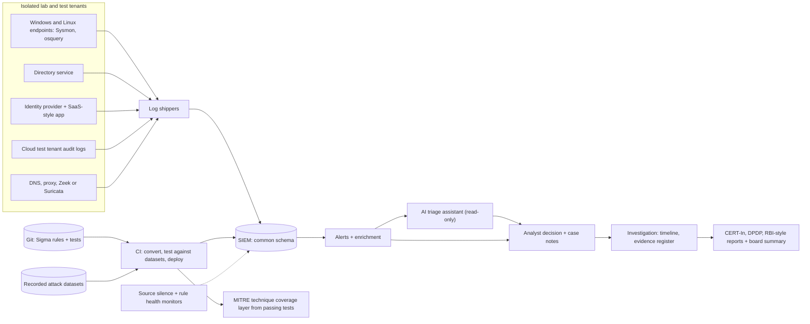

# SEC · Flagship project: a working SOC for a regulated company, with detections mapped to ATT&CK

| Major | Level | Time | Budget | Builds on |
|---|---|---|---|---|
| [Cybersecurity: Defense, Operations and Governance](../../03_majors/cybersecurity_defense/README.md) | L3 → L4 | MVP 2–3 weeks · v1 6–8 weeks · scale-up 4+ weeks | Laptop with 32 GB RAM (16 GB with a trimmed lab), free or trial test tenants; ≤ ₹2,000 of model API usage | SEC302 P3, SEC303 P3, SEC401 P3, SEC402 P3, SEC404 P3 |

You build and run a security operations centre (SOC) for an illustrative 400-person Indian payments company: a home lab and cloud test tenants that mirror its endpoints, servers, identity provider and a SaaS application; onboarded log sources with health monitoring; detections written as code, tested against recorded attack data and mapped to MITRE ATT&CK; an identity threat detection layer; an AI triage assistant evaluated against human labels and prompt-injection attempts; a full incident investigation with forensic evidence; the regulatory notifications such an incident would require in India; and a one-page risk summary for the board. Everything is defensive and runs only on systems you own. The company is an **illustrative scenario**, not a model of any real firm.

## 1. The problem and why it matters

In July 2024 a ransomware attack on C-Edge Technologies, a technology provider to co-operative and regional rural banks, led NPCI to isolate it from retail payment systems and disrupted payments for about 300 small banks ([CSO Online](https://www.csoonline.com/article/3480250/over-300-indian-banks-suffer-payment-disruption-from-ransomware-attack.html)). Indian rules now put a clock on every incident: CERT-In requires listed incidents to be reported within 6 hours ([CERT-In, 2022](https://www.cert-in.org.in/PDF/CERT-In_Directions_70B_28.04.2022.pdf)); the DPDP Rules, 2025 require notice to affected persons without delay and a detailed report to the Data Protection Board within 72 hours ([Rule 7](https://dpdpa.com/dpdparules/rule7.html)); and RBI's July 2026 directions require commercial banks to report cyber incidents on the DAKSH platform within 6 hours ([DSCI brief](https://www.dsci.in/files/content/knowledge-centre/2026/dsci-brief-on-rbi-cybersecurity-commercial-banks-directions-2026.pdf)).

The 2025 ISC2 study found AI and cloud security to be the most-cited skills needs, while many teams faced layoffs and hiring freezes ([ISC2 2025](https://www.isc2.org/Insights/2025/12/2025-ISC2-Cybersecurity-Workforce-Study)): employers want people who can show specific, tested skills. AI assistants now draft detection queries and summarise alerts, but someone must decide what to detect, prove that detections fire and stay quiet when they should, keep attacker-controlled text from steering an AI assistant ([OWASP LLM01](https://genai.owasp.org/llmrisk/llm01-prompt-injection/)), and write a report a regulator and a board can act on.

## 2. What you build

- **Lab estate** (isolated network): Windows and Linux endpoints with Sysmon or osquery, a directory service, a web application with single sign-on through an open-source identity provider such as Keycloak, a cloud test tenant's audit logs, DNS and proxy or firewall logs, and a network sensor (Zeek or Suricata).
- **SIEM and pipeline**: an open-source or free-tier SIEM (for example Wazuh, Security Onion or the Elastic stack's free tier), with parsing tests and log-source health alerts that fire when a source goes quiet.
- **Detections as code**: [Sigma](https://github.com/SigmaHQ/sigma) rules in Git, converted for your SIEM with pySigma, each with a test case of recorded telemetry that must trigger it and a benign baseline that must not, each mapped to an [ATT&CK](https://attack.mitre.org/) technique, deployed by CI (SEC401).
- **Coverage view**: an [ATT&CK Navigator](https://mitre-attack.github.io/attack-navigator/) layer generated from tests that pass, so it shows tested coverage rather than claimed coverage.
- **Identity threat detection**: risky sign-ins, repeated MFA prompts, new privileged role assignments, unusual OAuth consent grants and session anomalies, with response playbooks (SEC303).
- **AI triage assistant**: reads an alert and its enrichment, proposes a disposition and severity with cited evidence, and drafts the analyst note; read-only; tested against prompt injection placed in attacker-controllable fields (user agents, file names, email subjects) (SEC404).
- **Investigation**: a full incident worked from a recorded dataset, with a timeline, evidence register (hashes, chain of custody), scoping, containment and recovery recommendations (SEC402).
- **Reporting**: a CERT-In-style incident report, a DPDP breach notice and Board report, an RBI-style report for a bank customer, and a one-page board risk summary (SEC305).

Adversary emulation, if you use it, happens only inside the isolated lab with documented, approved scope, using established defensive validation tools such as [MITRE Caldera](https://caldera.mitre.org/). The project write-up describes what was detected, not how to attack.

## 3. Scope tiers

| Tier | Time | Scope |
|---|---|---|
| **MVP** | 2–3 weeks | Lab with 5 log sources in the SIEM; parsing and silence alerts; 15 tested Sigma rules in CI; ATT&CK layer from tests; one triage runbook |
| **v1** | 6–8 weeks | 8+ log sources; 40+ tested detections with false-positive baselines; identity detection layer; AI triage assistant with evaluation and injection tests; full investigation; regulatory reports and board summary; SOC metrics; ADRs, demo, write-up |
| **Scale-up** | 4+ weeks | Threat-hunting programme with hypotheses; detection health scoring; a purple-team exercise with a peer in the lab; a case-management integration with automated enrichment |

## 4. Requirements

**Functional**

1. Every log source is parsed into a common schema, with a test proving the parse and an alert if it stops sending.
2. Every detection lives in Git with metadata (ATT&CK technique, severity, data source, owner, test case) and deploys only through CI.
3. Analysts get enriched alerts (asset owner, user role, threat-intel matches) and a runbook link.
4. The AI assistant proposes, cites and drafts; humans decide and close.
5. The investigation produces a timeline, an evidence register and containment steps.
6. Reports meet the fields and timelines of the cited rules.

**Non-functional**

| Concern | Requirement |
|---|---|
| Detection quality | True-positive rate and false-positive volume measured for every rule |
| Timeliness | Alert within 5 minutes of the event for priority detections; source silence detected within 15 minutes |
| Evidence integrity | Hashes recorded at collection; chain-of-custody log for every artefact |
| Assistant safety | No write or response actions; injection resistance tested; every output stored with its inputs |
| Privacy | Lab data only; no real personal data; retention configured and documented |
| Cost | Runs on a laptop or small home server; model spend ≤ ₹2,000 |

## 5. Reference architecture

ADRs to write: SIEM choice; common schema; rule format and conversion; test strategy and datasets; alert severity model; assistant permissions and evaluation; evidence handling; retention.

## 6. Milestones and deliverables

| Week | Milestone | Deliverable |
|---|---|---|
| 1 | Lab | Lab network diagram, isolation proof, ADR-001 (SIEM); asset inventory for the illustrative company |
| 2 | Visibility | 5 log sources with parsing tests and silence alerts |
| 3 | **MVP** | 15 Sigma rules with tests in CI; ATT&CK layer from passing tests |
| 4 | Breadth | 8+ sources; 40+ rules; 7-day benign baseline for false positives |
| 5 | Identity | Identity detection layer and playbooks; 10 identity scenarios |
| 6 | AI triage | Assistant with 200-alert labelled set and 50 injection cases |
| 7 | Investigate | Full investigation, evidence register, timeline |
| 8 | **v1** | Regulatory reports, board summary, SOC metrics, ADRs, `AI_USE.md`, demo, write-up |

## 7. Acceptance criteria

| Criterion | Target | Evidence |
|---|---|---|
| Source health | Every source's silence detected within 15 minutes in a planted outage test | Test log |
| Detection tests | ≥ 40 rules; 100% have a passing positive test; each mapped to an ATT&CK technique | CI report |
| False positives | Measured per rule over a 7-day benign baseline; total ≤ 20 alerts per day after tuning, with tuning decisions recorded | Baseline report |
| Identity | 10 of 10 identity scenarios detected with correct severity | Scenario report |
| Triage agreement | ≥ 85% agreement with your labels on 200 alerts; 0 high-severity true positives proposed as benign | Eval report |
| Injection resistance | 0 of 50 injection cases change a disposition, hide evidence or leak data | Eval report |
| Investigation | ≥ 90% of the dataset's ground-truth events placed correctly on the timeline | Timeline versus answer key |
| Reporting clock | In a timed tabletop, a CERT-In-style report drafted within 6 hours of detection and the DPDP Board report within 72 hours | Tabletop log with timestamps |
| Board summary | One page; top 5 risks with owners, trend and decision requested; reviewed by a peer playing the CISO | Review notes |

## 8. Data plan

| Data | Source | Licence | Use |
|---|---|---|---|
| Recorded attack telemetry | [OTRF Security-Datasets](https://github.com/OTRF/Security-Datasets) | MIT | Positive tests for detections |
| Full intrusion dataset | [Splunk Boss of the SOC v3](https://github.com/splunk/botsv3) | CC0-1.0 | Investigation exercise (distributed as a Splunk app; query there or export) |
| Detection rules | [SigmaHQ rules](https://github.com/SigmaHQ/sigma) | Detection Rule License (check the repository) | Starting points; your changes and tests credited |
| Technique taxonomy | [MITRE ATT&CK](https://attack.mitre.org/) | ATT&CK terms of use | Mapping and coverage |
| Benign baseline | Your lab's normal activity for 7 days | Yours | False-positive measurement |

No live malware is handled. No real personal data is used; any names in the lab are fictitious.

## 9. Compute and cost

A laptop with 32 GB RAM runs a SIEM, two Windows VMs (evaluation editions), two Linux VMs and a sensor; with 16 GB, run fewer endpoints and replay datasets instead. Cloud identity and audit logs come from free or trial tenants where eligible. Model usage for the assistant is capped at ₹2,000 in total; use a small local model for routine summarisation if your hardware allows.

## 10. AI-use policy

- **You may delegate:** first drafts of detection queries (then tested), parsers and field mappings, enrichment scripts, dashboard layouts, report formatting.
- **You must write and verify yourself:** the choice of what to detect and why, every rule's test case and tuning decision, severity logic, the assistant's permission model and injection tests, the investigation's conclusions and timeline, and every statement in the regulatory reports and board summary.
- **Verify AI output by:** running every rule against positive and benign data before merging; checking every timeline event against raw evidence; having a peer review the reports against the rule texts.
- **Record:** `AI_USE.md`, with examples of generated detections that missed or over-fired, and assistant outputs you rejected.

## 11. Write-up and demo checklist

- [ ] README with the results table, lab diagram and how to replay the tests
- [ ] Detection catalogue with ATT&CK mapping, tests and tuning notes
- [ ] Investigation report, evidence register, regulatory reports, board summary
- [ ] Assistant eval report and `AI_USE.md`
- [ ] Demo (2 minutes): a log source goes silent and is caught; a recorded intrusion replays; detections fire; the assistant triages with citations and resists an injected instruction; the coverage layer updates from CI
- [ ] Write-up: "Building a SOC that proves its detections"

## 12. What it signals to employers

You can build visibility, write and test detections, investigate with evidence, use AI in a SOC without letting it be manipulated, and communicate to regulators and executives. That covers the daily work of SOC analysts and detection engineers and the reporting duties that Indian banks, fintechs and their suppliers now face.

## 13. Stretch goals toward L4 and L5

- **L4:** a threat-hunting programme of 5 hypothesis-driven hunts with documented results, including null results, and the detections they produced.
- **L4:** a purple-team exercise inside the lab with a peer, with pre-agreed scope, measured detection and response times, and an improvement plan.
- **L5:** an independent evaluation of an AI triage approach across two datasets and multiple models, measuring agreement, failure modes and injection resistance, published with the harness (SEC501).

## Sources

All checked October 2026.

- CSO Online, ransomware disruption at over 300 Indian banks (Aug 2024). https://www.csoonline.com/article/3480250/over-300-indian-banks-suffer-payment-disruption-from-ransomware-attack.html
- CERT-In, Directions (28 Apr 2022). https://www.cert-in.org.in/PDF/CERT-In_Directions_70B_28.04.2022.pdf
- DPDP Rules, 2025, Rule 7. https://dpdpa.com/dpdparules/rule7.html
- DSCI, brief on RBI cybersecurity directions for commercial banks (2026). https://www.dsci.in/files/content/knowledge-centre/2026/dsci-brief-on-rbi-cybersecurity-commercial-banks-directions-2026.pdf
- ISC2, 2025 Cybersecurity Workforce Study (4 Dec 2025). https://www.isc2.org/Insights/2025/12/2025-ISC2-Cybersecurity-Workforce-Study
- OWASP GenAI, LLM01 Prompt Injection. https://genai.owasp.org/llmrisk/llm01-prompt-injection/
- MITRE ATT&CK. https://attack.mitre.org/ ; ATT&CK Navigator. https://mitre-attack.github.io/attack-navigator/ ; MITRE Caldera. https://caldera.mitre.org/
- SigmaHQ. https://github.com/SigmaHQ/sigma ; OTRF Security-Datasets. https://github.com/OTRF/Security-Datasets ; Splunk BOTS v3. https://github.com/splunk/botsv3

_Last reviewed: 2026-10_
