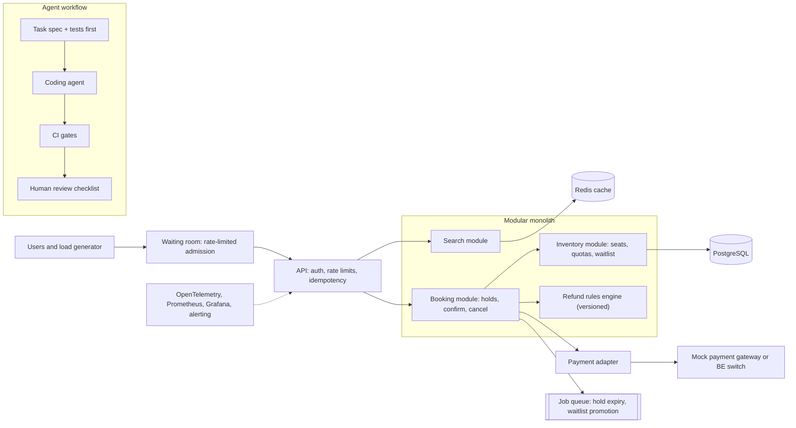

# SWE · Flagship project: a surge-proof booking platform, built with coding agents under review gates

| Major | Level | Time | Budget | Builds on |
|---|---|---|---|---|
| [Software Engineering](../../03_majors/software_engineering/README.md) | L3 → L4 | MVP 2–3 weeks · v1 6–8 weeks · scale-up 4+ weeks | Laptop with 16 GB RAM; ≤ ₹3,000 of coding-agent or API usage | SWE301 P3, SWE304 P1 and P2, SWE305 P3, SWE401 P3, SWE403 P3 |

You build a ticket-booking platform for an illustrative railway that must sell a few thousand seats to tens of thousands of people in the first minute after booking opens, without selling a seat twice, losing a paid booking or collapsing. You build most of it with coding agents, but every change passes review gates you designed: specifications, tests written first, property and mutation tests, contract checks, performance budgets and your own line-by-line review of the core. Then you run it under SLOs for two weeks, break it on purpose and document everything with a design doc, ADRs and postmortems. The railway, its rules and its numbers are an **illustrative scenario**, not a description of IRCTC's or any company's system.

## 1. The problem and why it matters

Booking openings are the classic "thundering herd". IRCTC reports a record of 28,434 tickets booked in one minute on 12 November 2022 ([IRCTC](https://www.irctc.com/internet-ticketing.php)), and every Tatkal opening concentrates demand into seconds. The hard parts are not screens: they are contention on a few rows (the last seats), holds that expire, payments that succeed after the hold expired, fairness in a queue, refunds computed from long rule tables, and bots.

The second problem is how software is now built. Coding agents write much of the code, but the evidence on productivity is mixed and stability suffers when review and testing do not keep up: experienced developers were 19% slower with AI on their own repositories in METR's 2025 trial ([METR](https://metr.org/blog/2025-07-10-early-2025-ai-experienced-os-dev-study/)), AI adoption is still negatively related to delivery stability ([DORA 2025](https://cloud.google.com/blog/products/ai-machine-learning/announcing-the-2025-dora-report)), and AI-generated code introduced risky security flaws in 45% of Veracode's tests ([Veracode](https://www.veracode.com/resources/analyst-reports/2025-genai-code-security-report/)). Employers now want engineers who can make agents productive without letting quality slip. This flagship shows both skills in one system.

## 2. What you build

- **Inventory service**: trains, coaches, seats and quotas (general, Tatkal-style late quota, ladies, senior), with seat allocation rules.
- **Booking service**: search, hold (seat lock with a time-to-live), pay, confirm, cancel, waitlist and automatic waitlist promotion on cancellation.
- **Waiting room**: a virtual queue that admits users at a controlled rate when booking opens, with fair ordering and a visible position.
- **Payment adapter**: talks to a mock payment gateway (or to the [BE flagship](BE_backend_engineering.md) switch) with idempotency keys; handles "payment succeeded after hold expired".
- **Refund engine**: computes refunds from a rule table modelled on a public cancellation policy ([IRCTC refund rules PDF](https://contents.irctc.co.in/en/RefundCancellationRules.pdf)), versioned and tested against hand-derived cases.
- **Abuse controls**: per-account and per-device rate limits, idempotent submissions, limits on bookings per account per window.
- **Agent workflow**: the repository's agent instructions, task templates, CI gates and a log of every agent-authored change with its outcome.

Start as a **modular monolith** with enforced module boundaries (SWE301), and extract a service only when a measurement justifies it, recorded in an ADR.

## 3. Scope tiers

| Tier | Time | Scope |
|---|---|---|
| **MVP** | 2–3 weeks | Search, hold, pay (mock), confirm for one train; seat holds with TTL; 0 oversell under a concurrency test; agent workflow with spec-first tasks and CI gates; one burst-load number |
| **v1** | 6–8 weeks | Quotas, waitlist and promotion; waiting room; refund engine; abuse controls; burst test at target load; SLOs, dashboards, alerts; two weeks of on-call with synthetic traffic; private agent benchmark; design doc, ADRs, postmortems, demo, write-up |
| **Scale-up** | 4+ weeks | Extract inventory as a service with a contract; sharded inventory by train and date; read replicas and caches for search; regional failover drill; a legacy "strangler" migration of a deliberately old module (SWE402) |

## 4. Requirements

**Functional**

1. Search trains between two stations on a date with live availability per class and quota.
2. Hold seats for up to 5 minutes; holds expire automatically and seats return to the pool.
3. Pay and confirm; a late payment for an expired hold is refunded automatically or re-allocated if seats remain.
4. Cancel with a refund computed by the versioned rule engine; cancellations promote waitlisted passengers in order.
5. Waiting room admits users at a configured rate when a quota opens, preserving arrival order.
6. Booking history and an audit log of every state change.

**Non-functional**

| Concern | Requirement |
|---|---|
| Correctness | 0 oversold seats and 0 paid bookings without a ticket or refund, under any tested load and fault |
| Burst | 50,000 booking attempts in 60 seconds against 2,000 seats on the reference laptop, without errors other than "sold out" or "queued" |
| Latency | Search p95 ≤ 200 ms; confirm p99 ≤ 800 ms at 300 requests/s steady state |
| Fairness | Admission order differs from arrival order by no more than the queue's batch size |
| Reliability | SLO: 99.5% of non-sold-out booking attempts succeed over the 14-day on-call period |
| Security | Authentication on all booking APIs; authorisation tests for every endpoint; secret and dependency scanning in CI |
| Quality gates | Type checks, unit and property tests, mutation testing on core modules, contract tests, a performance budget test, and human review of every diff in `booking/` and `inventory/` |

## 5. Reference architecture

Decisions to record as ADRs: how seats are locked (row locks, `SELECT ... FOR UPDATE SKIP LOCKED`, conditional updates or a counter in Redis) and why; hold expiry mechanism; waiting-room algorithm; where idempotency keys are stored; module boundaries and how they are enforced; which gates block a merge.

## 6. Milestones and deliverables

| Week | Milestone | Deliverable |
|---|---|---|
| 1 | Design and workflow | Design doc draft; ADR-001 (stack), ADR-002 (agent workflow and gates); `AGENTS.md` or equivalent; CI skeleton |
| 2 | Core booking | Hold, confirm, expire; concurrency tests written before the code |
| 3 | **MVP** | First burst test; agent change log with at least 15 entries; tagged release |
| 4 | Rules | Quotas, waitlist and promotion; refund engine with 60+ hand-derived cases |
| 5 | Surge | Waiting room; abuse controls; burst test at target |
| 6 | Operate | SLOs, dashboards, alerts, runbooks; start 14-day on-call with synthetic traffic and scheduled faults |
| 7 | Break and fix | Chaos experiments; postmortems; performance investigation with flame graphs (SWE305) |
| 8 | **v1** | Agent benchmark report; design doc final; 10+ ADRs; demo; write-up |

## 7. Acceptance criteria

| Criterion | Target | Evidence |
|---|---|---|
| No oversell | 0 across 20 burst runs, each 50,000 attempts for 2,000 seats, with random client retries | Burst harness output and database invariant check |
| No lost money | 0 paid bookings without a ticket or a refund, including payments that arrive after hold expiry | Reconciliation script over the run |
| Latency | Search p95 ≤ 200 ms; confirm p99 ≤ 800 ms at 300 requests/s | k6 report and hardware file |
| Refund correctness | 100% of 60+ hand-derived cases pass; rule versions tested side by side | Test report |
| Fairness | Measured admission-order deviation within batch size | Queue analysis script |
| SLO | ≥ 99.5% success over 14 days, or a postmortem for each budget breach | SLO dashboard export and postmortems |
| Coverage and mutation | ≥ 85% line coverage and ≥ 70% mutation score on `booking/` and `inventory/` | CI reports |
| Agent workflow evidence | ≥ 50 agent-authored changes logged with outcome; acceptance, rework and escaped-defect rates reported; ≥ 5 agent errors caught by gates, each linked | `docs/agent-benchmark.md` |
| Security | Authorisation test for every endpoint; scans pass; no secrets in history | CI logs |

## 8. Data plan

| Data | Source | Licence | Use |
|---|---|---|---|
| Train network, schedules, seats | Synthetic generator modelled on a few real routes (station names only) | Yours | All tests and demos |
| Cancellation and refund rules | [IRCTC public rules PDF](https://contents.irctc.co.in/en/RefundCancellationRules.pdf) as the model for your rule table | Public document; record the version date | Refund engine and its test cases |
| Demand shape | Your burst model, sized from public peaks such as the IRCTC record above | Public figure | Burst and waiting-room tests |

No real passenger data is used. If you show real station names, state that schedules and availability are synthetic.

## 9. Compute and cost

PostgreSQL, Redis, the application, the observability stack and k6 run in Docker on a 16 GB laptop. Budget at most ₹3,000 for coding-agent or model usage over the whole project, track it weekly, and report cost per merged change in the agent benchmark. A cloud burst test is optional (≤ ₹1,000, budget alert set, same-day teardown).

## 10. AI-use policy

- **You may delegate:** feature code within a module after you have written the spec and tests; adapters, DTOs, migrations (reviewed), UI, load scripts, dashboards, documentation drafts.
- **You must write and verify yourself:** the seat-locking and hold-expiry logic, the waitlist promotion algorithm, the refund rule engine's evaluation core, the waiting-room admission algorithm, and the CI gate definitions. Write the concurrency and property tests for these before any agent touches the module.
- **Verify AI output by:** the gates above; reading every diff in core modules; re-running the burst and chaos suites after agent changes; spot-checking 10% of non-core agent changes in depth and logging what you found.
- **Record:** `AI_USE.md` plus `docs/agent-benchmark.md`: tasks, tools and versions, outcomes, failure cases, cost and time. Report honestly if agents slowed you down on some task types.

## 11. Write-up and demo checklist

- [ ] README with the results table, one-command run and burst harness
- [ ] Design doc (SWE401 style) with capacity estimates and alternatives
- [ ] 10+ ADRs, including the locking strategy and the agent gates
- [ ] At least two postmortems from the on-call period
- [ ] Agent benchmark report and `AI_USE.md`
- [ ] Demo (2 minutes): open a quota with 50,000 simulated users; show the waiting room and live dashboard; kill the database primary or the payment adapter mid-burst; show the invariant check passing afterwards
- [ ] Write-up: "Selling 2,000 seats to 50,000 people, with agents writing most of the code"

## 12. What it signals to employers

You can design for contention and correctness, not just features; you can run a system against SLOs and learn from incidents; and you can lead an AI-assisted workflow with measurable quality, which is what many teams are trying to work out now. The agent benchmark is unusual evidence: it shows judgement about where agents help and where they do not, backed by your own data.

## 13. Stretch goals toward L4 and L5

- **L4:** extract inventory into its own service with consumer-driven contracts, sharded by train and date, and show the latency and failure trade-offs against the monolith with numbers.
- **L4:** a regional failover drill with a measured recovery point and recovery time, and a written disaster-recovery plan someone else could follow.
- **L4:** lead a second student through a feature using your workflow and measure whether the gates caught their agent's mistakes (SWE404).
- **L5:** turn the agent benchmark into a small study: a fixed set of tasks, two or more agent setups, repeated runs, and an analysis of which task properties predict agent success, written up as a workshop-style paper (SWE501).

## Sources

All checked October 2026.

- IRCTC, Internet ticketing (record of 28,434 tickets in one minute, 12 Nov 2022). https://www.irctc.com/internet-ticketing.php
- IRCTC, Refund and cancellation rules (PDF). https://contents.irctc.co.in/en/RefundCancellationRules.pdf
- METR, *Measuring the Impact of Early-2025 AI on Experienced Open-Source Developer Productivity* (10 Jul 2025). https://metr.org/blog/2025-07-10-early-2025-ai-experienced-os-dev-study/
- Google Cloud / DORA, 2025 report announcement (24 Sep 2025). https://cloud.google.com/blog/products/ai-machine-learning/announcing-the-2025-dora-report
- Veracode, *2025 GenAI Code Security Report* (updated Oct 2025). https://www.veracode.com/resources/analyst-reports/2025-genai-code-security-report/

_Last reviewed: 2026-10_
